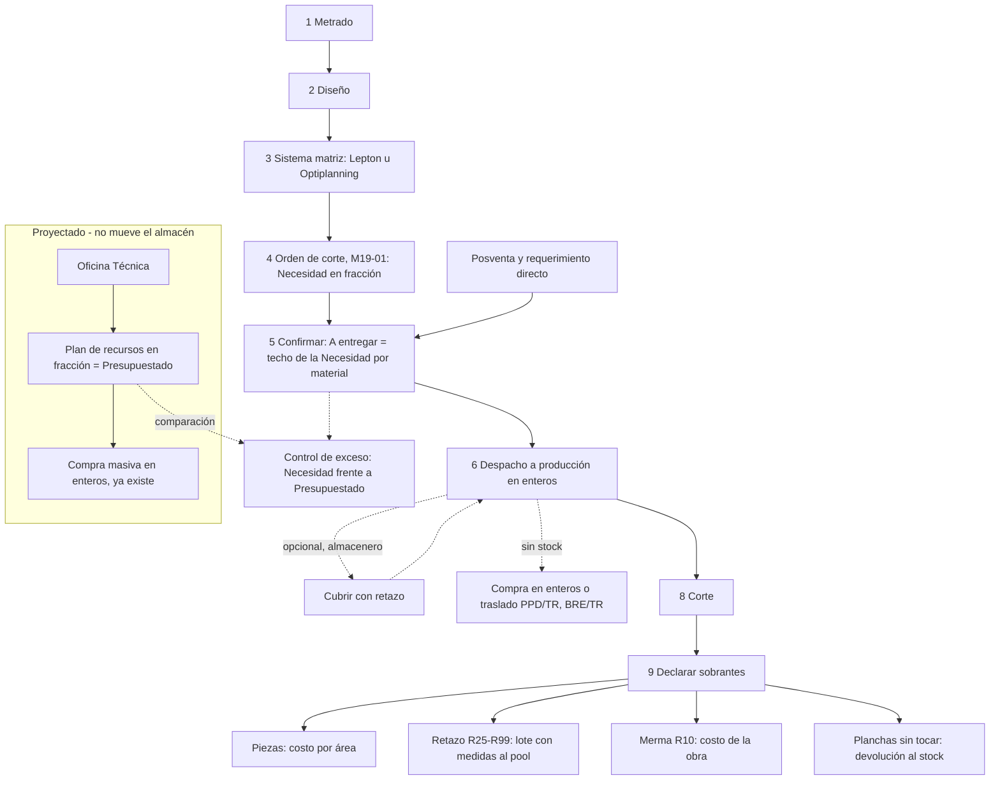

# Planificación de obra — correcciones de la prueba Montecarmelo (paquete 1.11)

19-oct-2026 · versión 1, actualizada el 23-oct · @Vicente · Para Cristóbal Och

## Objetivo y alcance

Este paquete junta las correcciones que salen de la prueba integral de Montecarmelo después de enviado el paquete 1.10. Se irá completando a medida que avance la prueba. Códigos M111.

Marcas de fuente:
- [V] leído o probado en `newallcenter_dev_1` el 19-oct-2026;
- [C] código leído en `olanoit/ol_new_apps`, rama 19.0: commit `38b5ada` para M111-01 y commit `2ef3210` (paquete 1.10 publicado) desde M111-02;
- [D] decisión de Vicente, con fecha;
- [P] propuesta de la asesoría, por validar.

| Código | Corrección | Vertical | Hallazgo | Módulo | Tamaño [P] |
| --- | --- | --- | --- | --- | --- |
| M111-01 | Avances y liquidaciones sin permisos de Nómina | Común a las dos verticales | HM-30 | `al_construction_attendance` | Pequeño |
| M111-02 | El asistente «Rechazar» de Aprobaciones no abre (urgente) | Común a las dos verticales | HM-43 | `al_construction_planner_approvals` | Pequeño |
| M111-03 | Operación por etapa en las listas que crea el importador | Mobiliario | HM-40 | `al_construction_planner_mrp`, `al_construction_planner_furniture` | Mediano |
| M111-04 | Exceso falso por redondeo entre el plan y la lista | Mobiliario | HM-41 | `al_construction_planner_furniture`, `al_construction_planner_approvals_mrp` | Mediano |
| M111-05 | Mismo % de exceso en Aprobaciones y en la orden de fabricación | Mobiliario | HM-42 | `al_construction_planner_approvals`, `al_construction_planner_approvals_mrp` | Pequeño |
| M111-06 | Cifras de la solicitud cuando el pedido ya tiene líneas del plan asignadas | Común a las dos verticales | HM-44 | `al_construction_planner_approvals`, `al_construction_planner_purchase` | Pequeño |
| M111-07 | Vale de despacho del requerimiento para pegar en el bulto | Almacén, fuera del planificador | Pedido de Vicente, 20-oct | `al_construction_material_request` | Pequeño |
| M111-08 | Menú «Productos por despachar» para el almacenero | Almacén, fuera del planificador | Pedido de Vicente, 20-oct | `al_construction_material_request` | Pequeño |
| M111-09 | Tarjetas compactas en el resumen de Inventario | Almacén, fuera del planificador | Pedido de Vicente, 20-oct | `al_stock_base` en el pedido; se hizo en `al_construction_planner_purchase` | Pequeño |
| M111-10 | Requerimiento interno de las áreas (sin obra) | Almacén, fuera del planificador | Pedido de Vicente, 22-oct | `al_construction_material_request` | Mediano |
| M111-11 | «Despachado por» del vale de despacho | Almacén, fuera del planificador | Verificación del 22-oct | `al_construction_material_request` | Pequeño |
| M111-12 | Requerimiento al almacén en planchas enteras y fracción cubierta con retazo | Mobiliario | Decisiones de Vicente, 15 y 22-oct | `al_construction_planner_mrp`, `al_construction_planner_approvals_mrp`, `al_construction_planner_production`, `al_construction_material_request`, `al_construction_planner_purchase`, `al_mrp_piece_costing` | Fase A mediana; fase B grande |

## Vertical de cada mejora

El planificador tiene dos perfiles de vertical [C] (`al_construction_planner/data/construction_vertical_profile_data.xml`, commit `777d82e`):
- **Construcción por partidas:** activa compras, contratas, cuadrillas, presupuesto y venta. No activa fabricación ni mobiliario.
- **Mobiliario:** activa lo mismo, más fabricación (`al_construction_planner_mrp`) y mobiliario (`al_construction_planner_furniture`). La suite agrega aprobaciones de fabricación (`al_construction_planner_approvals_mrp`) y la orden del mueble (`al_construction_planner_production`).

Cada mejora de este paquete lleva una de tres marcas [D, 23-oct-2026]:

| Vertical | Mejoras | Alcance para el desarrollo |
| --- | --- | --- |
| Mobiliario | M111-03, M111-04, M111-05, M111-12 | Fabricación, importador de tipologías y tableros. No debe cambiar nada en una compañía con el perfil Construcción por partidas |
| Común a las dos verticales | M111-01, M111-02, M111-06 | Contratas, aprobaciones y compras del plan. Se prueba en los dos perfiles |
| Almacén, fuera del planificador | M111-07, M111-08, M111-09, M111-10, M111-11 | Requerimiento de obra e Inventario. Funciona con o sin planificador instalado |

M111-12 es de Mobiliario, pero toca módulos compartidos (`al_construction_material_request` y `al_construction_planner_purchase`). En ellos, el cambio solo actúa con productos indivisibles (sección 8.9 de M111-12).

M111-09 se pidió en `al_stock_base`, pero se desarrolló en `al_construction_planner_purchase` (commits `7cc0cbe` y `f51ee75`). Hoy solo se ve con el planificador instalado. Decisión del 23-oct-2026: se mueve a `al_stock_base` (pendiente en la sección de M111-09).

El tamaño es una estimación de la asesoría para ordenar el trabajo, no un plazo. El plazo lo da Cristóbal.

**Estado al 22-oct-2026 [V]:**
- **M111-01 a M111-07:** desarrolladas por Cristóbal (commit `12b1657` del 21-oct y arreglos posteriores) y verificadas por la asesoría en dev1 el 22-oct; el detalle está en «Verificación de la asesoría (22-oct)».
- **M111-09:** desarrollada por pedido aparte, en `al_construction_planner_purchase` (commits `7cc0cbe` y `f51ee75`).
- **Pendientes para Cristóbal:** M111-08, M111-10, M111-11 y M111-12, y mover M111-09 a `al_stock_base`. Su copia del documento en el repositorio llega hasta M111-07.

## Avances y liquidaciones sin permisos de Nómina (M111-01)

**Vertical:** Común a las dos verticales.

Decisión de Vicente del 19-oct-2026: va como requerimiento de desarrollo, en este paquete y no en el 1.10, que ya se envió.

### Qué pasó [V]

- **18-oct:** Annabelees no pudo validar los avances AVN/2026/00001 a 00006 sin el grupo «Nómina: Encargado: gestionar todos los contratos». Se le dio ese grupo como parche temporal.
- **19-oct:** Anderson (produccion@allcenter.pe), que no tiene ningún grupo de Nómina, abrió la liquidación LIQ/2026/00001 y recibió este error:

  > Ocurrió un error al leer el campo project.project.construction_hr_site_ids. No puede acceder a los registros 'Obra de construcción' (l10n_pe.hr.construction.site). Esta operación está permitida para los siguientes grupos: Nómina/Administrador, Nómina/Encargado: gestionar todos los contratos.

### Causa [C]

1. **La pestaña de la liquidación:** la liquidación tiene la pestaña «Avances liquidados» (`al_construction_planner_subcontract/views/construction_settlement_views.xml`, l. 152-155). Usa la lista `al_construction_planner.construction_task_progress_view_list`.
2. **La columna heredada:** `al_construction_attendance` hereda esa lista y le agrega la columna «Con asistencia», `attendance_ok` (`views/contractor_views.xml`, l. 92-101).
3. **Cálculo con los permisos del usuario:** `attendance_ok` es un campo calculado y no guardado (`models/task_progress.py`, l. 9-12). En un campo así, Odoo calcula con los permisos del usuario, porque `compute_sudo` es falso por defecto.
4. **La lectura de la sede:** el cálculo llama a `progress.project_id._construction_site()` (`task_progress.py`, l. 27), que lee `construction_hr_site_ids` (`models/construction_site.py`, l. 106-111).
5. **El permiso que falla:** ese campo apunta al modelo `l10n_pe.hr.construction.site`, definido en `OL-PAYROLL/al_hr_pe_construction/models/hr_construction_masters.py` (l. 385). En dev1 solo pueden leerlo «Nómina: Administrador» y «Nómina: Encargado: gestionar todos los contratos» [V].

Por eso, un usuario sin Nómina recibe el error en estos casos:
- al abrir una liquidación semanal;
- al abrir la lista de avances;
- al abrir el menú «Avances sin asistencia», que filtra por `attendance_ok` (`contractor_views.xml`, l. 103-108).

En cambio, `distance_m` del avance no falla. También lee la sede, pero es un campo guardado (`al_construction_planner/models/construction_task_progress.py`, l. 101-103), y esos Odoo los calcula como superusuario.

### Corrección

- **`attendance_ok` con `compute_sudo=True`** en `al_construction_attendance/models/task_progress.py`. El valor solo dice si la contrata tuvo personal marcado ese día; no muestra datos de Nómina. La búsqueda `_search_attendance_ok` (l. 29-35) usa el mismo cálculo, así que queda cubierta.
- **Recomendado: `groups` en `construction_hr_site_ids`** con los grupos de Nómina (`hr_payroll.group_hr_payroll_user`). Si un usuario sin Nómina lee la obra completa, por ejemplo al exportar o duplicar, Odoo omite el campo en lugar de dar error. Antes de ponerlo, revisar que `construction_crew_attendance.py` (l. 259), que también lo lee, corra con permisos suficientes.
- **Versión:** en dev1 y en el repositorio, `al_construction_attendance` está en 3.20261016. La novedad va en `docs/fichas/al_construction_attendance.yml` y el `CHANGELOG.md` se genera con `scripts/gen_changelog.py`.

### Configuración de Allcenter después de publicar

Quitarle a Annabelees el grupo «Nómina: Encargado: gestionar todos los contratos», que se le dio solo como parche.

### Criterio de aceptación

- Anderson, sin Nómina, abre LIQ/2026/00001 y ve la pestaña «Avances liquidados» con la columna «Con asistencia», sin error.
- Annabelees, sin Nómina, valida un avance sin error.
- «Avances sin asistencia» abre para un usuario sin Nómina y muestra los mismos registros que para el administrador.
- Un usuario sin Nómina sigue sin poder abrir las sedes de obra de Nómina.

### Prueba automatizada

En `al_construction_planner_suite/tests`, con `PlannerCommon`, se crea un usuario con «Planificación de obra: Usuario» y sin Nómina, más una obra con sede y un avance de contrata. La prueba comprueba que ese usuario:
- lee `attendance_ok`;
- abre una liquidación;
- valida el avance;

y que nada de eso da error de acceso. Archivo propuesto: `test_permissions_v111.py`.

Efecto en Manufactura: ninguno directo. Evita que el jefe de producción y los supervisores necesiten permisos de Nómina para ver el avance de la obra.

## El asistente «Rechazar» de Aprobaciones no abre (M111-02)

**Vertical:** Común a las dos verticales.

Hallazgo de la prueba del paquete 1.10 del 19-oct-2026. Es urgente: mientras no se corrija, en dev1 nadie puede rechazar una solicitud de obra.

### Qué pasó [V]

El 19-oct, al intentar rechazar desde Aprobaciones la solicitud de RQO/2026/00017, el navegador mostró un error del cliente (OwlError) con este detalle:

> EvalError: Can not evaluate python expression: (bool(len(approval_ids) < 2)) — Error: Name 'len' is not defined

### Causa [C]

- **El paquete 1.10 cambió el asistente.** Para el rechazo en bloque (M110-07), el asistente de rechazo pasó de una solicitud (`approval_id`) a varias (`approval_ids`). Commit `2ef3210`, `al_construction_planner_approvals` 3.20261019.
- **La vista usa `len()`.** En `wizards/approval_refuse_wizard_views.xml` (l. 8-9), el campo lleva `invisible="len(approval_ids) &lt; 2"`. Esa expresión la evalúa el navegador, y en Odoo 19 el evaluador del navegador no tiene la función `len`. La vista falla al abrirse.
- **Falla en los dos caminos de rechazo**, porque los dos abren la misma vista:
  - el botón «Rechazar» del formulario de la solicitud (`action_construction_refuse`, `models/approval_request.py`, l. 386-395);
  - la acción «Rechazar» de la lista, para varias solicitudes a la vez.
- **Las pruebas automáticas no lo detectaron**, porque llaman al asistente desde Python y no abren la vista.

### Corrección

- Agregar al asistente un campo calculado `approval_count` (entero, sin guardar) con la cantidad de solicitudes, y usar `invisible="approval_count &lt; 2"`.
- Revisar las demás vistas del paquete 1.10 que usen funciones de Python en `invisible`, `readonly` o `required`, como `len`, `sum` o `any`. En todo el repositorio solo aparece esta (búsqueda de `len(`, `sum(`, `any(`, `all(`, `max(` y `min(` dentro de `invisible`, `readonly`, `required` y `column_invisible` en los XML, commit `2ef3210`, 19-oct).
- Agregar una prueba de vista: un recorrido (tour) o `Form` sobre el asistente que abra la vista con una y con dos solicitudes.

### Criterio de aceptación

- Desde el formulario de una solicitud pendiente, «Rechazar» abre el asistente, pide el motivo y rechaza.
- Desde la lista, con dos solicitudes marcadas, Acciones › «Rechazar» abre el asistente con las dos y rechaza solo las que le tocan al usuario.
- Con una solicitud ya aprobada cuyo documento siguió, rechazar da el aviso de M110-08 («El documento … ya siguió con la aprobación…»), no un error del navegador. El aviso ya funciona en el servidor: se comprobó en dev1 el 19-oct llamando al rechazo de la solicitud de RQO/2026/00017.

Efecto en Manufactura: el jefe de producción y la jefatura pueden volver a rechazar excesos de órdenes de fabricación y pedidos de accesorios.

## Prueba del paquete 1.10 con la obra ZZMONTEC2-41-26

Decisión de Vicente del 19-oct-2026: los cuatro hallazgos siguientes van como requerimiento en este paquete. Salen de la obra de prueba «ZZMONTEC2-41-26 MONTECARMELO PRUEBA 1.10» (piso 3, plan PLR/2026/00004), corrida en dev1 el 19-oct con el commit `2ef3210`.

## Operación por etapa en las listas que crea el importador (M111-03)

**Vertical:** Mobiliario.

### Qué pasó [V]

Las listas de fabricación que crea el importador para la obra nueva no tienen operaciones. Por eso las órdenes de corte (PPD/MO/00036 a 00048) y de armado (BRE/MO/00031 a 00043) no generaron órdenes de trabajo ni pasaron por ninguna estación. En la primera obra (ZZMONTEC-40-26) las órdenes de armado BRE/MO/00006 a 00017 sí tuvieron orden de trabajo, con listas preparadas antes del paquete 1.10.

### Causa [C]

`_construction_write_bom` (`al_construction_planner_furniture/models/construction_stage_bom.py`, l. 93-127) crea la lista con producto, secuencia, tipo de operación y obra, y escribe solo los componentes. Su comentario dice que «las operaciones y lo demás puesto a mano se conservan», pero en una lista nueva no hay nada puesto a mano. La etapa no tiene ningún campo de estación (búsqueda de `workcenter` en `al_construction_planner_mrp` y `al_construction_planner_furniture`, sin resultados).

### Corrección [P]

- **Estación por defecto en la etapa:** campo nuevo en `al_construction_planner_mrp`, junto a la planta y la categoría de M110-01, por compañía: «Estación de la etapa» (`mrp.workcenter`), más «Minutos por unidad» como tiempo estándar (puede ser 0).
- **Operación al crear la lista:** si la lista no tiene operaciones y la etapa tiene estación, `_construction_write_bom` crea una operación con el nombre de la etapa («Producción de piezas», «Armado»), esa estación y ese tiempo. Si la lista ya tiene operaciones, no las toca.
- **Listas ya creadas:** una acción «Completar operaciones» en la obra, o la misma regla al volver a importar, para las obras de prueba que ya existen.
- **Configuración de Allcenter después de publicar:** etapa 1.1 con la estación de corte de Puente Piedra y etapa 1.2 con la de armado de Breña (Azcona o Castrovirreyna, a decidir por Producción).

### Criterio de aceptación

- Obra nueva importada: al confirmar la orden de armado, ella y su orden de corte tienen una orden de trabajo en la estación de su etapa.
- Una lista con operaciones puestas a mano conserva las suyas al volver a importar.
- Una etapa sin estación crea la lista sin operaciones, como hoy.

Efecto en Manufactura: el corte y el armado vuelven a aparecer en las estaciones y en la planificación de planta, con tiempos para medir la carga.

## Exceso falso por redondeo entre el plan y la lista (M111-04)

**Vertical:** Mobiliario.

### Qué pasó [V]

Las órdenes de corte PPD/MO/00036 (cocina C07) y PPD/MO/00045 (cocina C09) salieron «excede» sin que nadie cambiara nada. Ejemplo en C07: el material 3103002 tiene 0.21 en el plan y 0.23 en la lista. La lista suma las 11 cantidades por módulo sin redondear (0.2327); el plan las redondea a 0.01 por módulo y luego suma. Las dos órdenes generaron solicitudes de exceso (46 y 47) por diferencias de céntimos.

### Causa

La lista y el plan calculan la misma cantidad por caminos distintos y redondean en momentos distintos [V, comparación de cantidades en dev1]. El punto exacto donde el plan redondea por módulo no se ubicó en esta revisión; queda para Cristóbal.

### Corrección [P]

- **Recomendado: una sola fuente.** La cantidad de cada componente en la lista de la etapa sale de las mismas cantidades por módulo que usa el plan, ya redondeadas, sumadas por tipología. Así plan y lista coinciden por construcción.
- **Alternativa:** el control de exceso de la orden ignora diferencias menores o iguales al redondeo acumulado (número de módulos × media unidad del redondeo del plan). Es más simple pero deja dos números distintos a la vista.

### Criterio de aceptación

- En una obra importada de nuevo, ninguna orden de corte ni de armado sale «excede» sin cambios de material o cantidad.
- La pestaña «presupuestado frente a requerido» muestra la misma cantidad en las dos columnas para el 3103002 de C07.
- Un exceso real de una unidad sigue marcándose.

Efecto en Manufactura: el jefe de producción solo recibe solicitudes de exceso cuando de verdad se pide de más.

## Mismo % de exceso en Aprobaciones y en la orden de fabricación (M111-05)

**Vertical:** Mobiliario.

### Qué pasó [V]

La solicitud de la orden PPD/MO/00036 mostraba en la lista de Aprobaciones «Exceso %» 9.52 %, mientras la orden mostraba 0 % y un monto de S/ 0.06. Quien aprueba ve un número que no es el de la orden.

### Causa [C]

- **La orden** calcula según la base de la compañía (`construction_production_margin_basis`). Con «por orden», el % es el monto del exceso entre el presupuesto total de la orden (`al_construction_planner_approvals_mrp/models/mrp_production.py`, l. 144-152). En dev1 la compañía tiene «por orden» y margen 5 %.
- **La solicitud** toma siempre el mayor % de sus líneas: `construction_excess_pct = max(lines.mapped('construction_diff_pct'))` (`al_construction_planner_approvals/models/approval_request.py`, l. 99-100), sin mirar la base de la compañía.

### Corrección [P]

- El «Exceso %» de la solicitud lo da el documento de origen, con su propia regla. Para la orden de fabricación es su `construction_excess_pct`; para el requerimiento, el que ya calcula `_construction_approval_info`.
- El mayor % por línea puede seguir visible en el detalle de cada línea de la solicitud.

### Criterio de aceptación

- Con base «por orden», la solicitud de PPD/MO/00036 muestra el mismo % que la orden.
- Con base «por material», muestra el mayor % de las líneas, como la orden.

Efecto en Manufactura: el jefe de producción y la jefatura deciden con el mismo número que ve la planta.

## Cifras de la solicitud cuando el pedido ya tiene líneas del plan asignadas (M111-06)

**Vertical:** Común a las dos verticales.

### Qué pasó [V]

- **Primer pedido, RQO/2026/00017:** 74 tornillos 4x30 para instalación. La solicitud mostró presupuestado 54, ya pedido 0, saldo 54, pedido 74 y exceso 20 (37.04 %). Correcto.
- **Segundo pedido, RQO/2026/00018:** el mismo material otra vez. El exceso salió bien (20), pero las demás cifras no: presupuestado 30, ya pedido 50, saldo −20 y 66.67 %. Lo correcto es presupuestado 54, ya pedido 74, saldo −20 y el % sobre 54.

### Causa [C]

`_construction_approval_info` (`al_construction_planner_approvals/models/construction_material_request.py`, l. 46-110) calcula las cifras sobre `_construction_candidate_plan_lines`. Ese método devuelve solo las líneas del plan ya asignadas al pedido cuando las hay, y solo si no hay ninguna busca todas las del mismo material bajo su nivel (`al_construction_planner_purchase/models/construction_material_request.py`, l. 230-246; con etapa, `construction_material_request_scope.py`, l. 401-409). El segundo pedido ya tenía asignada una línea de 30, así que «presupuestado» quedó en 30 y «ya pedido» salió de restar el saldo a esas 30.

### Corrección [P]

- Para las cifras de la solicitud (presupuestado, ya pedido, saldo y %), usar siempre todas las líneas del plan del mismo material bajo el nivel y la etapa del pedido, tengan o no asignación.
- El cálculo del exceso (`_construction_get_excess`) se queda como está: ya da el número correcto.

### Criterio de aceptación

- Se repite la prueba: RQO/2026/00017 por 74 y luego RQO/2026/00018 por 20 del mismo material y etapa. La segunda solicitud muestra presupuestado 54, ya pedido 74, saldo −20, pedido 20, exceso 20 y 37.04 %.
- Un pedido sin asignaciones muestra lo mismo que hoy.

Efecto en Manufactura: ninguno directo. Quien aprueba materiales de instalación ve cuánto se pidió en total contra lo presupuestado.

## Vale de despacho del requerimiento (M111-07)

**Vertical:** Almacén, fuera del planificador.

Pedido de Vicente del 20-oct-2026, ajustado el mismo día. Lo nativo se configura y se desarrolla un vale para pegar en el bulto. El vale muestra todo el requerimiento y, en cada producto, cuánto se despachó y cuánto falta, para que el capataz que recibe en obra sepa que lo demás está en proceso.

### Cómo trabaja el almacenero con lo nativo [V]

- **Los despachos le llegan por requerimiento.** Al procesar el requerimiento:
  - lo disponible en el origen sale en una transferencia «Despacho a obra» en estado «Listo»;
  - lo que falta comprar queda en otra transferencia «En espera de otra operación».

  Ejemplo en dev1, RQO/2026/00023 (AFFINITY-25-26): BRE/DO/00016 «Listo», con 100 tapatornillos, y BRE/DO/00017 «En espera», con 50 burletes que dependen del requerimiento de compra PR00005.
- **Favoritos configurados el 20-oct en dev1** para Lady Silva y Crisanto:
  - «Pendientes por requerimiento», en «Requerimientos de obra › Requerimientos › Materiales pedidos». Es la vista de trabajo del almacenero (decisión de Vicente, 20-oct). Está como favorito predeterminado: al abrir el menú van directo a una fila por producto, agrupada por requerimiento, con pedido, a despachar, a comprar, recibido en obra y «Situación». Toma las líneas no completas de requerimientos «Aprobado» y «En proceso».
  - «Despacho a obra por requerimiento», en la lista de transferencias: despachos a obra abiertos de Breña y Puente Piedra, agrupados solo por requerimiento. Vicente lo vio en pantalla el 20-oct y pidió quitar la separación por estado. En esa lista cada fila es una transferencia: Odoo no muestra ahí una fila por producto.
  - «Requerimientos por despachar», en la lista de requerimientos: requerimientos «Aprobado» y «En proceso».
- **Del despacho al requerimiento.** En la transferencia, el enlace «Requerimiento de obra» (pestaña «Logística PE») abre el requerimiento. En su pestaña de materiales cada producto muestra «A despachar», «A comprar», «Recibido en obra» y «Situación».

### Por qué el vale actual no sirve para el bulto [V] [C]

«Imprimir vale» (`report/construction_material_request_report.xml`) se probó con RQO/2026/00023.

Lo que ya trae:
- cada material con «A despachar» y «A comprar»: tapatornillos 100 a despachar, burletes 50 a comprar;
- las transferencias BRE/DO/00016 y BRE/DO/00017;
- el requerimiento de compra PR00005.

Lo que no sirve para pegar en el bulto:
- **Imprime montos:** «Valor estimado S/ 393,50».
- **Imprime stock interno:** «Disponible al procesar 68,943.50».
- **No dice qué va en el bulto** ni cuánto se despachó antes.
- **No imprime la «Situación»** de cada producto.
- **Solo se imprime desde el requerimiento**, no desde el despacho que prepara el almacenero.

El «Recibo de entrega» nativo de Odoo tampoco alcanza. Solo lista como pendiente lo que quedó en la misma transferencia (`stock/report/report_deliveryslip.xml` de Odoo 19, l. 181-196), y lo que espera compra va en otra transferencia.

### Corrección [P]

Un reporte nuevo, «Vale de despacho», en `al_construction_material_request`, con el formato común de `al_report_base` (el mismo encabezado del vale actual). Hecho en el módulo; no desde la base.

**Dónde se imprime**
- **En la transferencia con «Requerimiento de obra»:** Imprimir › «Vale de despacho». Es el uso principal: acompaña ese bulto.
- **En el requerimiento:** botón «Imprimir vale de despacho». Sin transferencia de referencia, no lleva la columna «En este bulto».
- Si se marcan varias transferencias del mismo requerimiento en la lista, sale un vale por transferencia.

**Diseño del documento** (A4 vertical, sin precios ni montos)

1. **Encabezado**, igual que el vale actual: datos de la compañía, título «Vale de despacho», N.º del requerimiento y transferencia que acompaña (por ejemplo «Bulto BRE/DO/00016»).
2. **Datos del envío**, en dos columnas:
   - obra (código y nombre) y ubicación de obra;
   - solicitado por, fecha del requerimiento y fecha requerida;
   - almacén de origen y fecha de despacho (la de validación; si no está validada, la de impresión).
3. **Tabla de materiales: todas las líneas del requerimiento**, también las que no van en este bulto. Columnas:

| Columna | Contenido |
| --- | --- |
| Ítem | Correlativo |
| Material | Código y nombre; debajo, en letra chica, piso, ambiente o tarea si la línea los tiene |
| Unidad | Unidad de la línea |
| Pedido | `product_qty` |
| Despachado antes | Movimientos hechos de la línea hacia la obra en otras transferencias (`qty_dispatched` menos lo de esta transferencia) |
| En este bulto | Cantidad de la línea en esta transferencia: lo preparado si aún no se valida, lo hecho si ya se validó. En negrita |
| Pendiente | Pedido − despachado antes − en este bulto; nunca menor que 0 |
| Situación | Texto corto en palabras, ver abajo |

   **Texto de la columna «Situación»**, a partir de la situación de la línea y sus documentos:
   - «Completo» si no queda pendiente;
   - «Va completo en este bulto» si este bulto cierra la línea;
   - «Por despachar · BRE/DO/00017» si está reservado en otra transferencia;
   - «En compra · PR00005» y, si ya hay orden de compra, «· OC P000xx · llega dd/mm» con la fecha prevista;
   - «Cancelado» si la línea se anuló.

   Las filas que no van en este bulto van en gris claro, para que el capataz vea primero lo que recibe.
4. **Resumen bajo la tabla**, en una línea: «En este bulto: 1 de 2 materiales. Pendientes: 1 (en compra).»
5. **Pie:**
   - «Despachado por» (nombre del almacenero y firma);
   - «Recibido por» (nombre del capataz, firma, fecha y hora);
   - nota fija: «Este vale acompaña el bulto. Los pendientes se enviarán en otro despacho.»

**Ejemplo con RQO/2026/00023**, impreso desde BRE/DO/00016 antes de validar:

| Ítem | Material | Unidad | Pedido | Despachado antes | En este bulto | Pendiente | Situación |
| --- | --- | --- | --- | --- | --- | --- | --- |
| 1 | [3200018] TAPATORNILLO BLANCO | Unidades | 100 | 0 | **100** | 0 | Va completo en este bulto |
| 2 | [31051499] BURLETE AUT. 5X10X5MT | m | 50 | 0 | 0 | 50 | En compra · PR00005 |

### Criterio de aceptación

- **Desde BRE/DO/00016:** el vale de RQO/2026/00023 sale como el ejemplo, sin montos y sin stock disponible.
- **Después de recibir la compra:** BRE/DO/00017 queda «Listo». Su vale muestra los tapatornillos con «Despachado antes» 100 y «Completo», y los burletes con «En este bulto» 50, pendiente 0.
- **Desde el requerimiento:** el vale sale sin la columna «En este bulto».
- **Sin requerimiento:** la opción no aparece en transferencias que no tienen «Requerimiento de obra».
- **El vale actual** («Vale de requerimiento de obra») no cambia.

Efecto en Manufactura: ninguno directo. La obra sabe qué le falta recibir sin llamar al almacén.

## Menú «Productos por despachar» para el almacenero (M111-08)

**Vertical:** Almacén, fuera del planificador.

Pedido de Vicente del 20-oct-2026, aprobado con la maqueta del mismo día: el almacenero consulta por requerimiento y baja hasta los productos, en vez de ver solo los despachos.

### Lo que ya funciona en dev1 [V]

En «Inventario › Reportes › Análisis de movimientos» (lista de movimientos de stock) está el favorito «Productos por despachar por requerimiento». Se configuró el 20-oct para Administrator, Lady Silva y Crisanto. La lista queda así:
- filtrada a los movimientos de «Despacho a obra» de Breña y Puente Piedra que no están en borrador, hechos ni cancelados;
- agrupada por documento origen (el requerimiento) y después por transferencia.

Se probó en pantalla con RQO/2026/00023:
- **BRE/DO/00016:** tapatornillos, demanda 100, cantidad 100, «Disponible».
- **BRE/DO/00017:** burletes, demanda 50, cantidad 0, «En espera de otra operación».

**El problema:** el menú «Reportes» de Inventario solo lo ve «Inventario: Administrador», y Lady no lo tiene. Darle ese grupo le abriría la configuración de almacenes y rutas.

### Corrección [P]

- **Acción y menú.** Una acción de ventana sobre `stock.move` con la vista de lista estándar (`stock.view_move_tree`) y un menú «Productos por despachar» en «Inventario › Operaciones › Traslados», para «Inventario: Usuario».
- **Dominio:** movimientos cuya transferencia tiene «Requerimiento de obra» y que no están en borrador, hechos ni cancelados.
- **Campo para agrupar.** Un campo guardado en el movimiento, «Requerimiento de obra», relacionado con el de la transferencia. Así se agrupa por el requerimiento y no por el texto del documento origen.
- **Al abrir:** agrupado por «Requerimiento de obra» y luego por «Referencia» (la transferencia). En el buscador, el filtro «Por almacén» y la agrupación «Obra».
- **Solo lectura:** sin crear ni borrar desde la lista. Clic en la fila abre la transferencia para validarla.
- **Imprimir:** con las filas marcadas, «Imprimir › Vale de despacho» (M111-07).

### Criterio de aceptación

- Lady, solo con «Inventario: Usuario», abre «Productos por despachar» y ve RQO/2026/00023 › BRE/DO/00016 y BRE/DO/00017 › sus productos con demanda, cantidad y estado.
- Quitando el grupo por transferencia, los productos quedan directo bajo el requerimiento, con la transferencia en la columna «Referencia».
- Validar BRE/DO/00016 lo saca de la lista.

## Tarjetas compactas en el resumen de Inventario (M111-09)

**Vertical:** Almacén, fuera del planificador.

Pedido de Vicente del 20-oct-2026: que en «Inventario › Información general» quepan más tarjetas, idealmente con la mitad de la altura. Decisión del mismo día: sin el gráfico de barras.

### Situación [V]

- **Altura:** en dev1, con una ventana de 1532 px, cada tarjeta de tipo de operación mide 334 px de alto. El gráfico de barras (`o_field_picking_type_dashboard_graph`) ocupa 150 px.
- **Sin ajuste nativo:** `stock.picking.type` no tiene ningún campo para ocultar el gráfico ni para cambiar la altura. Lo único nativo es quitar del resumen las tarjetas que no se usan, con la estrella («Mostrar operación en la información general»).
- **Prueba en el navegador**, sin tocar la base: ocultando el gráfico y bajando el margen de la fila de botones a 6 px, la tarjeta queda en 158 px (47 %). Con un gráfico mínimo de 32 px quedaba en 194 px.

### Corrección [P]

- Un estilo (SCSS) en `al_stock_base`, en `web.assets_backend`, limitado a la vista «Resumen de inventario» (kanban de `stock.picking.type`):
  - ocultar `.o_field_picking_type_dashboard_graph`;
  - bajar a 6 px el margen superior de la fila del botón y los enlaces («Con demora», «Operaciones»).
- No se hace desde la base (sin `ir.asset` ni vistas creadas a mano).

### Criterio de aceptación

- Con una ventana de 1532 px, las tarjetas del resumen miden alrededor de 160 px y caben unas cuatro por columna.
- Los botones («Por recibir», «Abrir») y los enlaces siguen funcionando.
- Las demás vistas kanban de Odoo no cambian.

### Pendiente: mover a `al_stock_base` [D, 23-oct-2026]

**Estado [C]:** Cristóbal la desarrolló el 21-oct en `al_construction_planner_purchase`, commits `7cc0cbe` y `f51ee75`, con estos archivos:
- `models/stock_picking_type.py`: `_get_view` quita el gráfico de las tarjetas del resumen y traduce al español las etiquetas que Odoo deja en inglés (`OVERVIEW_LABELS_ES`);
- `static/src/stock_overview/stock_overview.scss`: altura y botones;
- `tests/test_stock_overview.py`.

La verificación del 22-oct en dev1 dio tarjetas de 100 a 135 px [V].

**Problema:** al estar en un módulo del planificador, solo se ve donde el planificador de obra está instalado. Es una mejora de Inventario, de la vertical «Almacén, fuera del planificador».

**Pedido:**
- Mover esos tres archivos, su entrada en `web.assets_backend` y sus notas de CHANGELOG a `al_stock_base`, que es el módulo que se indicó en la corrección.
- En `al_construction_planner_purchase`, quitarlos sin dejar copia, para que la vista no se modifique dos veces.
- Subir versión en los dos módulos.

**Criterio de aceptación:**
- Con `al_stock_base` instalado y sin ningún módulo `al_construction_planner_*`, «Inventario › Información general» muestra las tarjetas sin gráfico, de 100 a 135 px, y con las etiquetas en español.
- En dev1, con el planificador instalado, el resumen se ve igual que hoy.
- `test_stock_overview` pasa en `al_stock_base`.

## Requerimiento interno de las áreas (M111-10)

**Vertical:** Almacén, fuera del planificador.

Pedido de Vicente del 22-oct-2026: que Administración, Marketing y las demás áreas pidan al almacén material de oficina o de consumo (papel, plumones, material de marketing). Decisión del mismo día: se hace con el requerimiento de obra, no con Helpdesk.

### Situación [V]

- **El requerimiento exige obra.** «Obra» (`project_id`) es obligatorio y solo acepta proyectos con «Es obra» (dominio del campo en dev1, 22-oct).
- **No hay consumo interno.** No existe un tipo de operación ni una ubicación de consumo interno; las únicas ubicaciones virtuales son «Desecho», «Inventory adjustment» y «Production».
- **Lo que sí está en dev1:**
  - el plan analítico «Área» (además de «Proyecto», «Etapa» y «Partida de costo»);
  - la categoría «07 EQUIPOS Y MATERIALES OFICINA» (economato, útiles, tecnología, mobiliario).
- **Helpdesk se descartó.** Está instalado, pero sus funciones de inventario (devoluciones, reemplazos, reparaciones) son de posventa a clientes, según la descripción de sus módulos; no saca material para un área. El ticket tampoco tiene líneas de productos, aprobación ni paso a compra.

### Corrección [P]

- **Tipo de requerimiento:** «Obra» (como hoy) o «Interno».
- **Requerimiento interno:**
  - no lleva obra; lleva «Área», una cuenta del plan analítico «Área», obligatoria, que va a la analítica de cada línea;
  - el destino es la ubicación de consumo interno del almacén de origen;
  - no muestra los controles del planificador (plan, niveles, etapas ni exceso sobre el plan).
- **Aprobación:** con las reglas de aprobación del requerimiento (base_tier_validation). Regla propuesta para el tipo interno: el jefe del departamento del solicitante y, sobre un monto que defina Vicente, la Gerencia de Administración y Finanzas.
- **Procesamiento igual que hoy:**
  - lo disponible sale en una transferencia de un tipo nuevo, «Consumo interno» (secuencia CI), uno por almacén;
  - lo que falta va a requerimiento de compra con la analítica del área.
- **Almacenero:** el pedido aparece en «Productos por despachar» (M111-08) y se imprime con el vale de despacho (M111-07), que muestra «Área» en lugar de «Obra».
- **Configuración que requiere:**
  - una ubicación «Consumo interno» por almacén, con la cuenta de gasto que indique contabilidad (Ana Bautista);
  - dar a los usuarios de las áreas el grupo de solicitante del requerimiento;
  - y, si se quiere, renombrar la aplicación a «Requerimientos».

### Criterio de aceptación

- Un usuario de Comercial pide 2 paquetes de papel A4 y 5 plumones, área «Comercial»; su jefe aprueba.
- Lady ve el pedido en «Productos por despachar», imprime el vale y valida la salida «Consumo interno».
- El stock baja y el costo queda en la cuenta de gasto con la analítica «Comercial».
- Si no hay papel, se crea el requerimiento de compra con la misma analítica.
- Los requerimientos de obra no cambian.

## «Despachado por» del vale de despacho (M111-11)

**Vertical:** Almacén, fuera del planificador.

### Qué pasó [V]

El 22-oct se imprimió el vale de despacho de RQO/2026/00023 desde BRE/DO/00016. En «Despachado por (almacén)» salió Ximena Zorrilla, que creó y procesó el requerimiento. El vale toma el responsable de la transferencia (`user_id`), que queda con quien la creó.

### Corrección [P]

- Guardar en la transferencia quién la valida, en un campo nuevo, «Validado por», que se llena en `button_validate`.
- En el vale: si la transferencia está validada, «Despachado por» es quien la validó; si no, quien imprime.

### Criterio de aceptación

Lady imprime el vale de BRE/DO/00016 sin validar y sale su nombre. Al validar y volver a imprimir, sale quien validó.

## Requerimiento al almacén en planchas enteras y fracción cubierta con retazo (M111-12)

**Vertical:** Mobiliario.

Versión detallada del 23-oct-2026, para implementar directamente. Reemplaza el resumen del 22-oct.

Marcas de esta sección:
- [D] decisión de Vicente, con fecha;
- [V] dato leído en `newallcenter_dev_1`;
- [C] código leído en `olanoit/ol_new_apps`, rama 19.0, commit `777d82e` del 22-oct-2026;
- [P] propuesta de la asesoría;
- [E] valor ilustrativo, no es dato.

### 1 · Objetivo

El almacén entrega tableros (melamina, MDF, aglomerado, fenólico, fórmica, Nordex) **solo en planchas enteras**, aunque el requerimiento del sistema matriz venga en fracción. La fracción se puede cubrir con un retazo del pool. El corte consume lo que entró físicamente y declara qué salió: piezas, retazo, merma y planchas sin tocar. El presupuesto y el control de exceso siguen comparando la **necesidad**, no el redondeo.

### 2 · Decisiones [D]

| Fecha | Decisión |
| --- | --- |
| 15-oct-2026 | La lista de materiales de la orden puede ir en plancha y fracción, como la da el sistema matriz (por ejemplo 3.7). El requerimiento al almacén va en planchas enteras redondeadas hacia arriba (4). Debe ser configurable con una casilla. No repetir el error de la base anterior (requerimientos de 3.5 o 1.7 planchas). Es el «Pedido al almacén en planchas enteras» (M17-27, paquete 1.7 parte 2), sin publicar. |
| 20-set-2026 | Especificación de merma y retazo: umbral de desecho 10 % (D1); bandas R10 (0–10 %], R25 (10–25 %], R50 (25–50 %], R75 (50–75 %], R99 (75–99 %] (D5); pool único de retazos en Puente Piedra (D6); el retazo es un producto propio con lote de medidas (D7); se valoriza por m² × costo promedio (D3); la merma va al costo de la obra (D4). |
| 22-oct-2026 | Se redondea el requerimiento que emite el sistema matriz (lo ejecutado), no el plan (lo proyectado). Toda fracción sube, aunque sea 0.1. La fracción se puede cubrir a mano con un retazo, y lo decide el almacenero. El corte reparte lo entregado entre piezas, retazo y merma. |

### 3 · Glosario

| Término | Significado | Ejemplo con Blanco RH de la OP 32019 |
| --- | --- | --- |
| Producto indivisible | Tablero que el almacén solo entrega por plancha entera. Se reconoce por su unidad de medida «Plancha …» (sección 7.2) | Melamina Blanco RH Pelikano 18 mm |
| Necesidad | Fracción que pide el sistema matriz (o la lista de materiales, si aún no se cargó la optimización) | 7.2 planchas |
| A entregar | Planchas enteras que mueve el almacén: techo(Necesidad − lo cubierto con retazo) | 8 planchas, o 7 si se cubre 0.2 con retazo |
| Redondeo a plancha entera | A entregar − Necesidad (sin contar retazos) | 0.8 plancha |
| Retazo | Sobrante recuperable de una plancha, producto propio con lote de medidas, banda R25 a R99 | Lote 1200 × 900 mm, 1.08 m², R25 [E] |
| Merma | Sobrante no recuperable (R10) y pérdida de corte | Lo que queda del cuadre |
| Plancha sin tocar | Plancha entregada que no se cortó (≥ 99 % del área) | Vuelve al stock |

### 4 · Flujo

**Proyectado (no mueve el almacén):** Oficina Técnica → hoja de trabajo y plan de recursos en fracción, que es el «Presupuestado». La compra masiva abastece el stock.

La compra masiva redondea hacia arriba solo si la unidad de compra es «entera» según `_is_whole_uom` (`al_construction_planner/wizards/plan_supply_mixin.py`, líneas 83-88; usado en `plan_purchase_wizard.py`, línea 156, y en `construction_supply_board.py`, línea 124 [C]). Esa función devuelve falso cuando la unidad comparte referencia con m², metro, kg, litro, m³ u hora. Las unidades «Plancha 2.14×2.44 m» y sus hermanas están definidas en dev1 con referencia m² (por ejemplo, 5.2216 m²) [V]. Por eso, **es probable que hoy la compra masiva no redondee las planchas**. No lo probé; queda como caso de prueba 17 y se corrige en 8.5.

**Ejecutado:**

| Paso | Quién | Dónde | Resultado |
| --- | --- | --- | --- |
| 1. Metrado | Supervisor de proyectos | Obra; ambiente «medido» (M19-06) | Medidas reales |
| 2. Diseño | Supervisor de proyectos | SketchUp, fuera de Odoo | Muebles diseñados |
| 3. Despiece y optimización | Asistente de optimización | Sistema matriz, por interfaz con Lepton u Optiplanning | OP (formato ALL-PR-F-01) y listado de despiece |
| 4. Carga a la orden de corte | Asistente de optimización | Importador de la orden (M19-01); una orden por obra + partida + piso (M17-19) | Componentes de tablero = Necesidad, en fracción |
| 5. Confirmar la orden de corte | Jefe de producción | Orden de corte | Odoo redondea cada tablero a plancha entera y crea el despacho a producción en enteros |
| 6. Cubrir fracción con retazo (opcional) | Almacenero | Despacho a producción, botón «Cubrir con retazo» | Una plancha menos y un retazo del pool |
| 7. Despachar | Almacenero | Despacho a producción | Planchas enteras y retazos en la preproducción de la planta |
| 8. Cortar | Planta | Fuera de Odoo | Piezas, retazo, merma, planchas sin tocar |
| 9. Declarar sobrantes | Jefe de producción o quien él asigne | Orden de corte, botón «Declarar sobrantes» | Retazos con lote y medidas, merma, devolución de planchas sin tocar |
| 10. Terminar la orden | Planta | Orden de corte | Costo de piezas por área; retazos valorizados aparte |

Posventa y reposición (corte en Castrovirreyna, tipo «Producción de piezas · posventa» (PV), o un requerimiento de obra directo con etapa 1.1 hacia la planta) siguen la misma regla desde el paso 5.

El esquema está en la imagen `Allcenter_Planificacion_Paquete_1.11_Flujo_Planchas_Enteras.png`, en la misma carpeta que este documento.




### 5 · Ejemplo de referencia: OP 32019 [V]

Planchas del PDF de la OP 32019 (Montecarmelo cocina piso 3), leído el 17-oct-2026 (`Allcenter_Formato_Sistema_Matriz_OP32019.md`).

| Material | Medida (mm) | Necesidad | A entregar | Redondeo |
| --- | --- | --- | --- | --- |
| Blanco RH Pelikano 18 mm | 2440 × 2140 | 7.2 | 8 | 0.8 |
| Panela Synchro Pelikano 18 mm | 2440 × 2140 | 2.3 | 3 | 0.7 |
| Blanco alto brillo Rehau 18 mm | 2800 × 1300 | 3.1 | 4 | 0.9 |
| Aglomerado 18 mm | 2500 × 1830 | 1 | 1 | 0 |
| Blanco Pelikano 7X8 18 mm | 2440 × 2140 | 2.8 | 3 | 0.2 |
| Nordex Blanco Bisson 6 mm | 2750 × 1830 | 0.6 | 1 | 0.4 |
| Nordex MDF blanco RH Medelac 3 mm | 2440 × 1830 | 2.9 | 3 | 0.1 |
| **Total** | | **19.9** | **23** | **3.1** |

Mientras M19-01 no esté publicado, la orden de corte toma la necesidad de su lista de materiales. Ejemplo en dev1, leído el 23-oct-2026 [V]: PPD/MO/00053 (corte de la cocina C07 de ZZMONTEC2-41-26) tiene siete tableros.

| Tablero | Unidad | Necesidad | A entregar |
| --- | --- | --- | --- |
| [3101508] Melamina MDP Blanco Fantasía Novopan | Plancha 2.14×2.44 m | 3.14 | 4 |
| [3101450] Melamina MDP Syncro Olmo | Plancha 2.15×2.44 m | 0.79 | 1 |
| [3103002] MDP aglomerado tropicalizado | Plancha 2.15×2.44 m | 0.21 | 1 |
| [3104048] MDF Medelac tropicalizado blanco | Plancha 1.83×2.44 m | 0.94 | 1 |
| [3101305] Melamina Blanco RH Fantasía | Plancha 2.15×2.44 m | 0.70 | 1 |
| [3101522] Melawood PG Bison blanco | Plancha 1.83×2.75 m | 0.16 | 1 |
| [3104040] Mel. MDF blanco alto brillo | Plancha 1.30×2.80 m | 1.16 | 2 |
| **Total** | | **7.10** | **11** |

Los tres tapacantos de la misma orden (138.33 m, 32.9 m y 28.9 m) y el de alto brillo (26.85 m) no cambian.

### 6 · Fases [P]

El requerimiento se entrega en dos fases. La A se puede publicar sola y ya evita las fracciones en el almacén.

| Fase | Contenido | Tamaño [P] |
| --- | --- | --- |
| A · Planchas enteras | Producto indivisible, redondeo al confirmar la orden, necesidad y redondeo en la orden y en el despacho, control de exceso con la necesidad, requerimiento de obra y compras en enteros, impresión | Mediano |
| B · Retazos | Producto retazo y lote con medidas, «Cubrir con retazo», «Declarar sobrantes», devolución de planchas sin tocar, costo del retazo fuera del reparto de piezas | Grande |

### 7 · Modelo de datos [P]

Todos los nombres técnicos llevan el prefijo `construction_`. Los textos visibles van en español, tal como se escriben aquí.

#### 7.1 Compañía y ajustes (`res.company`, `res.config.settings`) — Fase A, `al_construction_planner_mrp`

| Campo | Tipo | Etiqueta | Defecto | Ayuda |
| --- | --- | --- | --- | --- |
| `construction_whole_sheet` | Boolean | Pedir tableros en planchas enteras | False | Los productos indivisibles se entregan, compran y despachan en planchas enteras; la fracción queda como necesidad. |
| `construction_whole_sheet_tolerance` | Float (0 a 0.99) | Tolerancia de redondeo | 0.0 | Fracción de plancha que se redondea hacia abajo. 0 = toda fracción sube. |
| `construction_cut_closing_required` | Boolean (Fase B) | Exigir «Declarar sobrantes» antes de terminar el corte | False | |
| `construction_remnant_band_limits` | Char (Fase B) | Límites de las bandas de retazo (%) | `10,25,50,75,99` | Cota inferior abierta y superior cerrada. ≤ 10 es merma, > 99 es plancha sin tocar. |

En Ajustes › Fabricación van en un bloque nuevo, «Planchas y retazos» (pantalla P1).

#### 7.2 Unidad de medida y producto — Fase A

**Lo que ya existe en dev1 [V], leído el 23-oct-2026:**
- Hay 17 unidades «Plancha L×A m» (por ejemplo, «Plancha 2.14×2.44 m», id 32). Cada una tiene como referencia m² y su factor es el área: 5.2216 para la de 2.14×2.44 m, 4.4652 para la de 1.83×2.44 m. La precisión de redondeo es 0.01.
- Hay además una unidad genérica «Plancha» (id 47), sin referencia y con factor 1. La usan 2 productos.
- 196 plantillas tienen una unidad «Plancha …»: 179 en «PRINCIPAL / MELAMINA», 15 en «PRINCIPAL / OTROS» y 2 en «PRINCIPAL / FORMICA».
- «PRINCIPAL / OTROS» mezcla tableros (MDF, aglomerado) con 9 productos en unidades. Por eso la marca no puede ir en la categoría.

**Regla [P]:** un producto es indivisible si su unidad de stock está marcada «Plancha entera». El área de la plancha se lee del factor de la unidad; no se pide largo ni ancho en el producto. El producto puede forzar la regla hacia un lado u otro.

| Modelo | Campo | Tipo | Etiqueta | Notas |
| --- | --- | --- | --- | --- |
| `uom.uom` | `construction_whole_sheet` | Boolean | Plancha entera | Se marca en las 17 unidades «Plancha L×A m» y en «Plancha» (sección 11). |
| `uom.uom` | `construction_sheet_area_m2` | Float calculado | Área de la plancha (m²) | Si la referencia es m², el factor de la unidad convertido a m² (5.2216). Si no, 0. |
| `product.template` | `construction_indivisible_mode` | Selection (`uom` Según la unidad, `yes` Sí, `no` No) | Plancha indivisible | Defecto `uom`. |
| `product.template` | `construction_is_indivisible` | Boolean calculado y guardado | Es indivisible | `yes` → True; `no` → False; `uom` → `uom_id.construction_whole_sheet`. Se usa en todas las reglas. Depende de `uom_id` y del modo. |
| `product.template` | `construction_sheet_area_m2` | Float calculado | Área de la plancha (m²) | `uom_id.construction_sheet_area_m2`. Fase B: si es 0 en un indivisible, no se permite cubrir con retazo ni declarar sobrantes y se avisa: «La unidad de este tablero no tiene área; asigne una unidad "Plancha L×A m"». |
| `product.template` | `construction_remnant_tmpl_id` | Many2one `product.template` (Fase B) | Producto retazo | Plantilla espejo del tablero, con variante por banda. |

**Función única de consulta [P]:** `product.product._construction_is_whole(uom=None)` devuelve True si el producto es indivisible. La usan el redondeo de la orden (8.2), la reserva (8.3), el requerimiento (8.4) y las compras (8.5). En compras sustituye a `_is_whole_uom` cuando la unidad es una «Plancha entera» (8.5).

#### 7.3 Producto retazo y lote — Fase B

| Modelo | Campo | Tipo | Etiqueta | Notas |
| --- | --- | --- | --- | --- |
| `product.template` | `construction_is_remnant` | Boolean | Es retazo | Con seguimiento por lote obligatorio. |
| `product.template` | `construction_remnant_source_tmpl_id` | Many2one `product.template` | Retazo de | El tablero de origen. |
| `product.product` | `construction_remnant_band` | Selection (`r25`, `r50`, `r75`, `r99`) | Banda | Una variante por banda (D7). |
| `stock.lot` | `construction_length_mm`, `construction_width_mm` | Integer | Largo (mm), Ancho (mm) | Obligatorios para lotes de retazo. |
| `stock.lot` | `construction_area_m2` | Float calculado y guardado | Área (m²) | |
| `stock.lot` | `construction_sheet_pct` | Float calculado y guardado | % de plancha | área / área de la plancha de origen × 100. |
| `stock.lot` | `construction_band` | Selection calculada y guardada | Banda | Según los límites de la compañía. |
| `stock.lot` | `construction_origin_production_id` | Many2one `mrp.production` | Orden de origen | |
| `stock.lot` | `construction_origin_project_id` | Many2one `project.project` | Obra de origen | La que recibe el abono (D3, D4). |

Nombre del lote: `<código del tablero>-R<banda>-<largo>x<ancho>-<número>`, por ejemplo `3101508-R25-1200x900-0001` [E].

#### 7.4 Movimiento de stock (`stock.move`) — Fase A

| Campo | Tipo | Etiqueta | Notas |
| --- | --- | --- | --- |
| `construction_need_qty` | Float, digits «Product Unit» | Necesidad | En la unidad del movimiento. Lo escribe el redondeo; no lo cambia el usuario. Vacío en productos no indivisibles. |
| `construction_rounding_qty` | Float calculado | Redondeo a plancha entera | `product_uom_qty + lo cubierto con retazo − construction_need_qty`, si hay necesidad. Ejemplo: 7 + 0.21 − 7.2 = 0.01. |
| `construction_need_display` | Float calculado | Necesidad | En el despacho a producción: suma de `move_dest_ids.construction_need_qty`. En la orden: el propio campo. Se usa en vistas y en la impresión. |
| `construction_covers_move_id` | Many2one `stock.move` (Fase B) | Cubre la fracción de | En el movimiento del retazo: el movimiento de plancha cuya fracción cubre. |
| `construction_covered_qty` | Float calculado (Fase B) | Cubierto con retazo | Suma de % de plancha / 100 de los retazos que lo cubren. |

#### 7.5 Orden de fabricación (`mrp.production`)

| Campo | Tipo | Etiqueta | Fase |
| --- | --- | --- | --- |
| `construction_sheet_need` | Float calculado | Necesidad de tableros (planchas) | A |
| `construction_sheet_to_deliver` | Float calculado | Planchas a entregar | A |
| `construction_sheet_rounding` | Float calculado | Redondeo a plancha entera | A |
| `construction_cut_closing_ids` | One2many `construction.cut.closing.line` | Sobrantes declarados | B |
| `construction_cut_closed` | Boolean | Sobrantes declarados | B |

#### 7.6 Comparación de la orden (`construction.production.versus`) — Fase A

Columna nueva `qty_rounding` («Redondeo a plancha entera»). `qty_required` pasa a ser la **necesidad** en los productos indivisibles.

#### 7.7 Requerimiento de obra (`construction.material.request.line`) — Fase A

Campo nuevo `qty_rounding` («Redondeo a plancha entera»), solo lectura. `qty_to_dispatch` y `qty_to_purchase` quedan en enteros para productos indivisibles (regla 8.4).

#### 7.8 Modelos nuevos — Fase B

- **`construction.remnant.cover.wizard`** (TransientModel), asistente «Cubrir con retazo»:
  - campos: `picking_id`, `move_id` (movimiento de plancha), `product_id`, `fraction_to_cover` (Float, plancha), `area_to_cover_m2`, `line_ids`, `fit_confirmed` (Boolean, «Las piezas entran en los retazos elegidos (verificado con el despiece)»).
  - `construction.remnant.cover.wizard.line`: `lot_id`, `product_id` (variante retazo), `location_id`, `length_mm`, `width_mm`, `area_m2`, `sheet_pct`, `band`, `selected`.
- **`construction.cut.closing.wizard`** (TransientModel), asistente «Declarar sobrantes»:
  - una línea por tablero indivisible de la orden, `construction.cut.closing.wizard.line`, con `product_id`, `delivered_sheets`, `delivered_remnant_area_m2`, `delivered_area_m2`, `pieces_area_m2`, `untouched_sheets` (Integer), `remnant_ids`, `scrap_area_m2` (calculado) y `balance_ok` (calculado);
  - retazos declarados, `construction.cut.closing.remnant`: `length_mm`, `width_mm`, `qty` (Integer), `area_m2`, `sheet_pct`, `band` (calculados).
- **`construction.cut.closing.line`** (persistente, en la orden): lo que quedó declarado, por tablero, con `delivered_area_m2`, `pieces_area_m2`, `remnant_area_m2`, `scrap_area_m2`, `untouched_sheets`, `declared_by`, `declared_date`. Sirve para reportes de merma por obra.

### 8 · Reglas y algoritmo

#### 8.1 Cuándo se redondea (Fase A)

**En `mrp.production.action_confirm`, justo antes de `super().action_confirm()`.** El despacho a producción («Elegir componentes» renombrado; secuencia PC) nace de los movimientos de componentes al confirmar. Por eso tienen que estar ya en enteros.

- **Orden heredada [C]:** `al_construction_planner_mrp/models/mrp_production.py`, `action_confirm`, líneas 175-215.
  - Esa función primero revisa el exceso contra el plan, solo para órdenes con plan y en borrador (`planned`).
  - Puede devolver el asistente de exceso sin confirmar. En ese caso, el redondeo se hace cuando el asistente vuelve a llamar a `action_confirm` con `construction_exceed_checked`.
- **Llamada [P]:** `self.filtered(lambda p: p.state == 'draft')._construction_round_whole_sheets()`, en la línea anterior a `res = super().action_confirm()`.
  - Aplica a **todas** las órdenes en borrador de la compañía con la casilla activa, tengan plan o no. Así quedan cubiertos la posventa y la reposición.
  - El control de exceso no cambia de lugar: se calcula antes, con la necesidad (8.6).
- **Orden creada por abastecimiento:** también se redondea. Es el caso de la orden de corte que nace de la de armado (contexto `construction_from_procurement`, paquete 1.10, M110-04); pasa por el mismo `action_confirm`.
- **Cambio de cantidad de una orden confirmada** (asistente nativo «Cambiar cantidad a producir», `change.production.qty`): después del cambio nativo, se reescala la necesidad de cada movimiento en la misma proporción y se vuelve a redondear con la misma función.
- **Carga de M19-01 sobre una orden confirmada:** reemplaza la necesidad y vuelve a redondear.
- **Sin efecto:** si `construction_whole_sheet` está apagado, todo funciona como hoy.

#### 8.2 Algoritmo de redondeo (Fase A)

**Regla:** se redondea por producto en **toda la orden**, nunca por línea de la lista de materiales. Para no perder la etapa ni la línea de BOM de cada movimiento (`_construction_component_qty` filtra por `move.bom_line_id.construction_consumption_stage`), **no se fusionan movimientos**: cada uno guarda su propia necesidad y la diferencia del redondeo se carga al movimiento con mayor necesidad. El despacho a producción nativo une en una sola línea los movimientos del mismo producto, así que el almacenero ve el entero.

```python
@api.model
def _construction_whole_qty(self, need, product, company):
    """Entero a entregar para una necesidad (unidad del producto)."""
    uom = product.uom_id
    need = uom.round(need)                       # 7.000001 → 7.00, no 8
    whole = math.floor(need)
    frac = uom.round(need - whole)
    if frac > 0 and frac > company.construction_whole_sheet_tolerance:
        whole += 1
    return whole

def _construction_round_whole_sheets(self):
    for production in self:
        company = production.company_id
        if not company.construction_whole_sheet:
            continue
        raw = production.move_raw_ids.filtered(
            lambda m: m.state not in ('done', 'cancel')
            and m.product_id._construction_is_whole()
            and not m.product_id.construction_is_remnant)
        for product, moves in groupby(raw, key=lambda m: m.product_id):
            uom = product.uom_id
            # 1. Necesidad de cada movimiento. Si ya tiene, se conserva (re-redondeo).
            for m in moves:
                if not m.construction_need_qty:
                    m.construction_need_qty = m.product_uom_qty
            need = sum(m.product_uom._compute_quantity(m.construction_need_qty, uom) for m in moves)
            covered = sum(moves.mapped('construction_covered_qty'))     # Fase B; 0 en Fase A
            whole = self._construction_whole_qty(max(need - covered, 0), product, company)
            # 2. Cada movimiento vuelve a su necesidad; la diferencia va al mayor.
            delta = whole - need                                         # 0.8, o −0.21 con retazo
            for m in sorted(moves, key=lambda m: -m.construction_need_qty):
                own = m.product_uom._compute_quantity(m.construction_need_qty, uom)
                qty = max(own + delta, 0)
                delta -= qty - own
                m.product_uom_qty = uom._compute_quantity(qty, m.product_uom)
            # 3. Movimientos que quedan en 0: en borrador se dejan en 0 (no se borran,
            #    guardan la necesidad); confirmados se cancelan.

**Casos a cubrir:**
- **Necesidad entera** (aglomerado 1): se entrega 1 y el redondeo es 0.
- **Varias líneas de lista de materiales del mismo tablero** en la orden (3.14 y 0.5): se suman antes de redondear (3.64 → 4). Los movimientos guardan su necesidad (3.14 y 0.5) y quedan en 3.5 y 0.5 a consumir; el despacho a producción muestra una línea de 4.
- **Lo cubierto con retazo** (Fase B): se resta de la necesidad antes del techo. Necesidad 7.2 cubierta 0.21 → neto 6.99 → 7.
- **Necesidad menor que lo cubierto:** a entregar 0. El movimiento de plancha queda en 0 y se cancela, pero la necesidad queda registrada en la orden (`construction_sheet_need`).
- **Tolerancia 0.1 y necesidad 3.08:** a entregar 3. La necesidad queda en 3.08 y el redondeo es −0.08; el control de exceso sigue con la necesidad.
- **No se redondean:** los productos retazo, ni los componentes que no son indivisibles (tapacanto en metros, accesorios).

#### 8.3 Despacho a producción (Fase A)

- **El movimiento del despacho nace en enteros**, por el abastecimiento nativo del paso «Elegir componentes y luego fabricar». Muestra la necesidad con `construction_need_display`.
- **Si al confirmar no hay stock entero suficiente**, el despacho queda «En espera» como hoy. La reserva parcial solo puede ser en enteros: si el stock libre es 7.6 y se piden 8, se reservan 7. Se ajusta la reserva al entero inferior en `_action_assign` para productos indivisibles. No se cambia la precisión de las unidades (0.01 [V]), porque la necesidad, el stock heredado y las compras importadas tienen decimales.
  - **Por qué:** en dev1 hay stock con fracción. Por ejemplo, [3101508] tiene 1,177.92 en PPD/Existencias, 489.61 en Azcona/Racks y −97.65 en PPD/Preproducción, leídos el 23-oct-2026 [V].
- **Validar con fracción:** no se puede validar el despacho con una cantidad hecha con fracción en un producto indivisible. Error: «La melamina … se entrega en planchas enteras: 7.5 no es válido.»

#### 8.4 Requerimiento de obra con material indivisible (Fase A)

**Código actual [C]:** `construction.material.request._process_split` (`al_construction_material_request/models/construction_material_request_process.py`, líneas 40-69) reparte cada línea entre stock y compra. Trabaja en la unidad del producto: `product_uom_qty` es la cantidad pedida convertida (`construction_material_request_line.py`, líneas 45 y 144-153); `consumed` descuenta lo ya asignado a líneas anteriores del mismo producto. Después, `_reserve_and_adjust` (líneas 156-175) pasa a compra lo que no se pudo reservar.

**Cambio [P]**, dentro del mismo bucle y solo para líneas con producto indivisible (`product._construction_is_whole()`):

```python
need = line.product_uom_qty                               # unidad del producto
whole = self.env['mrp.production']._construction_whole_qty(need, product, company)  # misma función de 8.2
free = max(free_by_product.get(product.id, 0.0) - consumed[product.id], 0.0)
dispatch = min(floor(free + 1e-9), whole)                 # solo planchas enteras libres
purchase = whole - dispatch
line.write({
    'qty_available_at_approval': free,                    # sin cambio
    'qty_to_dispatch': uom_line(dispatch),                # conversión a la UdM de la línea
    'qty_to_purchase': uom_line(purchase),
    'qty_rounding': uom_line(whole - need),
})
consumed[product.id] += dispatch
```

**Notas:**
- `qty_to_dispatch + qty_to_purchase` deja de ser igual a `product_qty` en estas líneas: suma el entero. Revisar los lugares que lo asumen. El estado de la línea (`_compute_line_state`, líneas 216-236) compara lo recibido con `product_qty` y sigue funcionando, porque lo recibido será el entero.
- `_reserve_and_adjust` ya trabaja con lo reservado. Con la reserva en enteros de 8.3, el faltante también queda entero.
- El requerimiento de compra nace en enteros.
- Los requerimientos de obra con etapa 1.1 hacia la planta (posventa, reposición) quedan cubiertos por esta regla.

#### 8.5 Compras (Fase A)

- **Compra masiva y tablero de abastecimiento:** en `plan_purchase_wizard.py`, línea 156, y en `construction_supply_board.py`, línea 124 [C], la condición pasa a ser `self._is_whole_uom(purchase_uom) or product._construction_is_whole()`. Hoy `_is_whole_uom` da falso para las unidades «Plancha L×A m», porque tienen referencia m² (sección 4). La compra se redondea hacia arriba en enteros.
- **Requerimiento de compra que nace de un requerimiento de obra:** en enteros por 8.4.
- **Orden de compra manual de un producto indivisible:** la línea con fracción da un aviso al guardar (no un error), con la cantidad redondeada sugerida.

#### 8.6 Control de exceso y comparación (Fase A)

- **La necesidad sustituye a la cantidad del componente.** `_construction_component_qty` (`al_construction_planner_mrp/models/mrp_production.py`, líneas 103-117 [C]) suma `move.product_qty`; para productos indivisibles debe sumar la necesidad (`construction_need_qty`, en la UdM del producto). Así usan la necesidad sin más cambios:
  - el saldo contra el plan (`_construction_get_excess`, llamado en `action_confirm`);
  - la comparación de la orden (`al_construction_planner_approvals_mrp/models/mrp_production.py`, `_construction_versus_values`, líneas 89-133 [C]).
- **Redondeo en la comparación:** `_construction_versus_values` agrega `qty_rounding = entregado − necesidad` por material. No entra en `change_type`, ni en `qty_diff`, ni en el monto del exceso.
- **Con retazos:** se compara la necesidad. El retazo es solo una forma de entregarla.

#### 8.7 Cubrir con retazo (Fase B)

**Botón «Cubrir con retazo»** en cada línea del despacho a producción:
- **Cuándo se ve:** el producto es indivisible y tiene producto retazo; la necesidad de su movimiento de orden tiene fracción mayor que 0; el despacho no está hecho ni cancelado; y el usuario es «Inventario: Usuario».

**Al abrir el asistente:**
- `fraction_to_cover` = fracción de la necesidad no cubierta. Ejemplo: necesidad 7.2 → 0.2.
- `area_to_cover_m2` = fracción × área de la plancha. Ejemplo: 0.2 × 5.2216 = 1.04 m².
- **Lista de retazos:** quants con lote de las variantes del producto retazo del tablero, en ubicaciones internas marcadas «Pool de retazos» (`stock.location.construction_remnant_pool`, Boolean nuevo) o en la ubicación de retazos de la planta.
  - Solo libres (no reservados) y con `area_m2 ≥ area_to_cover_m2`.
  - Orden: área ascendente, para usar el más chico que alcance.
  - Columnas: Lote, Banda, Largo × Ancho (mm), Área (m²), % de plancha, Ubicación, Obra de origen.

**Al pulsar «Asignar»**, con al menos uno marcado y `fit_confirmed`:
1. Suma de áreas de los elegidos / área de la plancha = cubierto.
2. Se vuelve a calcular a entregar con 8.2 (necesidad − cubierto) y se baja el movimiento de plancha de la orden y su movimiento del despacho.
3. Por cada retazo se crea un componente en la orden, variante retazo, cantidad 1, con `construction_covers_move_id`, más su movimiento en el mismo despacho encadenado (`move_dest_ids`) y reservado con ese lote.
4. Se escribe en el historial de la orden y del despacho: «Fracción 0.2 de [3101508] cubierta con el retazo 3101508-R25-1200x900-0001 (0.21 plancha) por <usuario>.»

**Restricciones:**
- **El retazo debe ser del mismo tablero**, porque es variante de su producto retazo. No se permite otro decorado.
- **Quitar un retazo asignado:** botón «Quitar retazo» en su línea mientras el despacho no esté hecho. Revierte los pasos 2 y 3.
- **Si el cubierto pasa la necesidad** (se eligieron retazos de más): aviso, no error. A entregar puede quedar en 0.

#### 8.8 Declarar sobrantes (Fase B)

**Botón «Declarar sobrantes»** en la orden de corte:
- **Cuándo se ve:** la orden tiene componentes indivisibles, está confirmada o en curso, y el usuario es «Fabricación: Usuario».
- **Si la compañía lo exige** (`construction_cut_closing_required`), «Terminar» se bloquea hasta declarar, con el mensaje: «Declare los sobrantes del corte (retazos, merma y planchas sin tocar) antes de terminar la orden.»

**Por cada tablero indivisible de la orden:**

| Cifra | Cálculo |
| --- | --- |
| Entregado | planchas reservadas o hechas en el despacho × área de la plancha + área de los retazos entregados |
| Piezas | área de las piezas de ese material cargadas por M19-01; si no hay carga, necesidad × área de la plancha |
| Retazos declarados | lo que escribe Producción: largo, ancho y cantidad; Odoo calcula área, % y banda |
| Planchas sin tocar | entero que escribe Producción |
| Merma | entregado − piezas − retazos − planchas sin tocar × área |

**Validaciones:**
- La merma no puede ser negativa más allá de 0.5 % del entregado. Si pasa, error: «Lo declarado (piezas + retazos + planchas sin tocar) supera lo entregado en X m².»
- Un retazo con % ≤ 10 se avisa como merma y no se crea.
- Un retazo con % > 99 se trata como plancha sin tocar.

**Al confirmar:**
1. El consumo de la plancha en la orden queda en entregado − planchas sin tocar.
2. Las planchas sin tocar vuelven al stock: se crea y confirma la devolución del despacho a producción, de Preproducción a la ubicación de origen, por esa cantidad.
3. Cada retazo se agrega como subproducto de la orden, en la variante de su banda, con un lote nuevo por unidad (medidas, obra y orden de origen) y destino en la ubicación de retazos de la planta (`stock.warehouse.construction_remnant_location_id`, campo nuevo).
4. **Costo del retazo:** área × costo promedio de la plancha / área de la plancha. Queda fijo y fuera del reparto de piezas.
   - En `al_mrp_piece_costing` (`OL-INVENTORY/al_mrp_piece_costing/models/mrp_production.py`, `_cal_price` y `_piece_compute_costs`, líneas 85-162 [C]), los subproductos retazo no entran en la bolsa por área: su costo se descuenta antes de repartir el resto entre las piezas.
5. Se guarda `construction.cut.closing.line` por tablero y la orden queda con «Sobrantes declarados».

**El traslado del retazo al pool de Puente Piedra** con punto de calidad es configuración: ruta push por categoría y punto de control de calidad, según la especificación de merma y retazo del 20-set. No es parte de este desarrollo.

#### 8.9 Módulos compartidos con la construcción por partidas (Fase A) [D, 23-oct-2026]

`al_construction_material_request` y `al_construction_planner_purchase` también los usa el perfil Construcción por partidas, y el requerimiento de obra funciona sin planificador.

- Todo cambio de M111-12 en esos módulos entra **solo** si `product._construction_is_whole()` es verdadero. Sin productos indivisibles, el código sigue por el camino actual, línea por línea.
- `construction_is_whole()` y el campo `construction_whole_sheet` de la unidad no pueden vivir en `al_construction_planner_mrp`, porque `al_construction_material_request` no depende de él. Van en un módulo base que los dos puedan usar. Propuesta [P]: `al_stock_base` (OL-INVENTORY, depende solo de `stock_account`), que ya es dependencia de `al_construction_material_request` [C]. `al_construction_planner_mrp` y `al_mrp_piece_costing` tendrían que agregarlo a sus dependencias. Cristóbal confirma el lugar.
- La casilla de la compañía (`construction_whole_sheet`) se lee desde ese mismo módulo base.
- Las vistas nuevas en el requerimiento de obra (columna «Redondeo a plancha entera», P9) se ocultan si la línea no es de un producto indivisible.
- Prueba 19 (sección 12): en una compañía con el perfil Construcción por partidas, la casilla activa y un requerimiento de 3.5 bolsas de cemento, el reparto entre despacho y compra es el de hoy.

### 9 · Pantallas

Las maquetas en imagen están en `Allcenter_Planificacion_Paquete_1.11_M111-12_Pantallas.png`, en la misma carpeta. Abajo va cada pantalla en texto, con el orden de los campos.


#### P1 · Ajustes › Fabricación › bloque «Planchas y retazos» (Fase A y B)

```
Planchas y retazos
[x] Pedir tableros en planchas enteras
    Los tableros con unidad «Plancha entera» se entregan, compran y despachan en planchas enteras.
    Tolerancia de redondeo  [ 0.00 ] plancha   (0 = toda fracción sube)
[ ] Exigir «Declarar sobrantes» antes de terminar el corte            (Fase B)
    Límites de las bandas de retazo (%)  [ 10,25,50,75,99 ]            (Fase B)
```

Visible para «Administración: Ajustes». Los campos se ocultan si la casilla principal está apagada.

#### P2 · Unidad de medida (Inventario › Configuración › Unidades de medida), formulario de la unidad

```
Nombre                 Plancha 2.14×2.44 m
Referencia             m²          Factor  5.2216          (nativo, ya existe)
[x] Plancha entera                                           (nuevo)
Área de la plancha     5.2216 m²                             (nuevo, solo lectura)
```

Y una columna «Plancha entera» en la lista de unidades, para marcarlas de una vez.

#### P3 · Producto, pestaña nueva «Plancha» (visible si es indivisible, si su unidad es «Plancha entera» o si es retazo)

```
Plancha
Plancha indivisible   ( Según la unidad ▼ )     Es indivisible: Sí (unidad Plancha 2.14×2.44 m)
Área de la plancha      5.2216 m²
Producto retazo       [ RETAZO MELAMINA MDP BLANCO FANTASIA NOVOPAN ▼ ]          (Fase B)
```

En un producto retazo, la misma pestaña muestra «Es retazo» marcado, «Retazo de» y la banda de la variante.

#### P4 · Orden de corte, pestaña «Componentes» (Fase A)

Ejemplo con PPD/MO/00053 [V]. Aviso arriba de la orden, si tiene tableros indivisibles (tipo info):

```
Tableros en planchas enteras: necesidad 7.10 → a entregar 11 (redondeo 3.90). El exceso se mide con la necesidad.
```

Columnas nuevas en la lista de componentes, después de «Producto»:

```
Producto                                   Necesidad   A consumir   Redondeo   Cubierto con retazo   Unidad
[3101508] MELAMINA MDP BLANCO FANTASIA…        3.14          4         0.86          –                Plancha 2.14×2.44 m
[3101450] MELAMINA MDP SYNCRO OLMO…            0.79          1         0.21          –                Plancha 2.15×2.44 m
[3106547] TAPACANTO DELGADO BLANCO…              –        138.33         –           –                m
```

- «A consumir» es la columna nativa de cantidad.
- «Necesidad», «Redondeo» y «Cubierto con retazo» son de solo lectura y se ven solo en filas indivisibles.

#### P5 · Orden de corte, pestaña «Presupuestado frente a real» (Fase A)

```
Material        Presupuestado   Requerido (necesidad)   Diferencia   %      Redondeo a plancha entera   Consumido
[3103002] …           0.21              0.21                0.00     0.00             0.79                   …
```

«Requerido» pasa a ser la necesidad en los indivisibles. «Redondeo a plancha entera» es la columna nueva, sin montos para quien no tiene «ve montos» (M18-10).

#### P6 · Despacho a producción (transferencia PC), pestaña «Operaciones» (Fase A y B)

```
Producto                                  Necesidad   Demanda   Cantidad   Retazo                                   
[3101508] MELAMINA MDP BLANCO FANTASIA…      7.20        7          7      [Cubrir con retazo]  [Quitar retazo]
[3101508-R25] RETAZO MELAMINA … R25           0.21        1          1      Lote 3101508-R25-1200x900-0001 · cubre 0.21
[3101450] MELAMINA MDP SYNCRO OLMO…          2.30        3          3      [Cubrir con retazo]
```

- Cantidades ilustrativas [E]: la necesidad 7.2 es la del Blanco RH de la OP 32019 puesta sobre [3101508] para mostrar el retazo.
- «Necesidad» se ve en filas indivisibles.
- Los botones son de la Fase B.
- En el campo «Cantidad» de un indivisible solo se aceptan enteros.

#### P7 · Asistente «Cubrir con retazo» (Fase B)

```
Cubrir con retazo — [3101508] MELAMINA MDP BLANCO FANTASIA NOVOPAN 18X2140X2440
Orden de corte PPD/MO/00062 · Necesidad 7.20 planchas · Fracción a cubrir 0.20 plancha (1.04 m²)

Retazos disponibles (mismo tablero, área ≥ 1.04 m²)
[ ] Lote                          Banda  Largo × Ancho   Área m²  % plancha  Ubicación                 Obra de origen
[x] 3101508-R25-1200x900-0001      R25   1200 × 900      1.08     20.7      PPD/Retazos/R25           ZZMONTEC-40-26
[ ] 3101508-R50-1830x1200-0003     R50   1830 × 1200     2.20     42.1      PPD/Retazos/R50           ACACIAS353-24-26

[x] Las piezas entran en los retazos elegidos (verificado con el despiece)

Resultado: 7 planchas + 1 retazo (cubre 0.21)                         [ Asignar ]  [ Cancelar ]
```

- Los lotes, sus medidas, ubicaciones y obras de origen son ilustrativos [E]; hoy no hay retazos en dev1 [V].
- «Asignar» queda deshabilitado sin un retazo marcado o sin la casilla de verificación.
- Si no hay retazos, el asistente dice: «No hay retazos de este tablero que cubran 1.04 m². Se entrega la plancha entera.»

#### P8 · Asistente «Declarar sobrantes» (Fase B)

```
Declarar sobrantes — PPD/MO/00062 (corte) · ZZMONTEC2-41-26

[3101508] MELAMINA MDP BLANCO FANTASIA NOVOPAN (plancha 5.2216 m²)
  Entregado: 7 planchas + 1 retazo = 37.63 m²      Piezas: 33.20 m²
  Planchas sin tocar  [ 0 ]
  Retazos   Largo mm   Ancho mm   Cant.   Área m²   % plancha   Banda
            [ 1830 ]   [ 1200 ]   [ 1 ]    2.20       42.1        R50   (ejemplo)
            + Agregar retazo
  Merma: 2.23 m² (5.9 %)          Cuadre: 33.20 + 2.20 + 0 + 2.23 = 37.63 ✓

[3101450] MELAMINA MDP SYNCRO OLMO …
  …
                                                                  [ Confirmar ]  [ Cancelar ]
```

Cifras ilustrativas [E]: 7 × 5.2216 + 1.08 = 37.63 m²; el área de piezas es inventada. Si lo declarado supera lo entregado en más de 0.5 %, la línea de merma se pone en rojo con «⚠ Lo declarado supera lo entregado en X m²» y «Confirmar» no avanza.

#### P9 · Requerimiento de obra, líneas (Fase A)

```
Material                       Cantidad   A despachar   A comprar   Redondeo a plancha entera   Situación
[3101508] MELAMINA MDP …          13.30        10             4                0.70                Por despachar
```

«Redondeo a plancha entera» es opcional, visible por defecto en líneas indivisibles.

#### P10 · Impresión del despacho a producción (Fase A)

En «Imprimir › Operaciones de recolección» (`stock.report_picking`) de un despacho a producción se agregan dos columnas en las líneas indivisibles, «Necesidad» y «Redondeo», y el lote y las medidas de los retazos. Se hace con herencia del reporte en el módulo, no en la base.

### 10 · Permisos

| Acción | Grupo |
| --- | --- |
| Ajustes de P1 | Administración: Ajustes |
| Marcar «Plancha entera» en la unidad o cambiar «Plancha indivisible» en el producto | Inventario: Administrador |
| Cubrir con retazo y quitar retazo | Inventario: Usuario (almacenero) |
| Declarar sobrantes | Fabricación: Usuario |
| Ver montos en P5 | «ve montos» (M18-10) |

### 11 · Configuración en dev1 después de publicar

1. Ajustes: «Pedir tableros en planchas enteras» marcado y tolerancia 0.
2. «Plancha entera» en las 17 unidades «Plancha L×A m» y en la unidad genérica «Plancha» [V]. Con eso quedan indivisibles las 196 plantillas que usan esas unidades.
3. Revisar con Logística los 31 productos de «PRINCIPAL / MELAMINA» que están en «Unidades» [V] y los 2 que usan la unidad genérica «Plancha», sin área [V]. Si son tableros, cambiarles la unidad a la «Plancha L×A m» que corresponda. Si no se puede cambiar la unidad porque ya tienen movimientos, marcar «Plancha indivisible: Sí» en el producto; tendrán redondeo, pero no retazos, hasta que se corrija la unidad.
4. Fase B:
   - plantillas de retazo por tablero, con variantes R25, R50, R75 y R99;
   - ubicaciones de retazos por planta y pool de Puente Piedra, con sububicaciones por banda;
   - ruta push y punto de calidad (especificación de merma y retazo).

### 12 · Pruebas automatizadas

Archivo propuesto: `al_construction_planner_suite/tests/test_whole_sheet_v111.py`, con `PlannerCommon`.

| # | Caso | Resultado esperado |
| --- | --- | --- |
| 1 | Orden con tablero 7.2, casilla activa, tolerancia 0 | Al confirmar, movimiento de 8 con necesidad 7.2; despacho a producción de 8 |
| 2 | Misma orden, casilla apagada | 7.2, como hoy |
| 3 | Dos líneas de BOM del mismo tablero, 3.14 y 0.5 | Movimientos de 3.5 y 0.5 (necesidad 3.14 y 0.5); una línea de 4 en el despacho a producción |
| 4 | Necesidad entera 1.0 | 1, redondeo 0 |
| 5 | Tolerancia 0.1, necesidad 3.08 | 3 |
| 6 | Tapacanto 138.33 m en la misma orden | Sin cambios |
| 7 | Comparación de la orden con presupuesto 7.2 | Diferencia 0, sin exceso, redondeo 0.8 |
| 8 | Orden de corte creada por abastecimiento desde la de armado (contexto `construction_from_procurement`) | Redondeada |
| 9 | Cambio de cantidad a producir ×2 | Necesidad 14.4, a entregar 15 |
| 10 | Requerimiento de obra 13.3 con 10.6 libres | A despachar 10, a comprar 4, redondeo 0.7 |
| 11 | Validar despacho con 7.5 hecho en indivisible | Error |
| 12 | Fase B: cubrir 0.2 con retazo de 0.21 | Plancha 7, retazo reservado, historial escrito |
| 13 | Fase B: quitar el retazo | Vuelve a 8 y el retazo queda libre |
| 14 | Fase B: declarar 1 plancha sin tocar y un retazo R50 | Devolución de 1 plancha; subproducto con lote y medidas; costo del retazo = área × costo promedio / área de plancha; piezas con el resto |
| 15 | Fase B: declarar más de lo entregado | Error de validación |
| 16 | Fase B: exigencia activa, terminar sin declarar | Error |
| 17 | Compra masiva de un tablero con necesidad 3.7 y unidad «Plancha 2.14×2.44 m» | Cantidad a comprar 4 |
| 18 | Producto en «PRINCIPAL / OTROS» con unidad «Unidades» | No es indivisible; sin cambios |
| 19 | Perfil Construcción por partidas, casilla activa, requerimiento de 3.5 bolsas de cemento [E] | Reparto entre despacho y compra igual que hoy |

### 13 · Criterios de aceptación

**Fase A**
1. Con la OP 32019 cargada en su orden de corte, o con su lista de materiales equivalente, al confirmar la orden:
   - el despacho a producción pide 8, 3, 4, 1, 3, 1 y 3 planchas (23);
   - la orden muestra necesidad 19.9 y redondeo 3.1;
   - la comparación no marca exceso por el redondeo.
2. En dev1, una orden nueva igual a PPD/MO/00053 (corte de la cocina C07) da un despacho a producción de 4, 1, 1, 1, 1, 1 y 2 planchas (11) para necesidades de 3.14, 0.79, 0.21, 0.94, 0.70, 0.16 y 1.16 (7.10). Los tapacantos no cambian.
3. La compra masiva de un tablero con necesidad 3.7 compra 4.
4. Un requerimiento de obra de 13.3 planchas con stock suficiente despacha 14. Si solo hay 10.6 libres, despacha 10 y compra 4.
5. Con la casilla apagada, todo funciona como hoy.
6. El despacho a producción impreso muestra necesidad y redondeo en las líneas de tablero.

**Fase B**
1. Con un retazo R25 de 1200 × 900 de Blanco RH en el pool, Lady cubre la fracción 0.2 de una necesidad de 7.2: el despacho queda en 7 planchas + ese lote.
2. Al declarar sobrantes de la orden, se crea la devolución de las planchas sin tocar, los retazos entran con lote y medidas a la ubicación de retazos de la planta, y el cuadre de área muestra la merma.
3. El costo de los retazos sale por área y no pasa a las piezas. La suma de costos de piezas y retazos es igual al costo de la orden.

### 14 · Fuera de alcance y preguntas abiertas

- **Fuera de alcance:**
  - leer el PDF de la OP; es M19-01;
  - el pase del retazo al pool y su punto de calidad, que es configuración de la especificación de merma y retazo;
  - impedir fracciones de tablero en movimientos manuales que no son el despacho a producción, el requerimiento ni la compra (ajustes de inventario, traslados internos).
- **Preguntas abiertas:**
  - qué son los 31 productos de melamina en «Unidades» y los 2 en «Plancha» genérica (Logística, sección 11);
  - si la tolerancia debe ser por categoría además de por compañía (hoy, por compañía).

Efecto en Manufactura: el corte trabaja con lo que entra físicamente (planchas enteras y retazos) y su costo cierra por área. Queda registrado por obra cuánto se pidió en fracción, cuánto se entregó, cuánto volvió como retazo o como plancha sin tocar y cuánto fue merma, que es la base para medir el rendimiento del corte en cada planta.

## Verificación de la asesoría (22-oct-2026) [V]

Comprobado en `newallcenter_dev_1` el 22-oct, con el repositorio en `0b110d2`. Las versiones instaladas son las del repositorio.

| Corrección | Comprobación | Resultado |
| --- | --- | --- |
| M111-01 | `attendance_ok` con `compute_sudo`; sedes con grupo de Nómina; Annabelees sin grupos de Nómina | Cumple (no se probó con el usuario de Anderson) |
| M111-02 | Asistente «Rechazar» abierto en pantalla con dos solicitudes (cerrado con «Cancelar», sin rechazar) | Cumple |
| M111-03 | Etapas con «Producción de piezas · Puente Piedra» y «Armado · Azcona», 60 min; PPD/MO/00049 y BRE/MO/00044 con su orden de trabajo en esa estación | Cumple |
| M111-04 | 14 órdenes de corte del piso 4 sin exceso; 3103002 de C07: 0.21 presupuestado y 0.21 requerido | Cumple |
| M111-05 | Revisado en código (`construction_origin_pct`); sin caso real porque no hubo excesos | Cumple en código |
| M111-06 | Solicitud 52 de RQO/2026/00018: presupuestado 54, ya pedido 74, saldo −20, exceso 20, 37.04 % | Cumple |
| M111-07 | Vale de BRE/DO/00016: todo el requerimiento, sin montos, «Va completo en este bulto», firmas | Cumple, con M111-11 |
| M111-09 | Resumen sin gráficos, tarjetas de 100 a 135 px | Cumple |

**Hallazgo de datos:**
- El requerimiento de compra PR00005 (burletes de RQO/2026/00023) ya no existe en dev1.
- BRE/DO/00017 quedó «En espera» de una compra que no se hará, y la línea sigue «En compra» en «Materiales pedidos».
- Por eso el vale muestra «Por despachar · BRE/DO/00017».
- Falta saber quién borró PR00005.

## Fuentes

- **Base `newallcenter_dev_1`**, 19-oct-2026:
  - error de acceso de Anderson al abrir LIQ/2026/00001, en la captura enviada por Vicente;
  - permisos de acceso del modelo `l10n_pe.hr.construction.site`;
  - grupos de los usuarios Anderson y Annabelees;
  - versión instalada de `al_construction_attendance`.
- **Repositorio `olanoit/ol_new_apps`, commit `38b5ada`:** `al_construction_attendance`, `al_construction_planner_subcontract`, `al_construction_planner` y `al_hr_pe_construction`.
- **Error del asistente de rechazo** en dev1, 19-oct-2026, captura enviada por Vicente; repositorio en el commit `2ef3210`.
- **Prueba del paquete 1.10 en dev1**, 19-oct-2026: obra ZZMONTEC2-41-26, plan PLR/2026/00004, órdenes PPD/MO/00036 y 00045, requerimientos RQO/2026/00017 y 00018 y sus solicitudes de aprobación.
- **Repositorio en el commit `2ef3210`:** `al_construction_planner_furniture`, `al_construction_planner_approvals`, `al_construction_planner_approvals_mrp` y `al_construction_planner_purchase`.
- **Caso de prueba integral Montecarmelo:** hallazgos HM-30 y HM-40 a HM-44.
- **Planchas enteras (M111-12):** decisiones de Vicente del 15-oct (registradas en `Allcenter_Planificador_Recursos_Obra.md`) y del 22-oct; PDF de la OP 32019 (`Allcenter_Formato_Sistema_Matriz_OP32019.md`); especificación de merma y retazo del 20-set (`Allcenter_Especificacion_Merma_Retazo.md`); orden PPD/MO/00053, unidades de medida «Plancha», categorías y stock de [3101508] en dev1, 22 y 23-oct; código del commit `777d82e`.
- **Requerimiento interno y verificación (M111-10, M111-11):** pedidos y decisiones de Vicente del 22-oct-2026; dev1 leído el 22-oct (campos del requerimiento, ubicaciones, módulos de Helpdesk, planes analíticos, vale de BRE/DO/00016); repositorio en `0b110d2`.
- **Menú y tarjetas (M111-08 y M111-09):** pedidos de Vicente del 20-oct-2026; favorito y tarjetas probados en dev1 con la sesión de administrador; maqueta `maqueta_productos_por_despachar.html`.
- **Vale de despacho (M111-07):** pedido de Vicente del 20-oct-2026 y su ajuste del mismo día; vale de RQO/2026/00023 impreso en dev1; RQO/2026/00023 y sus transferencias en dev1; grupos de Lady Silva; `al_construction_material_request` en el repositorio; `stock/report/report_deliveryslip.xml` de Odoo 19 (github.com/odoo/odoo, rama 19.0).
