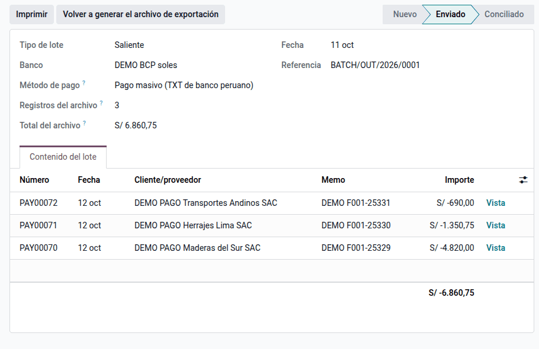
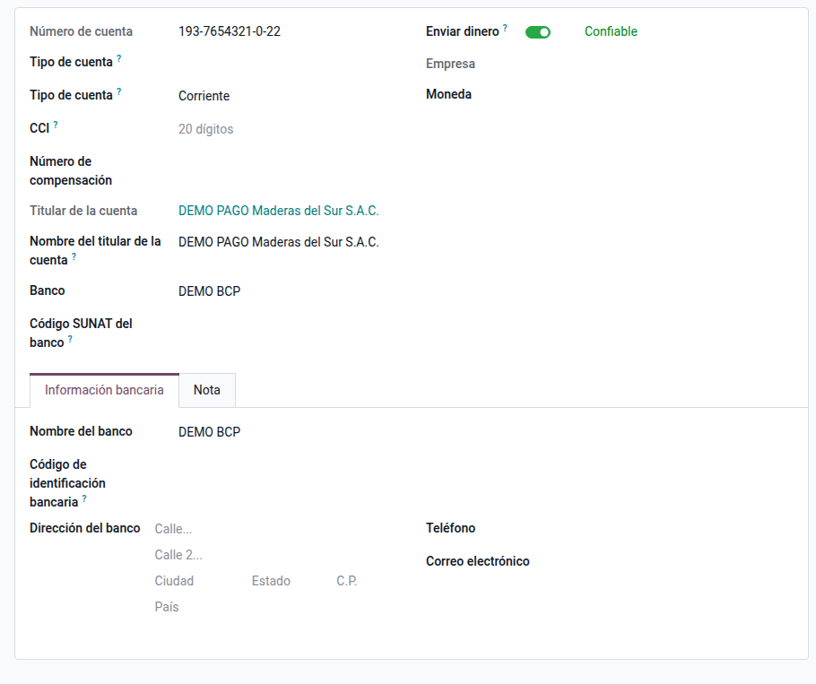
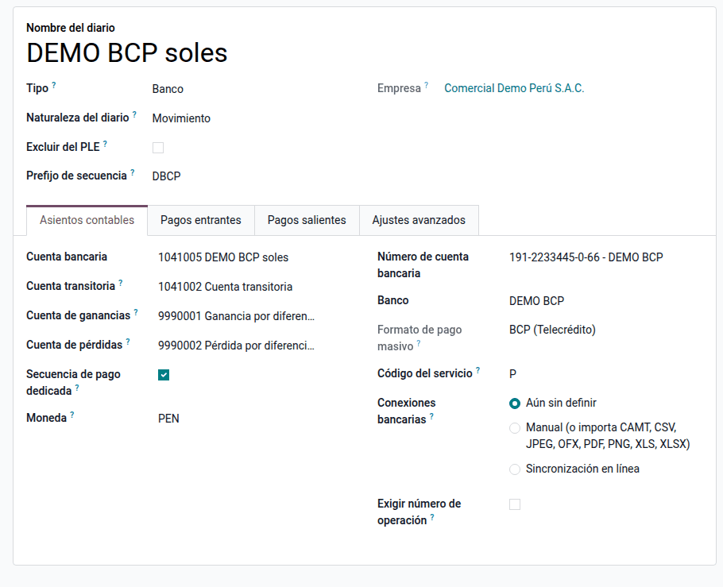

# Pagos masivos a proveedores

Un lote de pagos genera el archivo TXT que el banco pide para pagar a varios
proveedores a la vez: BCP (Telecrédito), BBVA (net cash), Interbank, Scotiabank o
Banco de la Nación. Cada proveedor se paga a su cuenta en el mismo banco o, si es de
otro banco, a su CCI. Lo usan tesorería y cuentas por pagar.

## Configuración

1. Instale **Pagos masivos a proveedores** (`al_l10n_pe_batch_payment`). Requiere
   Odoo Enterprise (lotes de pago).
2. Vaya a **Contabilidad ‣ Configuración ‣ Bancos**, abra el banco de la empresa y
   elija su **Formato de pago masivo**.
3. Vaya a **Contabilidad ‣ Configuración ‣ Diarios**, abra el diario del banco y
   revise:
    - **Número de cuenta bancaria**: la cuenta de cargo.
    - **Código del servicio**: el que asigna el banco al afiliar el pago a
      proveedores (BCP: subtipo, P por defecto; Interbank: servicio, 04;
      Scotiabank: forma de pago, 1).
    - **Código de la empresa** (Interbank) y **Proceso** (BBVA: inmediato o en la
      fecha del lote).
    - En **Pagos salientes**, el método **Pago masivo (TXT de banco peruano)**.
4. En cada proveedor, registre su cuenta en **Facturación ‣ Cuentas bancarias**:
   banco, número, **Tipo de cuenta** y **CCI** de 20 dígitos. Márquela como de
   confianza para poder pagarle.

!!! warning "Importante"
    Los bancos entregan la especificación de sus archivos a cada empresa afiliada.
    Antes del primer pago real, envíe un archivo de prueba al banco y confirme que
    lo acepta; si su afiliación usa otro subtipo o código, cámbielo en el diario.

## Pagar con un lote

1. Registre los pagos a proveedores con el diario del banco y el método **Pago
   masivo (TXT de banco peruano)**. El importe es el neto que recibe el proveedor:
   las retenciones del IGV y las detracciones ya se descontaron.
2. Vaya a **Contabilidad ‣ Proveedores ‣ Pagos por lote** y cree un lote saliente
   con ese diario y ese método, o seleccione los pagos y use **Crear lote**.
3. Haga clic en **Validar**. Si algo impide el archivo, el lote lo lista; si no,
   se genera el archivo, se adjunta al lote y quedan el **Registros del archivo** y
   el **Total del archivo** para cuadrar con el banco.
4. Descargue el archivo y súbalo en la banca por internet de la empresa.

### Qué controla el lote

| Control | Por qué |
|---|---|
| El banco del diario tiene formato y el diario tiene cuenta de cargo | Sin ellos no hay archivo |
| Cada pago tiene la cuenta del proveedor | El banco necesita dónde abonar |
| Proveedor de otro banco con CCI de 20 dígitos | Las transferencias interbancarias van al CCI |
| Moneda de la cuenta del proveedor igual a la del lote | Soles y dólares se pagan en lotes distintos |
| Proveedor con RUC o documento | El banco lo informa y lo valida |
| Ningún depósito de detracción | La detracción se deposita en el Banco de la Nación con su propio archivo |

### Nombre del archivo

`BANCO_MONEDA_DIARIO_LOTE.txt`, por ejemplo `BCP_PEN_DBCP_BATCH-OUT-2026-0001.txt`.
Si hay que corregir un pago, use **Volver a generar el archivo de exportación**.

## Casos especiales

| Situación | Qué pasa | Qué hacer |
|---|---|---|
| El banco rechaza el archivo | La especificación de su afiliación es distinta | Pida al banco el formato, ajuste el código del servicio o comuníquelo para adaptar el exportador |
| Proveedor sin CCI en otro banco | El lote no se valida | Registre el CCI en su cuenta |
| Pagos en soles y en dólares | Un lote solo tiene una moneda | Use un diario y un lote por moneda |

## Datos de demostración

Una base creada **con datos de demostración** carga, al instalar el módulo, un
ejemplo completo en la compañía **PE Company** (la compañía peruana de la demo
de Odoo, con el plan contable de Perú). Los registros llevan el prefijo **DEMO
PAGO** y las fechas se calculan respecto del día de la instalación. En una base
sin datos de demostración no se carga nada.

- Bancos DEMO BCP, DEMO BBVA y DEMO Interbank con su formato de archivo.
- Diario **DEMO BCP soles** (DBCP) con la cuenta de la compañía y el método de
  pago masivo.
- Un lote validado con tres pagos (S/ 4 820,00, S/ 1 350,75 y S/ 690,00) a
  proveedores de los tres bancos, listo para **Exportar archivo**.

!!! info "Ver también"
    - [Lotes de pago en Odoo](https://www.odoo.com/documentation/19.0/es_419/applications/finance/accounting/payments/batch.html)
    - [Detracciones (SPOT)](../fiscal_localizations/peru/detractions.md)
    - [Retenciones del IGV](../fiscal_localizations/peru/withholdings.md)
