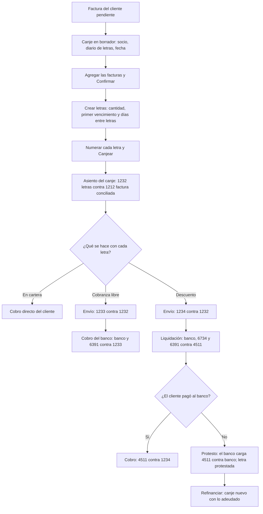
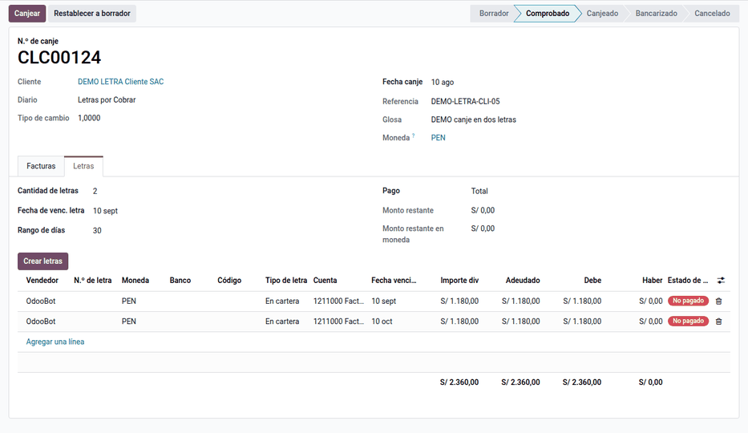
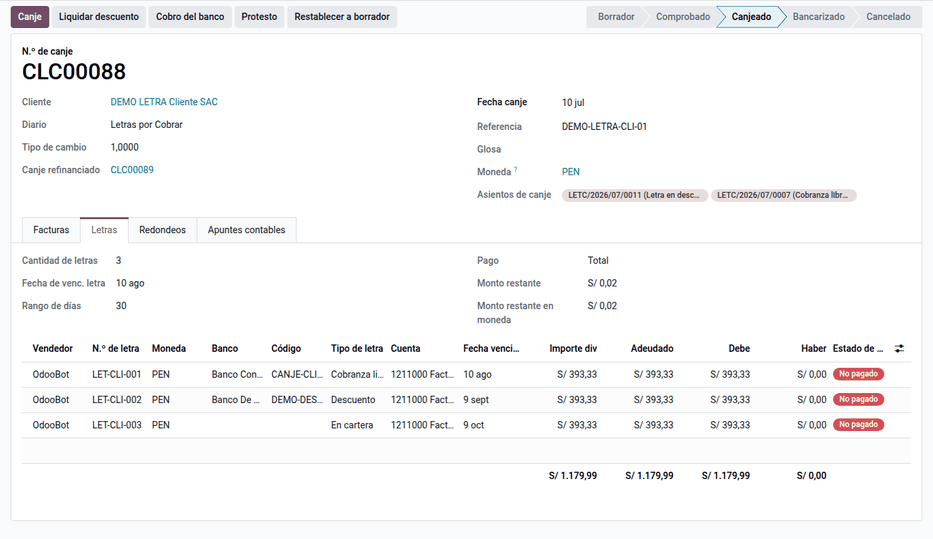
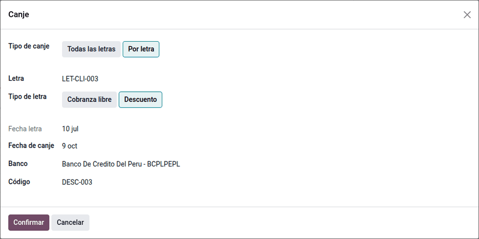
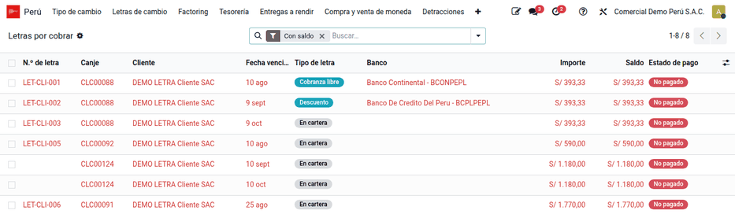

# Letras de cambio

En el Perú es habitual financiar ventas y compras **canjeando facturas por
letras de cambio** con vencimientos escalonados, que luego se llevan al banco
en **cobranza libre** o en **descuento**, y que a veces hay que **renovar**
(refinanciar) o **protestar**. El módulo **Letras de cambio y canje**
(`al_l10n_pe_account_letter`) convierte cada canje en un documento con estados
que **genera y concilia los asientos**: canje de facturas por letras, envío al
banco, liquidación del descuento, cobro, protesto, refinanciación y canje
masivo, para clientes y proveedores. Lo usan créditos y cobranzas, tesorería y
contabilidad.

La **factura negociable** no es una letra: se gestiona con
[factoring](factoring.md). El módulo no se integra con los bancos, no emite el
título físico y no devenga intereses de la letra.

## Configuración

1. Vaya a **Perú ‣ Configuración ‣ Cuentas de la localización ‣ Cuentas de
   letras** y cree una fila por tipo de cuenta (por cobrar o por pagar), tipo
   de letra (en cartera, cobranza libre, descuento, protestada) y moneda; como
   mínimo, **En cartera**.
2. En la compañía, configure las cuentas de las operaciones con el banco:
   obligación (4511), intereses (6734), gastos (6391) y redondeo.
3. Cree los diarios generales de letras: su nombre debe contener «letra» y
   «cobrar» (clientes) o «letra» y «pagar» (proveedores), y deben estar
   marcados como diarios de letras.
4. Cree las cuentas **Redondeo** de tipo gasto y de otros ingresos.
5. Asigne a los usuarios el grupo **Gestión de letras**.

## Conceptos

| Término | Significado | En Odoo |
|---|---|---|
| Canje | Reemplazo de facturas pendientes por letras: CLC para clientes, CLP para proveedores | **Perú ‣ Clientes ‣ Letras por cobrar ‣ Canje de letras** |
| En cartera | Letra en poder de la empresa | Tipo de letra |
| Cobranza libre | Letra entregada al banco solo para cobrarla | Tipo de letra (cuenta 1233) |
| Descuento | El banco adelanta el dinero antes del vencimiento; es una deuda con el banco hasta que el cliente paga | Tipo de letra (cuenta 1234, obligación 4511) |
| Protesto | Constancia de que la letra no se pagó | Asistente **Protesto** |
| Refinanciación | Lo adeudado de un canje pasa a un canje nuevo con otros vencimientos | Canje ‣ **Refinanciar** |

Las cuentas siguen el PCGE: subcuentas de **123 Letras por cobrar** (en
cartera, en cobranza, en descuento), **423 Letras por pagar**, **45
Obligaciones financieras** para el descuento, **673 Intereses** y **639 Gastos
bancarios**.

## Canjear facturas por letras

1. Vaya a **Perú ‣ Clientes ‣ Letras por cobrar ‣ Canje de letras** y haga clic
   en **Nuevo**. Elija el socio, el diario de letras y la fecha.
2. En **Facturas**, agregue las facturas pendientes y haga clic en
   **Confirmar**: el canje pasa a **Comprobado**.
3. En **Letras**, haga clic en **Crear letras** e indique la cantidad, el primer
   vencimiento y los días entre letras: el sistema reparte importes y
   vencimientos.
4. Numere cada letra y haga clic en **Canjear**. Se genera el asiento del
   canje, la factura queda conciliada y en estado **Canjeado**.

Para proveedores, el canje es CLP, con letras por pagar (cuenta 423).

### Ejemplo

DEMO LETRA Cliente SAC compra mercadería por S/ 3 000,00 + IGV = S/ 3 540,00 y
acepta canjearla por **3 letras de S/ 1 180,00** a 30, 60 y 90 días.

Factura de venta:

| Cuenta | Descripción | Debe | Haber |
|---|---|---|---|
| 1212000 | Facturas por cobrar emitidas en cartera | 3 540,00 | |
| 7011100 | Venta de mercaderías | | 3 000,00 |
| 4011100 | IGV – Cuenta propia | | 540,00 |
| **Totales** | | **3 540,00** | **3 540,00** |

Canje (CLC): la factura queda conciliada. Si las letras no sumaran exacto, la
diferencia iría a la cuenta de redondeo.

| Cuenta | Descripción | Debe | Haber |
|---|---|---|---|
| 1232000 | Letras por cobrar en cartera — LET-001 | 1 180,00 | |
| 1232000 | Letras por cobrar en cartera — LET-002 | 1 180,00 | |
| 1232000 | Letras por cobrar en cartera — LET-003 | 1 180,00 | |
| 1212000 | Facturas por cobrar — factura canjeada | | 3 540,00 |
| **Totales** | | **3 540,00** | **3 540,00** |

!!! note "Nota"
    - Se permite el canje parcial: baje el importe de la factura o use **Pago
      parcial**.
    - La fecha del canje no puede ser futura.
    - En dólares, el canje usa las cuentas configuradas por moneda y el
      [tipo de cambio](../fiscal_localizations/peru/exchange_rates.md) de la
      localización.

## Enviar las letras al banco

En el canje, haga clic en **Canje** y elija el **Tipo de canje**: **Todas las
letras** o **Por letra**, para enviar una sola. Indique el tipo de letra
(**Cobranza libre** o **Descuento**), la fecha, el banco y el código.

### Descuento

La letra 1 del ejemplo se descuenta, con intereses de S/ 35,00 y comisión y
gastos de S/ 4,50. Al recibir la liquidación del banco, haga clic en **Liquidar
descuento**; cuando el cliente paga al banco, registre el cobro.

| Asiento | Cuenta | Debe | Haber |
|---|---|---|---|
| Envío a descuento | 1234000 Letras en descuento | 1 180,00 | |
| | 1232000 Letras en cartera | | 1 180,00 |
| Liquidación del descuento | 1041000 Banco (neto) | 1 140,50 | |
| | 6734000 Intereses por documentos descontados | 35,00 | |
| | 6391000 Gastos bancarios | 4,50 | |
| | 4511000 Obligación con el banco (valor nominal) | | 1 180,00 |
| Cobro (el cliente pagó al banco) | 4511000 Obligación con el banco | 1 180,00 | |
| | 1234000 Letras en descuento | | 1 180,00 |

### Cobranza libre

La letra 2 va a cobranza libre, con gastos de cobranza de S/ 5,00. Cuando el
banco cobra, haga clic en **Cobro del banco**.

| Asiento | Cuenta | Debe | Haber |
|---|---|---|---|
| Envío a cobranza | 1233000 Letras en cobranza | 1 180,00 | |
| | 1232000 Letras en cartera | | 1 180,00 |
| Cobro del banco | 1041000 Banco (neto) | 1 175,00 | |
| | 6391000 Gastos bancarios | 5,00 | |
| | 1233000 Letras en cobranza | | 1 180,00 |

## Protestar y refinanciar

La letra 3 se descuenta y se liquida como la letra 1, pero el cliente no paga y
el banco carga la letra. Haga clic en **Protesto**:

| Cuenta | Descripción | Debe | Haber |
|---|---|---|---|
| 4511000 | Obligación con el banco | 1 180,00 | |
| 1041000 | Banco (cargo por la letra protestada) | | 1 180,00 |
| **Totales** | | **1 180,00** | **1 180,00** |

La letra queda **Protestada** y vuelve a estar pendiente a cargo del cliente.
Si el protesto se registra fuera del plazo legal, el canje lo anota: revíselo
con el área legal.

Para refinanciar, haga clic en **Refinanciar** en el canje, o use **Acciones ‣
Refinanciación masiva**: el saldo pasa a un canje nuevo con letras nuevas y
otras fechas, sin perder el rastro de las de origen.

### Canje masivo

El canje masivo consolida varios canjes ya canjeados de un mismo socio en un
solo registro; los canjes de origen pasan a **Historial de canje**.

## Reportes

- **Perú ‣ Clientes ‣ Letras por cobrar ‣ Letras por cobrar** y **Letras por pagar**: saldo,
  vencidas en rojo, por banco y por tipo.
- **Análisis de letras**: tabla dinámica por tipo, moneda y mes de vencimiento.
- Los asientos van al libro diario y al libro de inventarios y balances (detalle
  de las cuentas 12 y 42) de los [libros electrónicos](../fiscal_localizations/peru/ple.md).
- La factura muestra su **Estado de canje** y el canje que la canceló.

## Casos especiales

| Situación | Qué pasa | Qué hacer |
|---|---|---|
| No aparece ningún diario en el canje | Solo se ofrecen diarios con «letra» y «cobrar» o «pagar» en el nombre | Renombrar o crear el diario |
| No aparece la factura | Solo se ofrecen apuntes publicados, con saldo, del socio y de la moneda del diario | Revisar el socio, la moneda y el tipo de documento |
| «No se ha configurado la cuenta» al enviar al banco | Falta la fila de cuenta para ese tipo de letra y moneda | Completar **Cuentas de letras** |

## Datos de demostración

Una base creada **con datos de demostración** carga, al instalar el módulo, un
ejemplo completo en la compañía **PE Company** (la compañía peruana de la demo
de Odoo, con el plan contable de Perú). Las fechas se calculan respecto del día de la instalación. En una base
sin datos de demostración no se carga nada.

- Cuentas de letras del PCGE (1232, 1233 y 1234 por cobrar; 4230 por pagar) y
  cuentas «Redondeo».
- Diarios **Letras por cobrar** (DLEC) y **Letras por pagar** (DLEP).
- Canje de la factura de cliente de S/ 1 180,00 en tres letras de S/ 393,33 con
  su redondeo de S/ 0,01; la primera, enviada a **cobranza libre**.
- Canje de la factura de proveedor de S/ 2 360,00 en dos letras.

!!! info "Ver también"
    - [Ley 27287, Ley de Títulos Valores](https://www.leyes.congreso.gob.pe/Documentos/Leyes/27287.pdf)
    - [Plan Contable General Empresarial 2019 (MEF)](https://cdn.www.gob.pe/uploads/document/file/315820/PCGE_2019.pdf)
    - [Odoo: pagos](https://www.odoo.com/documentation/19.0/es/applications/finance/accounting/payments.html)
    - [Factoring](factoring.md)
