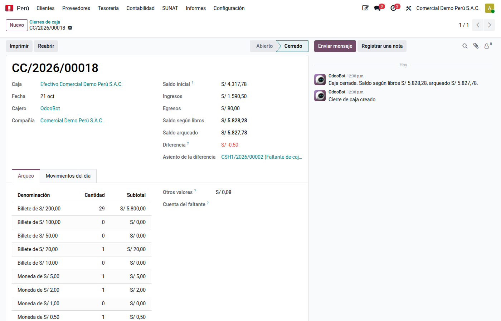
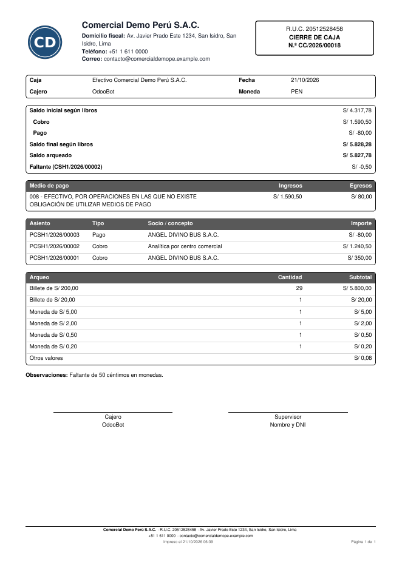

# Cierre de caja y arqueo

El **cierre de caja** compara al final del día lo que dice la contabilidad con el
efectivo que hay en la caja. El módulo **Cierre de caja y arqueo**
(`al_l10n_pe_cash_closing`) arma el resumen del día desde los libros, registra el
arqueo por billetes y monedas, contabiliza el faltante o sobrante y bloquea el día.

## Configuración

- **Cajas**: diarios de tipo efectivo. El faltante y el sobrante van a las cuentas de
  **pérdidas y ganancias por diferencias** del diario (pestaña Configuración avanzada) o,
  si están vacías, a las de la compañía.
- **Billetes y monedas**: en **Perú ‣ Configuración ‣ Contabilidad ‣ Billetes y
  monedas**. Vienen los soles y dólares en circulación; la moneda de 5 céntimos no se
  incluye porque dejó de circular en 2019. Se pueden archivar o agregar.

## Cerrar la caja del día

1. Vaya a **Perú ‣ Tesorería ‣ Caja ‣ Cierres de caja** y haga clic en **Nuevo**.
2. Elija la **caja** y la **fecha**. Odoo trae:
    - el **saldo inicial** según libros (el cierre del día anterior);
    - los **movimientos del día**, uno por asiento: cobros (separando la **venta al
      contado**, de facturas del mismo día, de la **cobranza** de días anteriores),
      pagos, transferencias y depósitos, y otros movimientos;
    - el **saldo según libros**.
3. En **Arqueo**, cuente la cantidad de cada billete y moneda. En **Otros valores**
   anote vales, cheques o vouchers que forman parte del saldo.
4. Revise la **diferencia**: negativa es **faltante**, positiva **sobrante**. Para cargar
   el faltante al cajero, indique la **cuenta del faltante** (por ejemplo, 1413 Cuentas
   por cobrar al personal) y su **responsable**.
5. Haga clic en **Cerrar caja**.

Si hubo movimientos después de abrir el cierre, **Actualizar movimientos** vuelve a
leerlos de los libros; al cerrar se actualizan solos.

## Qué pasa al cerrar

- Si hay diferencia, Odoo crea un asiento en el diario de la caja: el faltante abona la
  caja contra la cuenta de pérdidas (o la del faltante); el sobrante la carga contra la
  de ganancias. Desde el día siguiente los libros parten de lo arqueado.
- La caja queda **bloqueada hasta esa fecha**: no se pueden publicar ni volver a
  borrador asientos de la caja de esa fecha o anteriores. Las otras cajas y los días
  siguientes siguen abiertos.
- No se puede cerrar con pagos de la caja en borrador.

## Imprimir

**Imprimir** genera el PDF con el resumen por tipo de movimiento y por medio de pago
SUNAT, el detalle de los movimientos, el arqueo y las firmas del cajero y el
supervisor.

## Reabrir

Un **administrador de contabilidad** puede **Reabrir** un cierre: se anula el asiento
de la diferencia y la caja vuelve a admitir movimientos de esa fecha. Si hay cierres
posteriores de la misma caja, se reabren primero.

## Cómo se calcula el saldo según libros

Es la suma de las cuentas de liquidez del diario: la cuenta de la caja y las cuentas de
pagos pendientes de sus métodos de pago, en los asientos de ese diario. Así cuenta
tanto los pagos que van directo a la caja como los que pasan por una cuenta de
pendientes. El asiento de un extracto que solo cruza pendientes contra la caja suma
cero y no aparece como movimiento.
