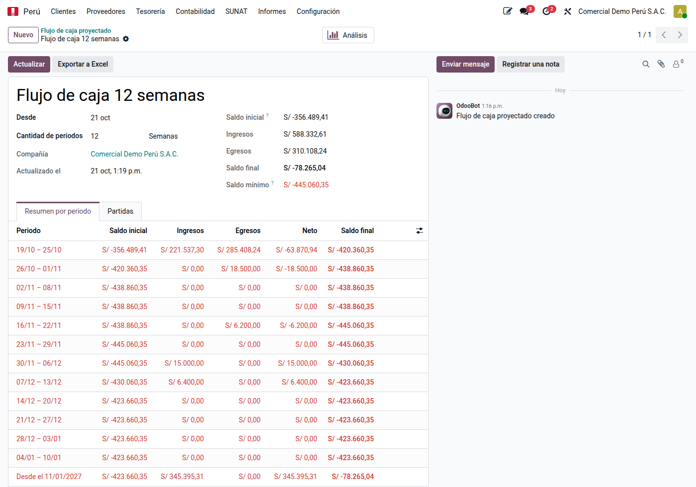
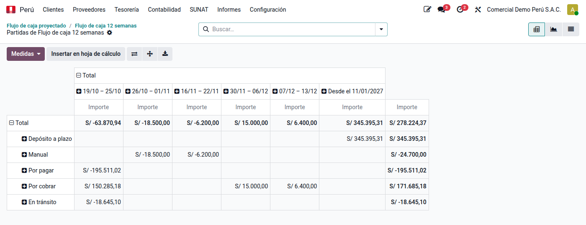

# Flujo de caja proyectado

El **flujo de caja proyectado** muestra, semana a semana o mes a mes, cuánto dinero
habrá en bancos y caja según lo que se espera cobrar y pagar. Lo arma el módulo **Flujo
de caja proyectado** (`al_l10n_pe_cash_forecast`) desde los libros; el usuario ajusta
las fechas que sabe que no se cumplirán y agrega lo que aún no está registrado.

## Crear un flujo

1. Vaya a **Perú ‣ Tesorería ‣ Planificación ‣ Flujo de caja proyectado** (o
   **Contabilidad ‣ Informes ‣ Flujo de caja proyectado**) y haga clic en **Nuevo**.
2. Indique el nombre, la fecha **Desde** y cuántos periodos de **semanas** o **meses**.
3. Guarde: Odoo calcula el saldo inicial y las partidas. **Actualizar** las vuelve a leer
   de los libros cuando quiera.

## De dónde sale cada cifra

| Partida | Origen | Fecha |
|---|---|---|
| Saldo inicial | Bancos y cajas al cierre de la fecha «Desde» | — |
| En tránsito | Cobros y pagos confirmados que el banco aún no refleja (cuentas de pagos pendientes) | La fecha «Desde» |
| Por cobrar | Cuotas abiertas de facturas, notas de crédito y letras de clientes | Vencimiento |
| Por pagar | Cuotas abiertas de facturas, notas de crédito y letras de proveedores | Vencimiento |
| Detracción por pagar | Cuotas de detracción de las compras | Vencimiento |
| Cheque propio | Cheques entregados que el banco aún no debita | Fecha de pago del cheque |
| Cheque de terceros | Cheques recibidos en cartera | Fecha de pago del cheque |
| Depósito a plazo | Capital e intereses de los depósitos vigentes | Vencimiento |
| Manual | Lo que agregue: planilla, impuestos, cuotas de préstamos | La que indique |

Lo **vencido** entra en el primer periodo y se marca como vencido. No se incluyen los
anticipos de clientes ni a proveedores (se aplican a la factura, no se cobran ni pagan)
ni las detracciones por cobrar (van a la cuenta del Banco de la Nación).

!!! tip "Fondos no disponibles"
    Marque **Fondos no disponibles** en la configuración avanzada de los diarios cuyo
    saldo no puede usar libremente, como la cuenta de detracciones del Banco de la
    Nación: su saldo se muestra aparte y no suma al saldo inicial.

## Resumen por periodo

Cada periodo muestra el saldo inicial, los ingresos, los egresos, el neto y el saldo
final. El **saldo mínimo** es el menor saldo final de todos los periodos: si es
negativo, en ese momento hará falta financiamiento.

En los periodos ya terminados aparecen el movimiento **real** de bancos y caja según
libros y la **diferencia** con lo proyectado.

## Ajustar el escenario

En **Partidas** puede cambiar la **fecha esperada** o el **importe** de cualquier partida
(por ejemplo, un cliente que siempre paga quince días tarde). La partida queda marcada
como **ajustada** y conserva el cambio al actualizar el flujo; el botón de deshacer la
devuelve a los datos de los libros. Para agregar una partida, añada una línea: es de
tipo **Manual** y también se conserva al actualizar.

## Análisis y Excel

**Análisis** abre las partidas en una tabla dinámica (tipo por periodo) y un gráfico de
barras de ingresos y egresos. **Exportar a Excel** descarga el resumen por periodo y el
detalle de las partidas.

## Cómo leer los importes

Todos los importes están en la moneda de la compañía: los documentos en moneda
extranjera por su saldo contable, y los cheques y depósitos en otra moneda al cambio de
la fecha «Desde».
