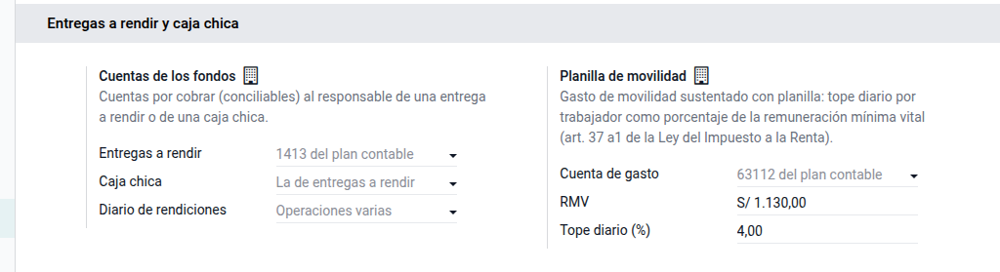
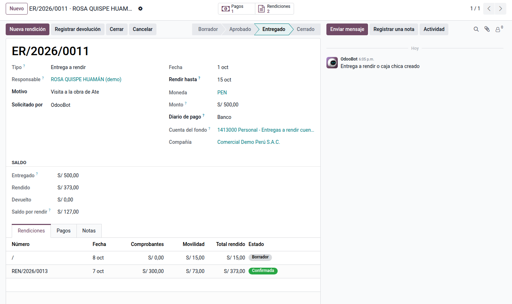
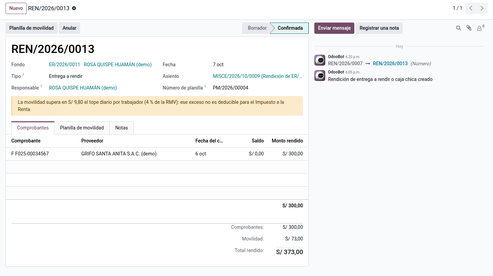
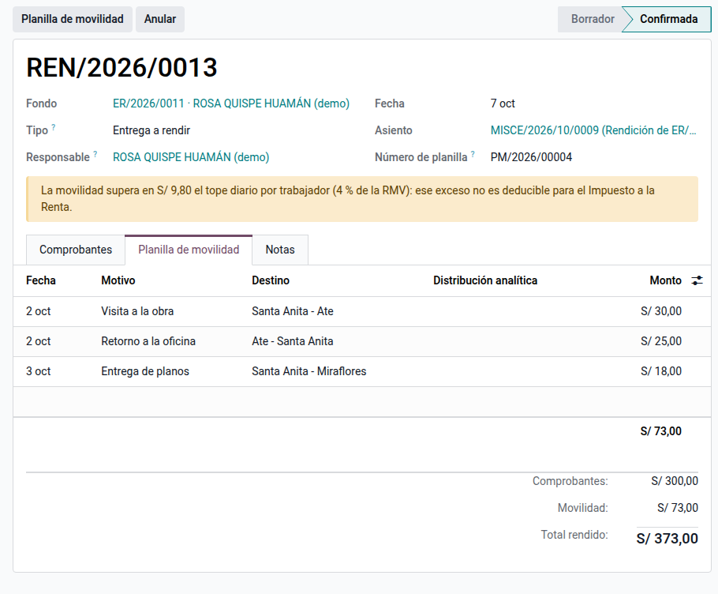
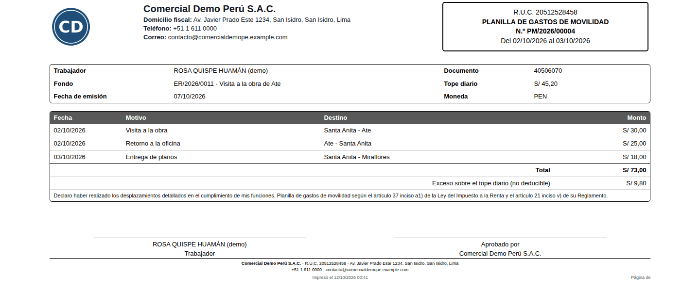

# Entregas a rendir y caja chica

Las empresas entregan dinero a sus trabajadores para gastos que se sustentan
después: viáticos de un viaje, una compra urgente en obra, la movilidad del
mensajero o la caja chica de la oficina. Mientras el trabajador no rinde
cuentas, ese dinero es una cuenta por cobrar a su nombre (PCGE 1413 «Personal -
Entregas a rendir cuenta»); cuando rinde, se convierte en el gasto de las
facturas que presenta, y lo que sobra se devuelve.

El módulo **Entregas a rendir y caja chica** (`al_l10n_pe_cash_fund`) lleva ese
ciclo: aprobación y entrega del dinero, rendiciones con facturas de proveedor y
con la planilla de gastos de movilidad, devolución o reembolso del saldo,
reposición de la caja chica y cierre con la cuenta del fondo conciliada. Lo usan
tesorería, que entrega y repone, y contabilidad, que revisa las rendiciones.

Quedan fuera:

- los gastos que no tienen factura ni van en la planilla de movilidad (por
  ejemplo, un ticket sin RUC): no son deducibles y se registran aparte;
- los viáticos con declaración jurada del inciso r) del artículo 37 de la Ley
  del Impuesto a la Renta (viajes al interior o al exterior), que tienen su
  propio límite;
- los pagos masivos al banco: cada entrega es un pago normal de Odoo.

## Configuración

1. Vaya a **Ajustes ‣ Perú ‣ Entregas a rendir y caja chica**.
2. **Entregas a rendir**: cuenta por cobrar al responsable. Vacía, se usa la
   1413 del plan contable. Debe ser **conciliable**.
3. **Caja chica**: cuenta del fondo fijo. Vacía, la de entregas a rendir. La 102
   «Fondos fijos» del PCGE es una cuenta de efectivo y no se puede conciliar:
   use una subcuenta conciliable de la 1413 o de la 1691.
4. **Diario de rendiciones**: diario de operaciones varias de los asientos de
   rendición (vacío, el primero de la compañía).
5. **Cuenta de gasto** de la movilidad (vacía, la 63112 «Transporte de
   pasajeros»), **RMV** vigente y **Tope diario (%)** (4 %).
6. Los usuarios de facturación crean fondos y rendiciones; aprobar, entregar,
   reponer y cerrar requiere permisos de contabilidad.

## Conceptos

| Término | Significado | En Odoo |
|---|---|---|
| Entrega a rendir | Dinero entregado para un fin concreto que se sustenta y se liquida | Fondo de tipo **Entrega a rendir** (ER/año/…) |
| Caja chica | Fondo fijo a cargo de un custodio que se repone por lo gastado | Fondo de tipo **Caja chica** (CCH/…) |
| Rendición | Sustento de lo gastado: facturas y movilidad | **Rendición** (REN/año/…) |
| Planilla de movilidad | Sustento de la movilidad sin comprobante, firmado por el trabajador | Pestaña **Planilla de movilidad** (PM/año/…) |
| Saldo por rendir | Entregado − rendido − devuelto | Campo **Saldo por rendir** |

## Entregar el dinero

1. Vaya a **Perú ‣ Tesorería ‣ Entregas a rendir ‣ Entregas a rendir y caja chica** y pulse **Nuevo**.
2. Indique el **Responsable**, el **Motivo**, el **Monto**, el **Diario de
   pago** y, si corresponde, la fecha **Rendir hasta**.
3. Pulse **Aprobar**: el fondo recibe su número.
4. Pulse **Entregar**: se abre el pago al responsable por el monto, con la
   cuenta del fondo como contrapartida. Complete el número de operación del
   banco y confírmelo.

## Rendir cuentas

1. En el fondo, pulse **Nueva rendición**.
2. En **Comprobantes**, agregue las facturas de proveedor que el trabajador
   pagó con el fondo. Deben estar publicadas, pendientes de pago y en la moneda
   del fondo. El **Monto rendido** propone el saldo de la factura; ponga menos
   si el fondo pagó solo una parte.
3. En **Planilla de movilidad**, agregue cada desplazamiento sin comprobante:
   fecha, motivo, destino y monto (y la analítica, si la usa).
4. Pulse **Confirmar**. El asiento paga las facturas con el fondo (quedan
   conciliadas) y lleva la movilidad al gasto; el saldo por rendir baja.

### Ejemplo

Rosa Quispe recibe S/ 500 para visitar la obra de Ate. Rinde la factura de
combustible F025-00034567 por S/ 300 y S/ 73 de movilidad: S/ 55 el 2 de octubre
y S/ 18 el 3. Con la RMV de S/ 1 130, el tope diario es S/ 45,20.

| Cuenta | Glosa | Debe | Haber |
|---|---|---|---|
| 4212 Facturas por pagar | Pago de F025-00034567 con ER/2026/0011 | 300,00 | |
| 63112 Transporte de pasajeros | Movilidad (planilla PM/2026/00004) | 73,00 | |
| 1413 Entregas a rendir | Rendición de ER/2026/0011 | | 373,00 |

El saldo por rendir queda en S/ 127. El 2 de octubre supera el tope en S/ 9,80:
la rendición lo avisa y la planilla lo muestra como exceso no deducible.

## Imprimir la planilla de movilidad

En la rendición confirmada, pulse **Planilla de movilidad**. El documento lleva
lo que exige el artículo 21 inciso v) del Reglamento de la Ley del Impuesto a la
Renta: número, empresa, periodo, fecha de emisión y, por cada desplazamiento,
fecha, trabajador con su documento, motivo, destino y monto, además del total,
el exceso y la firma del trabajador.

!!! note "Nota"
    Un mismo día y un mismo trabajador se sustentan con comprobantes **o** con
    planilla, no con ambos: si ese día hay facturas de movilidad, solo ellas son
    deducibles. La planilla no es un libro ni un registro: basta con imprimirla
    y archivarla firmada.

## Liquidar el saldo y cerrar

- **Registrar devolución**: el trabajador devuelve lo que no gastó (saldo
  positivo). Se abre un cobro por el saldo.
- **Reembolsar**: el trabajador gastó más de lo entregado (saldo
  negativo). Se abre un pago por la diferencia.
- **Cerrar**: con saldo cero, sin rendiciones en borrador ni pagos sin
  confirmar. Concilia los apuntes de la cuenta del fondo.

Desde el fondo, **Imprimir ‣ Liquidación del fondo** resume pagos, rendiciones y
saldo para la firma del responsable.

## Caja chica

La caja chica es un fondo fijo: se entrega una vez y, tras cada rendición,
**Reponer** prepara el pago por lo gastado para devolverla a su monto. Para
cerrarla, se devuelve el saldo y se pulsa **Cerrar**.

## Casos especiales

| Situación | Qué pasa | Qué hacer |
|---|---|---|
| «La cuenta … del fondo debe ser conciliable» | La cuenta elegida no se puede conciliar | Usar una subcuenta conciliable de la 1413 o la 1691 |
| La factura no aparece en la rendición | Está pagada, en borrador o en otra moneda | Publicarla o crear un fondo en esa moneda |
| Rendición confirmada con un error | Su asiento ya pagó las facturas | **Anular**, **Volver a borrador**, corregir y confirmar: conserva su número |
| No se puede cancelar el fondo | Tiene pagos confirmados o rendiciones publicadas | Anular primero las rendiciones; los pagos se revierten desde el pago |
| Entrega vencida | Pasó la fecha **Rendir hasta** | Filtro **Por rendir vencidas** en la lista de fondos |

!!! info "Ver también"
    - [TUO de la Ley del Impuesto a la Renta, capítulo VI (art. 37 inciso a1)](https://www.sunat.gob.pe/legislacion/renta/ley/capvi.pdf)
    - [Reglamento de la Ley del Impuesto a la Renta, capítulo VI (art. 21 inciso v)](https://www.sunat.gob.pe/legislacion/renta/regla/cap6.pdf)
    - [PCGE modificado 2019 (MEF)](https://www.mef.gob.pe/contenidos/conta_publ/documentac/PCGE_2019.pdf)
    - [Odoo: Pagos](https://www.odoo.com/documentation/19.0/es/applications/finance/accounting/payments.html)
    - [Medios de pago y número de operación](../fiscal_localizations/peru/payment_methods.md)
