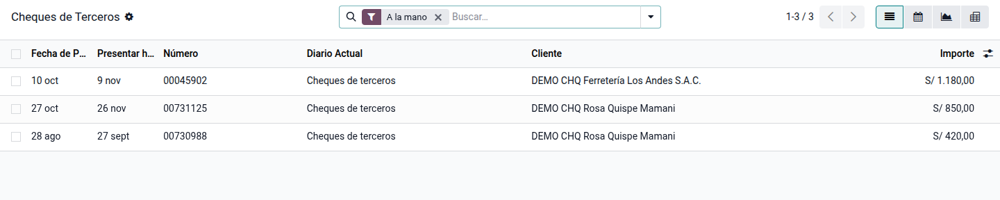
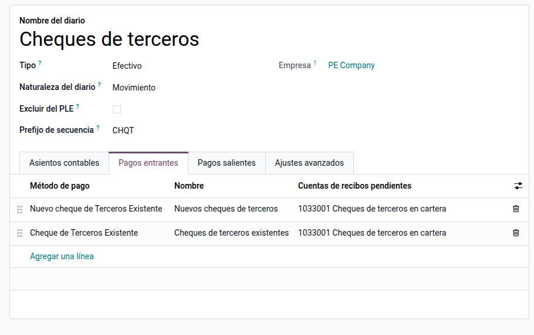
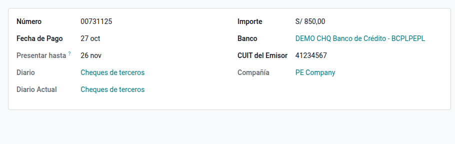
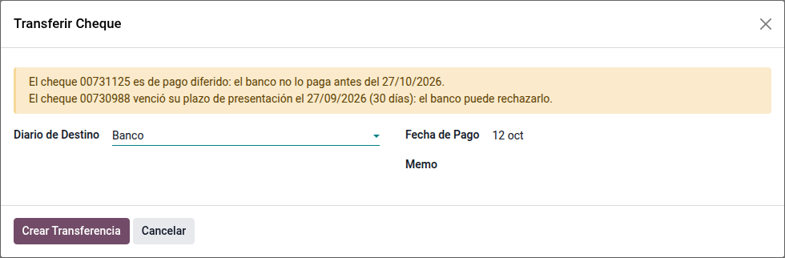
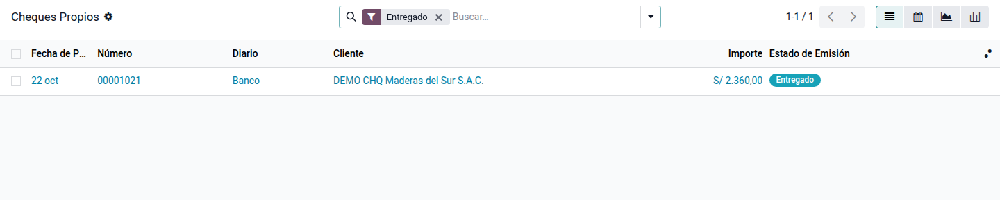

# Cheques recibidos y girados

Muchos clientes todavía pagan con cheque y muchas empresas pagan a sus
proveedores con cheques propios, a veces diferidos. Odoo trae la gestión de
cheques de América Latina (`l10n_latam_check`): la cartera de cheques de
terceros, su depósito en el banco, el endoso a un proveedor, el rechazo y la
devolución, y los cheques propios girados. El módulo **Cheques recibidos y
girados** (`al_l10n_pe_check`) la adapta a Perú. Lo usan tesorería y cuentas
por cobrar.

Qué agrega a lo nativo:

- **Diarios y cuentas del PCGE**, que Odoo solo crea para Argentina:
    - diario **Cheques de terceros** (CHQT), con la cuenta 1033001 «Cheques de
      terceros en cartera»;
    - diario **Cheques rechazados** (CHQR), con la cuenta 1689001 «Cheques de
      terceros rechazados»;
    - método **Cheques propios** en los diarios de banco, con la cuenta 1049001
      «Cheques girados en circulación» hasta que el banco los paga.
- **Emisor con RUC o DNI**: Odoo solo aceptaba un RUC como documento del emisor.
  Ahora acepta un RUC (con su dígito verificador), un DNI de 8 dígitos o un
  carné de extranjería.
- **Plazo de presentación** de la Ley de Títulos Valores (Ley 27287): el cheque
  se presenta al cobro dentro de los 30 días de su fecha; el de pago diferido,
  desde la fecha de pago y dentro de los 30 días siguientes. La cartera muestra
  la fecha límite y avisa al depositar.

## Configuración

1. Instale **Cheques recibidos y girados** (`al_l10n_pe_check`). Al instalarlo
   se crean los diarios y las cuentas en las compañías con el plan contable de
   Perú; una compañía nueva los recibe al cargar el plan.
2. Revise en **Contabilidad ‣ Configuración ‣ Plan de cuentas** las cuentas
   1033001, 1689001 y 1049001. Puede cambiarles el código o el nombre.
3. Si la empresa gira cheques desde una cuenta, revise en el diario del banco,
   pestaña **Pagos salientes**, que el método **Cheques propios** tenga la
   cuenta 1049001.

## Recibir un cheque

1. Registre el cobro de la factura con el diario **Cheques de terceros** y el
   método **Nuevos cheques de terceros**.
2. En la línea del cheque escriba el **Número** (8 dígitos), el **Banco**, la
   **Fecha de pago** (la fecha del cheque o, si es diferido, la fecha desde la
   que se puede cobrar) y el **Importe**. El **documento del emisor** se toma
   del cliente; cámbielo si el cheque lo gira otra persona.
3. Confirme. El cheque queda en cartera: la cuenta 1033001 sube y la factura
   queda cobrada.

Si alguien registra dos veces el mismo cheque (mismo banco, emisor y número),
Odoo avisa en el pago.

## Cartera de cheques

En **Contabilidad ‣ Clientes ‣ Cheques de Terceros** están todos los cheques
con su diario actual y la columna **Presentar hasta**. Dos filtros ayudan a
decidir qué depositar:

| Filtro | Muestra |
|---|---|
| **Por cobrar esta semana** | Cheques en cartera cuya fecha de pago llega en los próximos 7 días y que siguen dentro del plazo |
| **Plazo de presentación vencido** | Cheques en cartera que pasaron los 30 días: el banco puede rechazarlos |

## Depositar en el banco

1. En la cartera, seleccione los cheques y use **Transferir Cheque**.
2. Elija el diario del banco y la fecha del depósito.
3. Si algún cheque es diferido y aún no llega su fecha de pago, o si venció su
   plazo de presentación, el asistente lo avisa antes de confirmar.
4. Confirme. El cheque pasa al banco y queda listo para conciliarse con el
   extracto.

## Cheques rechazados y devueltos

1. Si el banco rechaza un cheque, transfiéralo con el mismo asistente al diario
   **Cheques rechazados**.
2. Para devolverlo al cliente, registre un pago saliente desde **Cheques
   rechazados** con el método **Devolver cheques de terceros**. La deuda del
   cliente vuelve a quedar abierta.

## Cheques propios

1. Registre el pago al proveedor con el diario del banco y el método
   **Cheques propios**. Escriba el número, la fecha de pago (para un cheque diferido,
   la fecha en que el proveedor puede cobrarlo) y el importe.
2. El cheque queda **Entregado** en la cuenta 1049001 hasta que el banco lo
   paga; al conciliar el extracto pasa a **Debitado**.
3. Para anular un cheque entregado, ábralo en **Contabilidad ‣ Proveedores ‣
   Cheques Propios** y use **Anular cheque**: la deuda con el proveedor vuelve
   a quedar abierta.

## Datos de demostración

Una base creada **con datos de demostración** carga, al instalar el módulo, un
ejemplo en la compañía **PE Company**. Los registros llevan el prefijo **DEMO
CHQ** y las fechas se calculan respecto del día de la instalación. En una base
sin datos de demostración no se carga nada.

- Cuatro cheques de terceros: uno ya depositado en el banco, uno en cartera,
  uno de pago diferido (de una persona con DNI) y otro con el plazo de
  presentación vencido.
- Un cheque propio diferido girado a un proveedor.

!!! info "Ver también"
    - [Cheques en Odoo](https://www.odoo.com/documentation/19.0/es_419/applications/finance/accounting/payments/checks.html)
    - [Pagos masivos a proveedores](batch_payments.md)
    - [Medios de pago y número de operación](../fiscal_localizations/peru/payment_methods.md)
