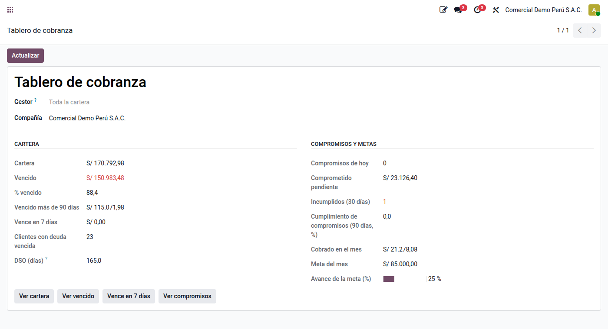
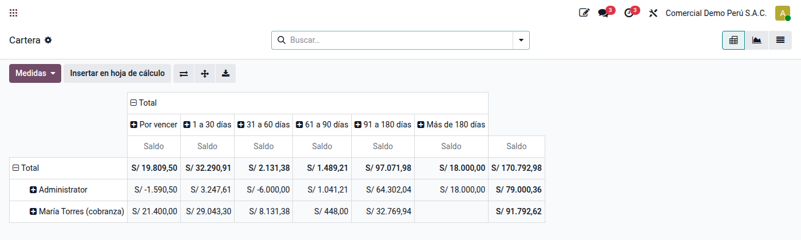
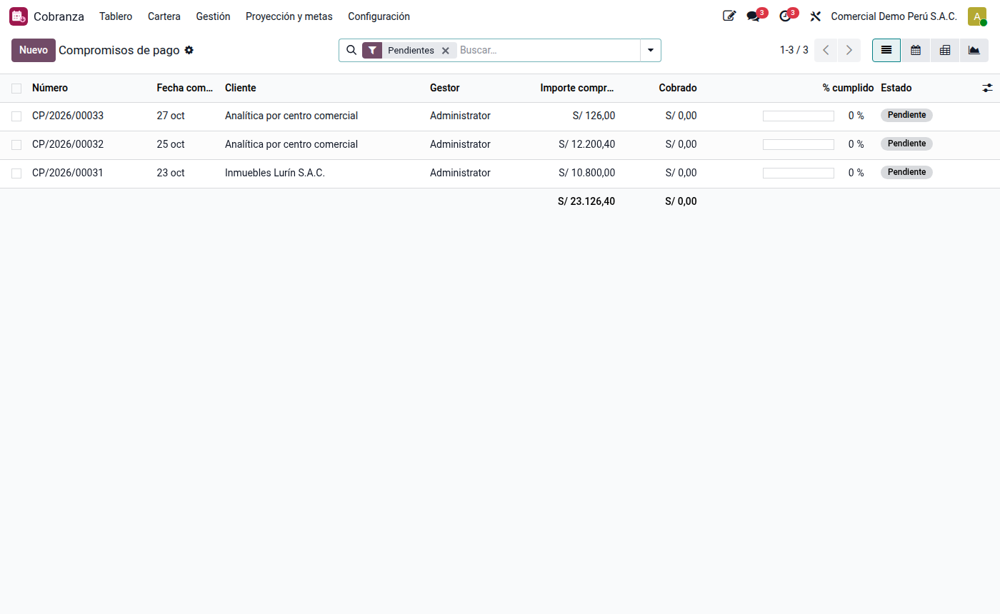
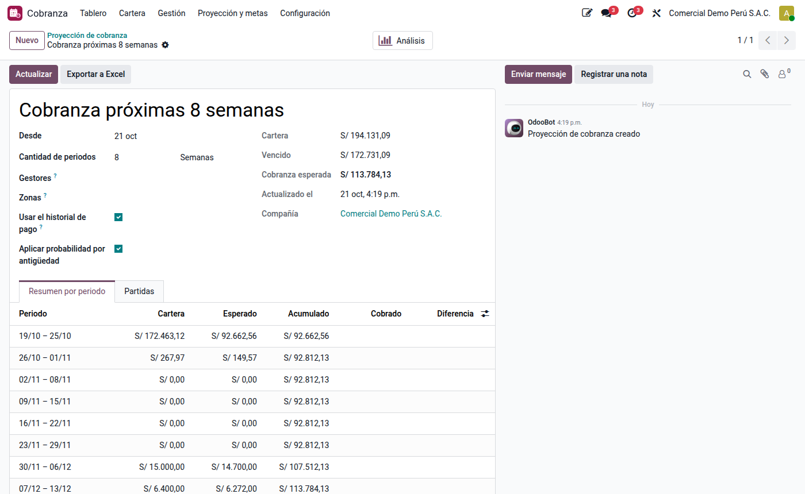
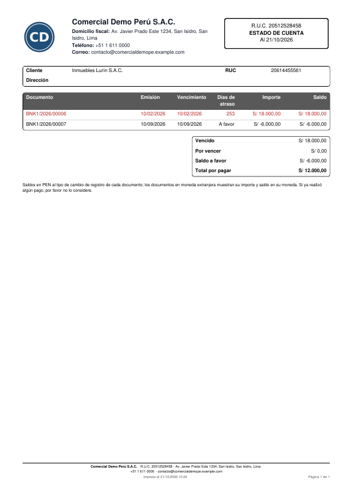

# Cobranza

La aplicación **Cobranza** (`al_l10n_pe_collection`) organiza el trabajo de cobrar: quién
cobra a qué cliente, qué se habló con él, qué prometió pagar y si lo cumplió, cuánto se
espera cobrar en las próximas semanas y cómo va cada gestor frente a su meta.

Se apoya en el **seguimiento de pagos** nativo de Odoo: el **gestor de cobranza** de un
cliente es su responsable de seguimiento, y los recordatorios automáticos por correo,
SMS o carta siguen siendo los niveles de seguimiento.

## Configuración

1. **Gestores:** dé a cada persona de cobranza el permiso **Cobranza / Gestor** (ve solo
   su cartera) o **Cobranza / Administrador** (toda la cartera, metas y configuración).
2. **Zonas** (opcional), en **Cobranza ‣ Configuración ‣ Zonas**, cada una con su gestor por
   defecto.
3. **Asignar clientes:** en **Cobranza ‣ Cartera ‣ Clientes y gestores**, seleccione
   clientes y edite en lote el **gestor de cobranza** y la **zona**. También se puede hacer
   desde la ficha del cliente, pestaña Contabilidad.
4. **Niveles de seguimiento en español:** en **Ajustes ‣ Perú ‣ Cobranza**, **Cargar
   niveles** agrega los que falten: recordatorio 3 días antes del vencimiento y avisos al
   vencer y a los 15, 30 y 60 días. Los niveles que ya existen no se tocan.
5. **Tramos de antigüedad y probabilidad de cobro**, en **Cobranza ‣ Configuración**. Vienen
   valores referenciales (por vencer 98 %, 1 a 30 días 95 %… más de 180 días 15 %) que
   conviene ajustar a la experiencia de la empresa.
6. **Ajustes ‣ Perú ‣ Cobranza:** tolerancia para evaluar compromisos, días de anticipación
   del recordatorio al cliente, porcentaje para darlos por cumplidos, meses de historial de
   pago y resumen diario a los gestores.

## Cartera

**Cobranza ‣ Cartera ‣ Cartera** lista cada cuota pendiente con su cliente, gestor, zona,
vencimiento, días de atraso, tramo y la fecha del compromiso de pago vigente.
**Antigüedad** muestra la misma cartera en tabla dinámica por gestor y tramo.

No se incluyen los anticipos de clientes (122) ni las detracciones por cobrar, que se
depositan en el Banco de la Nación.

## Gestiones

Cada contacto con el cliente se registra como **gestión** (**Cobranza ‣ Gestión ‣
Gestiones**, o **Registrar gestión** en la ficha del cliente): canal (llamada, visita,
correo, WhatsApp, SMS o carta), resultado, detalle y documentos. Al guardarla:

- queda en el historial del cliente;
- si el resultado lo indica, se programa la **próxima acción** del gestor (por ejemplo,
  volver a llamar mañana si no contestó);
- si el resultado es **Promete pagar**, se pide la fecha y el importe y se crea el
  **compromiso de pago**.

Los resultados se configuran en **Cobranza ‣ Configuración ‣ Resultados de gestión**.

## Compromisos de pago

Un compromiso tiene fecha, importe y, opcionalmente, los documentos que cubre. Se evalúa
solo cada día:

| Estado | Cuándo |
|---|---|
| **Cumplido** | Lo cobrado alcanza el importe (aunque no haya llegado la fecha) |
| **Parcial** | Pasada la fecha y la tolerancia, se cobró una parte |
| **Incumplido** | Pasada la fecha y la tolerancia, no se cobró nada |

Lo cobrado es cuánto bajó el saldo de los documentos desde que se pactó; sin documentos,
lo que el cliente pagó desde entonces. Un compromiso parcial o incumplido deja una
actividad al gestor. La vista de calendario muestra los compromisos por día.

## Proyección de cobranza

**Cobranza ‣ Proyección y metas ‣ Proyección de cobranza** calcula, por semanas o meses,
cuánto se espera cobrar (filtrable por gestor o zona):

- **Fecha esperada** de cada cuota: la del compromiso vigente; si no hay, el vencimiento
  más el **atraso promedio** con que ese cliente pagó en los últimos meses; si no tiene
  historial, el vencimiento. Lo vencido sin compromiso cae en el primer periodo.
- **Importe esperado:** saldo × probabilidad del tramo de antigüedad.
- En los periodos ya terminados, lo **cobrado** y la diferencia con lo esperado.
- Fecha e importe se pueden ajustar a mano y se conservan al actualizar.
- **Análisis** (tabla dinámica y gráfico) y **Exportar a Excel**.

## Metas e indicadores

En **Metas de cobranza** se fija el importe a cobrar por gestor y periodo; el avance es lo
cobrado de sus clientes. El **Tablero** reúne:

| Indicador | Qué mide |
|---|---|
| Cartera, vencido y % vencido | Saldo por cobrar y la parte vencida |
| Vencido más de 90 días | Cartera de riesgo |
| Vence en 7 días | Lo que se debe gestionar de inmediato |
| Compromisos de hoy, pendientes e incumplidos | Seguimiento de lo prometido |
| Cumplimiento de compromisos | Cumplidos sobre evaluados en 90 días |
| DSO | Cartera ÷ ventas de los últimos 90 días × 90 |
| Cobrado en el mes y avance de la meta | Resultado del periodo |

## Estado de cuenta

En la ficha del cliente, **Estado de cuenta** imprime el PDF con los documentos pendientes
(emisión, vencimiento, días de atraso, importe y saldo) y los totales vencido, por vencer y
saldo a favor. **Enviar estado de cuenta** lo envía por correo; desde la lista de clientes,
**Acción ‣ Enviar estado de cuenta** lo envía a varios a la vez.

## Notificaciones

| Aviso | A quién | Cuándo |
|---|---|---|
| Niveles de seguimiento | Cliente | Según los días de cada nivel (nativo) |
| Recordatorio del compromiso | Cliente | N días antes de la fecha comprometida |
| Compromiso incumplido o parcial | Gestor (actividad) | Al evaluarse |
| Resumen diario | Gestor (correo) | Cada mañana: compromisos del día, gestiones pendientes, lo que vence en 3 días y lo que venció ayer |

El resumen no se envía si el gestor no tiene novedades.
