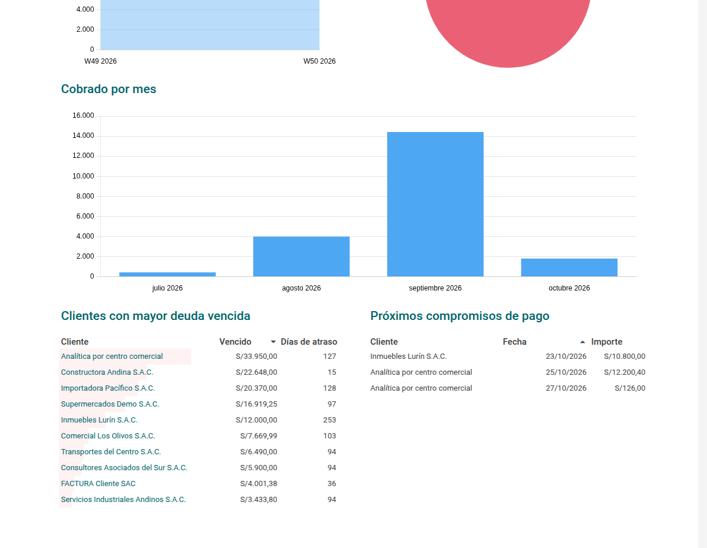
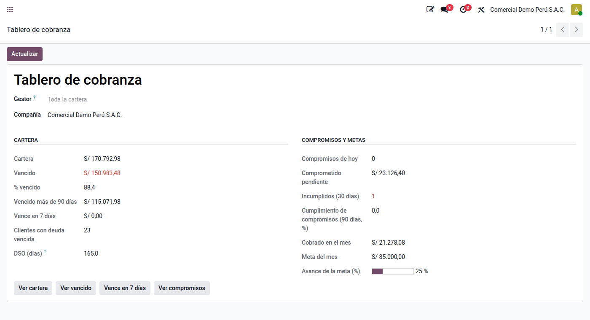

# Cobranza

La aplicación **Cobranza** (`al_l10n_pe_collection`) organiza el trabajo de cobrar: quién
cobra a qué cliente, qué se habló con él, qué prometió pagar y si lo cumplió, cuánto se
espera cobrar en las próximas semanas y cómo va cada gestor frente a su meta.

Se apoya en el **seguimiento de pagos** nativo de Odoo: el **gestor de cobranza** de un
cliente es su responsable de seguimiento, y los recordatorios automáticos por correo,
SMS o carta siguen siendo los niveles de seguimiento.

## Configuración

1. **Gestores:** dé a cada persona de cobranza el permiso **Cobranza / Gestor** (ve solo
   su cartera) o **Cobranza / Administrador** (toda la cartera, metas y configuración).
2. **Zonas** (opcional), en **Cobranza ‣ Configuración ‣ Zonas**, cada una con su gestor por
   defecto.
3. **Asignar clientes:** en **Cobranza ‣ Cartera ‣ Clientes y gestores**, seleccione
   clientes y edite en lote el **gestor de cobranza** y la **zona**. También se puede hacer
   desde la ficha del cliente, pestaña Contabilidad.
4. **Niveles de seguimiento en español:** en **Ajustes ‣ Perú ‣ Cobranza**, **Cargar
   niveles** agrega los que falten: recordatorio 3 días antes del vencimiento y avisos al
   vencer y a los 15, 30 y 60 días. Los niveles que ya existen no se tocan.
5. **Tramos de antigüedad y probabilidad de cobro**, en **Cobranza ‣ Configuración**. Vienen
   valores referenciales (por vencer 98 %, 1 a 30 días 95 %… más de 180 días 15 %) que
   conviene ajustar a la experiencia de la empresa.
6. **Ajustes ‣ Perú ‣ Cobranza:** tolerancia para evaluar compromisos, días de anticipación
   del recordatorio al cliente, porcentaje para darlos por cumplidos, meses de historial de
   pago y resumen diario a los gestores.
7. **Ajustes ‣ Perú ‣ Cobranza** (cumplimiento): horario de contacto con consumidores,
   bloqueo de crédito por mora, tasa de interés moratorio y su cuenta, diario y cuentas de
   la provisión de cobranza dudosa, valor de la UIT y días de espera del aviso a centrales
   de riesgo.

## Cartera

**Cobranza ‣ Cartera ‣ Cartera** lista cada cuota pendiente con su cliente, gestor, zona,
vencimiento, días de atraso, tramo y la fecha del compromiso de pago vigente.
**Antigüedad** muestra la misma cartera en tabla dinámica por gestor y tramo.

No se incluyen los anticipos de clientes (122) ni las detracciones por cobrar, que se
depositan en el Banco de la Nación.

## Cola de trabajo

**Cobranza ‣ Cartera ‣ Cola de trabajo** lista los clientes con deuda vencida ordenados por
**prioridad**: el vencido ponderado por el riesgo del cliente. **Gestionar** abre el
registro de la gestión. Cada día se recalcula la **calificación** de cada cliente
(también con **Calificar** en su ficha):

| Factor | Peso |
|---|---|
| Atraso promedio de pago (historial) | 40 |
| Días de la deuda más antigua | 30 |
| Compromisos incumplidos en 12 meses | 20 |
| Porcentaje vencido de su cartera | 10 |

El puntaje va de 0 a 100: **A** desde 80, **B** desde 60, **C** desde 40 y **D** por debajo.

## Bloqueo de crédito

Un cliente queda **bloqueado por mora** cuando su deuda más antigua supera los días
configurados o, si así se ajusta, cuando su calificación es D. También se puede bloquear a
mano desde la ficha. Con el módulo `al_l10n_pe_collection_sale` (se instala solo con
Ventas), un cliente bloqueado no puede confirmar pedidos y el pedido lo advierte.
El **administrador de cobranza** lo libera por siete días (la fecha se puede cambiar);
vencida la liberación, vuelven a aplicarse las reglas.

## Gestiones

Cada contacto con el cliente se registra como **gestión** (**Cobranza ‣ Gestión ‣
Gestiones**, o **Registrar gestión** en la ficha del cliente): canal (llamada, visita,
correo, WhatsApp, SMS o carta), resultado, detalle y documentos. Al guardarla:

- queda en el historial del cliente;
- si el resultado lo indica, se programa la **próxima acción** del gestor (por ejemplo,
  volver a llamar mañana si no contestó);
- si el resultado es **Promete pagar**, se pide la fecha y el importe y se crea el
  **compromiso de pago**.

Los resultados se configuran en **Cobranza ‣ Configuración ‣ Resultados de gestión**.

### Clientes consumidores

El art. 62 del Código de Protección al Consumidor (Ley 29571) prohíbe llamar o visitar a
un consumidor entre las 20:00 y las 07:00, los sábados, domingos y feriados, y comunicar
su deuda a terceros. La app considera **consumidor** a quien no tiene RUC (el **tipo de
deudor** de la ficha lo cambia) y:

- no deja registrar una gestión por llamada, visita, WhatsApp o SMS fuera del horario
  (se valida la fecha de la gestión, en la zona horaria del gestor); los feriados son las
  ausencias globales del horario laboral de la compañía;
- no le envía los niveles de seguimiento **previos al vencimiento** salvo que la ficha
  marque **Acepta recordatorios antes del vencimiento** (Indecopi multó en 2025 los
  recordatorios no consentidos).

Las empresas (con RUC) no tienen estas restricciones.

## Reclamos

Si el cliente discute un documento (precio, cantidad, calidad, comprobante con errores),
regístrelo en **Cobranza ‣ Gestión ‣ Reclamos**, con **Registrar reclamo** en la ficha o
con el resultado de gestión **Reclamo o disconformidad**. Mientras está abierto, sus
documentos:

- salen de los niveles de seguimiento (no se envían recordatorios);
- aparecen **en disputa** en la cartera y en el estado de cuenta;
- no generan intereses ni se pueden reportar a una central de riesgo.

Se cierra **a favor de la empresa** o **a favor del cliente** indicando la solución; en el
segundo caso, **Nota de crédito** abre el asistente nativo sobre la factura.

## Compromisos de pago

Un compromiso tiene fecha, importe y, opcionalmente, los documentos que cubre. Se evalúa
solo cada día:

| Estado | Cuándo |
|---|---|
| **Cumplido** | Lo cobrado alcanza el importe (aunque no haya llegado la fecha) |
| **Parcial** | Pasada la fecha y la tolerancia, se cobró una parte |
| **Incumplido** | Pasada la fecha y la tolerancia, no se cobró nada |

Lo cobrado es cuánto bajó el saldo de los documentos desde que se pactó; sin documentos,
lo que el cliente pagó desde entonces. Un compromiso parcial o incumplido deja una
actividad al gestor. La vista de calendario muestra los compromisos por día.

## Proyección de cobranza

**Cobranza ‣ Proyección y metas ‣ Proyección de cobranza** calcula, por semanas o meses,
cuánto se espera cobrar (filtrable por gestor o zona):

- **Fecha esperada** de cada cuota: la del compromiso vigente; si no hay, el vencimiento
  más el **atraso promedio** con que ese cliente pagó en los últimos meses; si no tiene
  historial, el vencimiento. Lo vencido sin compromiso cae en el primer periodo.
- **Importe esperado:** saldo × probabilidad del tramo de antigüedad.
- En los periodos ya terminados, lo **cobrado** y la diferencia con lo esperado.
- Fecha e importe se pueden ajustar a mano y se conservan al actualizar.
- **Análisis** (tabla dinámica y gráfico) y **Exportar a Excel**.

## Tablero

**Cobranza ‣ Tablero** abre el tablero **Cobranza** de la aplicación **Tableros** de Odoo
(grupo Finanzas): una hoja de cálculo de solo lectura con datos en vivo. Cada gestor ve
solo su cartera y sus compromisos; el administrador, toda la cartera.

| Bloque | Qué muestra |
|---|---|
| Indicadores | Cartera, vencido (y % de la cartera), vencido más de 90 días, por vencer, comprometido pendiente, compromisos cumplidos sobre evaluados, cobrado en el periodo y clientes con deuda vencida |
| Cartera por tramo de antigüedad | Saldo por tramo (por vencer, 1 a 30 días… más de 180 días) |
| Cartera por gestor | Saldo de cada gestor, apilado por tramo |
| Vencimientos por semana | Lo que vence en las próximas semanas (base de la proyección) |
| Compromisos pactados por estado | Pendientes, cumplidos, parciales e incumplidos |
| Cobrado por mes | Cobros de clientes registrados |
| Tablas | Diez clientes con mayor deuda vencida y próximos compromisos de pago |

Los filtros de la barra superior se aplican a todo el tablero: **Gestor**, **Zona**,
**Cliente** y **Periodo** (por defecto, el año a la fecha). La cartera es una foto al día,
por eso el periodo no la filtra: solo afecta a los compromisos (por fecha en que se
pactaron o se evaluaron) y a lo cobrado. Al hacer clic en un gráfico se abre la lista de
registros correspondiente.

Para adaptarlo, duplíquelo desde la aplicación **Tableros** (requiere permiso de edición
de tableros): los cambios hechos sobre el original se pueden perder al actualizar el
módulo.

## Metas e indicadores del gestor

En **Metas de cobranza** se fija el importe a cobrar por gestor y periodo; el avance es lo
cobrado de sus clientes. **Proyección y metas ‣ Indicadores del gestor** calcula, para un
gestor o para toda la cartera:

| Indicador | Qué mide |
|---|---|
| Cartera, vencido y % vencido | Saldo por cobrar y la parte vencida |
| Vencido más de 90 días | Cartera de riesgo |
| Vence en 7 días | Lo que se debe gestionar de inmediato |
| Compromisos de hoy, pendientes e incumplidos | Seguimiento de lo prometido |
| Cumplimiento de compromisos | Cumplidos sobre evaluados en 90 días |
| DSO | Cartera ÷ ventas de los últimos 90 días × 90 |
| Cobrado en el mes y avance de la meta | Resultado del periodo |

## Estado de cuenta

En la ficha del cliente, **Estado de cuenta** imprime el PDF con los documentos pendientes
(emisión, vencimiento, días de atraso, importe y saldo) y los totales vencido, por vencer y
saldo a favor. **Enviar estado de cuenta** lo envía por correo; desde la lista de clientes,
**Acción ‣ Enviar estado de cuenta** lo envía a varios a la vez.

## Intereses moratorios

Solo si se pactaron con el cliente. La tasa es una **TEA** (la del cliente o, si no tiene,
la de la compañía) con año de 360 días, desde el vencimiento o desde la última nota de
débito de intereses. El estado de cuenta muestra los intereses al día, aparte del total.

**Cobranza ‣ Gestión ‣ Liquidar intereses** (o **Acción** en la lista de clientes) calcula
los intereses de las facturas vencidas y crea una **nota de débito en borrador** por
factura, motivo **01 Intereses por mora** (catálogo 10), inafecta al IGV. Revísela y
publíquela como cualquier comprobante; si se anula, esos días vuelven a calcularse.

!!! warning "Tope del BCRP"
    El interés pactado no puede superar las tasas máximas que fija el BCRP cada semestre
    (mayo y noviembre). La app no las valida: revise la tasa en cada cambio.

## Provisión y castigo de cobranza dudosa

**Cobranza ‣ Gestión ‣ Provisión de cobranza dudosa** (administrador) aplica el art. 21
del Reglamento de la Ley del Impuesto a la Renta:

1. **Proponer documentos:** cuotas vencidas hace más de 12 meses (configurable), sin
   reclamo abierto y no provisionadas antes, con el número de **gestiones de cobro**
   registradas después del vencimiento. Se marcan las que tienen el mínimo de gestiones;
   las demás solo se pueden provisionar si se marca **Proceso judicial**.
2. **Contabilizar:** asiento por documento y deudor, debe **68711** y haber **1911**
   (configurables), el detalle que pide el Libro de Inventarios (PLE 3.6). La cuenta de
   estimación no forma parte de la cartera.
3. **Expedientes:** PDF por deudor con sus documentos, gestiones, compromisos, reclamos,
   reportes a centrales y comunicaciones. La Casación 15840-2025 exige documentar
   acciones concretas de cobro: este expediente es el sustento.
4. **Registrar recuperaciones:** si el cliente paga algo de lo provisionado, asiento
   1911 contra **7551** Recuperación de cobranza dudosa.
5. **Castigar** (art. 21 g): asiento 1911 contra la cuenta por cobrar, conciliado con la
   factura. Solo si la deuda provisionada del deudor no supera **3 UIT** o se marcan las
   **acciones judiciales agotadas**.

## Centrales de riesgo

**Cobranza ‣ Gestión ‣ Centrales de riesgo** lleva el reporte de un deudor a Equifax
(Infocorp), Sentinel, Experian u otra:

| Paso | Qué hace |
|---|---|
| **Enviar aviso previo** | Correo al deudor con la deuda y la fecha desde la que se reportará (7 días por defecto) |
| **Marcar reportado** | Pasado el plazo, registra el monto reportado |
| **Por retirar** | Cada día, si la deuda se pagó o cumplió 5 años de vencida (Ley 27489), el reporte pasa a este estado con una actividad al gestor |
| **Marcar retirado** | Cuando se retiró de la central |

No se pueden reportar documentos por vencer, en reclamo o vencidos hace más de 5 años.
Las centrales no tienen una interfaz pública: **Excel** genera el archivo con los datos
del deudor y de cada documento para cargarlo en la central.

## Recaudación bancaria

Con el módulo `al_l10n_pe_bank_collection`, el banco cobra a los clientes por ventanilla,
agentes o banca por internet con su código de depositante (RUC o DNI, referencia o un
código propio) y Odoo concilia lo cobrado.

1. **Convenio** (**Cobranza ‣ Configuración ‣ Convenios de recaudación**): diario de la
   cuenta recaudadora, moneda (un convenio por moneda), sucursal y número de cuenta, código
   de servicio, modalidad de validación y con qué código paga el cliente.
2. **Formato** (**Cobranza ‣ Configuración ‣ Formatos de recaudación**):

    | Banco | Formato incluido | Origen |
    |---|---|---|
    | BCP | CREP: deudores de 250 posiciones y respuesta | Layout más difundido: compárelo con la ficha técnica del BCP |
    | BBVA | Entrada de datos de 360 bytes y envío de información de 152 bytes | Ficha técnica oficial E1891 V21 (marzo 2025), publicada por BBVA |
    | Scotiabank | Validación completa: cobranza de 200 posiciones y resultados | Macro oficial publicada por Scotiabank |
    | Interbank | — | Cree el formato con la ficha que el banco entrega al afiliar (no es pública) |

    Puede ajustar posición, longitud, tipo y equivalencias de cualquier campo; los cambios se
    conservan al actualizar. En BBVA, ajuste la longitud del código de identificación al
    «tamaño campo código» de su ficha técnica (código y concepto suman 48).
3. **Archivo de deudores** (**Cobranza ‣ Recaudación bancaria ‣ Archivos de deudores**):
   **Cargar cuotas** trae lo vencido y lo que vence en los próximos días (sin documentos en
   reclamo, anticipos ni detracciones), **Generar archivo** y **Descargar** para subirlo a
   Telecrédito. El de **reemplazo** sustituye todo lo enviado antes; el de **actualización**
   solo agrega. Los clientes sin código quedan fuera con un aviso.
4. **Respuesta del banco** (**Cobranza ‣ Recaudación bancaria ‣ Respuestas del banco**):
   adjunte el archivo de abonos e **Importar**. Cada cobro se identifica:

    | Estado | Qué significa |
    |---|---|
    | **Identificado** | Cliente y documento (por la información de retorno) |
    | **Solo cliente** | Se aplicará a sus cuotas más antiguas; sin cuotas abiertas, queda como anticipo |
    | **Sin identificar** | Elija el cliente en la línea y pulse identificar, o descártela |
    | **Ya procesado** | La misma operación (fecha, número, depositante, importe) ya se pagó |

5. **Crear pagos y conciliar**: un pago por cobro en el diario del convenio, conciliado con
   las cuotas. Se compara también con la cantidad y el total que informa la cabecera.

!!! warning "Ficha técnica del banco"
    El layout del BCP precargado es el más difundido, pero cada empresa recibe la ficha
    técnica al afiliarse: verifíquela antes del primer envío.

## Notificaciones

| Aviso | A quién | Cuándo |
|---|---|---|
| Niveles de seguimiento | Cliente | Según los días de cada nivel (nativo) |
| Recordatorio del compromiso | Cliente | N días antes de la fecha comprometida |
| Compromiso incumplido o parcial | Gestor (actividad) | Al evaluarse |
| Resumen diario | Gestor (correo) | Cada mañana: compromisos del día, gestiones pendientes, lo que vence en 3 días y lo que venció ayer |
| Aviso previo de reporte | Cliente | Al enviar el aviso de central de riesgo |
| Reporte por retirar | Gestor (actividad) | Cuando la deuda reportada se paga o cumple 5 años |

El resumen no se envía si el gestor no tiene novedades.
