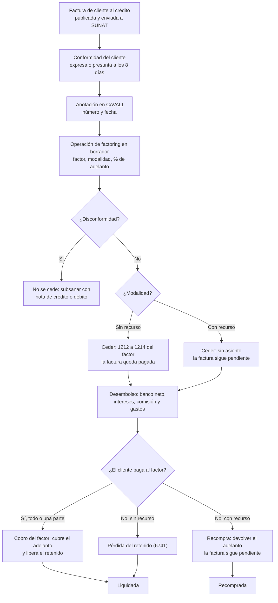
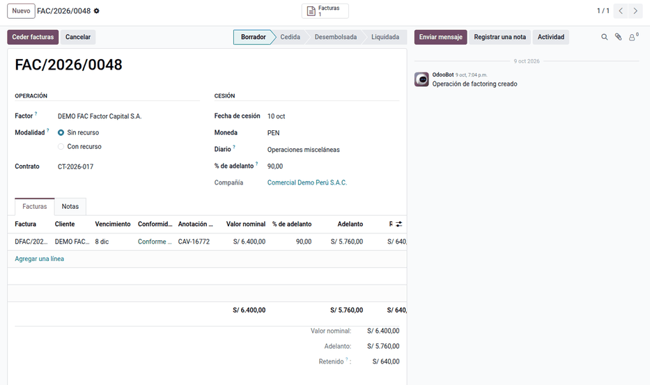
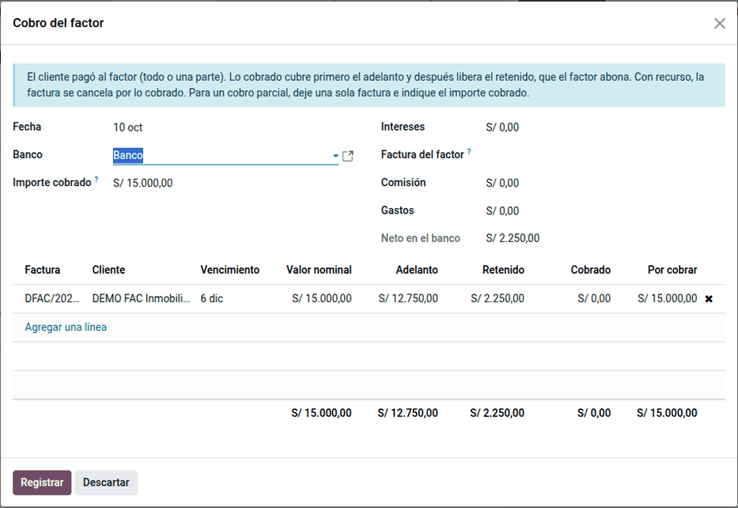
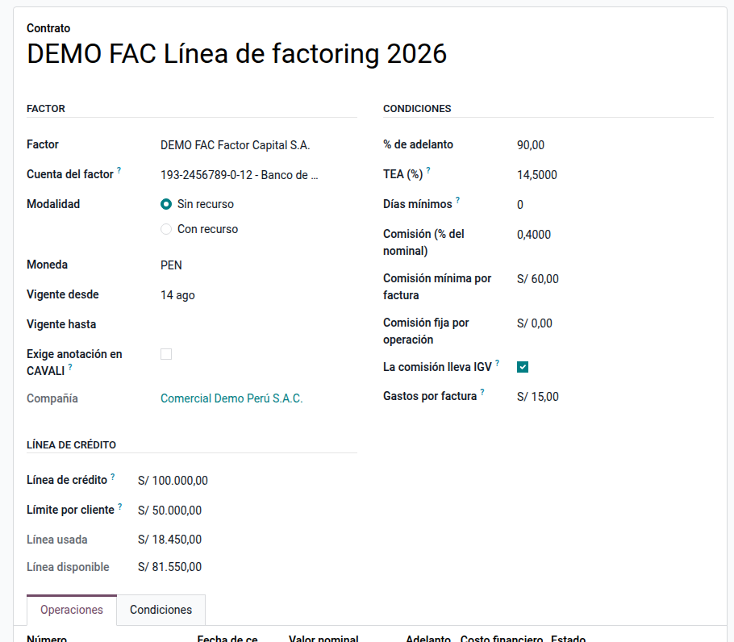
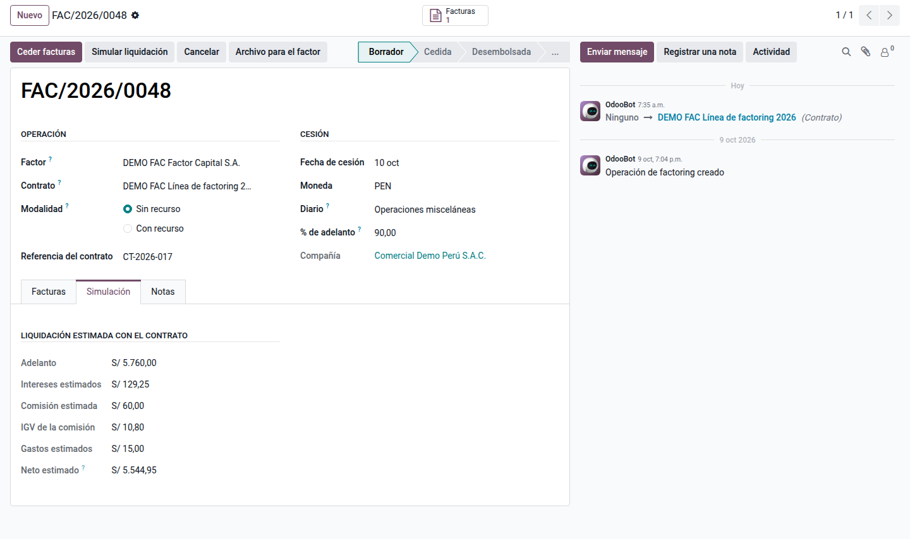
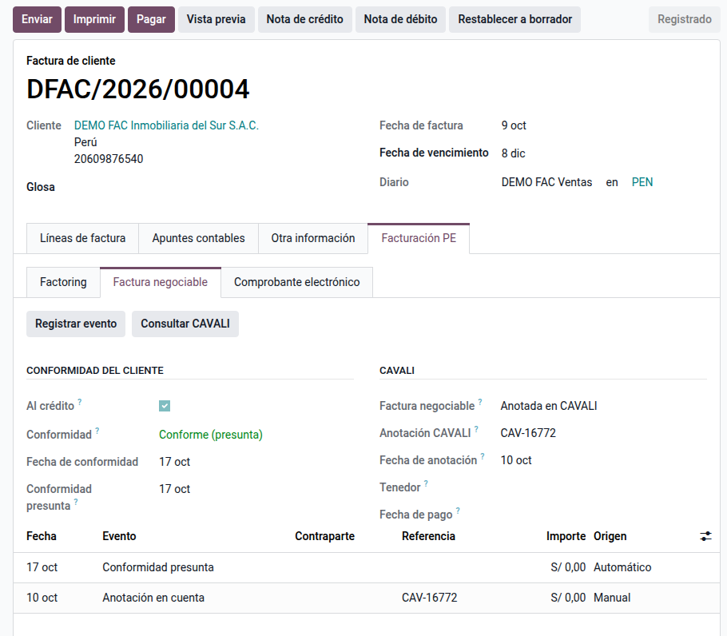
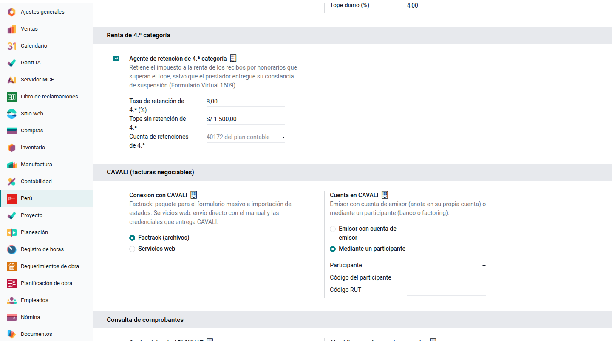
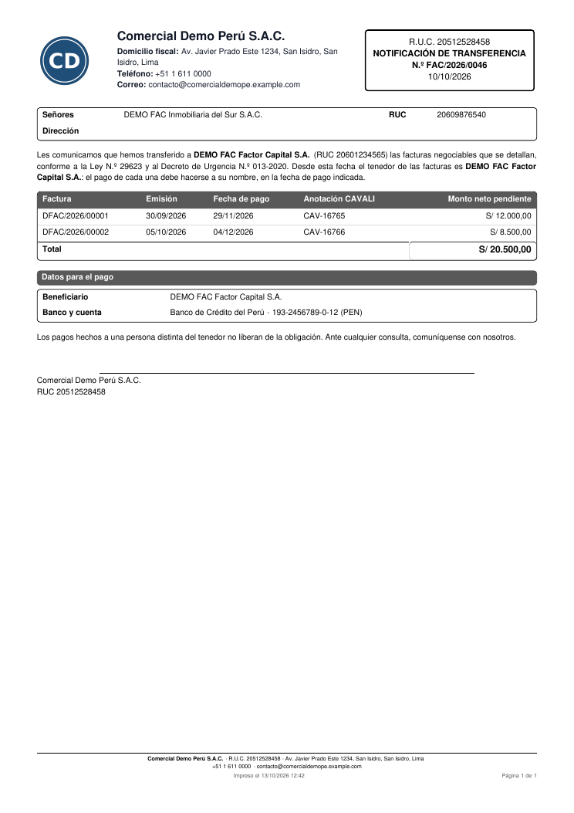
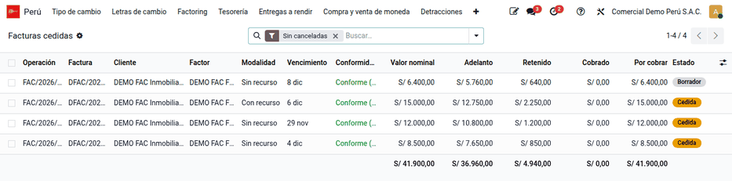

# Factoring

Una empresa que vende al crédito (30, 60 o 90 días) necesita liquidez antes de
que el cliente pague. Con el **factoring** cede esas facturas a un banco o a
una empresa de factoring, el **factor**, que le adelanta la mayor parte del
importe y cobra la factura al vencimiento. El módulo **Factoring de facturas**
(`al_l10n_pe_factoring`) registra la operación con el factor sobre las facturas
de cliente ya emitidas, sin duplicarlas, y genera los asientos de cada momento
(cesión, desembolso, intereses, cobro, recompra o pérdida) con las cuentas del
PCGE. Lo usan tesorería y contabilidad.

Además lleva la **factura negociable** en la propia factura (conformidad,
anotación en CAVALI y su historial de eventos) y se conecta con **CAVALI**:
paquete para Factrack, importación de estados y servicios web. Queda fuera la
factura negociable impresa (tercera copia física).

## Configuración

1. Vaya a **Perú ‣ Configuración ‣ Cuentas de la localización ‣ Factoring**.
   Las cuentas se crean solas con el PCGE por modalidad (1214, 4512, 6734,
   3731, 6391 y 6741). Ajústelas al plan de la empresa y agregue filas por
   moneda si usa cuentas distintas en dólares.
2. Prepare un diario de tipo **Varios** para la cesión y el devengo, y el
   diario del banco donde abona el factor.
3. Cree el factor como contacto (empresa con RUC). Si cobra comisiones
   facturadas, registre su factura de proveedor antes del desembolso.
4. Use términos de pago con vencimiento en las facturas: la factura negociable
   nace de una venta al crédito.
5. Asigne los permisos: facturación (crear y operar), administrador contable
   (cuentas) y solo lectura (auditor).
6. Revise las cuentas de ganancia y pérdida por diferencia de cambio en los
   ajustes de Contabilidad.
7. En **Perú ‣ Clientes ‣ Factoring ‣ Contratos**, registre las condiciones de
   cada factor (ver [Contrato y simulación](#contrato-y-simulación)).
8. En **Ajustes ‣ Perú ‣ CAVALI (facturas negociables)**, elija la conexión
   (ver [CAVALI](#cavali)).

## Conceptos

| Término | Significado | En Odoo |
|---|---|---|
| Factor | Banco o empresa que compra las facturas | Operación ‣ **Factor** |
| Sin recurso | El factor asume el riesgo de impago: la factura se da de baja | Operación ‣ **Modalidad** |
| Con recurso | Si el cliente no paga, la empresa devuelve el adelanto: la factura **no** se da de baja y el adelanto es una deuda | Operación ‣ **Modalidad** |
| Valor nominal | Monto neto pendiente de pago que se cede | Línea ‣ **Valor nominal** |
| Adelanto | Parte del nominal que el factor paga al inicio, por ejemplo el 90 % | Línea ‣ **% de adelanto** |
| Retenido | Resto del nominal; el factor lo paga cuando el cliente cancela | Línea ‣ **Retenido** |
| Conformidad | Aceptación de la factura por el cliente, expresa o presunta | Línea ‣ **Conformidad** |
| Anotación en cuenta | Registro de la factura negociable en CAVALI | Línea ‣ **Anotación CAVALI** |
| Recompra | Con recurso: la empresa devuelve el adelanto porque el cliente no pagó | Operación ‣ **Recompra** |

La **Ley 29623** crea la **factura negociable**, un título valor que incorpora
el derecho de cobro del saldo de la factura. El **D.U. 013-2020** exige que la
factura electrónica al crédito informe el **plazo de pago** y el **monto neto
pendiente de pago**, y regula la **conformidad**: el cliente tiene **8 días
calendario** para dar su conformidad o disconformidad y, si no se pronuncia, se
**presume conforme** (art. 7). La factura puede transferirse desde su
**anotación en cuenta** en CAVALI. Según la **R.S. 193-2020/SUNAT**, el monto
neto pendiente **excluye** la detracción y la retención del IGV (3 % de las
facturas de más de S/ 700 de un cliente agente de retención, R.S.
037-2002/SUNAT). El valor nominal propuesto usa la misma regla que el
[comprobante impreso](../fiscal_localizations/peru/electronic_invoicing/invoice_report.md#cliente-agente-de-retención):
entre agentes de retención no se retiene.

La cesión de créditos no es una venta gravada: no se emite comprobante por la
cesión. Los intereses y las comisiones del factor siguen las reglas de los
servicios financieros. La **NIIF 9** decide si la cuenta por cobrar se da de
baja según quién asume el riesgo.

## Crear la operación

1. Emita la factura al crédito en **Contabilidad ‣ Clientes ‣ Facturas**: el
   comprobante electrónico informa el monto neto pendiente.
2. Seleccione las facturas y vaya a **Acciones ‣ Ceder a factoring**, o cree la
   operación en **Perú ‣ Clientes ‣ Factoring ‣ Operaciones**. La operación queda en
   **Borrador** con el valor nominal propuesto, que se puede editar para ceder
   solo una parte (sin superar el saldo pendiente).
3. Elija el factor, la **Modalidad** que dice el contrato y el **% de
   adelanto**. Si el factor puede exigir la devolución cuando el cliente no
   paga, la modalidad es **con recurso**.
4. En **Facturas**, registre la **Conformidad** y la **Anotación CAVALI**
   (número y fecha).

!!! warning "Importante"
    Una factura con disconformidad no se puede ceder: subsánela con una nota de
    crédito o débito, o con un nuevo comprobante, y registre la conformidad.
    Una factura tampoco se puede ceder dos veces, salvo que la operación
    anterior se haya cancelado o recomprado.

### Ejemplo

Constructora SAC emite el **01/10/2026** la factura F001-125 a Inmobiliaria del
Sur SAC por **S/ 10 000 + IGV 1 800 = S/ 11 800**, al crédito con vencimiento el
**30/11/2026**. El cliente es **agente de retención**. El 10/10/2026 la cede a
Factor Capital SA con un **adelanto del 90 %**; el factor cobra **intereses de
S/ 180**, una **comisión facturada de S/ 118** (S/ 100 + IGV 18) y **gastos de
S/ 20**:

- monto neto pendiente = 11 800 − retención 3 % (354,00) = **S/ 11 446,00**,
  que es el valor nominal propuesto (la retención la sustenta el cliente con su
  comprobante de retención);
- adelanto = 11 446,00 × 90 % = **S/ 10 301,40**; retenido = **S/ 1 144,60**;
- neto en el banco = 10 301,40 − 180 − 118 − 20 = **S/ 9 983,40**;
- conformidad presunta: 01/10/2026 + 8 días = **09/10/2026**, antes de ceder.

La comisión del factor se registra como factura de proveedor:

| Cuenta | Descripción | Debe | Haber |
|---|---|---|---|
| 6391 | Comisión de factoring | 100,00 | |
| 40111 | IGV crédito fiscal | 18,00 | |
| 4212 | Factor Capital SA (por pagar) | | 118,00 |
| | **Total** | **118,00** | **118,00** |

## Ceder y recibir el desembolso

1. Haga clic en **Ceder facturas**: la operación pasa a **Cedida**.
2. Al recibir el dinero, haga clic en **Registrar desembolso** e indique los
   intereses, la comisión y los gastos: la operación pasa a **Desembolsada**.
3. Con recurso, haga clic en **Devengar intereses** en cada periodo para
   llevar el gasto financiero.

### Sin recurso

La cesión da de baja la factura por el nominal:

| Cuenta | Descripción | Debe | Haber |
|---|---|---|---|
| 1214 | Facturas cedidas — Factor Capital SA | 11 446,00 | |
| 1212 | Facturas por cobrar — Inmobiliaria del Sur SAC | | 11 446,00 |
| | **Total** | **11 446,00** | **11 446,00** |

En el desembolso, la comisión facturada se paga con el descuento:

| Cuenta | Descripción | Debe | Haber |
|---|---|---|---|
| 1041 | Banco | 9 983,40 | |
| 6734 | Intereses por documentos descontados | 180,00 | |
| 4212 | Factura de la comisión (se concilia y queda pagada) | 118,00 | |
| 6391 | Gastos | 20,00 | |
| 1214 | Adelanto — Factor Capital SA | | 10 301,40 |
| | **Total** | **10 301,40** | **10 301,40** |

### Con recurso

La cesión no genera asiento: según la NIIF 9, el riesgo sigue en la empresa y
la factura sigue pendiente a nombre del cliente, marcada como **Cedida**. El
botón **Pagar** de la factura queda bloqueado, porque la cobra el factor. El
adelanto es una obligación y los intereses se difieren:

| Cuenta | Descripción | Debe | Haber |
|---|---|---|---|
| 1041 | Banco | 9 983,40 | |
| 3731 | Intereses por devengar | 180,00 | |
| 4212 | Factura de la comisión | 118,00 | |
| 6391 | Gastos | 20,00 | |
| 4512 | Obligación con Factor Capital SA | | 10 301,40 |
| | **Total** | **10 301,40** | **10 301,40** |

El devengo de octubre y noviembre, S/ 90 cada mes, es 6734 al debe y 3731 al
haber.

!!! note "Nota"
    Una operación se puede **Cancelar** solo antes del desembolso: la factura
    vuelve al cliente. Una operación cancelada puede **Volver a borrador**.

## Registrar el cobro del factor

Cuando el cliente paga al factor, haga clic en **Cobro del factor**, con una o
varias facturas y el importe cobrado: el cobro cubre primero el adelanto y luego
libera el retenido. La operación pasa a **Liquidada** cuando todo está cobrado.

Sin recurso, si el cliente paga en dos partes:

1. Paga S/ 6 000: cubre parte del adelanto y no libera retenido, así que no
   hay asiento (quedan por cobrar S/ 5 446).
2. Paga S/ 5 446: S/ 4 301,40 completan el adelanto y **S/ 1 144,60** liberan
   el retenido:

| Cuenta | Descripción | Debe | Haber |
|---|---|---|---|
| 1041 | Banco | 1 144,60 | |
| 1214 | Retenido liberado — Factor Capital SA | | 1 144,60 |
| | **Total** | **1 144,60** | **1 144,60** |

Con recurso, cuando el cliente paga todo al vencimiento:

| Cuenta | Descripción | Debe | Haber |
|---|---|---|---|
| 4512 | Cancelación del adelanto | 10 301,40 | |
| 1041 | Banco (retenido) | 1 144,60 | |
| 1212 | Inmobiliaria del Sur SAC (la factura queda pagada) | | 11 446,00 |
| | **Total** | **11 446,00** | **11 446,00** |

### Impago

- **Con recurso:** haga clic en **Recompra** para devolver el adelanto (4512 al
  debe por 10 301,40 y banco al haber). La operación pasa a **Recomprada** y la
  factura sigue pendiente: se gestiona como cualquier deuda del cliente, con la
  provisión o el castigo de Odoo.
- **Sin recurso:** el factor asume el impago pero no libera el retenido. Haga
  clic en **Pérdida del retenido**: 6741 al debe y 1214 al haber por
  1 144,60, y la operación pasa a **Liquidada**.

### Moneda extranjera

Una obligación de USD 800 recibida a 3,75 (S/ 3 000) y cancelada cuando el
dólar está a 3,80 se salda en la 4512 por S/ 3 000, al cambio histórico, y la
diferencia de **S/ 40** va a pérdida por diferencia de cambio.

## Contrato y simulación

El **contrato** guarda las condiciones de un factor y la operación las toma al
elegirlo:

- **% de adelanto**, **TEA** y **días mínimos**: los intereses de cada factura
  son `adelanto × ((1 + TEA) ^ (días / 360) − 1)`, con los días hasta su
  vencimiento.
- **Comisión**: porcentaje del valor nominal con un **mínimo por factura**,
  más una **comisión fija** por operación. Si **la comisión lleva IGV**, se
  suma el 18 % (los intereses no llevan IGV).
- **Gastos por factura** (administrativos o de CAVALI).
- **Cuenta del factor**: la que va en la notificación al cliente.
- **Línea de crédito** y **límite por cliente**: el adelanto vigente de las
  facturas cedidas que aún no se cobran. Ceder por encima del límite da error.
- **Exige anotación en CAVALI**: solo se ceden facturas anotadas.

En la operación, **Simular liquidación** calcula los intereses de cada factura,
la comisión con su IGV y los gastos (pestaña **Simulación**). Al registrar el
desembolso, el asistente propone esos importes y muestra la **diferencia con
la simulación**, para revisar la liquidación real del factor.

## Revisar las facturas antes de ceder

**Ceder a factoring** desde la lista de facturas revisa todas las elegidas. Si
alguna no se puede ceder, muestra cada factura con **todos** sus motivos (no
está publicada, otra moneda, ya pagada, vencida, disconforme, ya cedida o ya
transferida) y los avisos (al contado, conformidad pendiente, sin anotación en
CAVALI), y **Crear operación** usa solo las que sí se pueden ceder. Al ceder,
la operación también junta todos los errores en un solo mensaje.

## Factura negociable

La pestaña **Facturación PE ‣ Factura negociable** de cada factura de cliente
muestra:

- **Conformidad del cliente**: pendiente, expresa, presunta o disconforme. Una
  tarea diaria marca la **conformidad presunta** a los 8 días calendario de la
  emisión en las facturas al crédito, y crea una actividad 2 días antes de que
  venza el plazo.
- **CAVALI**: situación de la factura negociable (sin anotar, anotada,
  transferida, pagada, protestada, recomprada o anotación anulada), código y
  fecha de anotación, **tenedor** y **fecha de pago**.
- **Eventos**: cada cambio con su fecha, contraparte, referencia, importe y
  origen (manual, CAVALI, operación de factoring o automático).

**Registrar evento** (también en la lista de facturas: **Acción ‣ Evento de
factura negociable**) anota lo que pasó. El orden se valida:

| Evento | Requiere |
|---|---|
| Anotación en cuenta | Factura al crédito y sin disconformidad |
| Transferencia | Anotación y conformidad (expresa o presunta) |
| Prórroga, pago o protesto | Anotación |
| Recompra | Transferencia o protesto |

La operación de factoring registra sola la **transferencia** al ceder una
factura anotada, el **pago** al cobrarla, la **prórroga** y la **recompra**; al
cancelar la operación, revierte la transferencia.

## CAVALI

CAVALI registra las facturas negociables por su aplicativo web **Factrack**
(formulario individual o masivo) y por **servicios web** para los
participantes (bancos y empresas de factoring) y los emisores con cuenta de
emisor. La especificación de los servicios web la entrega CAVALI con las
credenciales. En **Ajustes ‣ Perú ‣ CAVALI (facturas negociables)**:

- **Factrack (archivos)**: en la lista de facturas, **Acción ‣ Paquete para
  Factrack (CAVALI)** descarga un ZIP con el XML de cada comprobante y la
  información adicional en Excel (domicilios, fecha de pago, monto neto
  pendiente y cuotas) para el formulario masivo. Luego, **Perú ‣ Clientes ‣
  Factoring ‣ Importar estados de CAVALI** lee el Excel o CSV de Factrack
  (columnas **Serie**, **Número** y **Estado**; opcionales **Fecha**, **Código
  anotación** y **RUC tenedor**) y registra los eventos.
- **Servicios web**: ambiente (pruebas o producción), URL, usuario y clave.
  **Registrar en CAVALI** envía la factura con su XML; la cesión envía la
  transferencia, el cobro el pago y la prórroga la reprogramación; **Consultar
  CAVALI** (y una tarea diaria) trae el estado y la conformidad. Cada envío
  queda en **Envíos a CAVALI** con su solicitud y su respuesta, sin las
  credenciales. Las rutas de cada operación se ajustan al manual de CAVALI en
  los parámetros del sistema `l10n_pe_cavali.path.<operación>`.
- **Cuenta en CAVALI**: emisor con cuenta de emisor o mediante un participante,
  con su código y el código RUT de la empresa.

## Otras operaciones con el factor

- **Desembolso parcial**: el asistente de desembolso deja elegir las facturas;
  las demás quedan por desembolsar y se registran después. Solo se cobran,
  recompran o prorrogan las facturas ya desembolsadas.
- **Cobro recibido por la empresa**: si el cliente paga a la empresa en vez de
  al factor, lo cobrado cubre primero el adelanto, que queda **por transferir
  al factor** (sin recurso en la 4699; con recurso sigue en la 4512), y después
  el retenido, que es de la empresa. **Transferir al factor** entrega ese
  importe; la operación se liquida cuando no queda nada por transferir.
- **Prórroga**: nueva fecha de pago con los intereses de los días adicionales
  (propuestos con la TEA del contrato) y la comisión; la factura negociable
  registra la nueva fecha.
- **Notificar a los clientes**: un correo por cliente con el PDF de la
  transferencia, las facturas, el monto neto pendiente y la cuenta del factor.
- **Archivo para el factor**: Excel con las facturas, los clientes, los montos
  netos, los vencimientos, el adelanto y la anotación en CAVALI.

## Reportes

- **Perú ‣ Clientes ‣ Factoring ‣ Facturas cedidas**: cartera cedida por factor, cliente y
  vencimiento; cobrado y por cobrar; vencidas en rojo.
- **Perú ‣ Informes ‣ Análisis ‣ Factoring**: nominal y pendiente por factor
  y estado.
- **Perú ‣ Informes ‣ Análisis ‣ Costo financiero del factoring**: intereses, comisión, gastos y
  retenido perdido por factor y mes.
- La factura sigue en el registro de ventas por su importe y la cesión no genera
  comprobante. Los asientos de cesión, desembolso y cobro van al libro diario,
  y la comisión facturada va al registro de compras como cualquier factura de
  proveedor.

## Casos especiales

| Situación | Qué pasa | Qué hacer |
|---|---|---|
| Factura al contado | La cesión lo advierte en el historial | Verificar con el factor: la factura negociable nace de una venta al crédito |
| Factura con detracción | El nominal propuesto excluye la detracción | Nada: el cliente deposita la detracción en el Banco de la Nación y esa parte sigue en la factura |
| Cliente agente de retención | El nominal excluye el 3 % | Registrar la retención sufrida con el comprobante del cliente |
| Nominal mayor que el saldo de la factura | Error al ceder | Corregir el valor nominal |
| Intereses y comisiones mayores que el adelanto | Error en el desembolso | Revisar la liquidación del factor |
| Se intenta **Pagar** una factura cedida | Bloqueado | Registrar el cobro desde la operación |
| El cliente pagó a la empresa | El adelanto se debe al factor | **Cobro recibido por la empresa** y luego **Transferir al factor** |
| «La línea de … es …» o «El límite por cliente …» | La cesión supera la línea de crédito o el límite por cliente | Esperar cobros, ampliar la línea o ceder menos facturas |
| «No se transfiere sin conformidad» | La factura no tiene conformidad expresa ni presunta | Esperar los 8 días o registrar la conformidad expresa |
| CAVALI responde con error | El envío no se registra como evento | Revisar el mensaje en **Envíos a CAVALI** y corregir los datos |

## Datos de demostración

Una base creada **con datos de demostración** carga, al instalar el módulo, un
ejemplo completo en la compañía **PE Company** (la compañía peruana de la demo
de Odoo, con el plan contable de Perú). Las fechas se calculan respecto del día de la instalación. En una base
sin datos de demostración no se carga nada.

- Factor **Factor Capital S.A.** y cliente **Inmobiliaria del
  Sur S.A.C.**
- Operación sin recurso de dos facturas (S/ 12 000 y S/ 8 500), cedida y
  desembolsada.
- Operación con recurso de una factura de S/ 15 000, desembolsada y con
  intereses devengados.
- Una operación en borrador.

!!! info "Ver también"
    - [Ley 29623: factura negociable](https://www.leyes.congreso.gob.pe/Documentos/Leyes/29623.pdf)
    - [D.U. 013-2020: financiamiento de la MIPYME](https://www.leyes.congreso.gob.pe/Documentos/2016_2021/Decretos/Urgencias/2020/DU-013-2020-PP.pdf)
    - [R.S. 193-2020/SUNAT](https://www.sunat.gob.pe/legislacion/superin/2020/193-2020.pdf), su [anexo de forma de pago y cuotas](https://www.sunat.gob.pe/legislacion/superin/2020/anexo4-193-2020.pdf) y su [publicación en gob.pe](https://www.gob.pe/institucion/sunat/normas-legales/1124498-193-2020-sunat)
    - [R.S. 037-2002/SUNAT: régimen de retenciones del IGV](https://www.sunat.gob.pe/legislacion/superin/2002/037.htm)
    - [TUO de la Ley del IGV](https://www.sunat.gob.pe/legislacion/igv/ley/index.html)
    - [CAVALI](https://www.cavali.com.pe/)
    - [NIIF 9: instrumentos financieros](https://www.ifrs.org/issued-standards/list-of-standards/ifrs-9-financial-instruments/) y [NIC 21: variaciones en las tasas de cambio](https://www.ifrs.org/issued-standards/list-of-standards/ias-21-the-effects-of-changes-in-foreign-exchange-rates/)
    - [Plan Contable General Empresarial (MEF)](https://www.mef.gob.pe/contenidos/conta_publ/documentac/PCGE_2019.pdf)
    - [Odoo: Contabilidad](https://www.odoo.com/documentation/19.0/es/applications/finance/accounting.html)
    - [Letras de cambio](bills_of_exchange.md)
