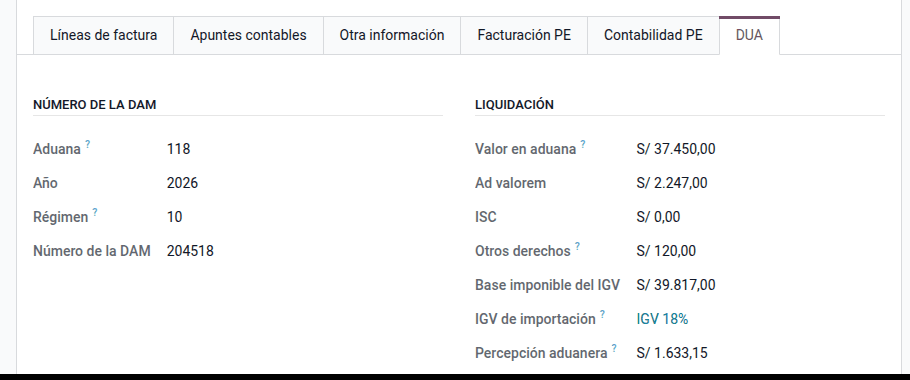
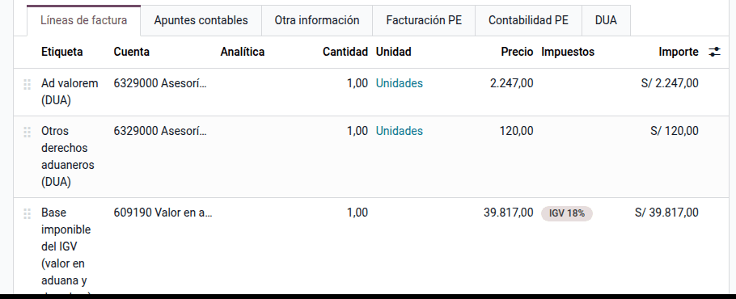
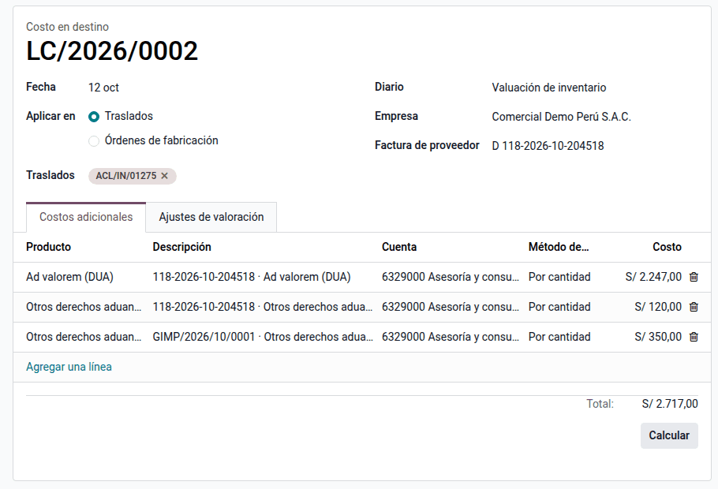

# DUA de importación

En una importación definitiva, la Aduana liquida en la Declaración Aduanera de
Mercancías (DAM, conocida como DUA) los derechos y el IGV que se pagan para
nacionalizar la mercancía. La DUA se registra como un documento de compra a
nombre de la Aduana (tipo 50; 52 la declaración simplificada): su IGV da crédito
fiscal y sus derechos, junto con los gastos de aduana, forman parte del costo del
producto importado.

## Configuración

1. Instale **PE - DUA de importación y costos en destino**
   (`al_l10n_pe_import_dua`). Instala también los costos en destino de Odoo.
2. Cree el contacto de la Aduana: **SUNAT** con R.U.C. 20131312955.
3. Cree una cuenta puente para la base imponible de la DUA (por ejemplo, una
   subcuenta de costos vinculados con las compras de la clase 60).
4. Vaya a **Ajustes ‣ Perú ‣ Importaciones (DUA)** y elija la **Aduana**, el
   **Diario de las DUA** y la **Cuenta puente del valor en aduana**.
5. Revise la cuenta de gasto de los productos **Ad valorem (DUA)**, **ISC de
   importación (DUA)** y **Otros derechos aduaneros (DUA)**: es la que usa el
   costo en destino.
6. Para registrar la percepción aduanera, instale
   [Percepciones del IGV](../fiscal_localizations/peru/perceptions.md) y configure
   su cuenta de percepciones por aplicar.

## Conceptos

- **Número de la DAM:** aduana (código de 3 dígitos de la tabla 11 de SUNAT, por
  ejemplo 118 Callao marítima), año, régimen (10, importación para el consumo) y
  número. Odoo arma con ellos el número del documento, `118-2026-10-204518`, que
  leen el registro de compras del PLE y el SIRE.
- **Base imponible del IGV:** valor en aduana (CIF) más el ad valorem, el ISC y
  los demás derechos que forman parte de la base.
- **IGV de importación:** 16 % de IGV más 2 % de IPM sobre la base imponible; es
  crédito fiscal como el de cualquier compra gravada.
- **Percepción aduanera:** la Aduana percibe un porcentaje del valor más los
  tributos (10 %, 5 % o 3,5 % según el importador y la mercancía); se aplica
  contra el IGV del periodo en el formulario 621.

## Registrar la DUA

1. Vaya a **Perú ‣ Proveedores ‣ Comprobantes ‣ DUA de importación** y haga clic en **Nuevo**.
2. Elija la Aduana como proveedor, el diario de compras y el tipo de documento
   **(50) Declaración Única de Aduanas - Importación definitiva**. La fecha de la
   factura es la de numeración de la DAM.
3. En la pestaña **DUA**, complete el número de la DAM y la liquidación: **Valor en
   aduana**, **Ad valorem**, **ISC**, **Otros derechos** y **Percepción aduanera**,
   en soles al tipo de cambio de la fecha de numeración.
4. Haga clic en **Generar líneas de la DUA**.

### Líneas que se generan

| Línea | Importe | Para qué |
|---|---|---|
| Ad valorem, ISC, otros derechos | Cada derecho | Costo en destino del producto |
| Base imponible del IGV | Valor en aduana + derechos, con el IGV del 18 % | Crédito fiscal |
| Compensación de la base | La misma base en negativo, sin impuesto | Anula la base en la cuenta puente |

La DUA suma lo que se paga a la Aduana: los derechos y el IGV. Volver a generar
las líneas reemplaza las anteriores sin duplicarlas.

!!! note "Nota"
    El valor en aduana se paga al proveedor del exterior con su propia factura.
    Por eso la base imponible y su compensación van a la misma cuenta puente y se
    anulan entre sí.

### Publicar y registrar la percepción

Al publicar la DUA, si tiene percepción aduanera y está instalado el módulo de
percepciones, se crea y publica su **percepción recibida** (régimen importación,
documento DUA). Se ve en el botón **Percepción** de la DUA y entra en el resumen
del formulario 621.

## Vincular la importación

En la pestaña **DUA**:

- **Facturas del exterior:** las facturas del proveedor no domiciliado que
  nacionaliza esta DUA. Cada una queda con la referencia a la DUA que pide el
  registro de compras.
- **Recepciones:** las recepciones de inventario de la mercadería importada.
- **Gastos de aduana:** facturas del agente de aduana, flete, almacén u otros,
  con productos de costo en destino.

## Costos en destino

1. Elija el método en **Repartir costos**: por cantidad, por peso, por volumen,
   por costo actual o en partes iguales.
2. Con la DUA publicada, haga clic en **Costos en destino**. Odoo crea el costo
   en destino con los derechos de la DUA y las líneas de costo de los gastos de
   aduana, sobre las recepciones, y lo calcula.
3. Revise los **Ajustes de valoración** y haga clic en **Validar**: el costo del
   producto sube con la importación.

!!! warning "Importante"
    Solo los productos con valoración perpetua (en tiempo real) generan el asiento
    de la valoración al validar el costo en destino.

## Reportes

- **Registro de compras (PLE 8.1 y SIRE RCE):** la DUA sale con el tipo 50, el
  código de aduana como serie, el año de la DAM y su número; la base imponible y
  el IGV salen del impuesto de la línea de base.
- **Percepciones:** el resumen del formulario 621 del módulo de percepciones.

## Casos especiales

| Situación | Qué hacer |
|---|---|
| Declaración simplificada (DSI) | Use el tipo 52 con los mismos pasos |
| La DUA se corrige después de numerada | Restablezca a borrador, corrija la liquidación, genere las líneas y publique; la percepción ya registrada no se duplica |
| Importación sin percepción | Deje la percepción en cero |
| Gastos con IGV (agente, flete local) | Registre su factura normal con el IGV y use un producto de costo en destino en la línea del servicio |

## Datos de demostración

Una base creada **con datos de demostración** carga, al instalar el módulo, un
ejemplo completo en la compañía **PE Company** (la compañía peruana de la demo
de Odoo, con el plan contable de Perú). Los registros llevan el prefijo **DEMO
DUA** y las fechas se calculan respecto del día de la instalación. En una base
sin datos de demostración no se carga nada.

- Configuración de la DAM: entidad aduanera, cuenta 609190 por regularizar y
  diario.
- Recepción de diez motobombas, factura del proveedor del exterior y gastos del
  agente de aduana (S/ 350).
- La DAM publicada (valor en aduana S/ 37 450, ad valorem S/ 2 247) con su costo
  en destino.

!!! info "Ver también"
    - [SUNAT: régimen de percepciones del IGV en la importación](https://orientacion.sunat.gob.pe/03-porcentajes-de-percepcion)
    - [Percepciones del IGV](../fiscal_localizations/peru/perceptions.md)
    - [Libros electrónicos (PLE)](../fiscal_localizations/peru/ple.md)
    - [Costos en destino en Odoo](https://www.odoo.com/documentation/19.0/es_419/applications/inventory_and_mrp/inventory/inventory_valuation/landed_costs.html)
