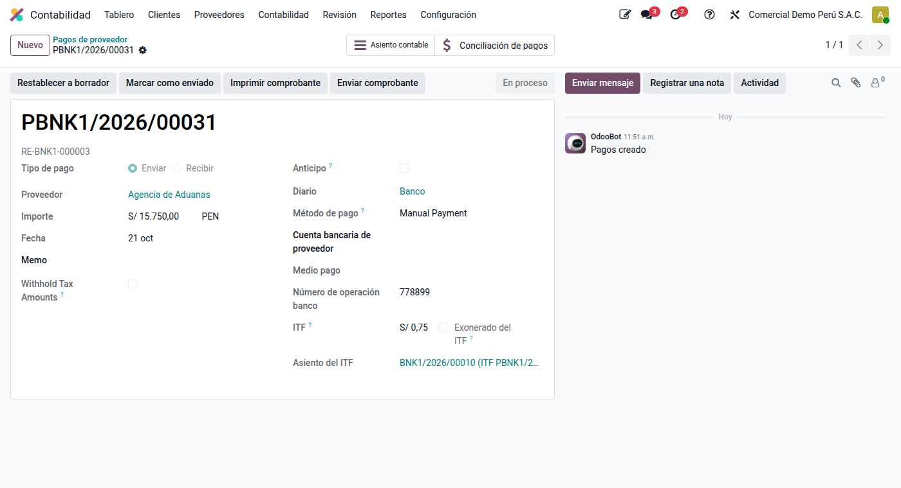
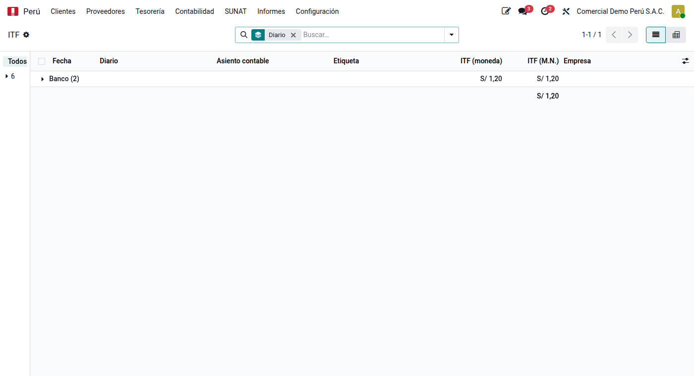

# ITF automático

El **Impuesto a las Transacciones Financieras** (ITF) grava los cargos y abonos en las
cuentas del sistema financiero. Lo retiene y paga el banco; la empresa lo registra como
gasto (PCGE 6412). El módulo **ITF automático** (`al_l10n_pe_itf`) lo registra solo al
confirmar cada pago o cobro de los diarios bancarios afectos.

## Cálculo

La tasa es **0,005 %** del importe de la operación (art. 10 del TUO de la Ley 28194). El
impuesto se expresa con dos decimales: se suprime el tercer decimal y el segundo se ajusta
a **0** si es menor que 5, o a **5** si es mayor (art. 13). En la práctica es el múltiplo
de 0,05 inmediatamente inferior:

| Importe | 0,005 % | ITF |
|---|---|---|
| S/ 999,99 | 0,0499 | 0,00 |
| S/ 1 000,00 | 0,0500 | 0,05 |
| S/ 1 999,99 | 0,0999 | 0,05 |
| S/ 15 750,00 | 0,7875 | 0,75 |
| S/ 30 000,00 | 1,5000 | 1,50 |

En una cuenta en dólares el ITF se calcula en dólares, como lo cobra el banco, y se
registra al tipo de cambio de la fecha del pago.

## Configuración

1. En **Ajustes ‣ Perú ‣ ITF**, revise la tasa (0,005 %) y la cuenta del gasto (vacía, se
   usa la 6412 del plan).
2. En cada diario de banco afecto, abra **Configuración avanzada** y marque **Afecto al
   ITF**. Deje sin marcar las cuentas exoneradas con declaración jurada ante el banco
   (detracciones en el Banco de la Nación, remuneraciones, CTS).

## Al confirmar un pago o cobro

En el formulario del pago se ve el **ITF** que cobrará el banco. Al confirmarlo, Odoo crea
un asiento en el mismo diario: cargo a la 6412 y abono a la cuenta de pagos pendientes del
banco. Al conciliar el extracto, la línea «ITF» del banco se concilia con ese apunte.

Los [pagos múltiples](multiple_payments.md) llevan un solo ITF por el total que sale del
banco.

Si el pago vuelve a borrador o se anula, su asiento de ITF queda anulado; al confirmarlo
otra vez se registra uno nuevo.

## Diarios sin cuenta de pagos pendientes

En Odoo 19 un pago de un diario sin cuenta de pagos pendientes no tiene asiento hasta
conciliar el extracto. Para esos diarios, el módulo crea la regla de conciliación **ITF**:
en la conciliación bancaria, la línea del extracto cuya descripción contiene «ITF» se
registra contra la cuenta del ITF con un clic. Se abre desde **Ajustes ‣ Perú ‣ ITF ‣
Regla de conciliación del extracto**.

## Cuándo no se registra

| Situación | Motivo |
|---|---|
| Transferencia entre cuentas propias o compraventa de moneda | No gravada: cuentas de un mismo titular (art. 9 a) |
| Diario sin marcar «Afecto al ITF» | Cuenta exonerada (Apéndice de la ley) |
| Pago marcado **Exonerado del ITF** | Operación exonerada o no gravada en particular |
| Importe menor que S/ 1 000 | El ITF redondeado es 0,00 |
| Caja | El ITF solo grava las cuentas del sistema financiero |

## Análisis

**Perú ‣ Informes ‣ Análisis ‣ ITF** lista el ITF registrado por banco, con vista pivote
por mes.

