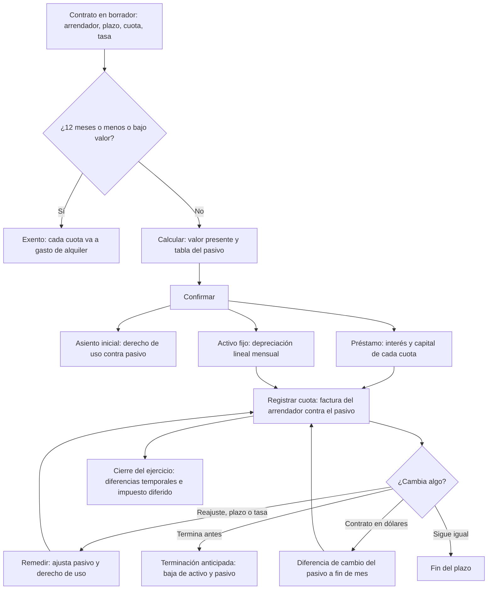
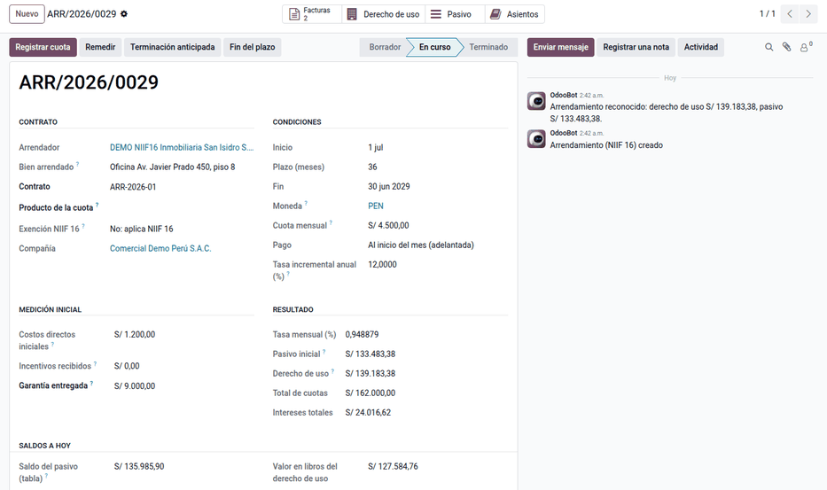
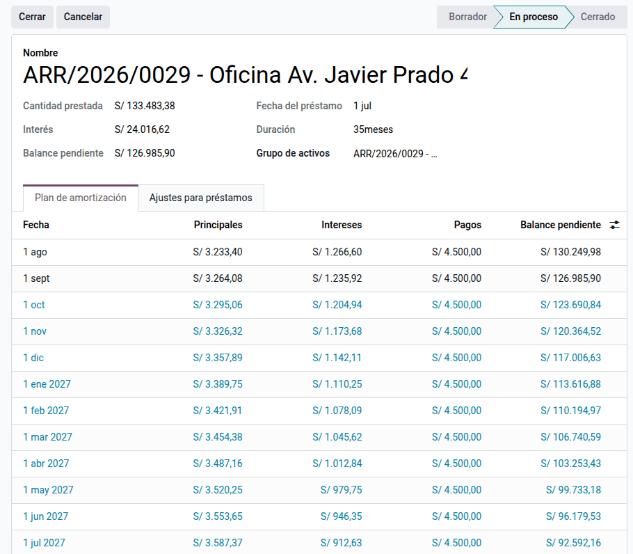
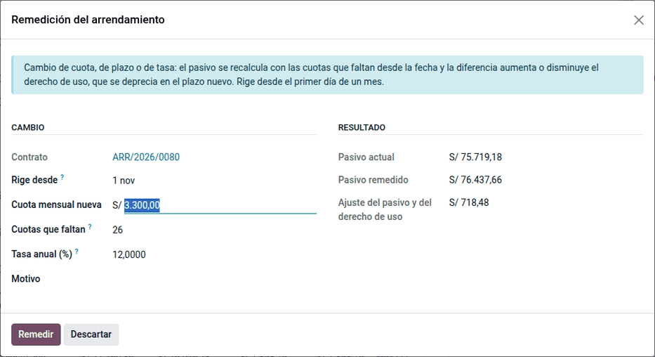
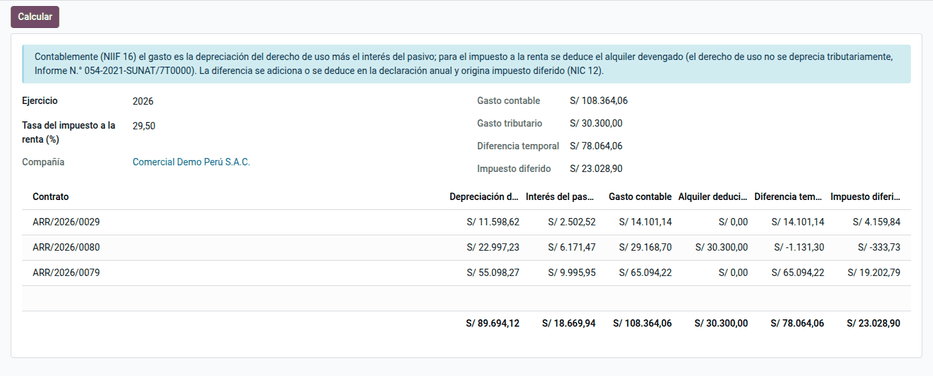

# Arrendamientos (NIIF 16)

Una empresa que alquila oficinas, almacenes, locales o equipos (es
**arrendataria**) y reporta con NIIF plenas no puede registrar el alquiler como
un simple gasto del mes: la NIIF 16 le exige reconocer en el balance un
**pasivo** por las cuotas futuras y un **activo por derecho de uso**. Para el
impuesto a la renta se sigue deduciendo el alquiler, lo que obliga a controlar
una diferencia temporal.

El módulo **Arrendamientos NIIF 16** (`al_l10n_pe_lease`) lleva el contrato de
principio a fin: lo mide, crea el activo y el pasivo, genera cada mes la
depreciación y el interés, prepara la factura del arrendador, permite
**remedir** (reajuste de renta, cambio de plazo o de tasa), **terminar antes de
tiempo**, ajustar por **diferencia de cambio** los contratos en dólares y
calcular el **impuesto diferido**. Lo usan el contador general y el área que
recibe las facturas del arrendador. Requiere Odoo Enterprise, porque usa los
activos y los préstamos de Odoo.

Quedan fuera:

- el arrendador: el módulo es solo para el arrendatario;
- los pagos variables (porcentaje de ventas, consumo, mantenimiento), que se
  facturan aparte, a gasto, y no forman parte del pasivo;
- la garantía entregada al arrendador, que se registra en
  [depósitos y garantías](term_deposits.md);
- el asiento del impuesto diferido: el reporte calcula el importe y el contador
  registra el asiento.

## Configuración

1. Revise en el plan contable las cuentas del PCGE que propone el contrato:
   32331 derecho de uso, 39412 depreciación acumulada, 683111 gasto de
   depreciación, 6732 intereses, 183 transitoria y 6352 gasto de alquiler (para
   los contratos exentos).
2. En el primer contrato, haga clic en **Crear subcuentas del pasivo**: crea la
   4521 (largo plazo) y la 4522 (corto plazo). Con una sola cuenta 452, el
   balance no separa la parte corriente y el contrato muestra un aviso.
3. Cree un producto de servicio «Alquiler de inmueble» con el IGV de compra y
   el tipo de detracción «Arrendamiento de bienes», y elíjalo como **Producto de
   la cuota**.
4. Tenga un diario de **Operaciones misceláneas** para el contrato.
5. Para contratos en dólares, active la moneda, cargue el tipo de cambio diario
   y configure las cuentas de diferencia de cambio de la compañía.
6. Para la terminación, configure las cuentas de **ganancia y pérdida de
   activos** de la compañía; también se pueden indicar en el asistente.
7. Los usuarios de contabilidad operan los contratos; los auditores tienen
   lectura.

## Conceptos

| Término | Significado | En Odoo |
|---|---|---|
| Pasivo por arrendamiento | Valor presente de las cuotas que faltan pagar | **Pasivo inicial**; cuentas 4521 y 4522 |
| Derecho de uso | Activo que representa usar el bien durante el plazo | **Derecho de uso**; activo fijo enlazado |
| Tasa incremental de endeudamiento | Tasa que la empresa pagaría por un préstamo al mismo plazo | **Tasa incremental anual (%)** |
| Cuota adelantada o vencida | Se paga al inicio o al final de cada mes | **Pago** |
| Remedición | Recalcular el pasivo por un cambio del contrato | Botón **Remedir** |
| Diferencia temporal | Gasto contable − gasto deducible | Menú **Diferencias temporales** |

- **NIIF 16:** el arrendatario reconoce el derecho de uso y el pasivo, salvo las
  exenciones de corto plazo (12 meses o menos) y de bajo valor. La tasa es la
  implícita del contrato si se conoce; si no, la tasa incremental.
- **PCGE 2019:** incorporó las cuentas del derecho de uso (32x), su
  depreciación acumulada (39x) y su gasto (68x).
- **Impuesto a la renta:** se deducen los gastos necesarios (art. 37) en el
  ejercicio en que se devengan (art. 57). Según SUNAT, el derecho de uso **no es
  activo fijo ni intangible**: no se deprecia para el impuesto y lo deducible es
  el alquiler devengado. El derecho de uso **sí integra la base del ITAN**.
- **NIC 12:** la diferencia entre el gasto contable y el deducible es temporal y
  genera impuesto diferido, a la tasa del 29,5 % (art. 55 de la LIR).
- **NIC 21:** el pasivo en dólares es una partida monetaria y se ajusta al
  cierre; el derecho de uso es no monetario y queda al tipo de cambio del
  inicio.
- **IGV y detracción:** el arrendamiento de bienes está en el Anexo 3 del
  sistema de detracciones, con el 10 %.

## Registrar el contrato

1. Vaya a **Perú ‣ Contabilidad ‣ Arrendamientos ‣ Contratos** y haga clic en **Nuevo**.
   Indique el arrendador, el plazo, la cuota, el **Pago** (adelantado o
   vencido) y la **Tasa incremental anual (%)**. Si el contrato dura 12 meses o
   menos, se marca **Corto plazo**.
2. Haga clic en **Calcular**: se obtienen el pasivo, el derecho de uso y la
   tabla del pasivo.
3. Haga clic en **Confirmar**: se crean el asiento inicial, el activo fijo y el
   préstamo, y el contrato pasa a **En curso**, o a **Exento** si es de corto
   plazo o bajo valor. En un contrato exento, cada cuota va a gasto de alquiler.

!!! tip "Consejo"
    Si la empresa prefiere aplicar la NIIF 16 a un contrato de 12 meses o menos,
    cambie la exención a **No** antes de confirmar.

### Ejemplo

Comercial Demo Perú S.A.C. alquila el *Depósito Ate* desde el 01/01/2026 por 36
meses, con una cuota de S/ 3 000 sin IGV pagada al inicio de cada mes y una tasa
incremental del 12 % anual (contrato de demostración ARR/2026/0080):

- tasa mensual = 1,12^(1/12) − 1 = **0,948879 %**;
- pasivo = valor presente de las 35 cuotas que faltan, porque la de enero se
  paga al firmar: 3 000 × Σ 1/(1 + r)^k, k = 1…35 = **S/ 88 988,92**;
- derecho de uso = pasivo + cuota adelantada = 88 988,92 + 3 000 =
  **S/ 91 988,92**, que se deprecia en 36 meses: S/ 2 555,25 al mes.

| Cuenta | Descripción | Debe | Haber |
|---|---|---|---|
| 32331 | Derecho de uso – edificaciones | 91 988,92 | |
| 4521 | Pasivo por arrendamiento – largo plazo | | 88 988,92 |
| 183 | Cuota de enero pagada por adelantado (transitoria) | | 3 000,00 |
| | **Totales** | **91 988,92** | **91 988,92** |

La cuota que se paga al firmar no es pasivo, porque ya se pagó: forma parte del
derecho de uso, y la factura de enero del arrendador carga la 183 y la salda.

## Registrar las cuotas

Cada mes, el activo registra la depreciación (683111 al debe y 39412 al haber,
por S/ 2 555,25 en el ejemplo) y el préstamo registra el interés y el capital de
la cuota. En febrero: interés = 88 988,92 × 0,948879 % = 844,40; capital =
3 000 − 844,40 = 2 155,60.

| Cuenta | Descripción | Debe | Haber |
|---|---|---|---|
| 4521 | Capital del pasivo (largo plazo) | 2 155,60 | |
| 6732 | Intereses del arrendamiento | 844,40 | |
| 4522 | Cuota por pagar (corto plazo) | | 3 000,00 |
| | **Totales** | **3 000,00** | **3 000,00** |

Para la factura del arrendador, haga clic en **Registrar cuota**: se crea una
factura de proveedor en borrador contra el pasivo de corto plazo, con el IGV y
la detracción del producto. Complete el número de comprobante del proveedor y
confírmela.

| Cuenta | Descripción | Debe | Haber |
|---|---|---|---|
| 4522 | Cuota por pagar (corto plazo) | 3 000,00 | |
| 40111 | IGV de la cuota (18 %) | 540,00 | |
| 4212 | Proveedor (arrendador) | | 3 540,00 |
| | **Totales** | **3 540,00** | **3 540,00** |

Como la factura supera S/ 700, el pago lleva la detracción del 10 %
(S/ 354,00), que gestiona el módulo de
[detracciones](../fiscal_localizations/peru/detractions.md).

!!! note "Nota"
    Contablemente, el gasto del mes es depreciación (683) más interés (673), no
    el alquiler. Al inicio el gasto contable es mayor, porque el interés se
    calcula sobre un saldo de pasivo más alto; la diferencia temporal se revierte
    en los últimos años del contrato. Un pago variable o un mantenimiento en la
    misma factura van en una línea aparte, a gasto.

## Remedir el contrato

Use **Remedir** cuando cambie la renta (por ejemplo, un reajuste por
inflación, con la cuota nueva y la misma tasa), el plazo (una prórroga, con más
cuotas y la tasa revisada a la fecha) o la tasa. El asistente ajusta el pasivo y
el derecho de uso, crea un préstamo nuevo y deja el cambio en el historial.

En el ejemplo, desde el 01/10/2026 la renta sube a S/ 3 300. Antes del cambio,
el pasivo pendiente es **S/ 71 160,39**, el saldo tras la cuota de setiembre.
Con 27 cuotas de S/ 3 300, la de octubre pagada ese mismo día, el pasivo
remedido es 3 300 + 3 300 × Σ 1/(1 + r)^k, k = 1…26 = **S/ 79 019,18**. La
diferencia, **S/ 7 858,79**, aumenta el derecho de uso:

| Cuenta | Descripción | Debe | Haber |
|---|---|---|---|
| 32331 | Derecho de uso (aumento bruto) | 7 858,79 | |
| 4521 | Pasivo por arrendamiento – largo plazo | | 7 858,79 |
| | **Totales** | **7 858,79** | **7 858,79** |

El aumento se deprecia en los 27 meses que faltan (S/ 291,07 al mes). El
préstamo nuevo lleva la tabla remedida: la cuota de octubre sin interés, porque
se paga el mismo día, y la de noviembre con un interés de
(79 019,18 − 3 300) × 0,948879 % = **718,48**.

!!! warning "Importante"
    La remedición y la terminación rigen desde el **primer día de un mes** sin
    asientos del préstamo ni del activo contabilizados desde esa fecha; los
    asientos posteriores se rehacen. Si el sistema avisa «Ya hay asientos
    contabilizados desde…», elija el primer día del mes siguiente al último
    asiento contabilizado. Si la remedición reduce el pasivo más que el valor del
    derecho de uso, el exceso va a la cuenta de ganancia de activos.

## Contratos en dólares

A fin de mes, la acción programada ajusta el pasivo al tipo de cambio de
cierre; también se puede hacer con **Diferencia de cambio** en el contrato. El
derecho de uso queda en soles al tipo de cambio del inicio.

Ejemplo con el contrato de demostración ARR/2026/0079 (USD 2 000 adelantados,
36 meses, 8 %): pasivo USD 62 499,00 y derecho de uso USD 64 499,00; al tipo de
cambio del inicio (3,417) el derecho de uso queda en **S/ 220 393,08**. Al
30/09/2026 el tipo de cambio bajó a 3,40 y se registra la ganancia:

| Cuenta | Descripción | Debe | Haber |
|---|---|---|---|
| 4521 | Pasivo por arrendamiento – largo plazo | 1 112,21 | |
| 776 | Diferencia de cambio (ganancia) | | 1 112,21 |
| | **Totales** | **1 112,21** | **1 112,21** |

## Terminar el contrato

- Si el contrato termina antes, haga clic en **Terminación anticipada**: se dan
  de baja el derecho de uso (pérdida) y el pasivo (ganancia) y el contrato pasa
  a **Terminado**. Un contrato confirmado no se cancela: se termina.
- Al vencer el plazo, haga clic en **Fin del plazo**.

Ejemplo de terminación con una cuota de S/ 1 000, 36 meses, 12 %, terminado
desde el 01/10/2026: derecho de uso original S/ 30 662,97, depreciado 9 meses
(9 × 851,75 = 7 665,75), con un valor en libros de S/ 22 997,22, y un pasivo
pendiente de S/ 23 720,13.

| Cuenta | Descripción | Debe | Haber |
|---|---|---|---|
| 39412 | Depreciación acumulada del derecho de uso | 7 665,75 | |
| (pérdida de activos) | Valor en libros dado de baja | 22 997,22 | |
| 32331 | Derecho de uso | | 30 662,97 |
| 4521 | Pasivo pendiente dado de baja | 23 720,13 | |
| (ganancia de activos) | Pasivo dado de baja | | 23 720,13 |
| | **Totales** | **54 383,10** | **54 383,10** |

El resultado neto es una ganancia de S/ 722,91. Las cuotas ya devengadas se
siguen facturando, y una penalidad del arrendador se registra con su factura, a
gasto.

## Reportes

- **Perú ‣ Contabilidad ‣ Arrendamientos ‣ Tabla de cuotas** y **Análisis**: interés, capital y
  saldo por contrato y año.
- **Saldos a hoy**, en cada contrato: pasivo según la tabla, pasivo en el libro
  y su diferencia, y valor en libros del derecho de uso. La diferencia es cero
  en soles; en dólares, es la diferencia de cambio aún no registrada.
- **Historial** del contrato: remediciones, terminación y diferencias de cambio
  con sus asientos.
- **Perú ‣ Contabilidad ‣ Arrendamientos ‣ Diferencias temporales**: para la declaración anual
  y el impuesto diferido.
- El derecho de uso aparece en los **Activos** de Odoo y el pasivo en los
  **Préstamos**. Los asientos van al libro diario y al mayor de los
  [libros electrónicos](../fiscal_localizations/peru/ple.md); las facturas del
  arrendador, al registro de compras del [SIRE](../fiscal_localizations/peru/sire.md).
- El valor del derecho de uso del balance forma parte de la base del ITAN.

### Diferencia temporal del ejercicio

Con los importes del ejemplo en 2026:

| Concepto | Importe (S/) |
|---|---|
| Depreciación del derecho de uso (enero–diciembre) | 31 536,17 |
| Interés del pasivo (enero–diciembre) | 7 583,94 |
| **Gasto contable (NIIF 16)** | **39 120,11** |
| Alquiler deducible: 9 × 3 000 + 3 × 3 300 | 36 900,00 |
| **Diferencia temporal** (se adiciona en la declaración) | **2 220,11** |
| Impuesto diferido (activo) al 29,5 % | 654,93 |

## Casos especiales

| Situación | Qué pasa | Qué hacer |
|---|---|---|
| **Diferencia con el libro** distinta de cero en soles | Hay cuotas sin factura o asientos manuales sobre el pasivo | Revisar las facturas del arrendador y los asientos del historial |
| Contrato en dólares sin tipo de cambio | No se puede medir ni ajustar | Registrar el tipo de cambio de la fecha |
| Factura del arrendador en borrador | **Registrar cuota** la deja así | Completar el número de comprobante del proveedor y confirmarla |

## Datos de demostración

Una base creada **con datos de demostración** carga, al instalar el módulo, un
ejemplo completo en la compañía **PE Company** (la compañía peruana de la demo
de Odoo, con el plan contable de Perú). Los registros llevan el prefijo **DEMO
NIIF16** y las fechas se calculan respecto del día de la instalación. En una
base sin datos de demostración no se carga nada.

- Oficina a 36 meses con cuota adelantada de S/ 4 500, confirmada y con sus dos
  primeras facturas.
- Almacén a 12 meses, exento por corto plazo.
- Montacargas a 24 meses en borrador con su tabla.
- Depósito con subcuentas del pasivo, remedido por el reajuste de la renta a S/
  3 300.

!!! info "Ver también"
    - [NIIF 16 Arrendamientos (IFRS Foundation)](https://www.ifrs.org/issued-standards/list-of-standards/ifrs-16-leases/) y [en español (MEF)](https://mef.gob.pe/contenidos/conta_publ/con_nor_co/niif/NIIF_16_BV2024_IRACH.pdf)
    - [NIC 12 Impuesto a las ganancias](https://www.ifrs.org/issued-standards/list-of-standards/ias-12-income-taxes/) y [NIC 21 Variaciones en las tasas de cambio](https://www.ifrs.org/issued-standards/list-of-standards/ias-21-the-effects-of-changes-in-foreign-exchange-rates/)
    - [PCGE 2019](https://cdn.www.gob.pe/uploads/document/file/315820/PCGE_2019.pdf) y la [Resolución 002-2019-EF/30](https://mef.gob.pe/contenidos/conta_publ/documentac/Resolucion_CNC002_2019EF30.pdf)
    - [Informe 054-2021-SUNAT/7T0000: derecho de uso, ITAN e impuesto a la renta](https://www.sunat.gob.pe/legislacion/oficios/2021/informe-oficios/i054-2021-7T0000.pdf)
    - Ley del Impuesto a la Renta: [art. 37](https://www.sunat.gob.pe/legislacion/renta/ley/capvi.pdf), [art. 55](https://www.sunat.gob.pe/legislacion/renta/ley/capvii.pdf) y [art. 57](https://www.sunat.gob.pe/legislacion/renta/ley/capviii.pdf)
    - [R.S. 183-2004/SUNAT: sistema de detracciones](https://www.sunat.gob.pe/legislacion/superin/2004/183.htm) y la [cartilla de detracciones](https://orientacion.sunat.gob.pe/sites/default/files/inline-files/Cartilla_detracciones.pdf)
    - Odoo: [activos](https://www.odoo.com/documentation/19.0/es/applications/finance/accounting/vendor_bills/assets.html), [préstamos](https://www.odoo.com/documentation/19.0/es/applications/finance/accounting/bank/loans.html) y [gastos diferidos](https://www.odoo.com/documentation/19.0/es/applications/finance/accounting/vendor_bills/deferred_expenses.html)
    - [Depósitos a plazo y garantías](term_deposits.md)
