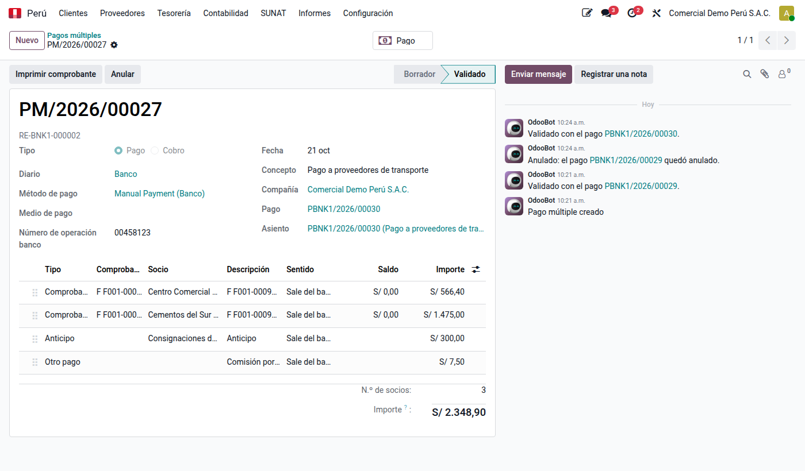
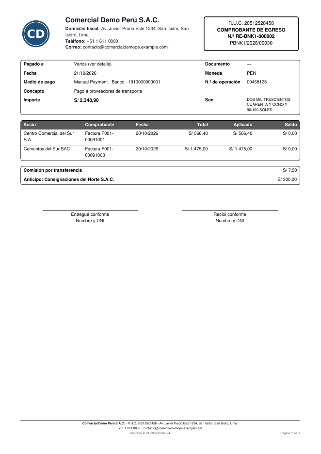

# Pago múltiple

Un **pago múltiple** es un solo movimiento de banco o caja que cancela varios
conceptos a la vez: facturas de distintos proveedores, un anticipo, una comisión
bancaria. El **cobro múltiple** es lo mismo en sentido inverso: un depósito que cubre
facturas de varios clientes. Lo registra el módulo **Pago múltiple**
(`al_l10n_pe_payment_multi`).

Al validarlo, Odoo crea **un solo pago**: un apunte de banco por el total y una
contrapartida por cada línea. Por eso el extracto bancario se concilia con un solo
movimiento y el [comprobante de pago](payment_receipts.md) muestra el detalle de lo
que se pagó a cada socio.

## Tipos de línea

| Tipo | Qué paga | Cuenta |
|---|---|---|
| Comprobante | El saldo de una factura, nota de crédito o cuota abierta de cualquier socio, total o parcial | La del comprobante (4212, 1212…) |
| Anticipo | Un adelanto al proveedor (o del cliente) sin comprobante | 422 (o 122), según [Anticipos](advances.md) |
| Otro pago | Un gasto o ingreso sin comprobante: comisión, ITF, movilidad | La que elija, con distribución analítica |

El **sentido** de cada línea indica si el importe **sale del banco** (se paga) o
**entra al banco** (se descuenta del pago). Una nota de crédito del proveedor entra
y reduce el total; el importe del pago es lo que sale menos lo que entra.

## Registrar un pago múltiple

1. Vaya a **Perú ‣ Proveedores ‣ Pagos múltiples** (o **Contabilidad ‣ Proveedores ‣
   Pagos múltiples**) y haga clic en **Nuevo**.
2. Elija el **diario** de banco o caja, la **fecha**, el **medio de pago** y el
   **número de operación**.
3. Agregue las líneas:
    - Para traer comprobantes, indique uno o varios **socios** y haga clic en
      **Cargar documentos**: aparecen sus saldos abiertos con el importe completo.
      Sin socios, trae todos los comprobantes por pagar abiertos.
    - Corrija el **importe** de las que paga en parte y use **Quitar sin importe**
      para limpiar las que no paga.
    - Agregue líneas de **anticipo** (socio e importe) o de **otro pago**
      (descripción, cuenta e importe).
4. Haga clic en **Validar**. Se crea el pago, cada comprobante queda conciliado y,
   si el diario numera comprobantes de pago, se asigna el número.
5. Haga clic en **Imprimir comprobante**.

También puede seleccionar varias facturas en la lista de **Facturas de proveedores** y
elegir **Acción ‣ Pago múltiple**: se abre un pago múltiple con sus cuotas abiertas.

Los **cobros múltiples** están en **Perú ‣ Clientes ‣ Cobros múltiples** y funcionan
igual, con las facturas de clientes.

## El comprobante de pago

El comprobante de egreso (o recibo de ingreso) dice **Varios (ver detalle)** en el
socio y agrega la columna **Socio** al detalle de comprobantes. Los anticipos y
otros pagos aparecen con su descripción.

## Moneda extranjera

El importe de cada comprobante se indica **en su moneda** y se convierte al cambio de
la **fecha del pago**. Una factura de 100 USD registrada a 3,70 y pagada desde un
banco en soles cuando el dólar vale 3,80 consume S/ 380; Odoo registra los S/ 10 de
diferencia de cambio al conciliar.

## Anular

**Anular** deja el pago anulado (su asiento queda anulado, no se borra) y los
comprobantes vuelven a quedar abiertos. **Volver a borrador** permite corregirlo; al
validarlo otra vez se crea un pago nuevo con otro número de comprobante. El pago de
un pago múltiple no se anula desde el propio pago, solo desde su pago múltiple.

## Casos especiales

| Situación | Qué pasa |
|---|---|
| Factura sujeta a retención del IGV | Se rechaza: páguela con **Registrar pago**, que emite el comprobante de retención de ese proveedor |
| Cuota de detracción (cuenta de detracciones) | No se carga: se deposita en el Banco de la Nación con **Registrar depósito** ([Detracciones](../fiscal_localizations/peru/detractions.md)) |
| Importe mayor que el saldo | Se rechaza |
| Lo que entra supera a lo que sale | Se rechaza: el importe debe ser positivo |
| Otro pago a una cuenta de banco o caja | Se rechaza: use una transferencia interna |
| Diario sin cuenta de pagos pendientes | El pago usa la cuenta de pendientes de Odoo para tener asiento desde el primer momento |
