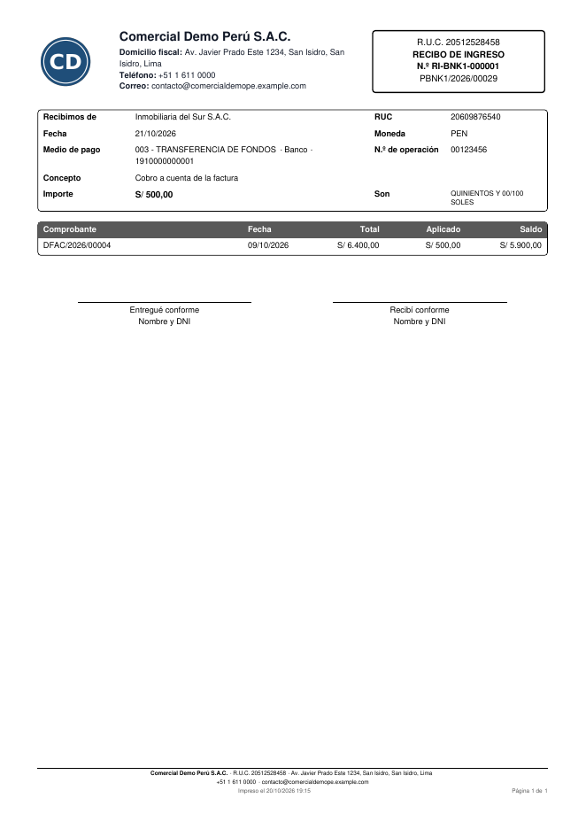

# Comprobante de pago

El **recibo de ingreso** (por cada cobro) y el **comprobante de egreso** (por cada
pago) son el documento interno que entrega o firma quien recibe el dinero. Odoo
imprime un recibo genérico con el número del asiento; el módulo **Comprobante de
pago** (`al_l10n_pe_payment_receipt`) agrega una **serie propia por diario**, sin
huecos, y el formato de los documentos de la suite.

## Configuración

1. Vaya a **Contabilidad ‣ Configuración ‣ Diarios** y abra el diario de banco o
   de caja.
2. En **Configuración avanzada ‣ Comprobante de pago**, active **Comprobante de
   pago numerado**. Odoo crea dos series: `RI-<código del diario>-` para los
   cobros y `RE-<código del diario>-` para los pagos.

## Uso

1. Registre el cobro o el pago como siempre (desde la factura con **Pagar** o
   desde **Pagos**), con el **medio de pago** SUNAT y el **número de operación**.
2. Al **confirmar**, el pago recibe su número (por ejemplo `RI-BNK1-000001`).
   Si vuelve a borrador y se confirma otra vez, conserva el mismo número.
3. Haga clic en **Imprimir comprobante** o **Enviar comprobante** (por correo con el
   PDF adjunto). Desde la lista de pagos se imprimen varios a la vez.

El PDF muestra:

- el socio con su tipo y número de documento, la fecha y la moneda;
- el medio de pago, el banco y la cuenta, y el número de operación;
- el importe en números y en letras («QUINIENTOS Y 00/100 SOLES»);
- los **comprobantes aplicados** con su total, lo aplicado y el saldo que queda
  (también si el pago es parcial o cubre varias facturas);
- otros conceptos del asiento (retención, diferencias) y lo que queda **a
  cuenta** (anticipo);
- las firmas «Entregué conforme» y «Recibí conforme».

## Casos especiales

| Situación | Qué pasa |
|---|---|
| Diario sin cuenta de pagos pendientes | El pago no tiene asiento hasta conciliar el extracto; el detalle reparte el importe entre las facturas del pago por fecha |
| Transferencia entre cuentas propias | No lleva comprobante |
| Pago en un diario sin la opción | No lleva número; **Imprimir comprobante** no aparece |
| Pago anulado | Conserva su número: la serie no se reutiliza |

!!! info "Ver también"
    - [Medios de pago SUNAT](../fiscal_localizations/peru/payment_methods.md)
    - [Anticipos y aplicación de documentos](advances.md)
