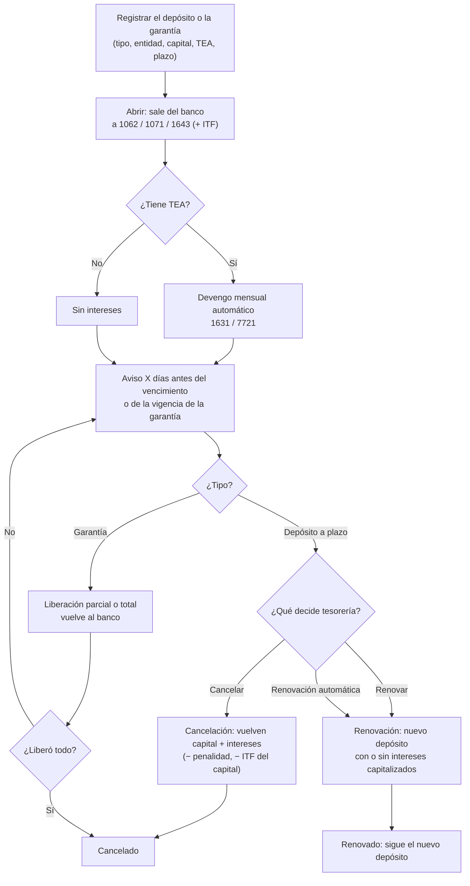
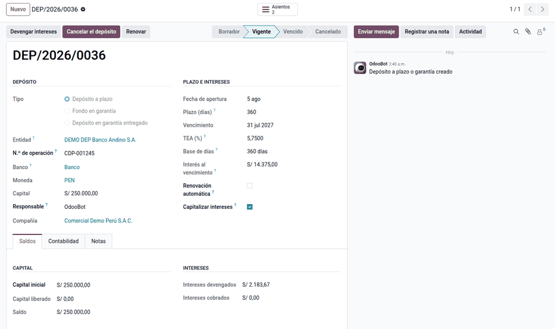
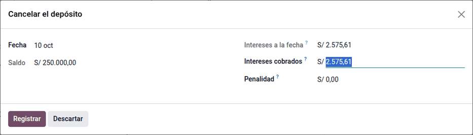
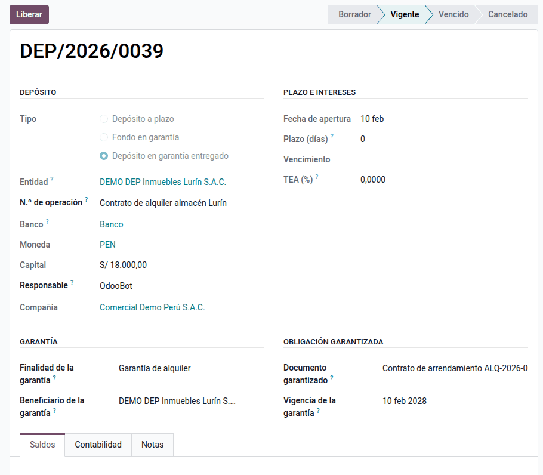
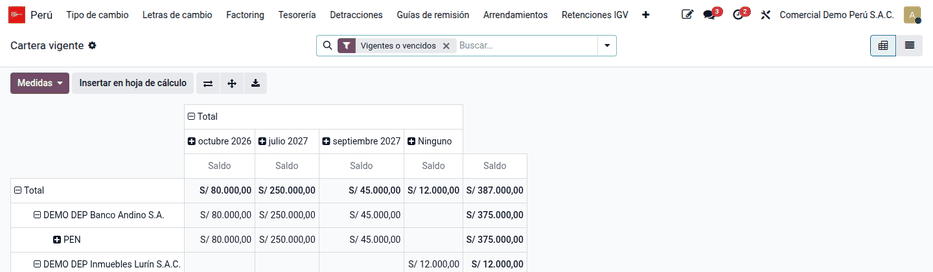

# Depósitos a plazo y garantías

Las empresas inmovilizan dinero de tres formas: lo **colocan a plazo** en un
banco para ganar intereses, lo dejan **retenido por el banco** como respaldo de
una carta fianza, o lo **entregan en garantía** a un tercero, típicamente al
arrendador de una oficina o un almacén. En los tres casos el dinero sigue siendo
de la empresa, pero ya no está en la cuenta corriente, y hay que controlar
cuánto hay, dónde, hasta cuándo y cuánto rinde.

El módulo **Depósitos a plazo y garantías** (`al_l10n_pe_term_deposit`) lleva
ese ciclo con su contabilidad: apertura, devengo mensual de intereses, aviso
antes del vencimiento, cancelación (también anticipada, con penalidad),
renovación y liberación de garantías, con el ITF opcional. Lo usan tesorería,
que opera los depósitos, y contabilidad, que revisa los asientos y los cierres.

Quedan fuera:

- la conexión con los bancos: los datos del certificado o del contrato se
  registran a mano;
- la diferencia de cambio de los depósitos en moneda extranjera, que calcula
  la [diferencia de cambio](../fiscal_localizations/peru/exchange_differences.md)
  de la suite o la revaluación de Odoo;
- la emisión de cartas fianza y la línea de crédito del banco: solo se registra
  el dinero que la empresa deja como respaldo;
- el alquiler en sí, que es de [arrendamientos](leases.md): aquí solo va la
  garantía entregada al arrendador.

## Configuración

1. Vaya a **Perú ‣ Configuración ‣ Cuentas de la localización ‣ Depósitos y
   garantías**. Las compañías peruanas reciben las cuentas del PCGE (1062,
   1071, 1643, 1631 y 7721). Agregue una fila por moneda si usa cuentas
   distintas en dólares, y la cuenta de penalidad si quiere separarla del
   ingreso.
2. En **Ajustes ‣ Perú ‣ Depósitos y garantías**, indique los **Días de aviso**
   del vencimiento (7 por defecto) y, si corresponde, active el **ITF** con su
   tasa (0,005 %) y su cuenta (6412).
3. Prepare un diario de banco por cuenta bancaria, de donde sale y adonde
   vuelve el dinero, y un diario de varios para el devengo de intereses.
4. Para depósitos en moneda extranjera, marque las cuentas 1062, 1071, 1643 y
   1631 en dólares para el cierre de tipo de cambio en **Contabilidad ‣
   Configuración ‣ Plan contable**. Si no lo hace, el formulario del depósito
   muestra un aviso.
5. Los usuarios de contabilidad operan los depósitos; las cuentas las configura
   el responsable contable.

## Conceptos

| Término | Significado | En Odoo |
|---|---|---|
| Depósito a plazo | Dinero colocado en un banco por un plazo fijo a una tasa pactada | Tipo **Depósito a plazo** |
| Fondo en garantía | Dinero de la empresa que el banco retiene como respaldo, por ejemplo de una carta fianza | Tipo **Fondo en garantía** |
| Depósito en garantía entregado | Dinero entregado a un tercero que lo devolverá, por ejemplo la garantía del alquiler | Tipo **Depósito en garantía entregado** |
| TEA | Tasa efectiva anual del depósito | Campo **TEA (%)** |
| Base de días | 360 (año comercial) o 365 (calendario), según el contrato | Campo **Base de días** |
| Devengo | Reconocer el interés ganado en el mes aunque se cobre al vencimiento | Acción programada mensual y botón **Devengar intereses** |
| Capitalizar | Sumar los intereses al capital del nuevo depósito al renovar | **Capitalizar intereses** |
| Penalidad | Lo que el banco descuenta por cancelar antes del vencimiento | Asistente **Cancelar el depósito** |
| ITF | Impuesto a las Transacciones Financieras (0,005 %) | Ajustes y **Afecto al ITF** |

El banco informa la **TEA** y la TREA, y un retiro antes del plazo puede
reducir la tasa pactada (SBS). El interés es compuesto:
`capital × ((1 + TEA)^(días/base) − 1)`. El ITF grava débitos y créditos en el
sistema financiero, pero las exoneraciones del Apéndice exigen una declaración
jurada ante el banco: por eso es **opcional por depósito**. El pago o abono de
intereses, su capitalización y la renovación sin dinero nuevo **no pagan ITF**
(Informe SUNAT 025-2004): el módulo lo calcula solo sobre el **capital**.

Para una empresa, los intereses son renta de **tercera categoría** y se
reconocen por **devengo**, mes a mes, no cuando se cobran: entran a los pagos a
cuenta y a la declaración anual como cualquier ingreso. El módulo no calcula
retenciones sobre intereses; confirme con el asesor tributario los casos
especiales (no domiciliados, personas naturales).

## Abrir un depósito

1. Vaya a **Perú ‣ Tesorería ‣ Depósitos y garantías** y haga clic en
   **Nuevo**. Elija el tipo, la entidad, el capital, la **TEA (%)**, la **Base
   de días** y el plazo. El borrador recibe el número `DEP/AAAA/NNNN` y las
   cuentas propuestas por tipo y moneda.
2. Si la cuenta está exonerada del ITF (la empresa presentó la declaración
   jurada al banco), desmarque **Afecto al ITF**.
3. Haga clic en **Abrir**: se genera el asiento de apertura y el depósito pasa
   a **Vigente**.

!!! note "Nota"
    Un borrador se edita o se elimina. Un depósito abierto ya no se elimina: se
    cancela con su asiento.

### Ejemplo

Comercial Demo Perú S.A.C. (soles), con el ITF activado, coloca el 01/01/2026
**S/ 100 000** a plazo fijo por **180 días** (vence el 30/06/2026), con una
**TEA del 6 %** y base 360. El interés del plazo es
100 000 × ((1,06)^(180/360) − 1) = **S/ 2 956,30**.

Apertura, con el ITF del capital (100 000 × 0,005 % = S/ 5,00):

| Cuenta | Descripción | Debe | Haber |
|---|---|---|---|
| 1062 | Depósitos a plazo (Banco) | 100 000,00 | |
| 6412 | ITF | 5,00 | |
| 1041 | Banco — cuenta corriente | | 100 005,00 |
| | **Total** | **100 005,00** | **100 005,00** |

## Devengar intereses

La acción programada diaria devenga hasta el último cierre de mes: el devengo
del mes anterior se registra el día 1. También se puede devengar a la fecha con
**Devengar intereses**. Cada asiento registra la diferencia entre el interés
acumulado y lo ya devengado: nunca duplica ni pasa del vencimiento.

| Cierre | Días desde la apertura | Acumulado | Devengo del mes |
|---|---|---|---|
| 31/01/2026 | 30 | 486,76 | 486,76 |
| 28/02/2026 | 58 | 943,20 | 456,44 |
| 31/03/2026 | 89 | 1 450,96 | 507,76 |
| 30/04/2026 | 119 | 1 944,78 | 493,82 |
| 31/05/2026 | 150 | 2 457,58 | 512,80 |
| 30/06/2026 | 180 | 2 956,30 | 498,72 |
| | | **Total** | **2 956,30** |

Asiento de enero:

| Cuenta | Descripción | Debe | Haber |
|---|---|---|---|
| 1631 | Intereses por cobrar | 486,76 | |
| 7721 | Rendimientos ganados — depósitos | | 486,76 |
| | **Total** | **486,76** | **486,76** |

Los días antes del vencimiento indicados en los ajustes, el **Responsable**
recibe la actividad «Vence DEP/…». Si el depósito vence sin decisión, pasa a
**Vencido**, con los intereses devengados hasta el vencimiento, y se cancela o
renueva después con la fecha real.

## Cancelar un depósito

Haga clic en **Cancelar el depósito** e indique lo que pagó el banco. Al
vencimiento del ejemplo vuelven el capital y los intereses; el ITF se calcula
solo sobre el capital (100 000 × 0,005 % = S/ 5,00):

| Cuenta | Descripción | Debe | Haber |
|---|---|---|---|
| 1041 | Banco — cuenta corriente | 102 951,30 | |
| 6412 | ITF | 5,00 | |
| 1062 | Depósitos a plazo | | 100 000,00 |
| 1631 | Intereses por cobrar | | 2 956,30 |
| | **Total** | **102 956,30** | **102 956,30** |

Resultado del depósito: ingreso 2 956,30 − ITF 10,00 = **S/ 2 946,30**.

### Cancelación anticipada

Al 31/03/2026 hay S/ 1 450,96 devengados. El banco paga solo **S/ 1 000** de
intereses y descuenta una **penalidad de S/ 150** (sin ITF en este caso, para
ver solo el efecto de la penalidad). Sin cuenta de penalidad configurada, la
penalidad rebaja el ingreso: ajuste a 7721 = 1 450,96 − 1 000 + 150 = 600,96.

| Cuenta | Descripción | Debe | Haber |
|---|---|---|---|
| 1041 | Banco (100 000 + 1 000 − 150) | 100 850,00 | |
| 7721 | Ajuste de intereses | 600,96 | |
| 1062 | Depósitos a plazo | | 100 000,00 |
| 1631 | Intereses por cobrar | | 1 450,96 |
| | **Total** | **101 450,96** | **101 450,96** |

Con una cuenta de penalidad, por ejemplo 6391 Gastos bancarios, la penalidad va
a esa cuenta y el ajuste a 7721 queda en 450,96 (6391 150,00 + 7721 450,96 al
debe).

!!! tip "Consejo"
    El ITF propuesto es el importe por la tasa, redondeado. Si el banco cobró
    otro importe, corríjalo en el depósito (apertura) o en el asistente
    (cancelación o liberación).

## Renovar un depósito

Haga clic en **Renovar** y elija si se capitalizan los intereses. Se crea un
depósito nuevo vigente, y el anterior queda **Renovado** y enlazado. Con
**Renovación automática** marcada, el sistema crea el depósito nuevo al vencer,
con el mismo plazo y la misma tasa.

Renovación del ejemplo por otros 180 días con los intereses capitalizados:
nuevo capital 102 956,30, sin ITF porque no hay dinero nuevo.

| Cuenta | Descripción | Debe | Haber |
|---|---|---|---|
| 1062 | Depósito nuevo | 102 956,30 | |
| 1062 | Depósito anterior | | 100 000,00 |
| 1631 | Intereses por cobrar | | 2 956,30 |
| | **Total** | **102 956,30** | **102 956,30** |

## Registrar y liberar garantías

Registre la garantía con su tipo, la **Finalidad**, el documento y la
**Vigencia de la garantía**, que da la fecha del aviso. Una garantía de alquiler
normalmente no genera intereses: deje la TEA en 0, salvo que el contrato los
pacte. Para el fondo que respalda una carta fianza, registre solo el dinero que
retiene el banco; la fianza y su comisión son de la línea del banco.

Cuando el tercero o el banco devuelve dinero, haga clic en **Liberar** e
indique el importe; al liberar todo, la garantía se cancela. Un depósito a
plazo no se libera: se cancela o se renueva.

Ejemplo: entrega de S/ 18 000 al arrendador de un almacén (finalidad
«Garantía de alquiler», documento «Contrato de arrendamiento ALQ-2026-003»),
sin intereses ni ITF. A los 7 meses el arrendador devuelve S/ 6 000.

| Momento | Cuenta | Debe | Haber |
|---|---|---|---|
| Entrega | 1643 Depósitos en garantía — alquileres | 18 000,00 | |
| | 1041 Banco | | 18 000,00 |
| Devolución parcial | 1041 Banco | 6 000,00 | |
| | 1643 Depósitos en garantía — alquileres | | 6 000,00 |
| | **Totales** | **24 000,00** | **24 000,00** |

Queda un saldo de S/ 12 000; al devolver el resto, **Liberar** por 12 000
cierra la garantía.

## Reportes

- **Perú ‣ Tesorería ‣ Cartera vigente**: saldo por entidad, moneda y mes de
  vencimiento. Sirve para el flujo de caja y para cuadrar las cuentas 106, 107
  y 164.
- **Perú ‣ Tesorería ‣ Intereses devengados**: ingreso por intereses
  (**Ingreso**) y ajustes (**Ajuste**) por depósito y mes, en soles; cuadra con
  la 7721 del mes.
- **Perú ‣ Tesorería ‣ Análisis de depósitos**: saldo e intereses por tipo,
  entidad y estado.
- Los asientos entran al libro diario y al mayor de los
  [libros electrónicos](../fiscal_localizations/peru/ple.md), y los saldos de
  1062, 1071 y 164x al balance.
- El gasto 6412 del mes ayuda a cuadrar lo que retiene el banco, que declara y
  paga el ITF como agente de retención.

## Casos especiales

| Situación | Qué pasa | Qué hacer |
|---|---|---|
| «Configure las cuentas de …» al abrir | Falta la fila de cuentas del tipo o la moneda | Crearla en **Perú ‣ Configuración ‣ Cuentas de la localización** |
| El banco pagó menos intereses al cancelar antes | Se reduce el ingreso por la diferencia | Registrar en el asistente lo cobrado y la penalidad |
| Depósito en dólares sin ajuste al cierre | Aviso amarillo en el formulario | Marcar sus cuentas para el cierre de tipo de cambio |
| La garantía no tiene vencimiento | No hay fecha de aviso | Llenar **Vigencia de la garantía** |
| «Solo se liberan las garantías» | Un depósito a plazo no se libera | Cancelarlo o renovarlo |

!!! info "Ver también"
    - [SBS: cuenta a plazo fijo](https://www.sbs.gob.pe/usuarios/informacion-financiera/productos-financieros/depositos-y-ahorros/cuenta-de-plazo-fijo) y [Compara y elige](https://www.sbs.gob.pe/usuarios/aprende-con-la-sbs/compara-y-elige)
    - [BCRP: glosario (tasa efectiva)](https://www.bcrp.gob.pe/publicaciones/glosario/t.html)
    - [TUO de la Ley 28194 (D.S. 150-2007-EF)](https://www.sunat.gob.pe/legislacion/itf/ds150_07.htm) y su [publicación del MEF](https://www.gob.pe/institucion/mef/normas-legales/224960-150-2007-ef)
    - [SUNAT: tasa del ITF](https://orientacion.sunat.gob.pe/07-la-tasa-del-impuesto-itf-empresas), [operaciones exoneradas](https://orientacion.sunat.gob.pe/11-operaciones-exoneradas-itf-empresas) y [declarar y pagar el ITF](https://www.gob.pe/7963-impuesto-a-las-transacciones-financieras-itf-declarar-y-pagar-el-itf)
    - [Informe SUNAT 025-2004-SUNAT/2B0000: ITF de intereses y renovaciones](https://www.sunat.gob.pe/legislacion/oficios/2004/oficios/i0252004.htm)
    - [TUO de la Ley del Impuesto a la Renta](https://www.sunat.gob.pe/legislacion/renta/ley/)
    - [PCGE modificado 2019 (MEF)](https://www.mef.gob.pe/contenidos/conta_publ/documentac/PCGE_2019.pdf) y la [Resolución CNC 002-2019-EF/30](https://www.gob.pe/institucion/mef/normas-legales/277088-002-2019-ef-30)
    - [Odoo: Contabilidad](https://www.odoo.com/documentation/19.0/es/applications/finance/accounting.html) y [multimoneda](https://www.odoo.com/documentation/19.0/es/applications/finance/accounting/get_started/multi_currency.html)
    - [Arrendamientos (NIIF 16)](leases.md)
