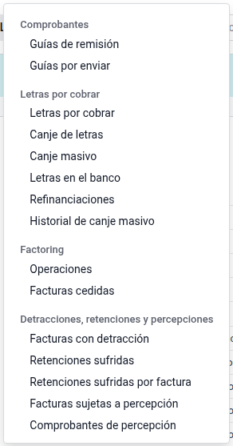
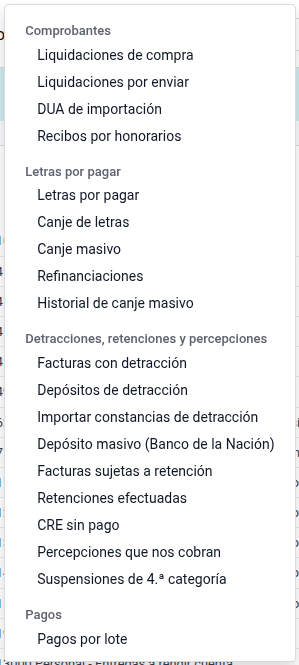
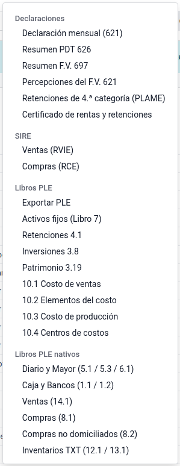
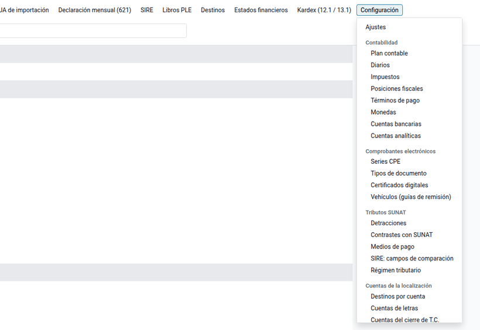
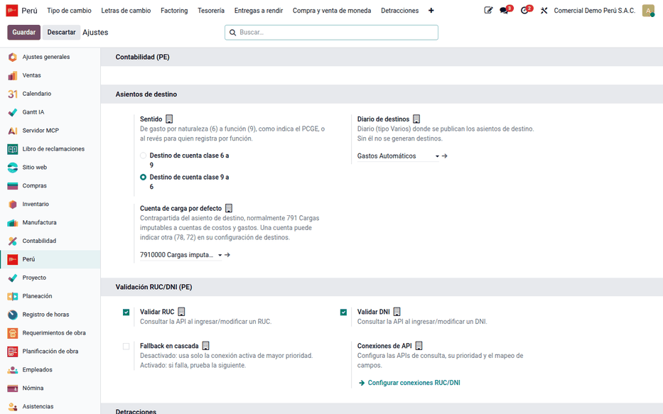

# Perú

La suite completa la [localización peruana de Odoo](https://www.odoo.com/documentation/19.0/es_419/applications/finance/fiscal_localizations/peru.html)
(`l10n_pe`, `l10n_pe_edi` y, en Enterprise, `l10n_pe_reports`) con lo que una
empresa peruana necesita en el día a día: los datos de los libros
electrónicos, el tipo de cambio de compra y venta, las detracciones y
retenciones, los registros del SIRE, los libros PLE que faltan, la diferencia
de cambio de cierre, los asientos de destino y la representación impresa de
los comprobantes electrónicos. Todo queda reunido en la aplicación **Perú**,
con su menú y su página de ajustes.

## Menú de la aplicación

El menú de **Perú** se organiza como el de Contabilidad: pocas secciones
generales y, dentro de cada una, encabezados por tema.

| Menú | Qué reúne |
|---|---|
| **Tablero** | Resumen tributario y de tesorería (ver [Tablero de la app Perú](peru/dashboard.md)) |
| **Clientes** | Guías de remisión, letras por cobrar, factoring, detracciones de ventas, retenciones sufridas, percepciones cobradas y cheques de terceros |
| **Proveedores** | Liquidaciones de compra, DUA, recibos por honorarios, letras por pagar, detracciones, retenciones efectuadas, CRE sin pago, percepciones que nos cobran y pagos por lote |
| **Tesorería** | Tipo de cambio y compra y venta de moneda, entregas a rendir y caja chica, depósitos y garantías |
| **Contabilidad** | Cierre del mes (cierre de tipo de cambio, ganancias no realizadas, asientos de destino), arrendamientos y kardex |
| **SUNAT** | Declaraciones (621, PDT 626, F.V. 697, retenciones de 4.ª), registros SIRE y libros PLE |
| **Informes** | Estados financieros y análisis (ventas, compras e IGV, letras, factoring, depósitos, detracciones, retenciones, arrendamientos, guías) |
| **Configuración** | Ajustes, catálogos y cuentas de cada módulo |

Cada menú aparece solo si su módulo está instalado. Los mismos documentos
siguen accesibles desde Contabilidad, Inventario o Compras, donde Odoo los
tiene.

| Clientes | Proveedores | SUNAT |
|---|---|---|
|  |  |  |

## Módulos

| Módulo | Qué agrega | Página |
|---|---|---|
| `al_account_base` | Aplicación **Perú**, glosa, naturaleza del diario, código SUNAT del banco, establecimiento anexo | [Configuración contable básica](peru/accounting_base.md) |
| `l10n_pe_vat_sunat` | Autocompletado de contactos por RUC o DNI y padrones de SUNAT | [Consulta de RUC y DNI](peru/ruc_dni_lookup.md) |
| `al_account_move_name_sequence` | Series CPE y numeración sin huecos por diario | [Numeración de asientos y series](peru/entry_numbering.md) |
| `al_account_payments` | Catálogo de medios de pago y número de operación en los pagos | [Medios de pago SUNAT](peru/payment_methods.md) |
| `al_l10n_pe_currency` | Tipo de cambio compra y venta de SUNAT y BCRP, elegible en cada comprobante | [Tipo de cambio](peru/exchange_rates.md) |
| `al_l10n_pe_exchange_closure`, `al_l10n_pe_multicurrency_revaluation` | Ajuste de cierre de saldos en moneda extranjera | [Diferencia de cambio](peru/exchange_differences.md) |
| `al_account_destinations` | Asiento de destino de la clase 6 al Elemento 9 | [Asientos de destino](peru/destination_entries.md) |
| `al_l10n_pe_detraction` | Detracciones SPOT en ventas y compras, depósito masivo | [Detracciones (SPOT)](peru/detractions.md) |
| `al_l10n_pe_retention` | Retenciones del IGV, CRE (también sin pago), reversión, retenciones sufridas y resumen del PDT 626 | [Retenciones del IGV](peru/withholdings.md) |
| `al_l10n_pe_perception` | Percepciones del IGV como agente (tipo 40) y las que nos cobran | [Percepciones del IGV](peru/perceptions.md) |
| `al_l10n_pe_fourth_category` | Retención de renta de 4.ª categoría a recibos por honorarios | [Retención de renta de 4.ª categoría](peru/fourth_category.md) |
| `al_l10n_pe_cpe_validation` | Consulta de validez de los comprobantes de proveedores | [Consulta de validez de comprobantes](peru/cpe_validation.md) |
| `al_l10n_pe_monthly_tax` | Régimen tributario, pago a cuenta y resumen del F.V. 621 | [Declaración mensual IGV y renta (621)](peru/monthly_tax.md) |
| `al_l10n_pe_invoice`, `al_l10n_pe_delivery_guide_report`, `al_l10n_pe_edi_downpayment_discount`, `al_l10n_pe_edi_free`, `al_l10n_pe_edi_purchase_settlement`, `al_ose_factory_hka` | Comprobante y guía impresos, anticipos y descuentos, liquidación de compra, operador The Factory HKA | [Facturación electrónica](peru/electronic_invoicing.md) |
| `al_l10n_pe_complaints_book` | Libro de reclamaciones en el sitio web | [Libro de reclamaciones](peru/complaints_book.md) |
| `al_l10n_pe_ple` | Libros PLE que Odoo no genera y formatos simplificados | [Libros electrónicos (PLE)](peru/ple.md) |
| `al_l10n_pe_sire` | Conciliación y envío del RVIE y el RCE | [Registros SIRE](peru/sire.md) |
| `al_l10n_pe_financial_reports` | Estado de cambios en el patrimonio neto (3.19) | [Estados financieros](peru/financial_statements.md) |

`al_account_base` se instala solo como dependencia de los demás. Varios
módulos (detracciones, PLE, revaluación multimoneda, estados financieros)
requieren Odoo Enterprise.

## Configuración

1. Instale la localización peruana de Odoo y el plan contable PCGE en la
   compañía, con su RUC.
2. Instale los módulos de la suite que necesite; la base contable se instala
   sola.
3. Vaya a **Perú ‣ Configuración ‣ Ajustes**: la página reúne un bloque por
   módulo instalado (tipo de cambio, detracciones, retenciones, cierre de
   tipo de cambio, asientos de destino, SIRE, libros PLE…). La configuración
   que depende del RUC se guarda en la compañía raíz y las sucursales la
   heredan.
4. Revise **Perú ‣ Configuración**: las secciones **Contabilidad**,
   **Comprobantes electrónicos**, **Tributos SUNAT**, **Cuentas de la
   localización** y **Consultas RUC / DNI** agrupan los catálogos y datos
   maestros de todos los módulos.

### Datos maestros

Antes de operar, complete en este orden:

1. Diarios con su naturaleza y, en los de ventas, sus Series CPE
   ([Configuración contable básica](peru/accounting_base.md),
   [Numeración de asientos y series](peru/entry_numbering.md)).
2. Cuentas bancarias con su código SUNAT y la cuenta de detracciones del Banco
   de la Nación.
3. Conexiones de consulta de RUC y DNI con su token
   ([Consulta de RUC y DNI](peru/ruc_dni_lookup.md)).
4. Tipos de cambio del año ([Tipo de cambio](peru/exchange_rates.md)).
5. Productos con su tipo de detracción ([Detracciones](peru/detractions.md)) y
   centros de costo con su cuenta de destino
   ([Asientos de destino](peru/destination_entries.md)).

## Flujo de un mes

1. **Ventas y compras**: los comprobantes llevan su serie, el tipo de cambio
   elegido, la detracción y la retención que correspondan.
2. **Cobros y pagos**: medio de pago y número de operación; depósitos de
   detracciones, comprobantes de retención y de percepción, retención de 4.ª
   categoría en los recibos por honorarios,
   [pagos masivos](../accounting/batch_payments.md) y
   [pagos múltiples](../accounting/multiple_payments.md), con su
   [ITF](../accounting/itf.md), y el [cierre diario de cada caja](../accounting/cash_closing.md);
   el [flujo de caja proyectado](../accounting/cash_forecast.md) anticipa las semanas
   siguientes.
3. **Cierre del mes**: [diferencia de cambio](peru/exchange_differences.md) y
   cuadre de los [asientos de destino](peru/destination_entries.md).
4. **Declaraciones**: [declaración mensual 621](peru/monthly_tax.md),
   [registros SIRE](peru/sire.md), [libros PLE](peru/ple.md), resúmenes del
   PDT 626 y del F.V. 697, y el archivo .4ta de la PLAME.
5. **Cierre del ejercicio**: [estados financieros](peru/financial_statements.md)
   y libros anuales (activos fijos, costos).

!!! info "Ver también"
    - [Odoo: localización Perú](https://www.odoo.com/documentation/19.0/es_419/applications/finance/fiscal_localizations/peru.html)
    - [Odoo: Contabilidad](https://www.odoo.com/documentation/19.0/es_419/applications/finance/accounting.html)
