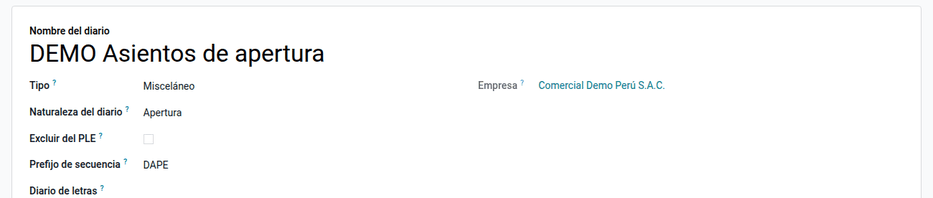
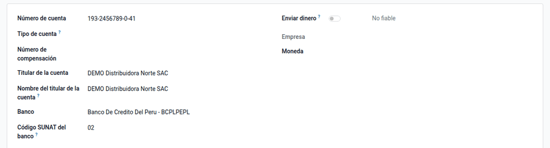
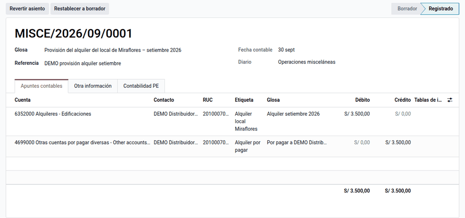

# Configuración contable básica

La base contable peruana de la suite crea la aplicación **Perú** (menú y página
de ajustes donde se agregan los demás módulos) y añade los datos que piden los
libros electrónicos (PLE) y que Odoo no trae: la **glosa** del asiento, la
**naturaleza del diario**, la exclusión de un diario de los libros, el
**código SUNAT del banco** y el **establecimiento anexo** del contacto. Se
instala sola como dependencia de cualquier módulo contable de la suite y la
usan el contador general y el administrador.

No genera libros ni asientos (eso lo hacen [Libros electrónicos (PLE)](ple.md)
y [Asientos de destino](destination_entries.md)) ni instala el plan contable,
que trae la localización `l10n_pe` de Odoo.

## Conceptos

El Libro Diario del PLE pide una **glosa** por apunte y el Libro Caja y Bancos,
el **código de la entidad financiera** (tabla 3 del Anexo 2 de la
R.S. N.° 286-2009/SUNAT, reemplazado por la R.S. N.° 196-2010/SUNAT). El plan
de cuentas es el Plan Contable General Empresarial (PCGE).

| Término | Significado | Dónde aparece en Odoo |
|---|---|---|
| Glosa | Descripción de la operación que exige el Libro Diario | Asiento (cabecera) y apunte (columna opcional) |
| Naturaleza del diario | Si el diario registra operaciones del periodo, la apertura o el cierre | Diario, campos de Perú |
| Excluir del PLE | Diario auxiliar cuyos asientos no son operaciones declarables | Diario |
| Código SUNAT del banco | Código de dos dígitos de la entidad financiera (tabla 3 del PLE) | Cuenta bancaria |
| Establecimiento anexo | Código de cuatro dígitos del establecimiento declarado en el RUC (el principal es 0000) | Contacto con país Perú |

## Configuración

1. Instale cualquier módulo contable de la suite: la base (`al_account_base`)
   se instala sola. Solo depende de `account`, así que funciona también en
   Community.
2. Vaya a **Perú ‣ Configuración ‣ Ajustes** (solo administradores). La página
   reúne el bloque **Contabilidad (PE)** y los de cada módulo instalado; la
   pestaña **Contabilidad PE** de la compañía tiene el resto.
3. El menú **Perú ‣ Configuración** agrupa las secciones **Contabilidad**,
   **Comprobantes electrónicos**, **Tributos SUNAT**, **Cuentas de la
   localización** y **Consultas RUC / DNI**.
4. Al final de **Ajustes ‣ Perú**, en **Documentación**, escriba la URL del
   sitio de documentación de la suite (por ejemplo
   `https://docs.altalatam.com/latest/`) y haga clic en **Guardar**. Aparecen
   **Abrir documentación** y los accesos a la documentación para usuarios,
   las novedades, la localización y la nómina peruanas y la sección del
   desarrollador, que se abren en una
   pestaña nueva.

### Diarios

Vaya a **Perú ‣ Configuración ‣ Contabilidad ‣ Diarios** y, en cada diario:

- marque la **Naturaleza del diario**: **Movimiento**, **Apertura** o
  **Cierre**;
- active **Excluir del PLE** en los diarios auxiliares cuyos asientos no son
  operaciones declarables (el Registro de Compras, por ejemplo, los omite).

### Cuentas bancarias

Vaya a **Perú ‣ Configuración ‣ Contabilidad ‣ Cuentas bancarias** y complete
el **Código SUNAT del banco** de cada cuenta de la compañía antes de generar el
Libro Caja y Bancos.

### Contactos con varios establecimientos

En el contacto con país Perú, debajo del RUC, registre el **Establecimiento
anexo** (cuatro dígitos; el principal es 0000).

!!! warning "Importante"
    Los códigos se guardan solo si tienen la longitud exacta: dos dígitos el
    del banco y cuatro el del establecimiento. Odoo no los recorta porque
    «123» recortado a «12» sería otro banco válido y el libro saldría mal sin
    que nadie lo advierta.

    | Campo | Valor | Resultado |
    |---|---|---|
    | Código SUNAT del banco | 02 | Aceptado (Banco de Crédito del Perú) |
    | Código SUNAT del banco | 123 | Rechazado: debe tener dos dígitos |
    | Establecimiento anexo | 0000 | Aceptado (principal) |
    | Establecimiento anexo | 00123 | Rechazado: debe tener cuatro dígitos |

## Registrar asientos con glosa

1. Vaya a **Contabilidad ‣ Contabilidad ‣ Asientos contables** y cree el
   asiento.
2. Escriba la **Glosa** en la cabecera.
3. Si una línea necesita su propio texto, active la columna **Glosa** en el
   selector de columnas de la pestaña **Apuntes contables** y escríbala en el
   apunte.

Por ejemplo, Comercial Demo Perú S.A.C. provisiona el alquiler de su local de
Miraflores de setiembre de 2026 por S/ 3 500,00 (asiento MISCE/2026/09/0001 de
la demostración), con la glosa «Provisión del alquiler del local de Miraflores
– setiembre 2026»:

| Cuenta | Etiqueta / glosa del apunte | Debe | Haber |
|---|---|---|---|
| 6352000 Alquileres – Edificaciones | Alquiler local Miraflores / Alquiler setiembre 2026 | 3 500,00 | |
| 4699000 Otras cuentas por pagar diversas | Alquiler por pagar / Por pagar a DEMO Distribuidora Norte | | 3 500,00 |
| **Totales** | | **3 500,00** | **3 500,00** |

El texto que llega a cada línea del Libro Diario simplificado (formato 5.2)
sigue este orden de preferencia:

| Glosa del apunte | Etiqueta del apunte | Texto en el libro |
|---|---|---|
| Alquiler setiembre 2026 | Alquiler local Miraflores | Alquiler setiembre 2026 |
| (vacía) | Alquiler local Miraflores | Alquiler local Miraflores |
| (vacía) | (vacía) | Glosa del asiento; si falta, su referencia o su número |

!!! note "Nota"
    Al duplicar un asiento la glosa no se copia: sería describir otra
    operación. Escriba la del asiento nuevo.

### Corregir un asiento

En el asiento, haga clic en **Restablecer a borrador**. El botón aparece en los
asientos publicados y cancelados, salvo los bloqueados con hash o los
comprobantes que requieren anulación ante SUNAT: en esos casos use la nota de
crédito o la comunicación de baja.

## Reportes

- **Libro Diario (5.1 / 5.2)**: usa la glosa ([Libros electrónicos (PLE)](ple.md)).
- **Libro Caja y Bancos (1.1 / 1.2)**: usa el código SUNAT del banco.
- **Registro de Compras**: excluye los diarios marcados.
- **Comprobante impreso**: muestra la glosa y usa el encabezado y el pie
  comunes que define este módulo
  ([Comprobante impreso](electronic_invoicing/invoice_report.md)).

## Casos especiales

| Situación | Qué pasa | Qué hacer |
|---|---|---|
| No se ve la columna Glosa en los apuntes | Es opcional | Actívela en el selector de columnas de la pestaña Apuntes contables |
| No aparecen Naturaleza del diario ni Establecimiento anexo | Solo se muestran en compañías o contactos de Perú | Revise el país de la compañía o del contacto |
| **Restablecer a borrador** da error | Asiento bloqueado con hash o comprobante que exige anulación ante SUNAT | Use la nota de crédito o la comunicación de baja |

!!! info "Ver también"
    - [R.S. N.° 286-2009/SUNAT — Libros y registros electrónicos](https://www.sunat.gob.pe/legislacion/superin/2009/rs286.doc)
    - [R.S. N.° 196-2010/SUNAT — Modifica la 286-2009 y reemplaza su Anexo 2](https://www.sunat.gob.pe/legislacion/superin/2010/196-10.pdf)
    - [Plan Contable General Empresarial 2019 (MEF)](https://cdn.www.gob.pe/uploads/document/file/315820/PCGE_2019.pdf)
    - [Odoo: localización Perú](https://www.odoo.com/documentation/19.0/es_419/applications/finance/fiscal_localizations/peru.html)
    - [Odoo: Contabilidad](https://www.odoo.com/documentation/19.0/es_419/applications/finance/accounting.html)
    - [Localización peruana de la suite](../peru.md)
