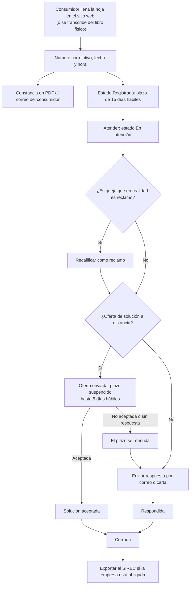
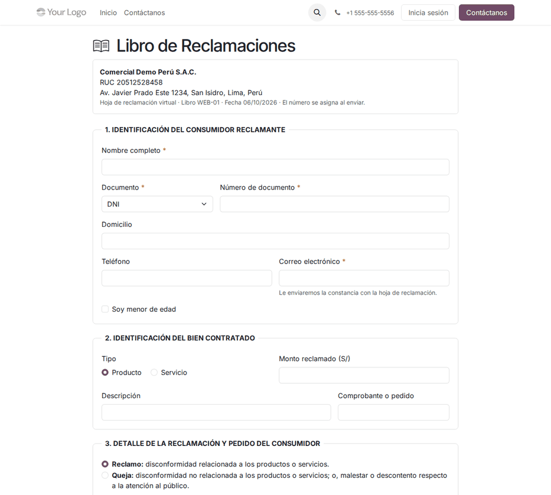
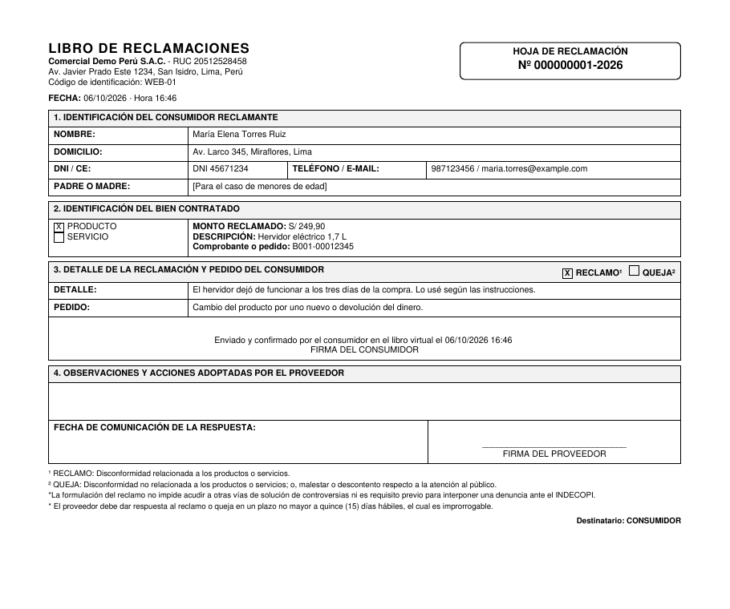

# Libro de reclamaciones

Todo proveedor que atiende a consumidores en un establecimiento abierto al
público o por internet debe tener un **Libro de Reclamaciones**, físico o
virtual, entregar constancia de cada hoja, responder en **15 días hábiles** y
conservar todo **dos años**. El módulo **Libro de reclamaciones**
(`al_l10n_pe_complaints_book`) lleva ese libro dentro de Odoo: el consumidor
llena la hoja en el sitio web sin registrarse y recibe su constancia en PDF por
correo, y el equipo de atención controla plazos, ofertas de solución y
respuestas.

Lo usan atención al cliente (responde), el responsable del libro (supervisa y
exporta al SIREC) y el área legal (conservación). Las denuncias ante Indecopi y
el arbitraje de consumo quedan fuera: son procedimientos administrativos. El
reporte al SIREC se entrega como archivo de carga masiva, y la carga en el
portal de Indecopi la hace el usuario.

## Configuración

1. Vaya a **Libro de reclamaciones ‣ Configuración ‣ Libros** y cree un libro
   por establecimiento o canal, con:
    - **Código de identificación**, único por compañía;
    - **Tipo**: virtual o físico;
    - **Domicilio**;
    - **Sitios web** donde se publica;
    - **Responsables** que reciben las hojas y las alertas;
    - **Código de sede SIREC** (6 caracteres), si aplica.
2. En **Libro de reclamaciones ‣ Configuración ‣ Ajustes**, elija el
   calendario laboral con los feriados nacionales y marque **Obligada al
   SIREC** si corresponde. Esta casilla se define en la compañía principal: las
   sucursales toman su valor.
3. Asigne a los usuarios los grupos **Atención de reclamos** y **Responsable**:
   solo ellos ven las hojas, y la IP de origen solo la ve el responsable.
4. Configure el servidor de correo saliente para las constancias y las
   respuestas.
5. En cada libro, haga clic en **Imprimir aviso (Anexo II)** y coloque el aviso
   en el establecimiento. El aviso indica «(virtual)» o «(físico)».

!!! warning "Importante"
    Sin calendario laboral, el plazo solo descuenta sábados y domingos: los
    feriados no se consideran.

## Conceptos

| Término | Significado | En Odoo |
|---|---|---|
| Reclamo | Disconformidad con el producto o servicio adquirido | Tipo de la hoja |
| Queja | Disconformidad con la atención, no con el producto | Tipo de la hoja; se puede **recalificar como reclamo** |
| Hoja de reclamación | Formato del Anexo I, numerado `000000001-AAAA` por libro y año | Formulario e informe PDF de la hoja |
| Libro virtual, físico o de respaldo | Canales del libro; el de respaldo se usa si falla el principal | Canal de la hoja |
| Oferta de solución a distancia | Propuesta al consumidor que suspende el plazo hasta 5 días hábiles | Botón **Oferta de solución** |
| SIREC | Sistema de Reportes de Reclamaciones de Indecopi, obligatorio con ingresos anuales de 3 000 UIT o más | **Informes ‣ Exportar al SIREC** |

## Registrar una hoja

El consumidor entra al **Libro de Reclamaciones** desde el enlace del pie de
todas las páginas del sitio web, llena la hoja sin crear una cuenta y la envía.
La hoja queda **Registrada** con número, fecha y hora, y el consumidor recibe la
constancia en PDF por correo con un enlace firmado de seguimiento.

Para las hojas del libro físico, del libro de respaldo o recibidas por
teléfono, vaya a **Libro de reclamaciones ‣ Hojas de reclamación ‣ Nuevo** y
elija el canal **Libro físico**, **Libro de respaldo** o **Teléfono**; si
aplica, anote el **N.º de hoja de respaldo**.

!!! note "Nota"
    - El formulario no se envía sin correo ni domicilio: sin esos datos la hoja
      «no se tiene por presentada» (art. 5 del reglamento).
    - Para un menor de edad, complete los datos del padre, la madre o el
      representante.
    - Se aceptan como máximo 5 hojas por conexión y hora, como protección
      contra robots y sin captcha. Las siguientes se registran desde el
      backend.

## Atender la hoja

1. En la hoja, haga clic en **Atender**: pasa a **En atención** con su
   responsable.
2. Si una queja es en realidad un reclamo, haga clic en **Recalificar como
   reclamo**; el cambio queda en el historial.
3. Para proponer una solución a distancia, haga clic en **Oferta de solución**:
   la hoja pasa a **Oferta de solución enviada** y el plazo se suspende hasta 5
   días hábiles.
    - Si el consumidor acepta, haga clic en **Oferta aceptada**: la hoja pasa a
      **Solución aceptada** e imprime «ACUERDO ACEPTADO PARA SOLUCIONAR EL
      RECLAMO».
    - Si no acepta, haga clic en **Oferta no aceptada**. El proceso automático
      hace lo mismo al vencer los 5 días. El plazo se reanuda sumando los días
      suspendidos.
4. Haga clic en **Enviar respuesta**: el consumidor recibe por correo la hoja
   completada, o se imprime como carta, y la hoja pasa a **Respondida**.
5. Haga clic en **Cerrar**. Una hoja cerrada se puede **Reabrir**, y se puede
   imprimir en cualquier momento con **Imprimir hoja**.

### Plazo de respuesta

El plazo son 15 días hábiles improrrogables, para reclamos y quejas, contados
desde el día siguiente al registro, de lunes a viernes y sin feriados. Ejemplo
con el libro virtual `LR-WEB` de Comercial Demo Perú S.A.C.:

| Fecha | Hecho | Resultado en Odoo |
|---|---|---|
| Lunes 05/10/2026, 18:42 | Una consumidora reclama por una licuadora defectuosa; monto reclamado S/ 249,90; pide respuesta por correo | Hoja `000000001-2026`, canal **Libro virtual (web)**, estado **Registrada**; constancia en PDF a su correo |
| 05/10/2026 | Cálculo del plazo | 15 días hábiles del 06/10 al **27/10/2026** (06, 07, 09, 12, 13, 14, 15, 16, 19, 20, 21, 22, 23, 26 y 27); el 08/10, Combate de Angamos, no cuenta |
| Viernes 09/10/2026 | Atención ofrece cambiar el producto por correo | **Oferta de solución enviada**; plazo suspendido |
| Martes 13/10/2026 | La consumidora no acepta (2 días hábiles suspendidos: 12 y 13/10) | **Oferta no aceptada**; el vencimiento pasa al **29/10/2026** |
| Martes 20/10/2026 | Se responde por correo: devolución del importe | **Respondida**, dentro del plazo |
| 31/10/2026 | Se cierra la hoja | **Cerrada**; se conserva hasta octubre de 2028 |

Las hojas que vencen aparecen en el menú **Vencidas** y el responsable recibe
una actividad.

!!! danger "Advertencia"
    Responder fuera de plazo es un incumplimiento sancionable. Si un feriado no
    se consideró, revise el calendario laboral de los ajustes.

!!! note "Nota"
    El módulo no genera asientos contables: la devolución del importe se
    registra con una nota de crédito en Contabilidad, como cualquier otra
    devolución.

## Reportar al SIREC

Vaya a **Libro de reclamaciones ‣ Informes ‣ Exportar al SIREC**: el archivo de
carga masiva tiene 18 campos separados por `|`, y las hojas incluidas quedan
marcadas como reportadas. Reportan las empresas con ingresos anuales de 3 000
UIT o más, salvo excepciones de sectores regulados: verifique la situación del
cliente con Indecopi.

## Reportes

- **Hojas de reclamación** y **Vencidas**: listas con los días hábiles
  restantes y el estado.
- **Hoja de reclamación (PDF)**: formato del Anexo I con las dos notas legales.
- **Aviso del Anexo II**: A4 por libro.
- **Exportar al SIREC**: archivo de carga masiva para Indecopi.

El libro no alimenta libros contables ni tributarios.

## Casos especiales

| Situación | Qué pasa | Qué hacer |
|---|---|---|
| Hoja duplicada por error | No se puede borrar antes de 2 años | Cerrarla con una nota en el historial |
| Borrar hojas | Solo el responsable y después de 2 años | — |
| Varios establecimientos | Cada uno tiene su libro, con su código y su numeración | Crear un libro por establecimiento o canal |
| Exigir registro al consumidor | No se permite: el libro debe ser de fácil acceso | El formulario no pide cuenta |

!!! info "Ver también"
    - [Código de Protección y Defensa del Consumidor (Ley 29571), art. 150 y siguientes](https://diariooficial.elperuano.pe/Normas/obtenerDocumento?idNorma=17)
    - [D.S. 006-2014-PCM: modifica el Reglamento del Libro de Reclamaciones (D.S. 011-2011-PCM)](https://faolex.fao.org/docs/pdf/per130742.pdf)
    - [D.S. 101-2022-PCM: plazo de 15 días hábiles y formato del Anexo I](https://www.gob.pe/institucion/pcm/normas-legales/3346742-101-2022-pcm) ([El Peruano](https://busquedas.elperuano.pe/dispositivo/NL/2095978-1))
    - [Indecopi](https://www.gob.pe/indecopi)
    - [Requisitos legales del libro de reclamaciones](../../../../developer/specs/reclamaciones/requisitos_legales.md)
