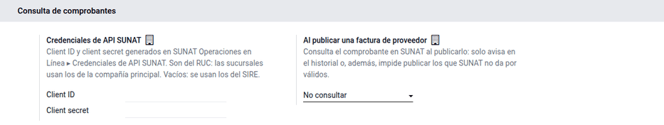
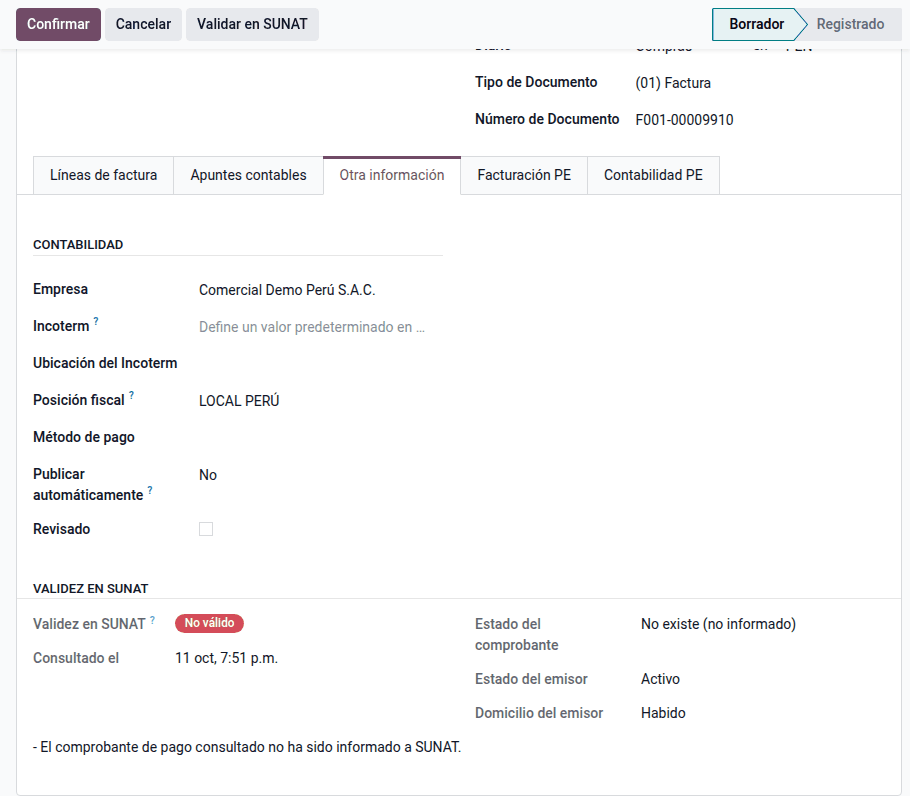
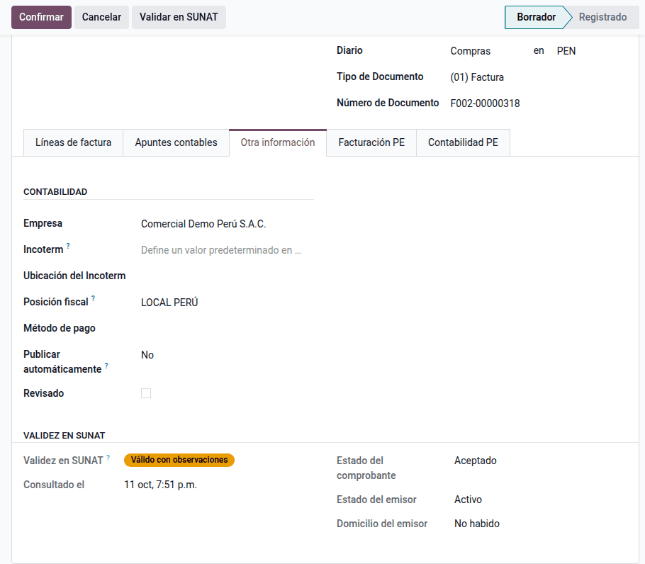
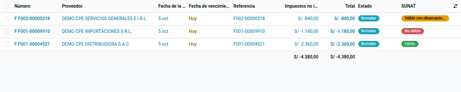

# Consulta de validez de comprobantes

Antes de usar el crédito fiscal de una compra, conviene comprobar en SUNAT que
el comprobante existe y que su emisor está activo y habido. Odoo consulta cada
factura de proveedor en el servicio web oficial **Consulta integrada de
comprobante de pago** y guarda el resultado en la factura.

## Configuración

1. Instale el módulo **PE - Consulta de validez de comprobantes en SUNAT**
   (`al_l10n_pe_cpe_validation`).
2. En SUNAT Operaciones en Línea, con la clave SOL de la empresa, vaya al menú
   de consulta de comprobantes de pago, opción **Credenciales de API SUNAT**, y
   genere un client ID y un client secret.
3. Vaya a **Ajustes ‣ Perú ‣ Consulta de comprobantes** y escriba el **Client
   ID** y el **Client secret**.
4. Elija qué hacer **Al publicar una factura de proveedor**: no consultar,
   consultar y avisar, o consultar y bloquear si no es válido.

!!! note "Nota"
    Las credenciales son del RUC: las sucursales usan las de la compañía
    principal. Si no se escriben, Odoo usa el client ID y el client secret del
    SIRE. El token de acceso se pide y se renueva solo.

## Conceptos

| Estado | Valores que devuelve SUNAT |
|---|---|
| Comprobante | No existe (no informado), aceptado, anulado (comunicado en una baja), autorizado (imprenta), no autorizado |
| Emisor | Activo, baja provisional, baja provisional por oficio, suspensión temporal, baja definitiva, baja de oficio, inhabilitado |
| Domicilio del emisor | Habido, pendiente, por verificar, no habido, no hallado |

Con esos estados, Odoo resume el **resultado**:

- **Válido**: comprobante aceptado o autorizado, emisor activo y habido.
- **Válido con observaciones**: el comprobante existe, pero el emisor no está
  activo o su domicilio no está habido.
- **No válido**: no existe, está anulado o no está autorizado.

Se consultan facturas (01), boletas (03), liquidaciones de compra (04), notas
de crédito (07) y de débito (08) y recibos por honorarios (02). El monto solo
se envía en los comprobantes electrónicos, cuya serie empieza con una letra.

## Consultar un comprobante

1. Abra la factura o nota de crédito de proveedor, con el **Número de
   Documento** en la forma serie-número y la fecha de emisión.
2. Haga clic en **Validar en SUNAT**.
3. El resultado queda en **Otra información ‣ Validez en SUNAT**, con los tres
   estados, la fecha de consulta y las observaciones de SUNAT.

## Consultar en lote

1. Vaya a **Contabilidad ‣ Proveedores ‣ Facturas**.
2. Use el filtro **Sin consultar en SUNAT**, seleccione las facturas y haga
   clic en **Acciones ‣ Validar en SUNAT**.
3. Un aviso resume cuántas resultaron válidas, con observaciones o no
   válidas, y las que no se pudieron consultar.

### Consulta diaria

La acción programada **Perú: validar en SUNAT las compras sin consultar**
revisa cada día las compras publicadas de los últimos 60 días que aún no
tienen resultado. Viene desactivada: actívela en **Ajustes ‣ Técnico ‣
Acciones programadas** cuando las credenciales estén configuradas.

## Al publicar

- **Consultar y avisar**: la factura se publica igual y, si no es válida, el
  resultado queda escrito en su historial.
- **Consultar y bloquear si no es válido**: Odoo no publica los comprobantes
  que SUNAT da por no existentes, anulados o no autorizados, y lista cuáles son.

!!! warning "Importante"
    Si SUNAT no responde o las credenciales fallan, la factura se publica igual
    y el error queda en su historial: una caída del servicio no detiene las
    compras.

## Casos especiales

| Situación | Qué pasa | Qué hacer |
|---|---|---|
| «el número no tiene el formato serie-número» | No se consulta | Corrija el número del documento (por ejemplo F001-123) |
| «el proveedor no tiene RUC» | No se consulta | Complete el RUC del proveedor |
| SUNAT rechazó las credenciales | Aviso con el código de SUNAT | Revise el client ID y el secret, o genérelos de nuevo en SOL |
| Comprobante físico | Se consulta sin monto | Nada: el servicio no lo pide |

## Datos de demostración

Una base creada **con datos de demostración** carga, al instalar el módulo, un
ejemplo completo en la compañía **PE Company** (la compañía peruana de la demo
de Odoo, con el plan contable de Perú). Los registros llevan el prefijo **DEMO
CPE** y las fechas se calculan respecto del día de la instalación. En una base
sin datos de demostración no se carga nada.

- Tres facturas de proveedor en borrador con el resultado de la consulta ya
  registrado: una **válida**, una **observada** (domicilio no habido) y una **no
  informada** a SUNAT.
- No se llama al servicio de SUNAT.

!!! info "Ver también"
    - [Manual de consulta integrada de comprobante de pago por servicio web (SUNAT)](https://cpe.sunat.gob.pe/sites/default/files/inline-files/Manual-de-Consulta-Integrada-de-Comprobante-de-Pago-por-ServicioWEB_v2_0.pdf)
    - [Registros SIRE](sire.md)
    - [Liquidación de compra electrónica](electronic_invoicing/purchase_settlement.md)
