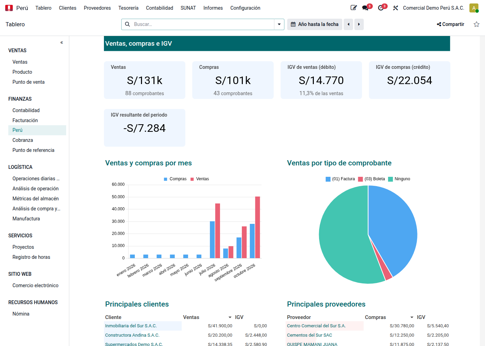
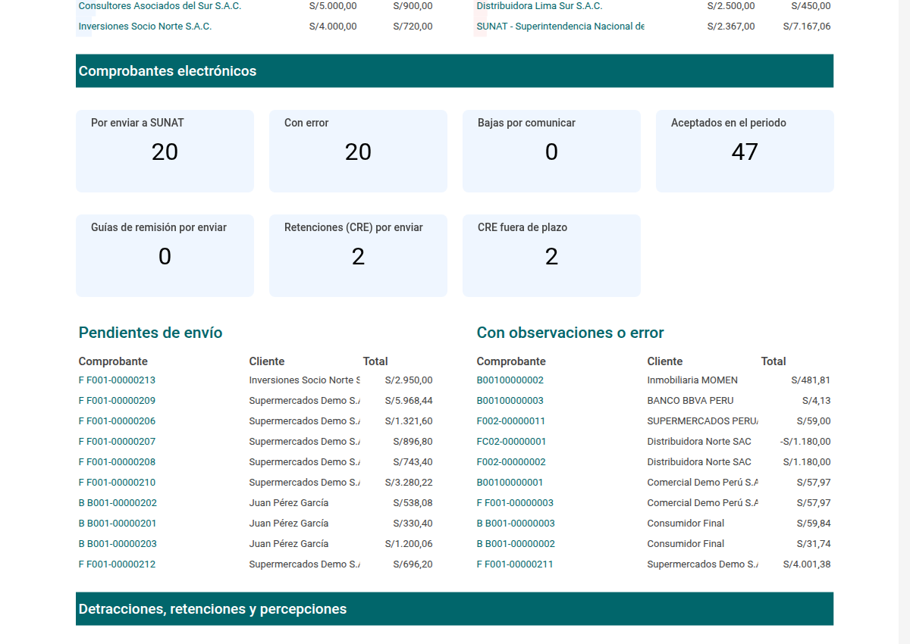
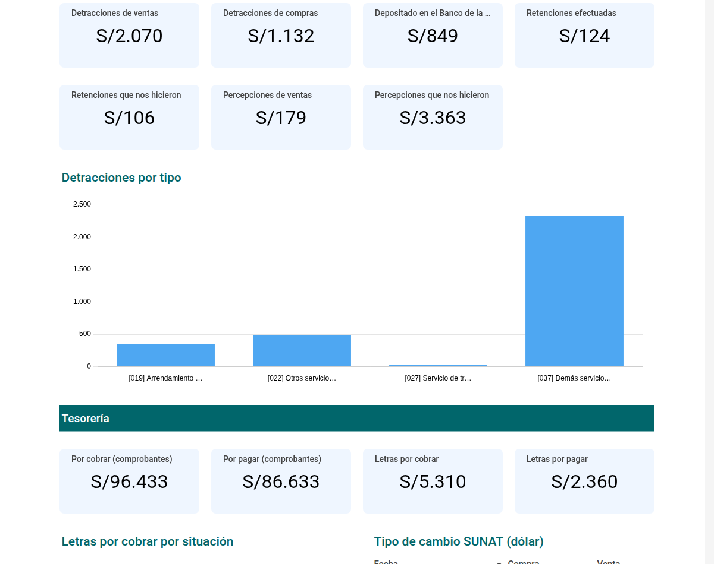

# Tablero de la app Perú

Al abrir la aplicación **Perú** se ve su **Tablero** (`al_l10n_pe_dashboard`): el resumen
tributario y de tesorería de la compañía, con datos en vivo. Es un tablero de la aplicación
**Tableros** de Odoo (grupo Finanzas), una hoja de cálculo de solo lectura: cada cifra y
cada gráfico llevan a los registros que la forman.

Lo ven los usuarios de **Contabilidad** con permiso de contable o de auditor (solo
lectura). Cada uno ve los datos de las compañías que tiene seleccionadas.

## Filtros

En la barra superior:

- **Periodo** (por defecto, el año a la fecha): filtra ventas, compras, detracciones,
  retenciones, percepciones, comprobantes aceptados y declaraciones. Con las flechas se
  pasa al periodo anterior o siguiente; para revisar un mes, elija **Mes**.
- **Cliente o proveedor**: limita todo el tablero a un tercero.

Los saldos por cobrar y por pagar, los comprobantes pendientes de envío y el tipo de cambio
no dependen del periodo: muestran la situación al día.

## Bloques

Cada bloque aparece solo si su módulo está instalado. El tablero se rearma solo al
instalar o desinstalar módulos de la localización.

| Bloque | Qué muestra | Módulo |
|---|---|---|
| **Ventas, compras e IGV** | Base imponible de ventas y compras, IGV de ventas (débito) y de compras (crédito), IGV resultante, ventas y compras por mes, ventas por tipo de comprobante y principales clientes y proveedores | Siempre |
| **Comprobantes electrónicos** | Comprobantes por enviar a SUNAT, con error, bajas por comunicar y aceptados en el periodo, con las listas de pendientes y de observados | Facturación electrónica (`l10n_pe_edi`) |
| | Guías de remisión por enviar | Guías electrónicas (`l10n_pe_edi_stock`) |
| | Comprobantes de retención (CRE) por enviar y fuera de plazo | Retenciones del IGV |
| **Detracciones, retenciones y percepciones** | Detracciones de ventas y de compras, lo depositado en el Banco de la Nación y detracciones por tipo | Detracciones |
| | Retenciones efectuadas y las que nos hicieron | Retenciones del IGV |
| | Percepciones de ventas y las que nos hicieron | Percepciones del IGV |
| **Tesorería** | Saldo por cobrar y por pagar de comprobantes | Siempre |
| | Letras por cobrar y por pagar, y letras por cobrar por situación (cartera, cobranza, descuento) | Letras de cambio |
| | Últimos tipos de cambio SUNAT del dólar (compra y venta) | Tipo de cambio |
| **Declaraciones mensuales** | Lo pagado en declaraciones del periodo, periodos por declarar y los últimos periodos con su IGV, renta y estado | Declaración mensual (621) |

## Cómo se calculan las cifras

- **Ventas y compras**: comprobantes publicados (facturas, boletas, notas de crédito y de
  débito) por **fecha contable**, en soles. Las notas de crédito restan.
- **IGV**: apuntes de impuesto con código de tributo **1000** (IGV) o **1016** (IVAP).
  El **IGV resultante** es débito menos crédito del periodo, sin saldos a favor anteriores,
  percepciones ni retenciones: el IGV a pagar es el de la [declaración mensual](monthly_tax.md).
- El detalle está en **Perú ‣ Informes ‣ Análisis ‣ Ventas, compras e IGV**, en tabla
  dinámica por mes y tipo de operación.

## Personalizarlo

Para adaptar el tablero, duplíquelo desde la aplicación **Tableros** (requiere permiso de
edición de tableros) y modifique la copia. El original lo mantiene el módulo: si se edita,
deja de rearmarse al instalar módulos.
