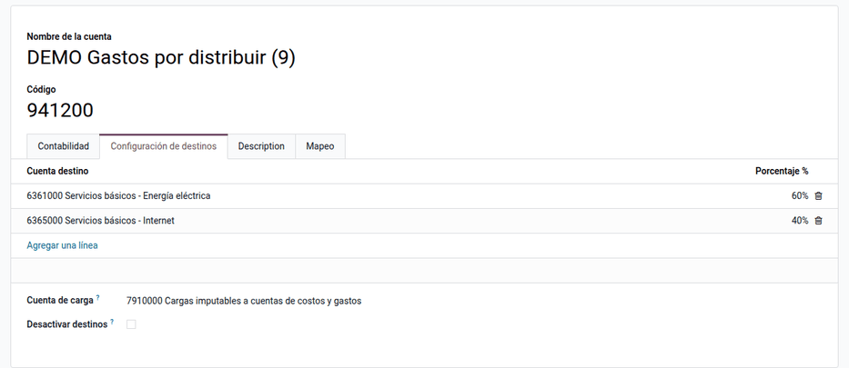
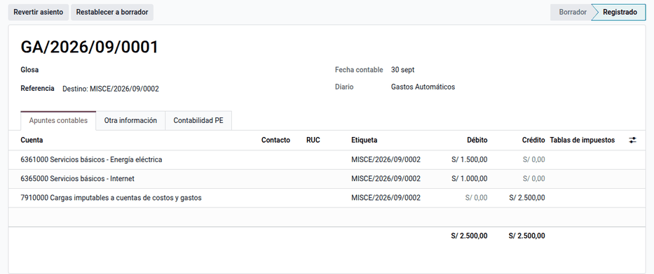
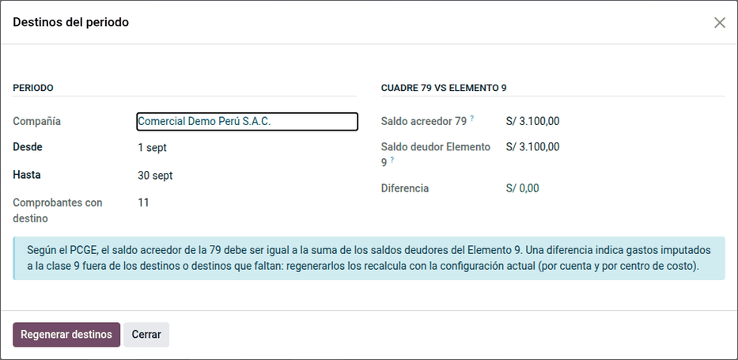

# Asientos de destino

En el Perú los gastos se registran **por naturaleza** en la clase 6 y, para
conocer el costo **por función** (producción, administración, ventas…), se
trasladan al **Elemento 9** contra la **cuenta de carga 79**. Este módulo
genera ese **asiento de destino** automáticamente al publicar cada
comprobante, según el **centro de costo** del gasto o el **reparto
porcentual** de la cuenta, y muestra el **cuadre 79 = Elemento 9** del
periodo. Lo usan el área contable y la de costos.

El paso de las compras (60) a inventarios (Elemento 2, contra la 61) lo hace
la valoración de inventario de Odoo (`stock_account`), no este módulo.

## Conceptos

Según el Plan Contable General Empresarial (PCGE), las cargas de la clase 6 se
transfieren a las cuentas de costos y gastos por función (Elemento 9) con abono
a la **79 Cargas imputables a cuentas de costos y gastos**; al cierre, el saldo
acreedor de la 79 debe ser igual al saldo deudor del Elemento 9.

| Término | Significado | Dónde aparece en Odoo |
|---|---|---|
| Clase 6 | Gastos por naturaleza (servicios, personal, tributos…) | Plan contable |
| Elemento 9 | Costos y gastos por función o destino | Plan contable, cuenta de destino |
| Cuenta de carga | Contrapartida del destino: 791 (78 o 72 en casos especiales) | Ajustes o la propia cuenta |
| Sentido | 6 → 9 (el del PCGE) o 9 → 6 (empresas que registran por función) | Ajustes |
| Centro de costo | Cuenta analítica con su cuenta de destino del Elemento 9 | Cuentas analíticas |

## Configuración

1. Vaya a **Perú ‣ Configuración ‣ Ajustes**, sección **Asientos de destino**,
   y elija el **sentido** (6 → 9 por defecto), el **diario de destinos**
   (obligatorio) y la **cuenta de carga por defecto** (normalmente 791). La
   configuración es del RUC: las sucursales usan la de su compañía raíz.
2. Vaya a **Contabilidad ‣ Configuración ‣ Cuentas analíticas** e indique la
   **cuenta de destino** de cada centro de costo. Si el gasto lleva centro de
   costo, este decide el reparto.
3. En las cuentas de clase 6 que no usan centros de costo, vaya a **Perú ‣
   Configuración ‣ Contabilidad ‣ Plan contable**, abra la cuenta y complete
   **Configuración de destinos**: cuentas de destino con porcentajes que suman
   100 % (tolerancia ±0,01 %). Una cuenta de carga propia solo si es distinta:
   78 para gastos cubiertos por provisiones, 72 para la producción de activo
   inmovilizado.
4. Revise todos los repartos en **Perú ‣ Configuración ‣ Cuentas de la
   localización ‣ Destinos por cuenta**: la lista es editable y se puede
   importar (**Acciones ‣ Importar registros**).

!!! tip "Consejo"
    Marque **Desactivar destinos** en las cuentas de clase 6 que no deben
    repartirse. Una cuenta sin reparto ni centro de costo con destino no genera
    asiento de destino; no es un error.

## Publicar comprobantes con gastos

Al publicar una factura de proveedor o cualquier asiento con gastos de clase 6,
se genera el asiento **«Destino: número»** en el diario de destinos. Solo
interviene la línea de gasto: el IGV y la cuenta por pagar no. En la factura,
la pestaña **Otra información** muestra el enlace al **Asiento de destino**.

Si el comprobante vuelve a borrador o se cancela, el destino lo acompaña, y al
publicarlo de nuevo se regenera conservando su número.

### Ejemplo

Factura de proveedor por energía eléctrica de octubre de 2026: S/ 1 000,00 +
IGV 18 % = S/ 1 180,00, con sentido 6 → 9 y la distribución analítica del
gasto en 70 % Administración (destino 942100) y 30 % Ventas (951100).

Asiento de la factura:

| Cuenta | Descripción | Debe | Haber |
|---|---|---|---|
| 6361000 | Servicios básicos – Energía eléctrica | 1 000,00 | |
| 4011100 | IGV – Cuenta propia | 180,00 | |
| 4212000 | Facturas por pagar | | 1 180,00 |
| **Totales** | | **1 180,00** | **1 180,00** |

Asiento de destino generado al publicar:

| Cuenta | Descripción | Debe | Haber |
|---|---|---|---|
| 942100 | Gastos de administración (9) — 70 % | 700,00 | |
| 951100 | Gastos de ventas (9) — 30 % | 300,00 | |
| 7910000 | Cargas imputables a cuentas de costos y gastos | | 1 000,00 |
| **Totales** | | **1 000,00** | **1 000,00** |

!!! note "Nota"
    El redondeo no descuadra el asiento: una cuenta repartida en tres destinos
    de 33,3333 % con un gasto de S/ 100,00 genera 33,33 + 33,33 + **33,34**;
    la última línea recibe el remanente.

## Cuadrar el periodo

Vaya a **Perú ‣ Contabilidad ‣ Cierre del mes ‣ Asientos de destino**: muestra el saldo de la 79,
el del Elemento 9 y la diferencia. En el ejemplo, ambos suman S/ 1 000,00 y la
diferencia es 0.

Un cambio de reparto no modifica los destinos ya publicados: si el periodo no
cuadra o se cambió la configuración, haga clic en **Regenerar destinos** para
rehacerlos con la configuración vigente.

## Reportes

Los asientos de destino entran al Libro Diario (PLE 5.1 y 5.2, ver
[Libros electrónicos (PLE)](ple.md)) y a los
[estados financieros](financial_statements.md) por función.

## Casos especiales

| Situación | Qué pasa | Qué hacer |
|---|---|---|
| Los porcentajes no suman 100 % | La cuenta no se guarda | Corrija los porcentajes |
| Parte del gasto sin centro de costo con destino y la cuenta sin reparto | Error al publicar que indica qué porcentaje quedó sin destino | Asigne un centro de costo o un reparto a la cuenta |
| Falta el diario de destinos | Aviso al publicar | Configúrelo en Ajustes |
| Se cambió un reparto | Los destinos publicados no cambian solos | **Destinos del periodo ‣ Regenerar destinos** |

!!! info "Ver también"
    - [Plan Contable General Empresarial 2019 (MEF)](https://cdn.www.gob.pe/uploads/document/file/315820/PCGE_2019.pdf)
    - [Resolución que aprueba el PCGE 2026 (El Peruano)](https://busquedas.elperuano.pe/dispositivo/NL/2550786-1)
    - [Odoo: contabilidad analítica](https://www.odoo.com/documentation/19.0/es_419/applications/finance/accounting/reporting/analytic_accounting.html)
