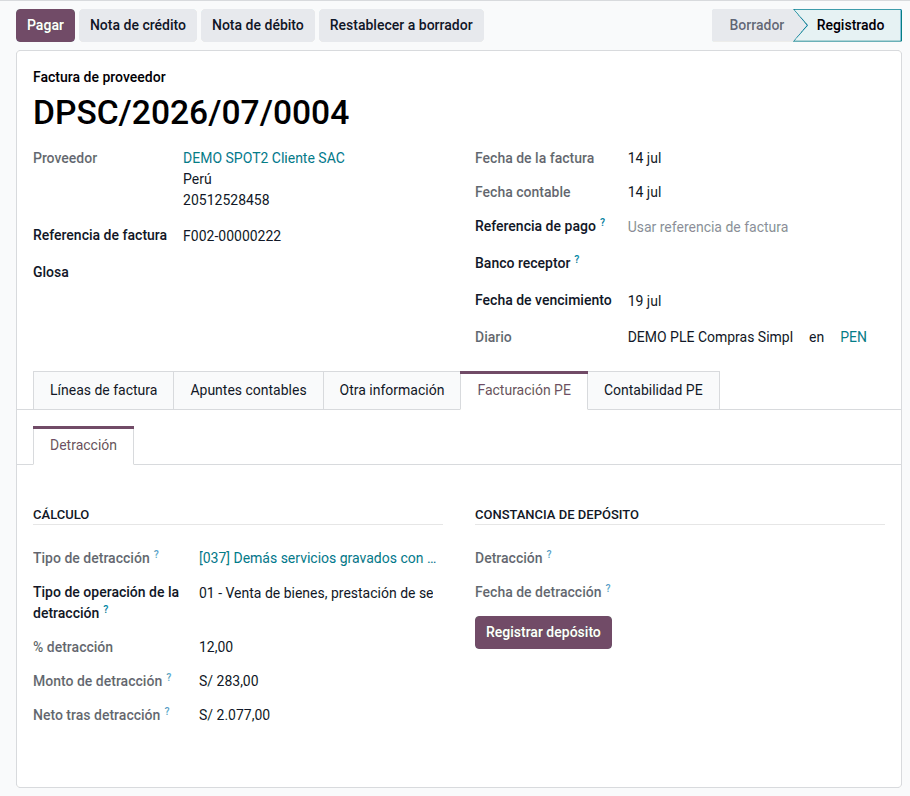
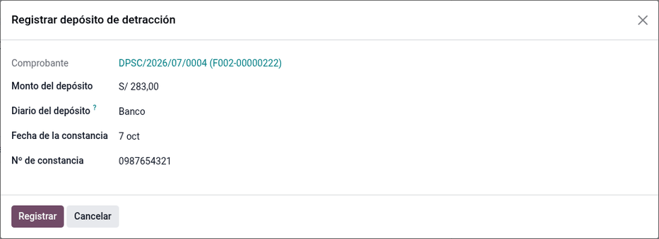
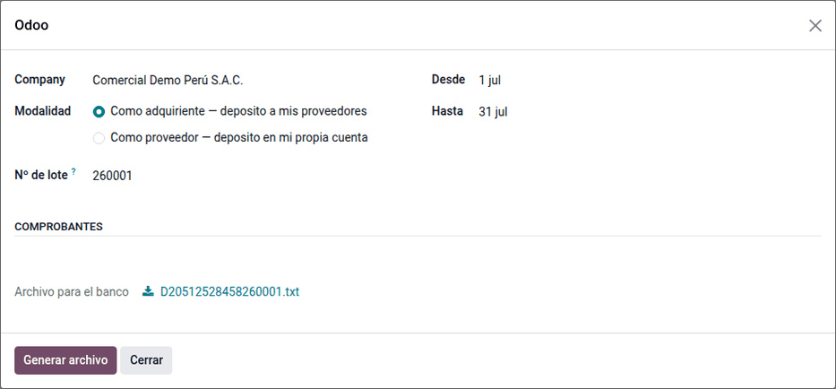
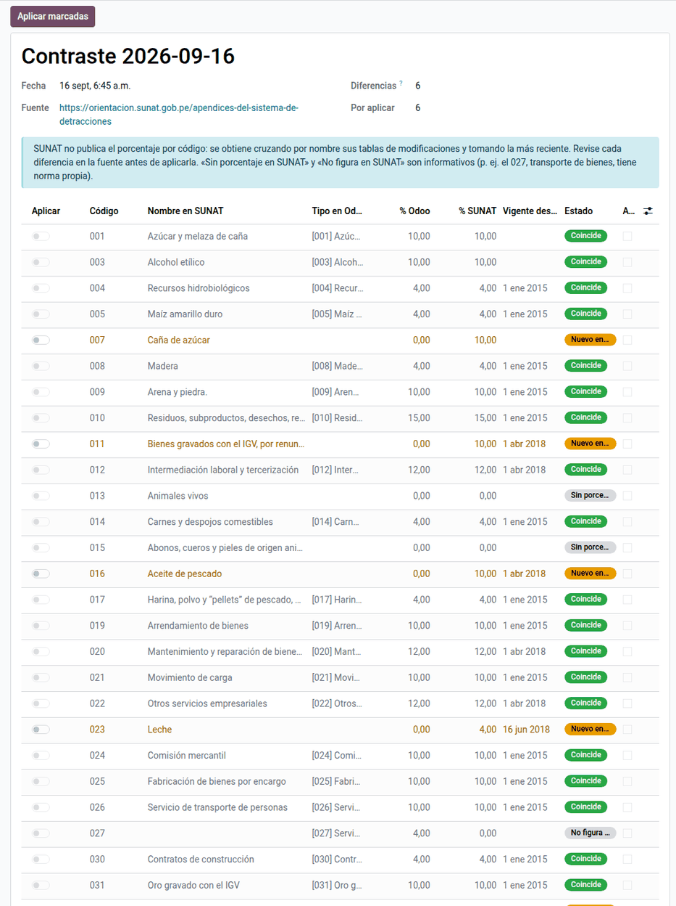

# Detracciones (SPOT)

En las operaciones sujetas al **Sistema de Pago de Obligaciones Tributarias
(SPOT)** el comprador descuenta un porcentaje del importe total y lo
**deposita en la cuenta de detracciones del proveedor en el Banco de la
Nación**; el proveedor cobra el neto y usa ese fondo para pagar sus tributos.
Este módulo lleva el régimen de punta a punta: el **catálogo de tipos**
(catálogo 54) con porcentaje y monto mínimo, el **cálculo** en facturas de
venta y compra, el **reparto** opcional en el asiento, el **registro del
depósito** con su constancia, el **archivo de depósito masivo** del Banco de la
Nación y el **contraste** del catálogo con SUNAT. Lo usan facturación,
compras, tesorería y contabilidad.

Requiere Odoo Enterprise (usa campos de `l10n_pe_reports`). No envía el archivo
al banco ni consulta constancias en línea.

## Conceptos

El régimen lo regulan el **TUO del D. Leg. N.° 940** (D.S. N.° 155-2004-EF) y
la **R.S. N.° 183-2004/SUNAT** con sus modificatorias: bienes y servicios
sujetos, porcentajes, montos mínimos y forma de depósito. Por ejemplo, la
**R.S. N.° 082-2018/SUNAT** modificó porcentajes y anexos, y la
**R.S. N.° 216-2019/SUNAT** introdujo el número de pago de detracciones. Como
regla general, aplica a operaciones mayores a **S/ 700** (algunos anexos tienen
mínimos propios) y el monto se **redondea a soles enteros**.

| Término | Significado | Dónde aparece en Odoo |
|---|---|---|
| Tipo de detracción | Código del catálogo 54 con porcentaje y mínimo | **Perú ‣ Configuración ‣ Tributos SUNAT ‣ Detracciones** |
| Código dominante | Si hay varios productos afectos, el de mayor porcentaje | Pestaña **Detracción** de la factura |
| Constancia de depósito | Número y fecha que entrega el banco | Factura, pestaña **Detracción** |
| Cuenta de detracciones | Cuenta del proveedor en el Banco de la Nación (11 dígitos) | Contacto, debajo del RUC |
| Tipo de operación 1001 | Operación sujeta a detracción en el comprobante electrónico | Se fija al publicar la venta |

## Configuración

1. Vaya a **Perú ‣ Configuración ‣ Tributos SUNAT ‣ Detracciones** y revise
   los 32 códigos con su porcentaje y su monto mínimo. Actualice el mínimo de
   los códigos del Anexo 1 con la UIT del año (en 2026, ½ UIT = S/ 2 750).
2. En cada producto o servicio afecto, complete el **Tipo de detracción** en la
   pestaña **Contabilidad**: el código y el porcentaje del comprobante salen
   solos.
3. Para ventas, registre la cuenta de detracciones del Banco de la Nación entre
   las cuentas bancarias de la compañía y cree un diario de banco para ella.
4. Para compras, complete la **Cuenta de detracciones** de cada proveedor
   (debajo del RUC). El depósito masivo la necesita.
5. Opcional: vaya a **Perú ‣ Configuración ‣ Ajustes**, sección
   **Detracciones**, y active **Separar detracción en el asiento** con las
   cuentas de detracciones por cobrar y por pagar.

!!! warning "Importante"
    Con el reparto activo, la factura no se publica sin las dos cuentas de
    detracciones: configúrelas o desactive el reparto.

## Facturar con detracción

1. Cree la factura de venta o de proveedor en **Contabilidad ‣ Clientes** (o
   **Proveedores**) **‣ Facturas** con un producto afecto.
2. Si el total con IGV en soles supera el mínimo, aparece la pestaña
   **Detracción** con el monto (total × porcentaje, redondeado a soles enteros)
   y el neto. Con varios productos afectos va el código de mayor porcentaje.
3. Publique la factura. Con el reparto activo, el neto va a la cuenta del
   tercero y la detracción a su propia cuenta; sin reparto, el total va a la
   cuenta del tercero. En una venta se fija el tipo de operación 1001.

En una factura en dólares el mínimo se compara en soles. Las notas de crédito
no llevan detracción.

### Ejemplo

Comercial Demo Perú contrata un servicio empresarial (código 022, 12 %) por
S/ 3 000,00 + IGV S/ 540,00 = **S/ 3 540,00**, con el reparto activo. La
detracción es 3 540,00 × 12 % = 424,80 → **S/ 425** y el neto al proveedor,
3 540,00 − 425,00 = **S/ 3 115,00**.

| Cuenta | Descripción | Debe | Haber |
|---|---|---|---|
| 63x | Servicio empresarial (cuenta del producto) | 3 000,00 | |
| 4011100 | IGV – Cuenta propia | 540,00 | |
| 4212000 | Facturas por pagar — neto al proveedor | | 3 115,00 |
| Detracciones por pagar (configurada) | Detracción — depósito en el Banco de la Nación | | 425,00 |
| **Totales** | | **3 540,00** | **3 540,00** |

En una venta con los mismos importes el asiento es el espejo: 3 115,00 a la
cuenta del cliente y 425,00 a la de detracciones por cobrar, contra venta
3 000,00 e IGV 540,00.

## Depositar la detracción (compras)

### Depósito individual

1. En la factura de proveedor publicada, pestaña **Detracción**, haga clic en
   **Registrar depósito**.
2. Escriba el número y la fecha de la constancia. Se crea un pago estándar y la
   constancia queda guardada en la factura.

Con el ejemplo anterior, el depósito queda así; el apunte de pagos pendientes
pasa al banco al conciliar:

| Cuenta | Descripción | Debe | Haber |
|---|---|---|---|
| Detracciones por pagar | Detracción ‹constancia› | 425,00 | |
| 1041004 | Pagos pendientes | | 425,00 |
| **Totales** | | **425,00** | **425,00** |

Después, pague el neto (S/ 3 115,00) al proveedor con el flujo normal de pagos.

### Depósito masivo

Vaya a **Perú ‣ Detracciones ‣ Depósito masivo (Banco de la Nación)** para
generar el archivo TXT de ancho fijo del Banco de la Nación con las facturas
pendientes. La lista de excluidos indica el motivo de cada una: falta el tipo,
el monto, el RUC, la cuenta del Banco de la Nación o la fecha.

## Cobrar la detracción (ventas)

El cliente paga el neto y deposita la detracción en la cuenta de la compañía en
el Banco de la Nación. Registre el cobro de la detracción con el diario que
representa esa cuenta.

## Seguimiento y contraste con SUNAT

En **Perú ‣ Detracciones** están las listas de **Facturas**, **Depósitos** y
**Productos**, y el **Análisis de detracciones** por tipo y mes. Las facturas
pendientes sin constancia se ven en amarillo.

Si SUNAT cambia un porcentaje, el catálogo no cambia solo. Haga clic en
**Contrastar con SUNAT** (en **Perú ‣ Detracciones**) para ver las diferencias y
aplicarlas, o edite el tipo y haga clic en **Actualizar productos
vinculados**.

## Reportes

- **Registro de Compras (PLE 8.1)** y **no domiciliados (8.3)**: número y
  fecha de la constancia ([Libros electrónicos (PLE)](ple.md)).
- **Comprobante electrónico**: bloque de detracción (tipo de operación 1001).
- **Análisis de detracciones**: por tipo y mes.
- **Depósito masivo**: archivo de ancho fijo del Banco de la Nación.

## Casos especiales

| Situación | Qué pasa | Qué hacer |
|---|---|---|
| No aparece la pestaña **Detracción** | Sin producto afecto, total bajo el mínimo o nota de crédito | Revise el producto y el total en soles |
| No aparece **Registrar depósito** | La factura no está publicada o ya tiene constancia | Verifique el estado y el campo de la constancia |
| Comprobante excluido del depósito masivo | Falta un dato | Corrija el que indica el motivo |

!!! info "Ver también"
    - [Normas legales de detracciones (SUNAT)](https://orientacion.sunat.gob.pe/normas-legales-detracciones-empresas)
    - [Consultas sobre detracciones (SUNAT)](https://orientacion.sunat.gob.pe/consultas-sunat-detracciones-empresas)
    - [R.S. N.° 082-2018/SUNAT](https://www.sunat.gob.pe/legislacion/superin/2018/082-2018.pdf)
    - [R.S. N.° 216-2019/SUNAT — Número de pago de detracciones](https://www.sunat.gob.pe/legislacion/superin/2019/216-2019.pdf)
    - [Detracciones — Banco de la Nación](https://www.bn.com.pe/clientes/detracciones/)
    - [Medios de pago SUNAT](payment_methods.md)
