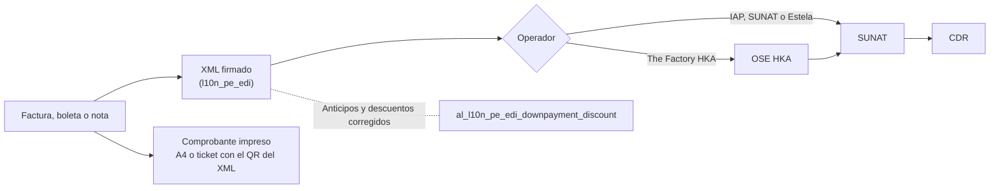

# Facturación electrónica

En Perú, las facturas, boletas, notas de crédito y notas de débito se emiten
como comprobantes electrónicos: un XML firmado que se envía a SUNAT, directamente
o a través de un operador (OSE), y una representación impresa para el cliente.
La localización peruana de Odoo (`l10n_pe_edi`) firma y envía el XML; los
módulos de la suite completan lo que falta para el día a día: el comprobante
impreso, los anticipos y descuentos que SUNAT rechaza, otro operador y la guía
de remisión impresa.

| Necesidad | Quién la resuelve | Página |
|---|---|---|
| Firmar y enviar el XML a SUNAT, consultar el CDR y comunicar bajas | Localización de Odoo (`l10n_pe_edi`) con IAP, SUNAT directo o Estela | [Odoo: localización peruana](https://www.odoo.com/documentation/19.0/es/applications/finance/fiscal_localizations/peru.html) |
| Enviar por el OSE The Factory HKA | `al_ose_factory_hka` | [OSE Factory HKA](electronic_invoicing/ose_factory_hka.md) |
| Imprimir el comprobante en A4 y ticket, con QR, detracción y cuotas | `al_l10n_pe_invoice` | [Comprobante impreso](electronic_invoicing/invoice_report.md) |
| Anticipos exonerados o inafectos, anticipos repetidos, descuentos globales y notas de crédito de esas facturas | `al_l10n_pe_edi_downpayment_discount` | [Anticipos y descuentos](electronic_invoicing/down_payments_discounts.md) |
| Imprimir la guía de remisión electrónica | `al_l10n_pe_delivery_guide_report` (la envía `l10n_pe_edi_stock`) | [Guía de remisión impresa](electronic_invoicing/delivery_guide.md) |
| Boletas y facturas desde el punto de venta | `al_l10n_pe_edi_pos` | [Comprobantes electrónicos en el TPV](../../../sales/point_of_sale/electronic_invoicing.md) |
| Comprobante de retención (CRE) | `al_l10n_pe_retention` | [Retenciones del IGV](withholdings.md) |
| Liquidación de compra a personas naturales sin RUC, con retención del IGV y de la renta | `al_l10n_pe_edi_purchase_settlement` | [Liquidación de compra](electronic_invoicing/purchase_settlement.md) |

## Configuración

1. Configure la localización peruana de Odoo: certificado digital, operador,
   diarios de venta con documentos (series F y B) y tipos de documento.
2. Instale los módulos de la suite que necesite, según la tabla anterior. Cada
   uno funciona por separado: el comprobante impreso no depende del operador, y
   la corrección de anticipos funciona con cualquier operador.

## Emitir un comprobante

1. Registre la venta en **Contabilidad ‣ Clientes ‣ Facturas** y publíquela.
2. El XML se firma y se envía con el operador configurado; con el CDR, el
   comprobante queda enviado.
3. Imprima o envíe al cliente la representación impresa.

!!! note "Nota"
    La factura y su nota se envían hasta el tercer día calendario siguiente a la
    emisión (R.S. 000003-2023/SUNAT). Las boletas se anulan con una nota de
    crédito.

## Reportes

Los comprobantes aceptados alimentan el registro de ventas del
[SIRE](sire.md) y los [libros electrónicos (PLE)](ple.md).

!!! info "Ver también"
    - [R.S. 097-2012/SUNAT: SEE – Del contribuyente](https://www.sunat.gob.pe/legislacion/superin/2012/097-2012.pdf)
    - [R.S. 117-2017/SUNAT: SEE – OSE](https://www.sunat.gob.pe/legislacion/superin/2017/117-2017.pdf)
    - [Reglamento de Comprobantes de Pago (R.S. 007-99/SUNAT)](https://www.sunat.gob.pe/legislacion/superin/1999/007.pdf)
    - [Odoo: localización peruana](https://www.odoo.com/documentation/19.0/es/applications/finance/fiscal_localizations/peru.html)
    - [Libro de reclamaciones](complaints_book.md)
