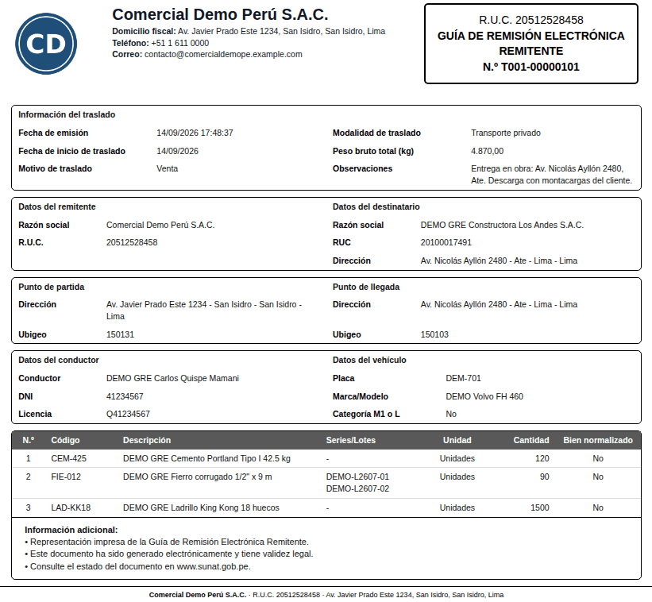
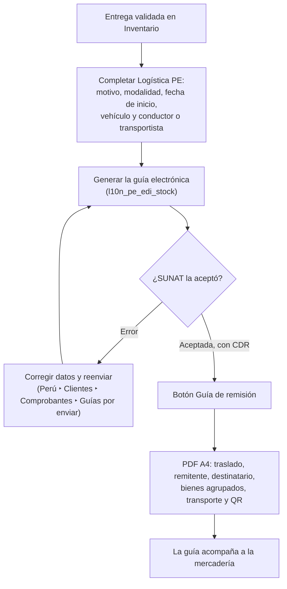
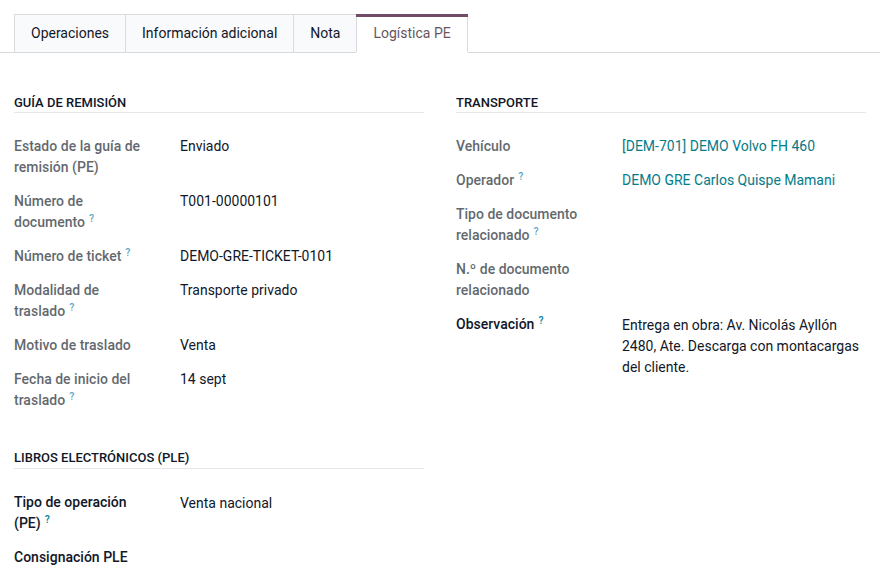
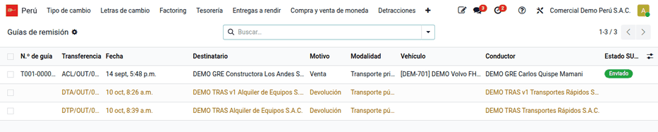

# Guía de remisión impresa

La mercadería que sale del almacén viaja con su **guía de remisión remitente
electrónica (GRE)**. Odoo Enterprise (`l10n_pe_edi_stock`) genera y envía la GRE
a SUNAT, pero el albarán estándar no muestra lo que debe tener la
representación impresa: motivo y modalidad del traslado, conductor y vehículo o
transportista, peso bruto, número de guía y QR. El módulo **Guía de remisión
impresa** (`al_l10n_pe_delivery_guide_report`) agrega:

- la **representación impresa A4** de la GRE desde la entrega;
- una línea por **bien transportado**, que agrupa los movimientos del mismo
  producto y junta sus lotes o series;
- el **peso bruto** de respaldo cuando los productos no tienen peso;
- el menú **Perú ‣ Clientes ‣ Comprobantes ‣ Guías de remisión** con las guías, las pendientes, los
  vehículos y el análisis.

Lo usan almacén y despacho, que emiten e imprimen, y contabilidad, que hace el
seguimiento. El envío a SUNAT, los vehículos, los conductores y el QR del CDR
son de `l10n_pe_edi_stock`. No emite guía de remisión transportista.

## Configuración

1. Instale la guía electrónica peruana (`l10n_pe_edi_stock`, Enterprise) con
   sus credenciales de la API de SUNAT, y el módulo **Guía de remisión
   impresa** (`al_l10n_pe_delivery_guide_report`).
2. Complete la calle y el **distrito** del almacén (o de la compañía) y de los
   clientes: SUNAT rechaza la guía sin ubigeo.
3. Registre los vehículos con placa y operador en **Perú ‣ Configuración ‣
   Comprobantes electrónicos ‣ Vehículos (guías de remisión)**.
4. Configure el peso de los productos o indique el **peso para envío** en la
   entrega.

## Conceptos

| Término | Significado | Dónde aparece en Odoo |
|---|---|---|
| GRE remitente | Guía que emite el dueño o remitente de los bienes | Entrega ‣ **Logística PE** ‣ **Guía de remisión** |
| Motivo de traslado | Catálogo 20 de SUNAT: venta, compra, traslado entre establecimientos… | Campo motivo en la entrega |
| Modalidad | Transporte privado (vehículo y conductor propios) o público (transportista) | Campo modalidad |
| CDR | Constancia de recepción de SUNAT, que trae el QR | Adjunto de la entrega |
| Representación impresa | Versión en papel o PDF que acompaña a la mercadería | Botón **Guía de remisión** |

## Emitir la guía

1. Valide la entrega en **Inventario ‣ Operaciones ‣ Entregas**.
2. En la página **Logística PE** de la entrega, grupos **Guía de remisión** y
   **Transporte**, complete el motivo, la modalidad, la fecha de inicio y el
   vehículo y conductor (transporte privado) o el transportista (transporte
   público).
3. Genere la guía con el flujo nativo de la localización: la entrega recibe el
   número de guía y el ticket de SUNAT.
4. Revise en **Perú ‣ Clientes ‣ Comprobantes ‣ Guías por enviar** y **Guías de remisión**
   las pendientes (en amarillo) y las rechazadas (en rojo); corrija y reenvíe.

!!! note "Nota"
    Con transporte público, la guía imprime la razón social, el RUC y el
    registro MTC del transportista en lugar del conductor y el vehículo.

## Imprimir la guía

Haga clic en **Guía de remisión** en la entrega, o vaya a **⚙ ‣ Imprimir**. El
PDF se llama `GUIA_REMISION - <cliente> - <referencia>` y muestra el traslado,
el remitente, el destinatario, los bienes, el transporte y, con el CDR
recibido, el QR de SUNAT.

### Una línea por bien

La guía declara **bienes transportados**, no movimientos de stock. Ejemplo con
la entrega de demostración **DEMO GRE Obra Ate**, transporte privado, guía
`T001-00000101`:

| N° | Código | Descripción | Series o lotes | Cantidad |
|---|---|---|---|---|
| 1 | CEM-425 | Cemento Portland Tipo I 42.5 kg | — | 120 |
| 2 | FIE-012 | Fierro corrugado 1/2" x 9 m | DEMO-L2607-01 · DEMO-L2607-02 | 90 |
| 3 | LAD-KK18 | Ladrillo King Kong 18 huecos | — | 1 500 |

El fierro salió en dos movimientos por lote (60 + 30 = 90): la guía declara
**un solo bien** con sus dos lotes, como exige SUNAT.

### Peso bruto

Los productos del ejemplo no tienen peso configurado: el peso bruto total
declarado es el **peso para envío** de la entrega, 4 870 kg, en lugar de
0 KGM, también en el XML. Para obtener el peso desde el detalle, configure el
peso de cada producto.

!!! note "Nota"
    El módulo no genera asientos: la salida de mercadería la contabiliza la
    valorización de inventario de Odoo. El formato es A4; otros tamaños de
    papel requieren una personalización.

## Reportes

- **Guía de remisión** (PDF A4).
- **Perú ‣ Clientes ‣ Comprobantes ‣ Guías de remisión**: lista con el estado SUNAT y filtros **Por
  enviar**, **Enviadas**, **Con error** y por modalidad.
- **Perú ‣ Informes ‣ Análisis ‣ Guías de remisión**: guías por motivo y mes.
- El [kárdex valorizado](../../../../inventory_and_mrp/inventory/kardex.md) usa
  el tipo 09 (guía de remisión) en los movimientos sin comprobante de pago.

## Casos especiales

| Situación | Qué pasa | Qué hacer |
|---|---|---|
| No aparece el botón **Guía de remisión** | La entrega no está hecha o la guía aún no tiene ticket de SUNAT | Validar la entrega y emitir la GRE; mientras tanto, imprimir desde **⚙ ‣ Imprimir** |
| La guía no muestra QR | Todavía no hay CDR | Esperar la respuesta de SUNAT o reenviar desde **Por enviar** |
| Peso bruto distinto de la suma de los productos | Los productos no tienen peso y se usó el peso para envío | Configurar el peso de los productos |
| SUNAT rechaza por dirección | Falta el distrito (ubigeo) del almacén o del cliente | Completar el distrito y reenviar |
| Traslado entre almacenes o de bienes de terceros | La guía nativa solo cubre entregas | Usar [traslados y bienes de terceros](../../../../inventory_and_mrp/inventory/stock_transfers.md) (motivo 04) |

!!! info "Ver también"
    - [R.S. 123-2022/SUNAT: guía de remisión electrónica](https://www.sunat.gob.pe/legislacion/superin/2022/123-2022.pdf) y su [anexo](https://www.sunat.gob.pe/legislacion/superin/2022/anexo-123-2022.pdf)
    - [Reglamento de Comprobantes de Pago (R.S. 007-99/SUNAT), arts. 17 a 21](https://www.sunat.gob.pe/legislacion/superin/1999/007.pdf)
    - [Orientación SUNAT: guía de remisión remitente](https://orientacion.sunat.gob.pe/02-guia-de-remision-remitente)
    - [Odoo: localización peruana](https://www.odoo.com/documentation/19.0/es/applications/finance/fiscal_localizations/peru.html)
    - [Odoo: envíos y recepciones](https://www.odoo.com/documentation/19.0/es/applications/inventory_and_mrp/inventory/shipping_receiving.html)
    - [Facturación electrónica en la suite](../electronic_invoicing.md)
