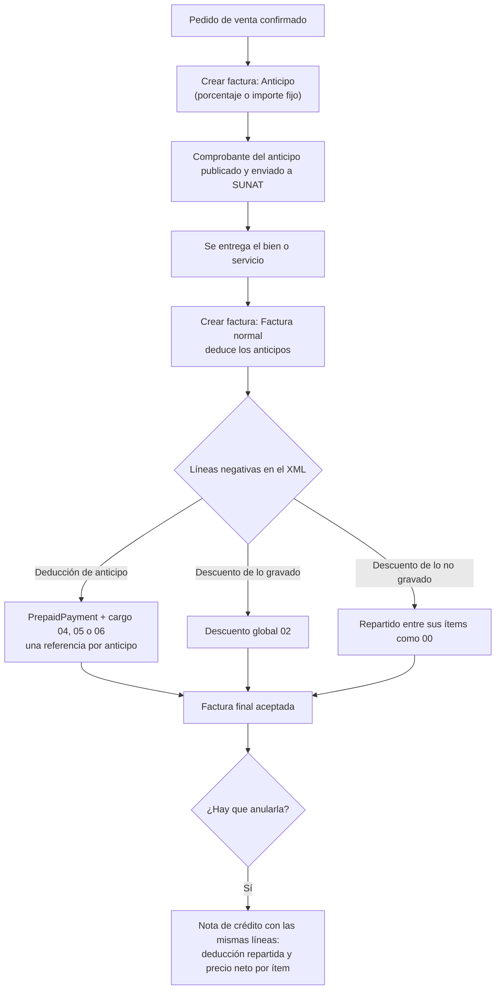
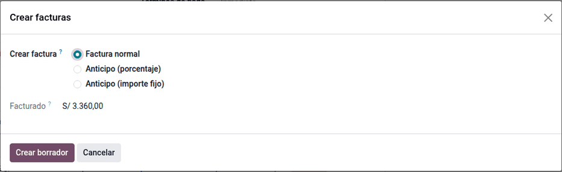
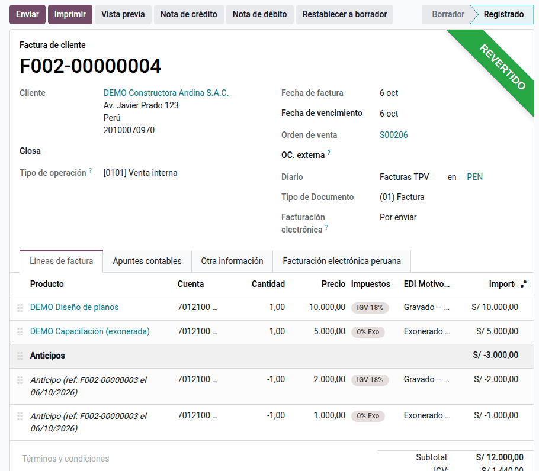

# Anticipos y descuentos

Cuando una venta se cobra por adelantado, primero se emite el **comprobante del
anticipo** y luego la **factura final**, que **deduce** lo anticipado. Odoo
resuelve el caso simple (anticipo gravado), pero SUNAT rechaza el XML cuando:

- el anticipo incluye partes **exoneradas o inafectas**, que Odoo informa como
  descuento gravado;
- el mismo comprobante de anticipo aparece **varias veces** (error 2365);
- hay un **descuento global** sobre partes no gravadas;
- se emite una **nota de crédito** de una factura con anticipos o descuentos,
  que Odoo no deja publicar.

El módulo **Anticipos y descuentos en CPE** (`al_l10n_pe_edi_downpayment_discount`)
corrige el XML en esos casos. **No cambia la contabilidad**: todo ocurre al
generar el archivo que va a SUNAT, y al desinstalarlo Odoo vuelve al XML
estándar. Lo usan facturación y ventas. Los anticipos de compras (los emite el
proveedor) y la percepción o detracción del anticipo quedan fuera: los resuelven
sus propios módulos.

## Configuración

1. Instale el módulo (requiere `l10n_pe_edi` y Ventas). No tiene ajustes
   propios.
2. Revise en **Ventas ‣ Configuración ‣ Ajustes** el producto y la cuenta de
   anticipos.
3. Para un descuento global, use una línea negativa con el impuesto de lo que
   se descuenta, por ejemplo el producto de descuento de Ventas.

## Conceptos

| Término | Significado | En el XML |
|---|---|---|
| Comprobante de anticipo | Factura o boleta emitida al cobrar el anticipo | Referenciado en la factura final |
| Deducción del anticipo | Línea negativa de la factura final que resta lo anticipado | `PrepaidPayment` y cargo o descuento global |
| Código 04, 05 o 06 | Catálogo 53: anticipo gravado, exonerado o inafecto | `AllowanceCharge` |
| Código 02 | Descuento global que afecta la base gravada | `AllowanceCharge` |
| Código 00 | Descuento de línea (ítem) | En cada ítem |
| Regla 2365 | SUNAT rechaza un comprobante de anticipo repetido | Una referencia por anticipo |

## Facturar el anticipo

1. Confirme el pedido en **Ventas ‣ Pedidos**.
2. Haga clic en **Crear factura** y elija **Anticipo**, por porcentaje o por
   importe fijo.
3. Publique la factura o boleta del anticipo en **Contabilidad ‣ Clientes ‣
   Facturas** y envíela a SUNAT.

## Facturar el saldo

1. Cuando se entregue el bien o el servicio, haga clic en **Crear factura** en
   el pedido y elija **Factura normal**.
2. La factura final trae la sección **Anticipos**, que resta lo cobrado.
3. Publique y envíe la factura: el XML lleva los anticipos y los descuentos
   corregidos.

### Ejemplo con partes gravadas y exoneradas

Contrato de una constructora: diseño de planos **gravado** (S/ 10 000 + IGV) y
capacitación **exonerada** (S/ 5 000). Total del contrato S/ 16 800, con un
anticipo del 20 % (IGV 18 %):

| Concepto | Contrato | Anticipo 20 % | Factura final (saldo) |
|---|---|---|---|
| Base gravada (diseño) | 10 000,00 | 2 000,00 | 8 000,00 |
| IGV 18 % | 1 800,00 | 360,00 | 1 440,00 |
| Exonerado (capacitación) | 5 000,00 | 1 000,00 | 4 000,00 |
| **Total** | **16 800,00** | **3 360,00** | **13 440,00** |

En el XML de la factura final, la deducción sale como **cargo 04** (anticipo
gravado, S/ 2 000 de base) y **cargo 05** (anticipo exonerado, S/ 1 000), con
**un solo** `PrepaidPayment` de S/ 3 360 referido al comprobante del anticipo.
Sin el módulo, Odoo informa los dos como descuento gravado y repite la
referencia, y SUNAT rechaza el comprobante (regla 2365 y descuadre de la base).

Los asientos son los de Odoo; el módulo no los cambia. Con la cuenta de
anticipos de Ventas configurada como 122 Anticipos de clientes:

Comprobante del anticipo:

| Cuenta | Descripción | Debe | Haber |
|---|---|---|---|
| 1212 | Facturas por cobrar emitidas en cartera | 3 360,00 | |
| 40111 | IGV – cuenta propia | | 360,00 |
| 122 | Anticipos de clientes | | 3 000,00 |
| | **Totales** | **3 360,00** | **3 360,00** |

Factura final:

| Cuenta | Descripción | Debe | Haber |
|---|---|---|---|
| 1212 | Facturas por cobrar emitidas en cartera | 13 440,00 | |
| 122 | Anticipos de clientes (deducción) | 3 000,00 | |
| 70321 | Servicios – local – terceros: diseño 10 000 + capacitación 5 000 | | 15 000,00 |
| 40111 | IGV neto (1 800 – 360) | | 1 440,00 |
| | **Totales** | **16 440,00** | **16 440,00** |

### Descuentos globales

Las líneas negativas que no son anticipos se informan según su impuesto: el
descuento sobre lo gravado sale como **descuento global 02**, y el de lo no
gravado se reparte entre sus ítems como descuento de línea **00**.

!!! warning "Importante"
    Si los descuentos de un impuesto superan el importe de sus ítems, el
    módulo avisa al publicar: el XML no puede cuadrar. Revise las líneas
    negativas.

## Anular la factura final

Haga clic en **Nota de crédito** en la factura final. La nota se publica con
las mismas líneas, sin rehacerlas: en el XML, la deducción del anticipo se
reparte entre los ítems del mismo impuesto y cada ítem lleva su precio neto
(regla 3271 de la nota de crédito). El asiento es el inverso del de la factura
final.

## Reportes

- En el registro de ventas ([SIRE](../sire.md) y [PLE](../ple.md)), la factura
  final y la nota se registran con sus importes contables, que no cambian.
- El [comprobante impreso](invoice_report.md) muestra la sección de anticipos.

## Casos especiales

| Situación | Qué pasa | Qué hacer |
|---|---|---|
| Anticipo solo gravado | Sale igual que en Odoo estándar | Nada |
| Varios anticipos del mismo pedido | Una referencia y un `PrepaidPayment` por cada comprobante de anticipo | Nada |
| Anticipo emitido con boleta | El tipo del anticipo (03) se toma del propio comprobante | Nada |
| Descuentos de un impuesto mayores que sus ítems | Aviso al publicar | Revisar las líneas negativas |
| Anticipos en dólares o con IGV incluido | Cubiertos | Nada |

!!! note "Nota"
    El módulo se comprobó con las reglas de validación oficiales de SUNAT del
    26/08/2026 en 20 escenarios (anticipos simples, dobles, en dólares, con IGV
    incluido, en boletas, mixtos y notas de crédito), todos con el mismo total
    que el asiento. Las guías XML UBL 2.1 y el archivo de reglas oficiales
    están en `docs/anticipos/oficial/` del repositorio, con el resumen en
    [las reglas SUNAT de anticipos y descuentos](../../../../../developer/specs/anticipos/reglas_sunat_anticipos_descuentos.md).

!!! info "Ver también"
    - [Reglamento de Comprobantes de Pago (R.S. 007-99/SUNAT)](https://www.sunat.gob.pe/legislacion/superin/1999/007.pdf): comprobante en la fecha del cobro del anticipo y deducción posterior
    - [R.S. 117-2017/SUNAT (SEE-OSE)](https://www.sunat.gob.pe/legislacion/superin/2017/117-2017.pdf) y su [Anexo I](https://www.sunat.gob.pe/legislacion/superin/2017/anexoI-117-2017.pdf)
    - [Odoo: anticipos en Ventas](https://www.odoo.com/documentation/19.0/es/applications/sales/sales/invoicing/down_payment.html)
    - [Facturación electrónica en la suite](../electronic_invoicing.md)
