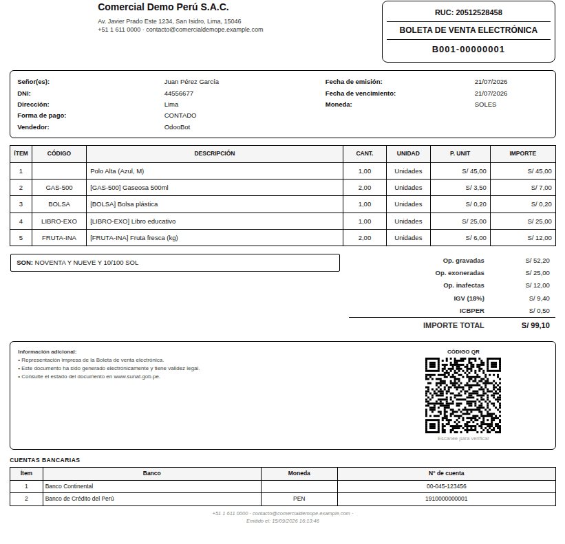
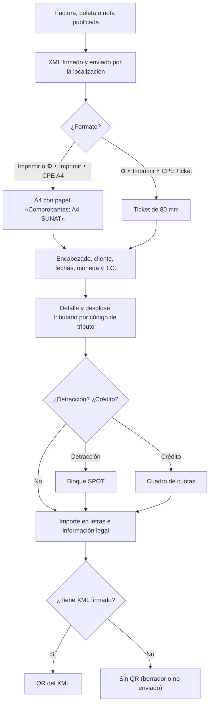
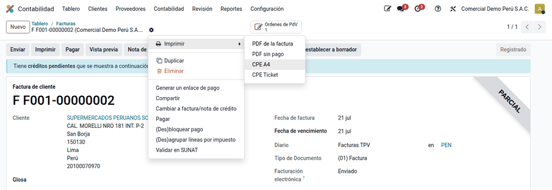
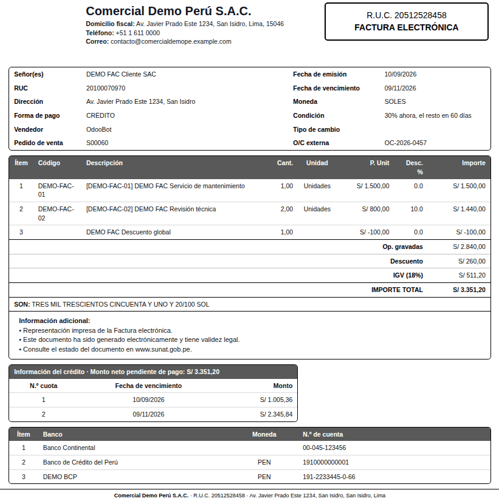
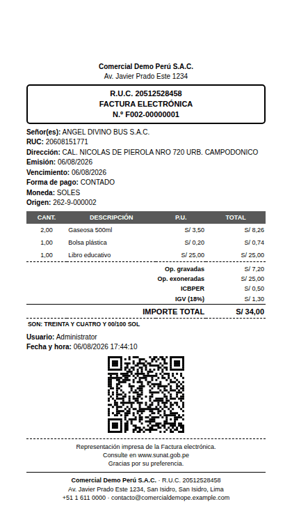

# Comprobante impreso

La representación impresa es lo que recibe el cliente de una factura, boleta,
nota de crédito o nota de débito electrónica, y debe mostrar lo mismo que el
XML enviado a SUNAT. El módulo **Comprobantes electrónicos impresos**
(`al_l10n_pe_invoice`) la genera en **A4** y en **ticket de 80 mm**, a partir de
los datos que firmó la localización peruana de Odoo (`l10n_pe_edi`). No firma ni
envía nada a SUNAT: de eso se encarga la localización o el operador OSE.

El comprobante impreso muestra:

- RUC, tipo y número del comprobante en el recuadro SUNAT;
- desglose de **operaciones gravadas, exoneradas e inafectas**, ISC, IGV e
  ICBPER, solo con las filas que tienen importe;
- **importe en letras**, moneda y tipo de cambio cuando no es en soles;
- bloque de **detracción** (SPOT) y cuadro de **cuotas** en las ventas al
  crédito;
- **código QR** tomado del XML firmado, no recalculado;
- pedido de venta, orden de compra del cliente, firmas y cuentas bancarias.

## Configuración

1. Instale el módulo **Comprobantes electrónicos impresos**
   (`al_l10n_pe_invoice`).
2. Vaya a **Perú ‣ Configuración ‣ Ajustes ‣ Comprobantes electrónicos** y, si
   el A4 debe llevar firmas, active **Firma y eslogan en el reporte**, elija el
   **Representante** y escriba el **Eslogan**.
3. Complete el logo y los datos de la compañía: dirección con distrito,
   teléfono y correo.
4. Registre la cuenta en el Banco de la Nación en la compañía si vende bienes o
   servicios sujetos a detracción.
5. Revise en **Perú ‣ Configuración ‣ Comprobantes electrónicos ‣
   Certificados digitales** que el certificado con el que se firma el XML está
   vigente.

## Conceptos

| Término | Significado | En el comprobante |
|---|---|---|
| Op. gravadas, exoneradas e inafectas | Bases según la afectación del IGV (códigos de tributo 1000, 9997 y 9998) | Filas de totales |
| ICBPER | Impuesto al consumo de bolsas plásticas (tributo 7152) | Fila ICBPER |
| SPOT | Sistema de detracciones: porcentaje que el cliente deposita en el Banco de la Nación | Bloque **Información de la detracción — SPOT** |
| Forma de pago crédito | Factura con vencimiento posterior a la emisión | **CRÉDITO** y cuadro de cuotas |
| QR | Datos del comprobante y del XML firmado para verificarlo | Pie del comprobante |

## Imprimir el comprobante

1. Registre y publique la venta en **Contabilidad ‣ Clientes ‣ Facturas**. La
   localización firma y envía el XML.
2. Para el **A4**, haga clic en **Imprimir** o vaya a **⚙ ‣ Imprimir ‣ CPE A4**.
   El PDF usa el papel **Comprobantes: A4 SUNAT** y se nombra con el número del
   comprobante y el cliente.
3. Para el **ticket**, vaya a **⚙ ‣ Imprimir ‣ CPE Ticket**: sale en 80 mm.

!!! note "Nota"
    El PDF estándar de Odoo sigue disponible en **Imprimir**; el botón
    **Imprimir** de la factura usa el CPE A4. El formato no depende del
    operador: funciona igual con la localización nativa que con un OSE.

### Desglose tributario

Ejemplo con la boleta **B001-00000001**: productos gravados, un libro
exonerado, fruta inafecta y una bolsa plástica.

| Fila del comprobante | Importe |
|---|---|
| Op. gravadas | 52,20 |
| Op. exoneradas | 25,00 |
| Op. inafectas | 12,00 |
| IGV 18 % (52,20 × 0,18 = 9,396) | 9,40 |
| ICBPER | 0,50 |
| **Total** | **99,10** |

El asiento de la boleta usa las cuentas de ingreso de los productos; la del
ICBPER es la configurada en su impuesto (por ejemplo, 40189 Otros impuestos):

| Cuenta | Descripción | Debe | Haber |
|---|---|---|---|
| 1212 | Facturas, boletas y otros comprobantes por cobrar | 99,10 | |
| 70121 | Mercaderías – venta local (52,20 + 25,00 + 12,00) | | 89,20 |
| 40111 | IGV – cuenta propia | | 9,40 |
| 40189 | Otros impuestos (ICBPER) | | 0,50 |
| | **Totales** | **99,10** | **99,10** |

Solo se imprimen las filas con importe: una boleta sin productos inafectos no
muestra **Op. inafectas**. En una factura en dólares, el desglose sale en la
moneda del documento con el tipo de cambio de la factura (tres decimales).

### Detracción

En la factura **F001-00000002** de S/ 2 301,00, un servicio sujeto al 12 %
(código 022): 2 301,00 × 12 % = 276,12, y el comprobante muestra **S/ 276,00**
a depositar en el Banco de la Nación, porque SUNAT exige el monto de la
detracción sin decimales. El bloque SPOT muestra el número de cuenta del Banco
de la Nación solo si la compañía lo tiene registrado.

### Venta al crédito

Desde el pedido **DEMO FAC**, con los términos «30 % ahora, el resto en 60
días» sobre S/ 3 351,20: cuota 1 = 1 005,36 y cuota 2 = 2 345,84
(1 005,36 + 2 345,84 = 3 351,20). La forma de pago pasa a **CRÉDITO** y se
imprime **Información del crédito** con cada cuota.

#### Cliente agente de retención

Si el cliente es agente de retención, el **Monto neto pendiente de pago** y las
cuotas no incluyen la retención del IGV (R.S. 193-2020/SUNAT, numeral 2.1). La
retención es el 3 % del total cuando el comprobante supera S/ 700; no se
aplica si la operación tiene detracción, si no tiene IGV, o si su compañía es
agente de retención o buen contribuyente. Se reparte entre las cuotas en
proporción a cada una, igual en el PDF y en el XML.

Por ejemplo, una factura de S/ 1 180,00 en dos cuotas iguales: retención
35,40, neto pendiente **S/ 1 144,60** y cuotas de **572,30** cada una.

### Orden de compra del cliente

En **Ventas ‣ Pedidos**, el campo **OC. externa** guarda el número de la orden
de compra del cliente y se imprime como **O/C externa** en el comprobante.

### Ticket de 80 mm

El ticket muestra los mismos datos en formato angosto. Lo reutiliza el
[punto de venta peruano](../../../../sales/point_of_sale/electronic_invoicing.md).
En las notas de crédito no se imprime la detracción.

### Código QR

El QR no se calcula en Odoo: se toma del XML firmado con el método de la
localización, para que coincida con lo enviado a SUNAT. Sin XML firmado no se
imprime un QR falso y la información legal ocupa todo el ancho.

## Reportes

- Los informes **CPE A4** y **CPE Ticket** están en el menú **Imprimir** de la
  factura.
- El desglose tributario se guarda en la factura y coincide con el registro de
  ventas ([SIRE](../sire.md) y [PLE](../ple.md)).

## Casos especiales

| Situación | Qué pasa | Qué hacer |
|---|---|---|
| Comprobante en borrador | Sin número en el recuadro y sin QR | Publicar y enviar |
| Sin XML firmado | No se imprime el QR; la información legal ocupa todo el ancho | Esperar el envío o revisar el estado del documento electrónico |
| Factura en dólares | Desglose en la moneda del documento y tipo de cambio de la factura | Nada |
| Falta la cuenta del Banco de la Nación | El bloque SPOT sale sin número de cuenta | Registrar la cuenta en la compañía |
| Nota de crédito | Muestra **Modifica a** con el documento de origen; el ticket no imprime la detracción | Nada |
| No se quieren firmas | El A4 sale sin bloque de firmas | Desactivar **Firma y eslogan en el reporte** |

!!! info "Ver también"
    - [Reglamento de Comprobantes de Pago (R.S. 007-99/SUNAT)](https://www.sunat.gob.pe/legislacion/superin/1999/007.pdf)
    - [R.S. 340-2017/SUNAT: código QR en la representación impresa](https://www.sunat.gob.pe/legislacion/superin/2017/340-2017.pdf) y su prórroga, la [R.S. 309-2018/SUNAT](https://www.sunat.gob.pe/legislacion/superin/2018/309-2018.pdf)
    - [R.S. 193-2020/SUNAT: forma de pago, monto neto pendiente y cuotas](https://www.sunat.gob.pe/legislacion/superin/2020/193-2020.pdf)
    - [Anexo I de la R.S. 117-2017/SUNAT: requisitos del comprobante electrónico](https://www.sunat.gob.pe/legislacion/superin/2017/anexoI-117-2017.pdf)
    - [Odoo: localización peruana](https://www.odoo.com/documentation/19.0/es/applications/finance/fiscal_localizations/peru.html)
    - [Odoo: facturas de cliente](https://www.odoo.com/documentation/19.0/es/applications/finance/accounting/customer_invoices.html)
    - [Facturación electrónica en la suite](../electronic_invoicing.md)
