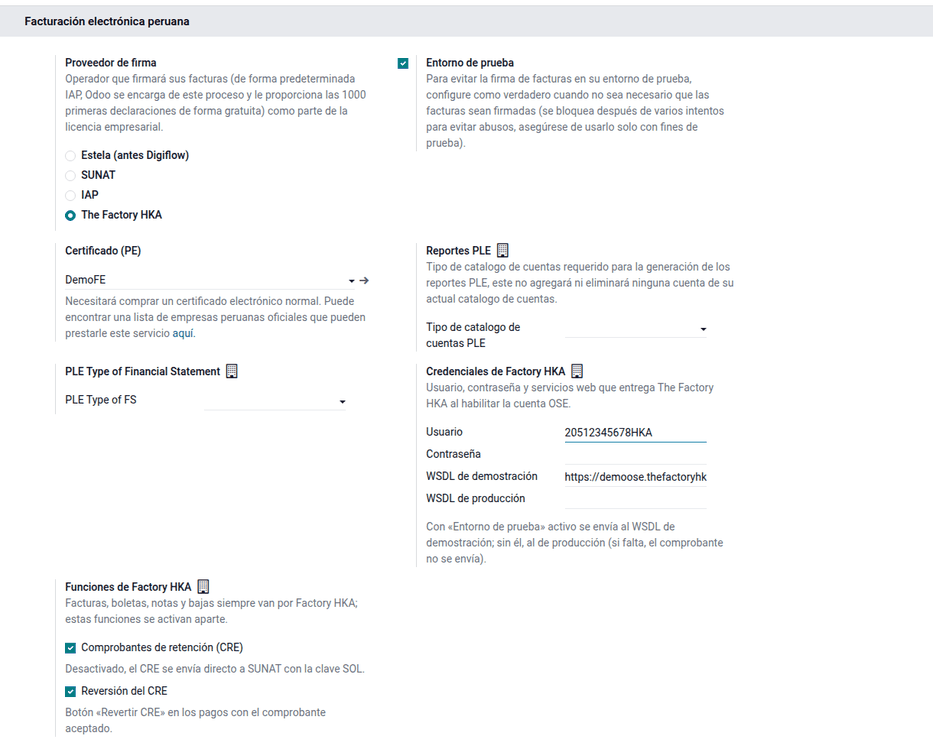
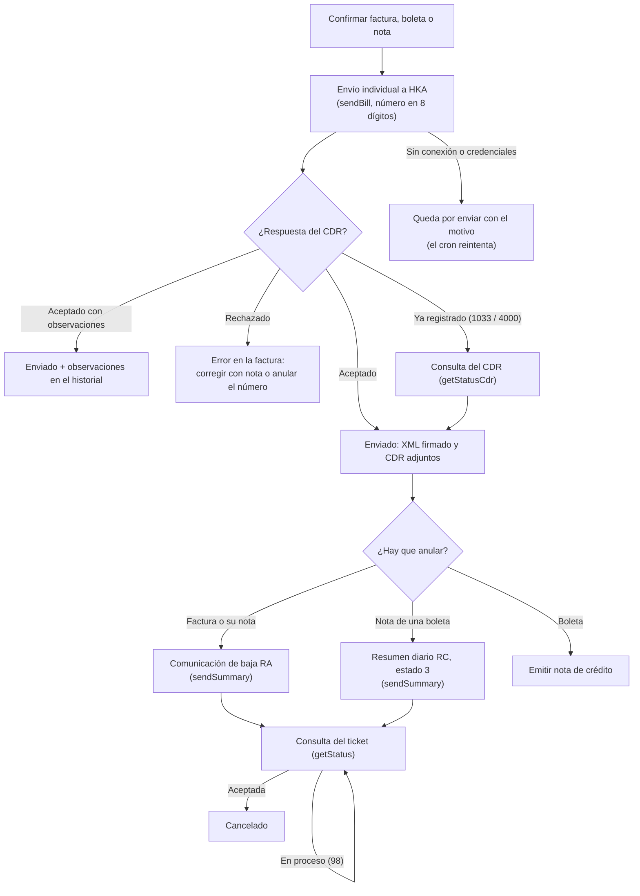

# OSE Factory HKA

Una empresa obligada a la facturación electrónica puede enviar sus comprobantes
directamente a SUNAT o a través de un **Operador de Servicios Electrónicos
(OSE)**, que los valida y le devuelve la constancia de recepción (CDR). Odoo
trae como operadores IAP, SUNAT directo y Estela. El módulo **OSE The Factory
HKA** (`al_ose_factory_hka`) agrega **The Factory HKA**, para las empresas que
contrataron ese OSE.

Lo usan facturación (emite y envía), contabilidad (bajas y notas) y tesorería
(comprobantes de retención). El usuario factura igual que siempre: el módulo
solo cambia **por dónde sale** el comprobante. Cubre facturas, boletas, notas
de crédito y débito (también las del punto de venta), comunicaciones de baja,
baja de notas de boleta por resumen diario, consulta del CDR, el comprobante de
retención (CRE) y su reversión.

Quedan fuera:

- la **guía de remisión electrónica (GRE)**, que SUNAT recibe por su propia API
  REST (`l10n_pe_edi_stock`), no por el OSE;
- los **comprobantes de contingencia**, emitidos en papel ante una caída, que
  se informan aparte a SUNAT;
- el **resumen diario para informar boletas** (estado 1): Odoo envía cada
  boleta de forma individual, que SUNAT también admite.

## Configuración

1. Vaya a **Ajustes ‣ Contabilidad ‣ Facturación electrónica peruana** y cargue
   el **Certificado (PE)** digital de la compañía.
2. En **Operador**, marque **The Factory HKA**.
3. Escriba las credenciales de Factory HKA: usuario, contraseña, WSDL de
   demostración (viene cargado) y WSDL de producción. Solo los administradores
   las ven.
4. Active **Entorno de prueba** para validar con HKA antes de producción y
   desactívelo al pasar a producción.
5. En **Funciones de Factory HKA**, revise **Comprobantes de retención (CRE)**
   y **Reversión del CRE** (activas por defecto). Si desactiva el CRE, este se
   envía directo a SUNAT con la clave SOL.
6. Configure los diarios de venta con documentos (series F y B) y los tipos de
   documento de la localización.

!!! warning "Importante"
    El módulo se probó con el servicio simulado. Valide la primera emisión en
    producción con las credenciales que entrega HKA. Sin credenciales o sin
    WSDL de producción, el documento queda por enviar con el motivo: nunca se
    envía al ambiente de demostración por error.

## Conceptos

| Término | Significado | En Odoo |
|---|---|---|
| OSE | Operador que valida los comprobantes en nombre de SUNAT | Operador **The Factory HKA** en Ajustes |
| CDR | Constancia de recepción: aceptado, aceptado con observaciones o rechazado | Adjunto `CDR-…xml` en el ZIP de la factura |
| Comunicación de baja (RA) | Anula facturas y sus notas ya aceptadas | Botón **Solicitar cancelación de EDI** |
| Resumen diario (RC) | Informa o da de baja boletas y sus notas, por fecha de emisión | Se arma solo al anular una nota de boleta |
| Ticket | Número que devuelve el OSE al recibir un resumen o una baja | Campo **Número de CDR de cancelación** |
| CRE / RR | Comprobante de retención y su resumen de reversiones | Pago con retención ‣ **Revertir CRE** |

## Emitir y enviar comprobantes

1. Confirme la factura, boleta o nota en **Contabilidad ‣ Clientes ‣
   Facturas**: se crea el asiento y el documento electrónico queda por enviar.
2. Haga clic en **Procesar ahora** o espere a la acción programada de envíos.
3. Con el CDR aceptado, la factura queda **Enviada** con el XML firmado y el
   CDR en un ZIP adjunto. Si el CDR trae observaciones, se listan en el
   historial: el comprobante es válido y el dato se corrige en los siguientes.

### Ejemplo

Comercial Demo Perú S.A.C. vende a un cliente con RUC 5 kg de un producto a
S/ 2 000 por kg, con 20 % de descuento, gravado con IGV 18 %, en la factura
**F001-11** del 06/10/2026:

- valor de venta: 5 × 2 000 × (1 − 0,20) = **8 000,00**;
- IGV: 8 000,00 × 18 % = **1 440,00**;
- total: **9 440,00**.

| Cuenta | Descripción | Debe | Haber |
|---|---|---:|---:|
| 1212 | Facturas, boletas y otros comprobantes por cobrar – Emitidas en cartera | 9 440,00 | |
| 40111 | IGV – Cuenta propia | | 1 440,00 |
| 70121 | Mercaderías – Venta local – Terceros | | 8 000,00 |
| | **Totales** | **9 440,00** | **9 440,00** |

El archivo enviado se llama `RUC-01-F001-00000011.zip`: HKA exige el número con
8 dígitos en el nombre del archivo, aunque la factura se llame F001-11; el
número del comprobante y su XML no cambian. HKA devuelve el CDR con código 0.

### Plazo de envío

La factura y su nota se envían hasta el **tercer día calendario siguiente** a la
emisión: la F001-11 debía enviarse hasta el 09/10/2026. Si se envía después, el
historial muestra el aviso de envío fuera de plazo.

!!! danger "Advertencia"
    Una factura enviada fuera de plazo no tiene calidad de factura. Evalúe el
    caso con el contador.

### Rechazos y documentos ya registrados

- **Rechazo del OSE:** el número queda registrado como inválido en SUNAT.
  Emita otro comprobante, o una nota si el original fue aceptado.
- **Documento ya registrado** (códigos 1033 o 4000): Odoo consulta el CDR y, si
  el cliente y el número coinciden, lo da por enviado.

## Anular comprobantes

1. En la factura o nota aceptada, escriba el **Motivo de cancelación** y haga
   clic en **Solicitar cancelación de EDI**.
2. Según el documento, el módulo envía:
    - una **comunicación de baja (RA)** para facturas y sus notas;
    - un **resumen diario (RC)** con estado 3 para las notas de boleta.
3. El ticket que devuelve HKA se guarda en **Número de CDR de cancelación**. Con
   **Procesar ahora**, o con la acción programada, se consulta el ticket hasta
   que la baja queda aceptada y el documento pasa a **Cancelado** con el CDR de
   la baja adjunto.

Ejemplo: la boleta B001-21 (mismos importes que la factura anterior) tiene una
nota de crédito BNC-21 de S/ 9 440,00 que no se entregó al cliente. Al anular la
nota, el módulo envía el resumen `RUC-RC-20261006-1` con una línea: tipo 07,
número BNC-21, referencia a la boleta B001-21 (tipo 03), estado 3, total
9 440,00, gravadas 8 000,00 e IGV 1 440,00.

!!! note "Nota"
    Una boleta solo se anula con una nota de crédito. SUNAT permite la baja por
    resumen únicamente si la boleta no se entregó al cliente, y Odoo usa la
    nota de crédito en todos los casos.

## Comprobante de retención

Con **Comprobantes de retención (CRE)** activo, el CRE de los pagos con
[retención del IGV](../withholdings.md) se envía por HKA. Para revertirlo, vaya
a **Perú ‣ Proveedores ‣ Detracciones, retenciones y percepciones ‣ Retenciones efectuadas**, abra el pago y haga clic
en **Revertir CRE**, con el motivo obligatorio: el módulo envía el resumen de
reversiones (RR) y guarda el ticket, que se consulta con **Consultar
reversión**. Con **Reversión del CRE** desactivada la reversión no está
disponible; con el CRE desactivado, la reversión va directo a SUNAT como en
[Retenciones del IGV](../withholdings.md#revertir-un-cre-aceptado).

## Reportes

- La lista de facturas muestra el estado electrónico; los ZIP con el XML y el
  CDR quedan en cada comprobante.
- Los [libros electrónicos (PLE)](../ple.md) y el [SIRE](../sire.md) se generan
  con los comprobantes aceptados; las bajas aceptadas dejan los documentos como
  anulados.
- Los comprobantes de retención están en **Perú ‣ Proveedores ‣ Detracciones, retenciones y percepciones**.

## Casos especiales

| Situación | Qué pasa | Qué hacer |
|---|---|---|
| Faltan el usuario o la contraseña de HKA | El documento queda por enviar con el motivo | Cargar las credenciales y hacer clic en **Procesar ahora** |
| Producción sin WSDL de producción | No se envía | Pedir el WSDL a HKA y cargarlo, o activar el entorno de prueba |
| Anular juntas una factura y una nota de boleta | Error: van por caminos distintos | Solicitar la cancelación por separado |
| Anular notas de boleta de fechas distintas | Error: un resumen es de una sola fecha | Anular cada fecha por separado |
| Ticket en proceso (código 98) | La baja sigue pendiente | Volver a procesar más tarde; la acción programada lo hace sola |

!!! info "Ver también"
    - [R.S. 117-2017/SUNAT: SEE – OSE](https://www.sunat.gob.pe/legislacion/superin/2017/117-2017.pdf)
    - [R.S. 097-2012/SUNAT: SEE – Del contribuyente](https://www.sunat.gob.pe/legislacion/superin/2012/097-2012.pdf)
    - [R.S. 000003-2023/SUNAT: plazo de envío de la factura](https://www.sunat.gob.pe/legislacion/superin/2023/000003-2023.pdf)
    - [R.S. 000048-2026/SUNAT: baja de boletas y notas con el resumen diario (art. 17.4 de la R.S. 117-2017)](https://www.sunat.gob.pe/legislacion/superin/2026/000048-2026.pdf)
    - [Guía SUNAT del resumen diario de boletas y notas](https://cpe.sunat.gob.pe/sites/default/files/inline-files/GUIA_Resumen_de_Boletas_11-01-2018%20%282%29_2_0%20%281%29_0.pdf)
    - [Orientación SUNAT: operatividad de la emisión electrónica](https://orientacion.sunat.gob.pe/3529-operatividad)
    - [R.S. 123-2022/SUNAT: guía de remisión electrónica](https://www.sunat.gob.pe/legislacion/superin/2022/123-2022.pdf)
    - [The Factory HKA Perú](https://www.thefactoryhka.com/pe/)
    - [Odoo: localización peruana](https://www.odoo.com/documentation/19.0/es/applications/finance/fiscal_localizations/peru.html)
    - [Facturación electrónica en la suite](../electronic_invoicing.md)
