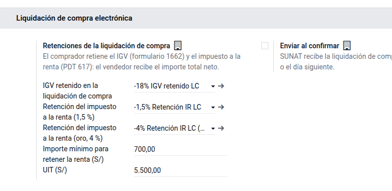
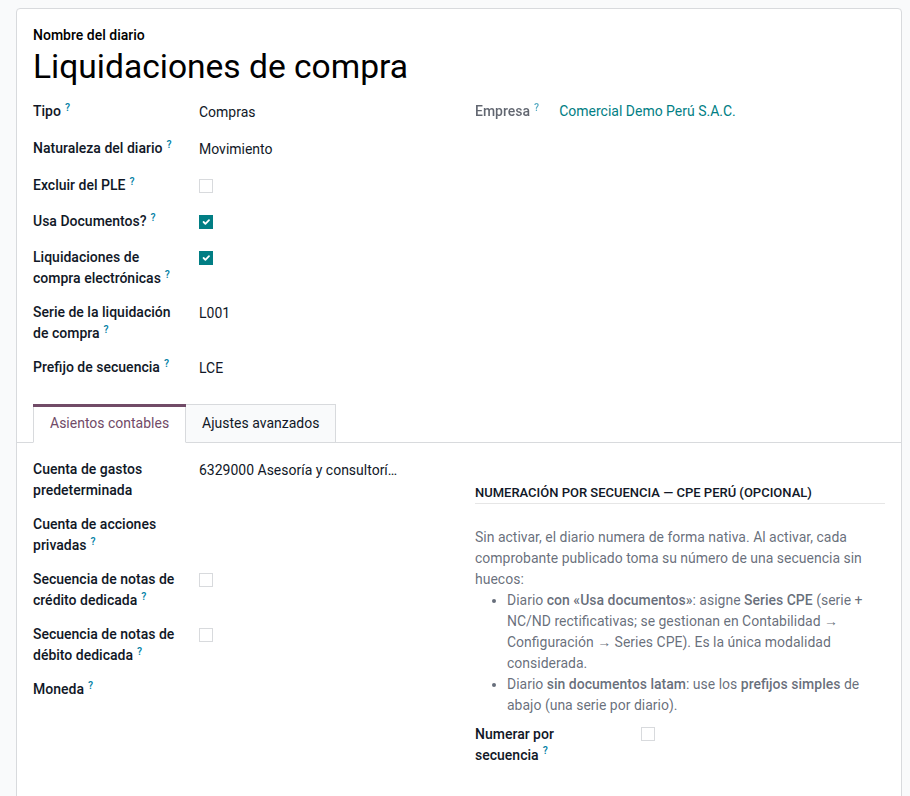
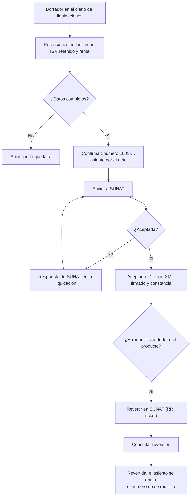
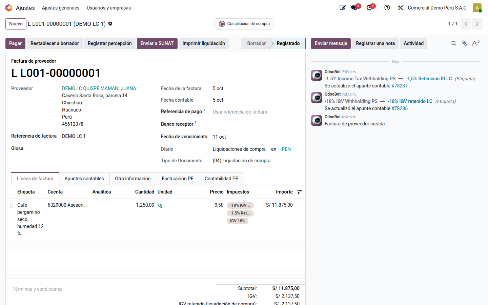
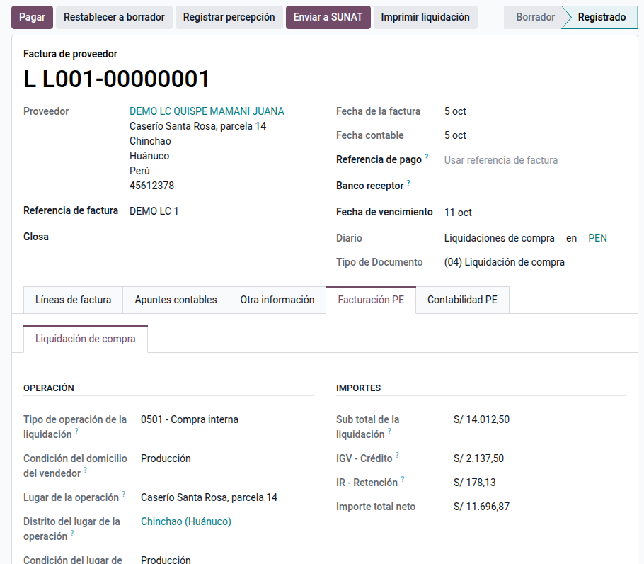
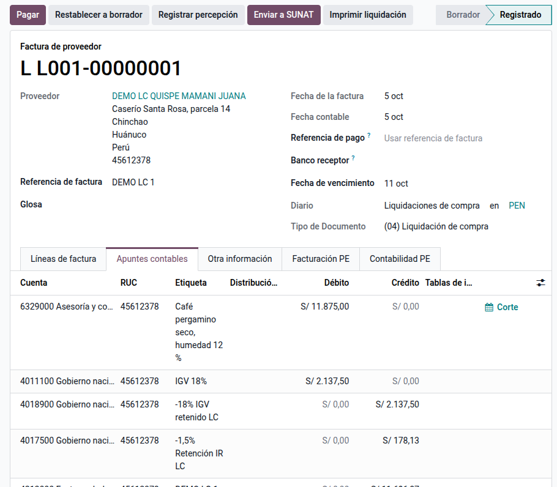
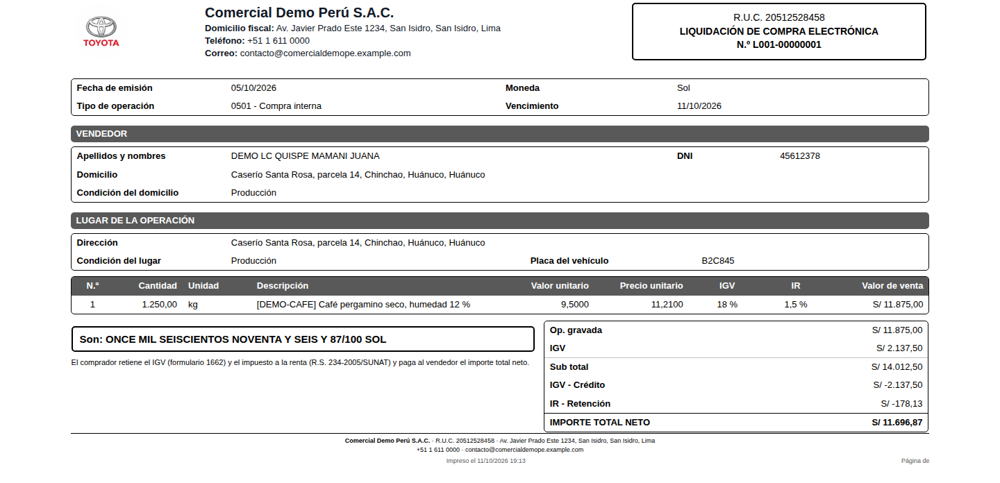

# Liquidación de compra electrónica

Cuando una empresa compra a personas naturales **sin RUC** productos primarios
agropecuarios, de pesca artesanal, madera, productos silvestres, oro de
minería artesanal, artesanía o desperdicios (metálicos, de papel o de caucho),
el comprobante no lo entrega el vendedor: lo emite **el comprador**. Es la
**liquidación de compra** (tipo de documento 04). Además, el comprador:

- retiene el **IGV** de la operación y lo paga con el **formulario 1662**;
- retiene el **impuesto a la renta**: 1,5 % del importe de la operación, o 4 %
  en el oro, y lo declara en el **PDT 617** (tributo 3039);
- paga al vendedor el **importe total neto**.

La facturación electrónica de Odoo solo emite comprobantes de venta. El módulo
**Liquidación de compra electrónica** (`al_l10n_pe_edi_purchase_settlement`)
emite la liquidación desde una factura de proveedor, la firma y la envía a
SUNAT con el operador electrónico de la compañía y, si hubo un error, la
revierte.

!!! note "Base legal"
    Reglamento de Comprobantes de Pago, art. 6, num. 1.3; R.S. 097-2012/SUNAT,
    capítulo XI y anexos 6, 17, 22 y 27, incorporados por la
    [R.S. 244-2019/SUNAT](https://www.sunat.gob.pe/legislacion/superin/2019/244-2019.pdf);
    retención de renta: [R.S. 234-2005/SUNAT](https://www.sunat.gob.pe/legislacion/superin/2005/234.htm)
    y R.S. 028-2013/SUNAT (oro).

## Configuración

Al instalarse, el módulo crea en cada compañía con el plan peruano:

- el diario de compras **Liquidaciones de compra** (código LCE, serie L001);
- tres impuestos de retención: **-18% IGV retenido LC** (cuenta 40189),
  **-1,5% Retención IR LC** y **-4% Retención IR LC (oro)** (cuenta 40175,
  «Impuesto a la renta – Otras retenciones»).

1. Vaya a **Ajustes ‣ Perú ‣ Liquidación de compra electrónica** y revise los
   impuestos, el **Importe mínimo para retener la renta** (S/ 700) y la **UIT**
   del aviso de 75 UIT. Son del RUC: se configuran en la compañía raíz.
2. Si quiere que la liquidación salga a SUNAT al confirmarla, active **Enviar
   al confirmar**.
3. Para otra serie, marque un diario de compras que use documentos como
   **Liquidaciones de compra electrónicas** y escriba su **Serie de la
   liquidación de compra** (cuatro caracteres que empiezan con L).
4. Marque como **Oro (retención de renta del 4 %)** los productos de oro, en la
   pestaña **Contabilidad** del producto.
5. Registre al vendedor con su **DNI** (o carné de extranjería, pasaporte o
   cédula diplomática), su dirección y su **distrito**.

!!! warning "Operador electrónico"
    La liquidación sale por el operador de **Ajustes ‣ Contabilidad ‣
    Facturación electrónica peruana**: con SUNAT directo va al servicio de
    facturas y la reversión al de retenciones y percepciones; con IAP,
    Digiflow o The Factory HKA, por sus servicios. El módulo se probó con
    envíos simulados: valide la primera liquidación en el entorno de prueba de
    su operador.

## Conceptos

| Término | Significado | En Odoo |
|---|---|---|
| Liquidación de compra (04) | Comprobante que emite el comprador al vendedor sin RUC | Factura de proveedor en el diario de liquidaciones |
| IGV - Crédito | IGV de la operación que retiene el comprador | Impuesto **-18% IGV retenido LC** en las líneas gravadas |
| IR - Retención | Retención del impuesto a la renta del vendedor | **-1,5% Retención IR LC** o **-4% Retención IR LC (oro)** |
| Importe total neto | Lo que recibe el vendedor: sub total − IGV − renta | **Total** de la factura |
| Condición (catálogo 60) | Punto de venta, producción, extracción, explotación u otros | Del domicilio del vendedor y del lugar de la operación |
| Resumen de reversiones (RR) | Anula una liquidación aceptada | Botón **Revertir en SUNAT** |

## Emitir una liquidación de compra

1. Vaya a **Perú ‣ Liquidaciones de compra ‣ Liquidaciones de compra** (o
   **Contabilidad ‣ Proveedores ‣ Liquidaciones de compra**) y haga clic en
   **Nuevo**: se abre en el diario de liquidaciones, con el tipo de documento
   **(04) Liquidación de compra**.
2. Elija al vendedor, la fecha y las líneas con su IGV (gravado, exonerado o
   inafecto). El módulo añade solo el IGV retenido a las líneas gravadas y la
   retención de renta si la operación pasa de S/ 700.
3. En **Facturación PE ‣ Liquidación de compra**, revise el **Tipo de operación
   de la liquidación** (0501 compra interna, 0503 compra de oro), la
   **Condición del domicilio del vendedor**, el **Lugar de la operación** (se
   propone el domicilio del vendedor) con su distrito y condición y, si los
   bienes se trasladan con la liquidación, la **Placa del vehículo**.
4. Haga clic en **Confirmar**: la liquidación toma su número (L001-00000001…)
   y queda **Por enviar**.
5. Haga clic en **Enviar a SUNAT**. Aceptada, queda **Aceptada por SUNAT** con
   el ZIP del XML firmado y la constancia en el historial. Si SUNAT responde
   con un error, se muestra en la parte superior: corrija y vuelva a enviar.
6. Con **Imprimir liquidación** obtiene la representación impresa.

!!! tip "Plazo de envío"
    SUNAT recibe la liquidación el día de su emisión o el **día siguiente**.
    Si se envía después, el historial advierte que ya no tiene calidad de
    comprobante.

### Ejemplo

Comercial Demo Perú S.A.C. compra el 05/10/2026 a una productora de Chinchao
(Huánuco), identificada con DNI, 1 250 kg de café pergamino a S/ 9,50 el kg,
gravado con IGV, en la liquidación **L001-00000001**:

- valor de venta: 1 250 × 9,50 = **11 875,00**;
- IGV (crédito): 11 875,00 × 18 % = **2 137,50**;
- sub total: **14 012,50**;
- IR - Retención: 11 875,00 × 1,5 % = **178,13** (pasa de S/ 700);
- importe total neto: 14 012,50 − 2 137,50 − 178,13 = **11 696,87**.

| Cuenta | Descripción | Debe | Haber |
|---|---|---:|---:|
| 6329000 | Café pergamino seco | 11 875,00 | |
| 4011100 | IGV – Cuenta propia (crédito) | 2 137,50 | |
| 4018900 | IGV retenido de la liquidación (formulario 1662) | | 2 137,50 |
| 4017500 | Impuesto a la renta – Otras retenciones | | 178,13 |
| 4212000 | Vendedor (neto por pagar) | | 11 696,87 |
| | **Totales** | **14 012,50** | **14 012,50** |

En el registro de compras (RCE del PLE y del SIRE) la liquidación se informa
por su total, **14 012,50**, con el DNI del vendedor y el IGV como crédito
fiscal.

## Revertir una liquidación

La reversión solo procede por error en los **apellidos y nombres** o el
**documento** del vendedor, o en el **producto**, la **cantidad** o la
**unidad**, y dentro de los **siete días calendario** siguientes a la
aceptación. SUNAT la rechaza si la liquidación tiene pagos registrados en SUNAT
Operaciones en Línea.

1. Abra la liquidación aceptada y escriba el **Motivo de la reversión** en
   **Facturación PE ‣ Liquidación de compra**.
2. Haga clic en **Revertir en SUNAT**: se envía el resumen diario de
   reversiones (RR-AAAAMMDD-N) y queda **Reversión en proceso** con su ticket.
3. Haga clic en **Consultar reversión** hasta que SUNAT responda. Aceptada, la
   liquidación queda **Revertida** y su asiento se anula; el número no se
   vuelve a usar. Si SUNAT la rechaza, la liquidación sigue vigente.

!!! note
    Una liquidación aceptada no vuelve a borrador ni admite notas de crédito
    o débito: se corrige revirtiéndola y emitiendo otra.

## Límite de 75 UIT

Solo se emiten liquidaciones a vendedores cuyas ventas del año no superen
**75 UIT** (RCP, art. 6, num. 1.3). El límite se consulta en SUNAT Operaciones
en Línea. El módulo suma las liquidaciones del año al mismo vendedor y avisa en
la parte superior de la liquidación cuando ya pasan de 75 UIT.

## Qué no hace

- **Anticipos** (tipo de operación 0502) y operaciones gratuitas.
- **Datos del oro** del D.S. 018-2018-EM (derecho minero, ley mineral): la
  compra de oro retiene el 4 %, pero esos datos no van en el XML.
- **Registro de pagos** de las liquidaciones (art. 29-G): se hace en SUNAT
  Operaciones en Línea.
- **Pago del IGV retenido** (formulario 1662) y declaración del PDT 617: se
  registran como cualquier pago de tributos.
