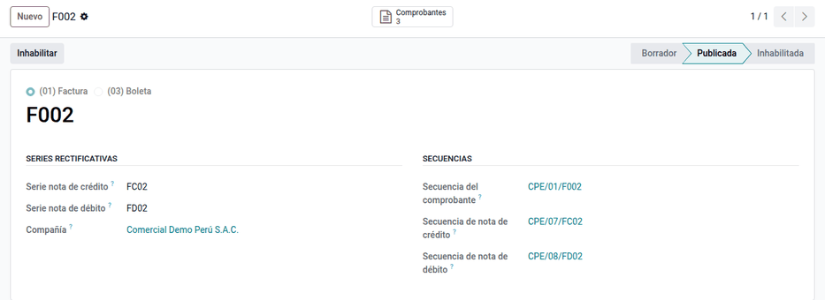
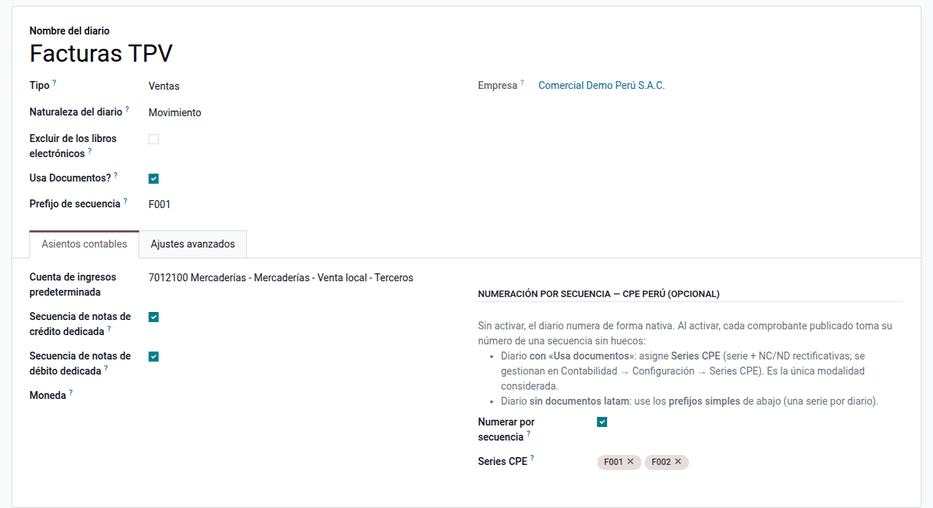
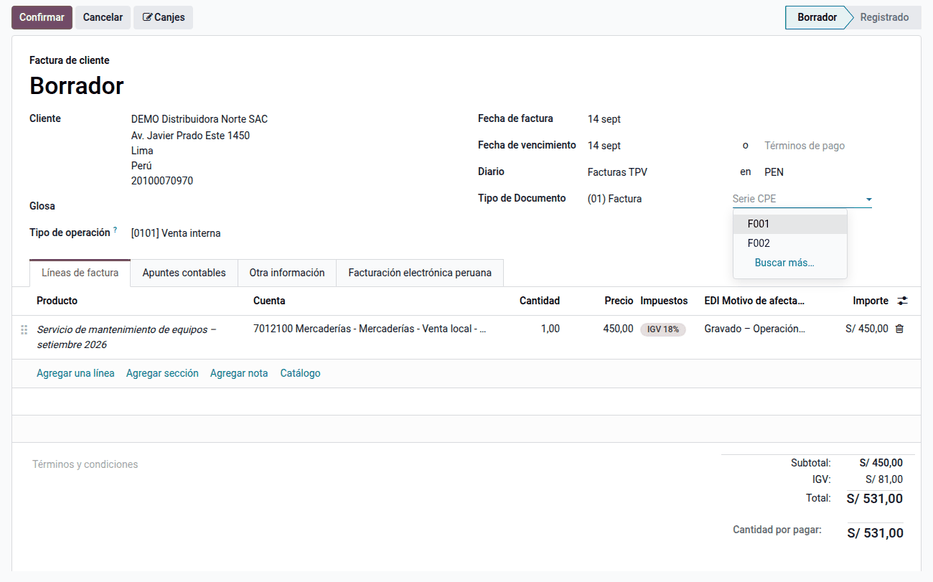

# Numeración de asientos y series

SUNAT identifica cada comprobante electrónico por su **serie** de cuatro
caracteres (F para facturas, B para boletas) y un **correlativo** continuo de
hasta ocho dígitos; las notas de crédito y débito llevan una **serie
rectificativa** vinculada a la del comprobante que modifican. Este módulo
numera con **secuencias explícitas sin huecos**, solo en los diarios donde se
activa: **Series CPE** (F001, B001… con sus rectificativas FC01 y FD01) en los
diarios con documentos y un **prefijo simple** (por ejemplo, CC01-) en los
demás. Lo usan el contador y el responsable de facturación.

Los diarios que no se activan siguen con la numeración de Odoo, basada en el
último número del diario. El módulo no envía comprobantes a SUNAT (eso lo hace
la [facturación electrónica](electronic_invoicing.md)) ni reutiliza números
anulados.

## Conceptos

El Reglamento de Comprobantes de Pago (R.S. N.° 007-99/SUNAT y modificatorias)
exige numeración correlativa por serie. En el Sistema de Emisión Electrónica,
las series empiezan con F (facturas y sus notas) o B (boletas y sus notas) y
el correlativo tiene hasta ocho dígitos (R.S. N.° 206-2019/SUNAT).

| Término | Significado | Dónde aparece en Odoo |
|---|---|---|
| Serie CPE | Serie de cuatro caracteres de un tipo de comprobante (01 factura, 03 boleta) | **Perú ‣ Configuración ‣ Comprobantes electrónicos ‣ Series CPE** |
| Serie rectificativa | Serie de las notas de crédito (FC01) y débito (FD01) de una serie | Serie CPE |
| Secuencia sin huecos | Contador que no salta números al asignarlos | Se crea al publicar la serie |
| Numerar por secuencia | Casilla que activa el módulo en un diario | Diario |

## Configuración

### Crear y publicar una serie

1. Vaya a **Perú ‣ Configuración ‣ Comprobantes electrónicos ‣ Series CPE** y
   haga clic en **Nuevo** (requiere ser administrador de Contabilidad).
2. Elija el tipo de documento y escriba la serie, por ejemplo **F001**. Se
   proponen las rectificativas **FC01** y **FD01**.
3. Haga clic en **Publicar**. Se crean tres secuencias sin huecos (comprobante,
   nota de crédito y nota de débito) con relleno de ocho dígitos.

!!! warning "Importante"
    La serie se valida al guardar: facturas con F y tres caracteres
    alfanuméricos; boletas con B o E y tres caracteres. Cada serie es única.

### Activar el diario

1. Vaya a **Perú ‣ Configuración ‣ Contabilidad ‣ Diarios** y abra el diario.
2. Marque **Numerar por secuencia** y asigne sus **Series CPE**. Un diario
   puede tener varias.
3. En un diario sin documentos, escriba el **Prefijo (serie)** y, si aplica,
   el **Prefijo NC (serie)**.

## Emitir comprobantes

1. Cree la factura en **Contabilidad ‣ Clientes ‣ Facturas**. En borrador, el
   campo **Serie CPE** propone la serie del diario; si hay varias candidatas,
   elija una.
2. Haga clic en **Confirmar**. El número se asigna en ese momento, no al crear
   el borrador.

Una nota de crédito o de débito toma la serie rectificativa de la serie del
documento de origen, no la del diario de la nota. En un diario con F001 y
F002:

| Comprobante | Serie que numera | Número |
|---|---|---|
| Factura (01) con serie F002 | F002 | F002-00000002 |
| Nota de crédito (07) de F002-00000002 | FC02 | FC02-00000001 |
| Nota de débito (08) de una factura F002 | FD02 | siguiente de FD02- |

### Ejemplo

Comercial Demo Perú emite desde su diario de ventas con las series F001 y F002
(asientos de la demostración).

Factura **F002-00000002** (servicio de instalación de red, S/ 1 000,00 + IGV):

| Cuenta | Descripción | Debe | Haber |
|---|---|---|---|
| 1213000 | Facturas por cobrar | 1 180,00 | |
| 7012100 | Venta local | | 1 000,00 |
| 4011100 | IGV – Cuenta propia | | 180,00 |
| **Totales** | | **1 180,00** | **1 180,00** |

Nota de crédito **FC02-00000001**, que anula la factura anterior:

| Cuenta | Descripción | Debe | Haber |
|---|---|---|---|
| 7012100 | Venta local | 1 000,00 | |
| 4011100 | IGV – Cuenta propia | 180,00 | |
| 1213000 | Facturas por cobrar | | 1 180,00 |
| **Totales** | | **1 180,00** | **1 180,00** |

Caja chica **CC01-00000002** (diario sin documentos con prefijo CC01-):

| Cuenta | Descripción | Debe | Haber |
|---|---|---|---|
| 6560000 | Suministros — Útiles de oficina | 142,50 | |
| 1041001 | Banco | | 142,50 |
| **Totales** | | **142,50** | **142,50** |

## Retirar una serie

En la serie, haga clic en **Inhabilitar**: deja de ofrecerse en los diarios.
**Volver a borrador** la reabre.

## Reportes

- El número (serie-correlativo) es el que usan la factura electrónica, el QR
  del [comprobante impreso](electronic_invoicing/invoice_report.md) y los
  registros de ventas y compras ([PLE](ple.md) y [SIRE](sire.md)).
- **Series CPE ‣ Comprobantes** lista los documentos de cada serie.

## Casos especiales

| Situación | Qué pasa | Qué hacer |
|---|---|---|
| La factura sigue con numeración nativa | En diarios con documentos solo cuentan las Series CPE | Asigne al diario una serie publicada del tipo de documento |
| No aparece **Serie CPE** en la factura | Solo se muestra en borrador y si el diario tiene series | Revise el diario |
| Formato de serie inválido | Facturas F + 3 alfanuméricos; boletas B o E + 3 | Corrija la serie |
| Comprobante cancelado | Su número no se reutiliza (no hay aviso de hueco) | Es el comportamiento esperado |
| Se cambió el prefijo y siguen los números anteriores | El prefijo se usa al crear la secuencia | Cambie el prefijo en la secuencia o genere otra |

!!! info "Ver también"
    - [Reglamento de Comprobantes de Pago — R.S. N.° 007-99/SUNAT](https://www.sunat.gob.pe/legislacion/superin/1999/007_anterior.htm)
    - [R.S. N.° 206-2019/SUNAT — Modifica el Reglamento de Comprobantes de Pago](https://www.sunat.gob.pe/legislacion/superin/2019/206-2019.pdf)
    - [Odoo: facturas de cliente](https://www.odoo.com/documentation/19.0/es_419/applications/finance/accounting/customer_invoices.html)
    - [Facturación electrónica](electronic_invoicing.md)
