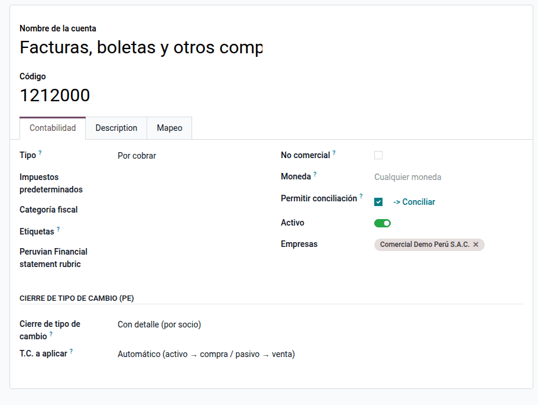
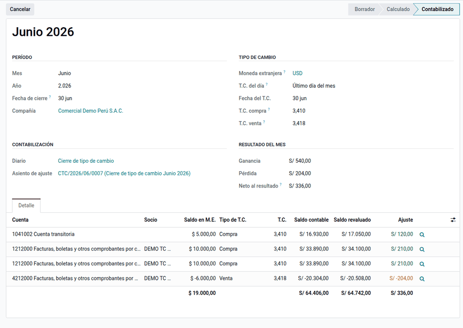
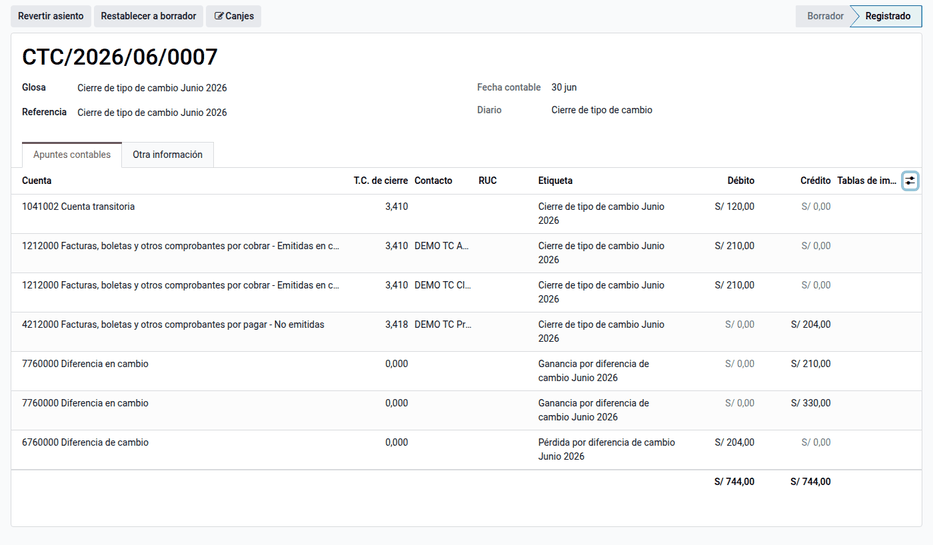

# Diferencia de cambio

Al cierre de cada mes, los saldos en moneda extranjera de las cuentas de
balance (bancos, cuentas por cobrar y por pagar, préstamos) deben expresarse al
tipo de cambio de la fecha: los **activos al T.C. compra** y los **pasivos al
T.C. venta**. La suite lo resuelve de dos maneras, que el contador elige según
su criterio de cierre:

- El **cierre de tipo de cambio** (`al_l10n_pe_exchange_closure`) calcula el
  ajuste **definitivo** desde los apuntes publicados, con **saldos
  acumulados**: el mes siguiente parte del saldo ya ajustado. Detalla por
  cuenta o por socio, hereda la analítica y deja el asiento listo contra las
  cuentas 776 (ganancia) y 676 (pérdida).
- La **revaluación multimoneda** (`al_l10n_pe_multicurrency_revaluation`, solo
  Odoo Enterprise) hace que el informe **Ganancias/pérdidas de moneda no
  realizadas** de Enterprise use **compra o venta** por cuenta y genera la
  **provisión reversible** de Enterprise, que se revierte el día siguiente.

La diferencia de cambio que Odoo registra al conciliar cobros y pagos
(realizada) la hace Odoo y queda dentro del saldo. Las partidas no monetarias
(inventarios, activo fijo) no se revalúan.

## Conceptos

- **Ley del Impuesto a la Renta, artículo 61**: las diferencias de cambio son
  resultados computables del ejercicio.
- **Reglamento de la LIR, artículo 34**: los saldos en moneda extranjera se
  expresan al tipo de cambio **compra** los activos y **venta** los pasivos, al
  cierre de operaciones de la fecha del balance que publica la SBS.
- **NIC 21**: las partidas monetarias se convierten al tipo de cambio de cierre
  y la diferencia va a resultados.
- SUNAT publica el cierre de un día con la fecha del día siguiente: la tasa de
  cierre del 30/06 es la registrada con fecha 01/07 (o, si no la hay, la última
  anterior).

| Término | Significado | Dónde aparece en Odoo |
|---|---|---|
| Partida monetaria | Saldo que se cobra o paga en una cantidad fija de moneda | Cuentas marcadas para el cierre |
| Saldo en M.E. | Saldo acumulado en moneda extranjera a la fecha de cierre | Detalle del cierre |
| Saldo contable | Saldo en soles, con los cierres anteriores | Detalle del cierre |
| Saldo revaluado | Saldo en M.E. × T.C. | Detalle del cierre |
| Ajuste | Revaluado − contable: positivo es ganancia, negativo es pérdida | Detalle y asiento |
| No realizada | Diferencia por valuar un saldo que sigue pendiente | Informe de ganancias/pérdidas no realizadas |
| Provisión reversible | Asiento de ajuste que Odoo revierte el día siguiente | Botón **Asiento de ajuste** del informe |

## Configuración

1. Instale el [tipo de cambio](exchange_rates.md) (`al_l10n_pe_currency`) y
   tenga cargadas las tasas de compra y venta del mes.
2. Configure las cuentas de diferencia de cambio de la compañía (676 y 776).
3. Para el cierre de tipo de cambio, vaya a **Perú ‣ Configuración ‣ Ajustes**,
   sección **Cierre de tipo de cambio**, y elija un diario general dedicado
   (por ejemplo, CTC).
4. Marque cada cuenta de balance en moneda extranjera en **Contabilidad ‣
   Configuración ‣ Plan de cuentas**, pestaña **Contabilidad** de la cuenta:
    - **Cierre de tipo de cambio (PE)**: **sin detalle** (bancos, préstamos)
      o **con detalle** por socio (cuentas por cobrar y por pagar), y el
      **T.C. a aplicar** (automático por defecto: compra en activos y venta en
      pasivos; **Siempre compra** o **Siempre venta** para cuentas de
      naturaleza contraria);
    - **Ganancias/pérdidas no realizadas (PE)**: **Compra** (activos) o
      **Venta** (pasivos). Es obligatorio en las cuentas por cobrar y por
      pagar y en las de moneda extranjera.
5. Revise la lista en **Perú ‣ Configuración ‣ Cuentas de la localización ‣
   Cuentas del cierre de T.C.**

!!! warning "Importante"
    Defina con el contador cuál de los dos ajustes se usa en cada cierre: cada
    uno tiene su propio campo en la cuenta y no se deben contabilizar los dos
    sobre el mismo saldo.

## Cierre de tipo de cambio

1. Vaya a **Perú ‣ Contabilidad ‣ Cierre del mes ‣ Cierre de tipo de cambio** y haga clic en
   **Nuevo**. Elija el mes, el año y la moneda.
2. Haga clic en **Traer T.C.**: toma la compra y la venta del cierre del último
   día. Si no hay tasa para esa fecha, la descarga del BCRP o de apis.net.pe;
   si no puede, usa la última anterior y lo anota.
3. Haga clic en **Calcular**. El detalle muestra, por cuenta o por socio, el
   saldo en moneda extranjera, el saldo contable, el revaluado y el ajuste.
4. Revise con **Vista previa del asiento** y con la lupa de cada renglón, que
   muestra los apuntes que forman el saldo.
5. Haga clic en **Contabilizar**: el asiento se publica el último día del mes y
   el cierre pasa a **Contabilizado**.

El asiento es definitivo, no se revierte: como el saldo es acumulado, el mes
siguiente solo reconoce la nueva variación, y un documento atrasado se corrige
solo al recalcular el mes (o en el siguiente). Hay un solo cierre vigente por
mes, moneda y compañía; los cancelados no cuentan. La columna opcional **T.C.
de cierre** de los apuntes guarda el tipo usado.

### Ejemplo

Cierre de **junio de 2026** en dólares, con **compra 3,410** y **venta 3,418**
(datos de demostración). Saldos acumulados al 30/06/2026:

| Cuenta | Socio | Saldo US$ | T.C. | Saldo S/ | Revaluado S/ | Ajuste S/ |
|---|---|---|---|---|---|---|
| 1041002 Banco en US$ | — | 5 000,00 | 3,410 compra | 16 930,00 | 17 050,00 | +120,00 |
| 1212000 Por cobrar | DEMO TC Cliente | 10 000,00 | 3,410 compra | 33 890,00 | 34 100,00 | +210,00 |
| 1212000 Por cobrar | DEMO TC Analítica | 10 000,00 | 3,410 compra | 33 890,00 | 34 100,00 | +210,00 |
| 4212000 Por pagar | DEMO TC Proveedor | −6 000,00 | 3,418 venta | −20 304,00 | −20 508,00 | −204,00 |

Ganancia S/ 540,00, pérdida S/ 204,00, neto **+S/ 336,00**. Asiento del
cierre (diario CTC, 30/06/2026; las líneas de balance solo corrigen soles):

| Cuenta | Descripción | Debe | Haber |
|---|---|---|---|
| 1041002 | Banco en US$ (5 000 × 3,410) | 120,00 | |
| 1212000 | Por cobrar — DEMO TC Cliente | 210,00 | |
| 1212000 | Por cobrar — DEMO TC Analítica | 210,00 | |
| 4212000 | Por pagar — DEMO TC Proveedor (6 000 × 3,418) | | 204,00 |
| 7760000 | Ganancia por diferencia de cambio | | 540,00 |
| 6760000 | Pérdida por diferencia de cambio | 204,00 | |
| **Totales** | | **744,00** | **744,00** |

La ganancia del cliente con analítica (S/ 210,00) va en su propia línea de la
776 con la distribución heredada de sus ventas (60 % / 40 %). En julio
(compra 3,395, venta 3,404) cada saldo contable ya incluye el ajuste de junio,
así que solo se reconoce la variación del mes.

### Corregir un cierre

Un cierre contabilizado no se elimina: haga clic en **Cancelar**, vuelva a
borrador y recalcule. Si ya hay un cierre posterior contabilizado, cancele
primero los posteriores, en orden.

## Ganancias y pérdidas no realizadas (Enterprise)

1. Vaya a **Perú ‣ Contabilidad ‣ Cierre del mes ‣ Ganancias/pérdidas no realizadas** (el
   mismo informe está en **Contabilidad ‣ Informes**).
2. Revise la columna **T.C.**: cada cuenta muestra la tasa que le corresponde y
   la cabecera indica la tasa de la moneda («USD (1 USD = S/ 3.700)»). En los
   totales que mezclan tasas, la columna queda en blanco.
3. Haga clic en **Asiento de ajuste** y elija las cuentas de ganancia y
   pérdida. La provisión cita la tasa en cada línea y Odoo la revierte el día
   siguiente.

### Ejemplo

Cierre del 30/09/2026 con T.C. SBS de **compra 3,72** y **venta 3,75**:

| Cuenta | Tipo | Saldo USD | Registrado (S/) | T.C. cierre | Revaluado (S/) | Diferencia |
|---|---|---|---|---|---|---|
| 1212 Facturas por cobrar | Compra | 10 000 | 37 000 (3,70) | 3,72 | 37 200 | +200 ganancia |
| 1041 Banco en dólares | Compra | 2 000 | 7 420 (3,71) | 3,72 | 7 440 | +20 ganancia |
| 4212 Facturas por pagar | Venta | 5 000 | 18 400 (3,68) | 3,75 | 18 750 | +350 de deuda: pérdida |

Provisión al 30/09, revertida el 01/10, con las cuentas 776 y 676:

| Cuenta | Descripción | Debe | Haber |
|---|---|---|---|
| 1212 | Provisión de USD (T.C. S/ 3.720) | 200,00 | |
| 1041 | Provisión de USD (T.C. S/ 3.720) | 20,00 | |
| 776 | Diferencia de cambio — ganancia | | 220,00 |
| 676 | Diferencia de cambio — pérdida | 350,00 | |
| 4212 | Provisión de USD (T.C. S/ 3.750) | | 350,00 |
| **Totales** | | **570,00** | **570,00** |

Cálculo: 10 000 × (3,72 − 3,70) = 200; 2 000 × (3,72 − 3,71) = 20;
5 000 × (3,75 − 3,68) = 350. Sirve para cualquier moneda con tasas de compra
y venta registradas. En una compañía no peruana el informe es el nativo, sin
la columna **T.C.**

## Reportes

- El asiento del cierre entra al Libro Diario y a los estados financieros, y
  es la base del Libro de Inventarios y Balances con saldos expresados al
  cierre ([Estados financieros](financial_statements.md)).
- La lista de cierres muestra la ganancia, la pérdida, el neto y el estado por
  mes.
- Los asientos de provisión salen en el Libro Diario como cualquier asiento.

## Casos especiales

| Situación | Qué pasa | Qué hacer |
|---|---|---|
| No hay T.C. de la fecha | El cierre intenta descargarlo; si no, usa el último anterior y lo anota. La provisión usa la última tasa anterior o, si no hay, la genérica | Revise el historial o registre la tasa a mano antes del cierre |
| Falta el diario o las cuentas 676/776 | Error al calcular | Complete la configuración |
| Cuenta con naturaleza contraria | El T.C. automático usaría el tipo equivocado | Fuerce **Siempre compra** o **Siempre venta** en la cuenta |
| Cuenta por cobrar o por pagar sin tipo de revaluación | El campo es obligatorio | Elija **Compra** o **Venta** |

## Datos de demostración

Una base creada **con datos de demostración** carga, al instalar el módulo, un
ejemplo completo en la compañía **PE Company** (la compañía peruana de la demo
de Odoo, con el plan contable de Perú). Las fechas se calculan respecto del día de la instalación. En una base
sin datos de demostración no se carga nada.

- Cuenta 1041901 en dólares (cierre sin detalle) y 1212000 y 4212000 con detalle
  por socio.
- Venta de US$ 10 000, compra de US$ 6 000 y depósito de US$ 5 000 de hace dos
  meses.
- Tipos de cambio de cierre registrados sin descargarlos (3,410/3,418 y
  3,395/3,404).
- El cierre de ese mes **contabilizado** y el del mes siguiente **calculado**.

!!! info "Ver también"
    - [Ley del Impuesto a la Renta, capítulo IX — artículo 61](https://www.sunat.gob.pe/legislacion/renta/ley/capix.pdf)
    - [Reglamento de la LIR, capítulo IX — artículo 34](https://www.sunat.gob.pe/legislacion/renta/regla/cap9.pdf)
    - [Reglamento de la LIR, capítulo V](https://www.sunat.gob.pe/legislacion/renta/regla/cap5.pdf)
    - [NIC 21 — Efectos de las variaciones en los tipos de cambio](https://www.ifrs.org/issued-standards/list-of-standards/ias-21-the-effects-of-changes-in-foreign-exchange-rates/)
    - [Tipo de cambio promedio ponderado (SBS)](https://www.sbs.gob.pe/app/pp/sistip_portal/paginas/publicacion/tipocambiopromedio.aspx)
    - [Odoo: multimoneda](https://www.odoo.com/documentation/19.0/es_419/applications/finance/accounting/get_started/multi_currency.html)
    - [Tipo de cambio](exchange_rates.md)
