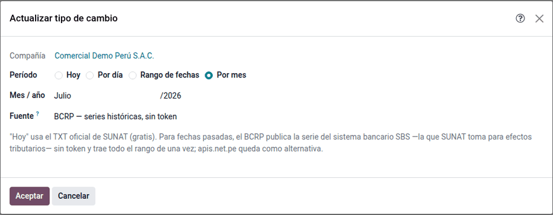
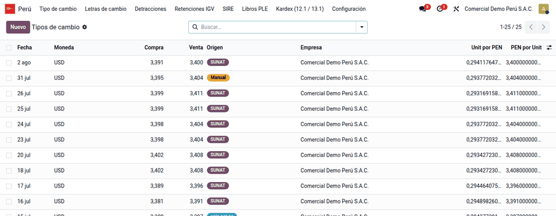
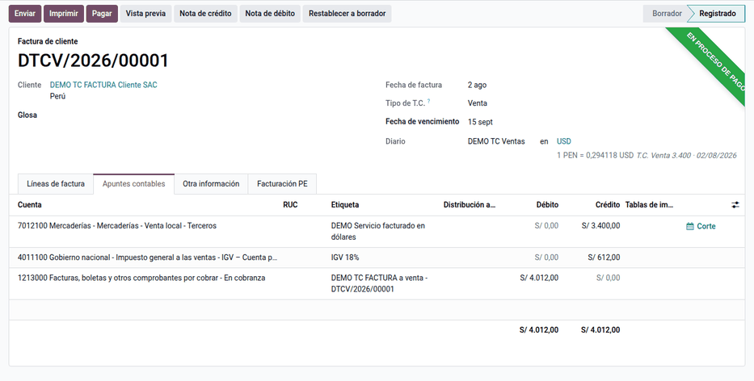

# Tipo de cambio

En el Perú se publica cada día un tipo de cambio **compra** y otro **venta**, y
las normas tributarias indican cuál usar según la operación. Odoo guarda una
sola tasa por día; este módulo guarda **compra, venta y origen** de cada tasa,
la **actualiza cada hora** desde el archivo oficial de SUNAT, carga
**históricos** desde el BCRP (o Decolecta y apis.net.pe) y permite elegir
**compra o venta en cada factura y cada pago**, lo que fija su importe en
soles. Lo usan contabilidad y tesorería.

El ajuste de saldos al cierre de mes lo hace la
[diferencia de cambio](exchange_differences.md). Las conversiones entre dos
monedas extranjeras usan la tasa nativa de Odoo.

## Conceptos

- **Ley del Impuesto a la Renta, artículo 61**: las diferencias de cambio son
  resultados computables y las operaciones en moneda extranjera se
  contabilizan al tipo de cambio vigente.
- **Reglamento de la LIR, artículo 34**: tipo de cambio **compra** para activos
  y **venta** para pasivos.
- **Reglamento de la Ley del IGV**: las operaciones en moneda extranjera se
  convierten al tipo de cambio **venta** de la fecha en que nace la obligación
  tributaria. Es el criterio por defecto.
- El tipo de cambio de referencia lo publica la **SBS** al cierre de
  operaciones; SUNAT lo publica con fecha del día siguiente y el **BCRP** lo
  difunde en sus series estadísticas. Por eso la tasa «del día» en SUNAT es el
  cierre del día anterior.

| Término | Significado | Dónde aparece en Odoo |
|---|---|---|
| T.C. compra / venta | Precio del dólar al que compra o vende el sistema financiero | **Tipos de cambio**, columnas **Compra** y **Venta** |
| Origen | De dónde vino la tasa: SUNAT, BCRP, Decolecta, apis.net.pe o Manual | **Tipos de cambio** |
| Tipo de T.C. | Compra o venta elegido en el comprobante | Factura y pago (solo en moneda extranjera) |
| Diferencia de cambio | Resultado al cobrar o pagar a un tipo distinto al registrado | Cuentas 676 (pérdida) y 776 (ganancia) |

## Configuración

1. Vaya a **Contabilidad ‣ Configuración ‣ Ajustes**, sección **Tipo de cambio
   (Perú)**, y elija el criterio de **T.C. en ventas** y **T.C. en compras**
   (**Venta** por defecto en ambos, criterio del IGV).
2. Compruebe que la acción planificada **Tipo de cambio: actualizar desde
   SUNAT** está activa (**Ajustes ‣ Técnico ‣ Acciones planificadas**). Se
   activa al instalar y corre cada hora.
3. Para usar Decolecta o apis.net.pe, registre el token en su conexión de
   [consulta de RUC y DNI](ruc_dni_lookup.md).
4. Verifique las cuentas de diferencia de cambio de la compañía (676 y 776).

### Cargar históricos

1. Vaya a **Perú ‣ Tesorería ‣ Tipo de cambio ‣ Actualizar tipo de cambio**.
2. Elija la fuente y el periodo (un día, un rango o un mes). El BCRP no pide
   token y trae todo el rango en una consulta: es la fuente recomendada para
   cargar un año.

### Revisar las tasas

Vaya a **Perú ‣ Tesorería ‣ Tipo de cambio ‣ Tipos de cambio**: cada día tiene su compra,
su venta y su origen. Una tasa escrita a mano tiene origen **Manual** y la
actualización automática no la pisa.

!!! note "Nota"
    Si solo se registra la venta, la compra toma el mismo valor. Si la compra
    es mayor que la venta, Odoo avisa pero deja guardar: revise el dato.

## Facturar en moneda extranjera

1. Cree la factura en dólares en **Contabilidad ‣ Clientes ‣ Facturas**. El
   campo **Tipo de T.C.** propone el criterio de ventas (en una factura de
   proveedor, el de compras) y se puede cambiar mientras la factura está en
   borrador.
2. Publique la factura: su importe en soles queda fijo.

Los sábados y feriados sin tasa se usa la última tasa anterior; la fecha que
se muestra junto a la moneda es la de la tasa aplicada.

## Cobrar y pagar

Al registrar el cobro o el pago con **Pagar**, el pago lleva su propio **Tipo
de T.C.**: el cobro sigue el criterio de ventas y el pago a proveedor el de
compras, y se puede cambiar. Si el pago cancela otro importe en soles que la
factura, Odoo registra la diferencia de cambio (676 o 776) al conciliar,
aunque sea el mismo día.

### Ejemplo

Factura de venta del 02/08/2026 por US$ 1 000,00 + IGV US$ 180,00 =
US$ 1 180,00. Ese día SUNAT publicó **compra 3,391** y **venta 3,400** (datos
de demostración «DEMO TC FACTURA»).

Factura a T.C. venta (criterio por defecto):

| Cuenta | Descripción | Debe | Haber |
|---|---|---|---|
| 1212000 | Facturas por cobrar (US$ 1 180,00 × 3,400) | 4 012,00 | |
| 7011100 | Venta (US$ 1 000,00 × 3,400) | | 3 400,00 |
| 4011100 | IGV (US$ 180,00 × 3,400) | | 612,00 |
| **Totales** | | **4 012,00** | **4 012,00** |

La misma factura con T.C. compra quedaría en 3 391,00 + 610,38 = 4 001,38 (una
diferencia de S/ 10,62).

Cobro de US$ 1 180,00 el mismo día con T.C. compra:

| Cuenta | Descripción | Debe | Haber |
|---|---|---|---|
| 1041000 | Banco (US$ 1 180,00 × 3,391) | 4 001,38 | |
| 1212000 | Facturas por cobrar | | 4 001,38 |
| **Totales** | | **4 001,38** | **4 001,38** |

Diferencia de cambio que registra Odoo al conciliar (la factura quedó en
S/ 4 012,00 y el cobro canceló S/ 4 001,38):

| Cuenta | Descripción | Debe | Haber |
|---|---|---|---|
| 6760000 | Pérdida por diferencia de cambio | 10,62 | |
| 1212000 | Facturas por cobrar | | 10,62 |
| **Totales** | | **10,62** | **10,62** |

## Reportes

- Los importes en soles de facturas y pagos, y el tipo de cambio que informan,
  alimentan los registros de ventas y compras ([PLE](ple.md) y [SIRE](sire.md)).
- La [diferencia de cambio](exchange_differences.md) de fin de mes usa estas
  mismas tasas.
- Las [letras de cambio](../../accounting/bills_of_exchange.md) en moneda
  extranjera usan la compra o la venta según el canje.

## Casos especiales

| Situación | Qué pasa | Qué hacer |
|---|---|---|
| No se puede cambiar el **Tipo de T.C.** | La factura está publicada | Pásela a borrador |
| No hay compra y venta para una fecha | Odoo convierte con su tasa nativa | Cargue la tasa del día |
| Una tasa manual está mal | La actualización automática no la pisa | Edítela a mano |

!!! info "Ver también"
    - [Ley del Impuesto a la Renta, capítulo IX — artículo 61](https://www.sunat.gob.pe/legislacion/renta/ley/capix.pdf)
    - [Reglamento de la LIR, capítulo IX — artículo 34](https://www.sunat.gob.pe/legislacion/renta/regla/cap9.pdf)
    - [Consulta del tipo de cambio de SUNAT](https://e-consulta.sunat.gob.pe/cl-at-ittipcam/tcS01Alias)
    - [Tipo de cambio promedio ponderado (SBS)](https://www.sbs.gob.pe/app/pp/sistip_portal/paginas/publicacion/tipocambiopromedio.aspx)
    - [Series estadísticas del BCRP](https://estadisticas.bcrp.gob.pe/estadisticas/series/)
    - [Odoo: multimoneda](https://www.odoo.com/documentation/19.0/es_419/applications/finance/accounting/get_started/multi_currency.html)
