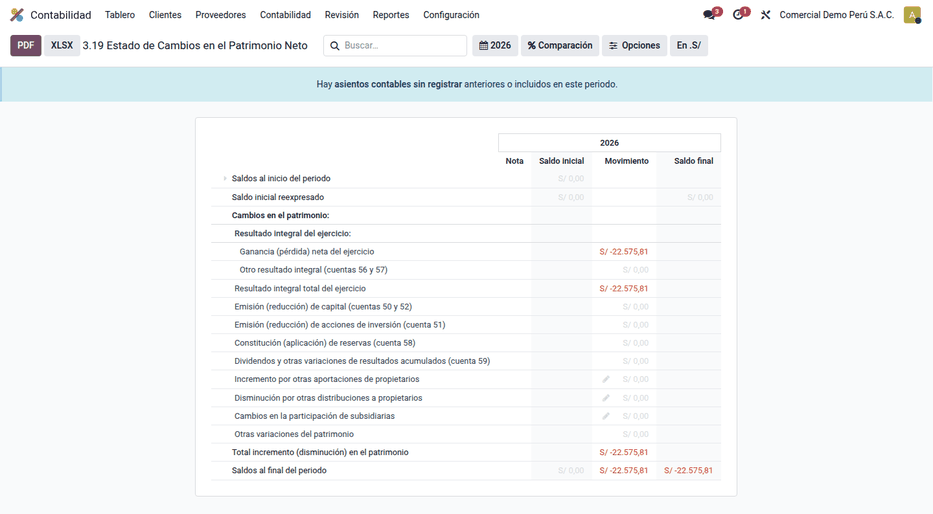
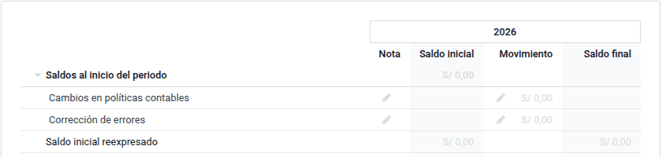

# Estados financieros

**Perú ‣ Informes ‣ Estados financieros** reúne los estados financieros peruanos como
informes contables de Odoo: el **Estado de Cambios en el Patrimonio Neto
(formato 3.19)**, calculado desde los asientos con las cuentas del PCGE, la
**hoja de trabajo** (formatos 1 y 2) y los accesos al **Balance** y al
**Estado de resultados** de Odoo Enterprise en su variante peruana, que aquí
se pueden filtrar por centro de costo. El módulo trae además el asistente de
**cierre del ejercicio** con la cascada de la clase 8. Lo usa el contador al
cierre del ejercicio o de un periodo intermedio. Todo sale en pantalla, en PDF
y en XLSX.

No incluye el Estado de Flujos de Efectivo ni la versión por columnas del
3.19. El TXT 3.19 para el PLE lo genera
[Libros electrónicos (PLE)](ple.md#libro-3-inversiones-intangibles-y-patrimonio).

## Conceptos

- La **NIC 1** exige el estado de cambios en el patrimonio entre los estados
  financieros completos.
- El **PCGE** define las cuentas de patrimonio: 50 capital, 51 acciones de
  inversión, 52 capital adicional, 56 y 57 resultados no realizados y
  excedente de revaluación, 58 reservas y 59 resultados acumulados. Está
  vigente el PCGE 2019; el PCGE 2026, aprobado en setiembre de 2026, es
  obligatorio desde el 1/1/2028 y, si el plan cambia, habrá que revisar las
  cuentas de cada línea.
- El **formato 3.19** pertenece al Libro de Inventarios y Balances
  (R.S. 286-2009/SUNAT).

| Término | Significado | Dónde aparece en Odoo |
|---|---|---|
| Saldo inicial | Patrimonio al día anterior al periodo, más la apertura | Primera línea del informe |
| Saldo reexpresado | Saldo inicial + cambios de política + corrección de errores | Línea editable |
| Movimiento | Variación del periodo por rubro | Columna **Movimiento** |
| Diario de apertura o cierre | Naturaleza del diario | **Perú ‣ Configuración ‣ Contabilidad ‣ Diarios** |
| Línea editable | Importe que no sale de asientos (aportes, distribuciones) | Lápiz de la línea |

## Configuración

1. Use el plan contable peruano (PCGE) con las cuentas 50 a 59 para el
   patrimonio. Las cuentas de patrimonio fuera de ese rango salen en «Otras
   variaciones del patrimonio».
2. Marque la **Naturaleza del diario** en **Perú ‣ Configuración ‣
   Contabilidad ‣ Diarios** ([Configuración contable básica](accounting_base.md)):
   **Apertura** para la carga de saldos al empezar a usar Odoo y **Cierre**
   para los asientos de cierre del ejercicio, que el informe excluye de los
   movimientos.

!!! warning "Importante"
    Si al 31/12 se cierra y se reabre todo el balance, ambos asientos van en
    diarios de **Cierre**: el diario de **Apertura** queda solo para la carga
    inicial. Un asiento de cierre en un diario de movimiento duplica el
    resultado.

## Estado de cambios en el patrimonio neto

1. Vaya a **Perú ‣ Informes ‣ Estados financieros ‣ 3.19 Estado de Cambios en el
   Patrimonio Neto** y elija el periodo.
2. Revise el saldo inicial, los movimientos por rubro y el saldo final. El
   resultado del ejercicio sale de las cuentas de resultados del periodo, no de
   la cuenta 59: aparece aunque el ejercicio no esté cerrado.
3. Si hay ajustes sin asiento (cambios de política, corrección de errores,
   aportes), haga clic en el lápiz de la línea y escriba el importe con su
   nota.
4. Compare el saldo final con el patrimonio del **Balance** (**Perú ‣ Informes ‣
   Estados financieros ‣ Balance**) a la misma fecha.
5. Exporte con los botones **PDF** o **XLSX**.

### Ejemplo

Saldos al 1/1/2026: capital 50 000 (5011), reserva legal 5 000 (5821) y
resultados acumulados 20 000 (5911), es decir, un **patrimonio inicial de
75 000**. Movimientos del ejercicio:

| Hecho | Cuenta | Debe | Haber |
|---|---|---|---|
| Aumento de capital en efectivo | 1041 Banco | 10 000,00 | |
| | 5011 Capital social | | 10 000,00 |
| Dividendos declarados | 5911 Utilidades acumuladas | 8 000,00 | |
| | 4411 Dividendos por pagar | | 8 000,00 |
| Constitución de reserva legal | 5911 Utilidades acumuladas | 1 200,00 | |
| | 5821 Reserva legal | | 1 200,00 |
| **Totales** | | **19 200,00** | **19 200,00** |

Además, las cuentas de resultados dejan una ganancia de **12 000**. El estado
(columna **Movimiento**) queda así:

| Línea | Importe |
|---|---|
| Saldos al inicio del periodo | 75 000,00 |
| Ganancia (pérdida) neta del ejercicio | 12 000,00 |
| Emisión (reducción) de capital | 10 000,00 |
| Constitución (aplicación) de reservas | 1 200,00 |
| Dividendos y otras variaciones de resultados acumulados | −9 200,00 |
| **Saldos al final del periodo** | **89 000,00** |

75 000 + 12 000 + 10 000 + 1 200 − 9 200 = 89 000, igual al patrimonio del
Balance: capital 60 000 + reserva 6 200 + resultados acumulados 10 800 +
resultado del ejercicio 12 000. La línea de la cuenta 59 suma el dividendo
(−8 000) y el traslado a la reserva (−1 200).

## Hoja de trabajo

**Perú ‣ Informes ‣ Estados financieros ‣ Hoja de trabajo (formato 1)** y
**(formato 2)** muestran una línea por cuenta:

| Columnas | Formato 1 | Formato 2 | Qué llevan |
|---|---|---|---|
| Saldo inicial debe / haber | | ✓ | Saldo al día anterior al periodo |
| Movimiento debe / haber | | ✓ | Debe y haber del periodo |
| Sumas debe / haber | ✓ | ✓ | Saldo inicial + movimiento |
| Saldo deudor / acreedor | ✓ | ✓ | Diferencia de las sumas |
| Activo / Pasivo y patrimonio | ✓ | ✓ | Saldo de las cuentas de balance |
| Pérdidas / Ganancias por naturaleza | ✓ | ✓ | Cuentas 60 a 68, 70 a 78 y 88 |
| Pérdidas / Ganancias por función | ✓ | ✓ | Cuentas de **Ajustes ‣ Perú ‣ Hoja de trabajo** (por defecto 69, 70 a 78, 88 y la clase 9) |

Al pie salen las **Sumas**, el **Resultado del ejercicio** (la utilidad va al
haber de cada par; la pérdida, al debe) y los **Totales**, que se igualan.

- Las cuentas de resultados empiezan en cero cada ejercicio: lo que traen de
  ejercicios anteriores sale en la línea **Resultados de ejercicios
  anteriores**, en el pasivo y patrimonio.
- La hoja no cuenta los asientos de los diarios de **Cierre**, así que se
  puede sacar después de cerrar.
- Se filtra por diario y por **centro de costo** (cuenta analítica).

!!! tip "Cuadre de naturaleza y función"
    Si el resultado por función no coincide con el de naturaleza, falta llevar
    a función alguna cuenta de la clase 6 sin destino (por ejemplo, 67 si los
    gastos financieros no se destinan a la 97): añádala en **Ajustes ‣ Perú ‣
    Hoja de trabajo ‣ Cuentas por función**. Con inventario permanente el
    costo de ventas está en la 69, que es de función: el resultado por
    naturaleza solo cuadra si la variación de existencias (61) refleja el
    consumo del ejercicio.

## Cierre del ejercicio

**Perú ‣ Contabilidad ‣ Cierre del mes ‣ Cierre del ejercicio** genera los
asientos de cierre en un diario de naturaleza **Cierre**.

1. Elija **Cierre al** (último día del ejercicio) y el **Diario de cierre**.
2. Marque **Cerrar y reabrir las cuentas de balance** si lleva el Libro diario
   con el asiento de cierre del balance y el de reapertura.
3. Pulse **Generar asientos**. Se crean en borrador, un asiento por paso:

    | Paso | Salda | Va a |
    |---|---|---|
    | Cancelación de las cuentas analíticas | Clase 9 | 791 |
    | Margen comercial | 701, 709, 741, 731, 601, 611, 691 | 801 |
    | Producción de bienes / servicios / activo inmovilizado | 702, 704, 71, 692, 694 / 703, 693 / 72 | 811 / 812 / 813 |
    | Valor agregado | 80, 81, demás 60 y 61, 63 | 821 |
    | Excedente bruto de explotación | 821, 62, 64 | 831 |
    | Resultado de explotación | 831, 65, 68, demás 69 y 70, 73, 74, 75, 78, 79 | 841 |
    | Resultado antes del impuesto a la renta | 841, 66, 67, 76, 77 | 851 |
    | Resultado del ejercicio | 851, 88 | 891 utilidad · 892 pérdida |
    | Resultados acumulados | 891, 892 | 5911 utilidad · 5921 pérdida |

4. Revise los asientos y pulse **Publicar**. Si marcó el cierre del balance,
   la reapertura queda conciliada con el cierre en las cuentas conciliables:
   las partidas abiertas de clientes y proveedores siguen siendo las de sus
   comprobantes.

- Si vuelve a generar, los borradores del asistente se rehacen; los
  asientos que usted haya registrado a mano en el diario de cierre no se
  tocan. Un cierre publicado se rehace pasándolo antes a borrador.
- Si una cuenta de resultados queda con saldo porque ninguna regla la salda,
  el asistente lo avisa con su código.
- Las reglas se editan en **Perú ‣ Configuración ‣ Contabilidad ‣ Reglas del
  cierre del ejercicio**: cada una salda las cuentas que empiezan por sus
  prefijos y lleva el neto a la cuenta destino. Se aplican en orden, y un
  prefijo amplio en un paso posterior solo recoge lo que dejaron los
  anteriores.

!!! note
    El cierre del balance y la reapertura van al diario de **Cierre**, no al
    de **Apertura**: Odoo arrastra los saldos por sí mismo y los informes no
    cuentan ese diario. El diario de **Apertura** queda para la carga inicial.

- El cierre es del RUC: se hace en la compañía raíz y recoge los apuntes de
  todas sus sucursales. Hace falta acceso a todas ellas.
- Las reglas sin compañía valen para todos los RUC de la base; una regla con
  compañía solo para ese RUC.
- En moneda extranjera, el cierre del balance cancela por separado el monto en
  moneda y el saldo en soles cuando la diferencia de cambio los deja con signos
  distintos.
- Si ejercicios anteriores quedaron sin cerrar, su resultado se reconoce en la
  59 (5911 utilidad, 5921 pérdida) dentro del cierre del balance.

## Por centro de costo

El **Balance** y el **Estado de resultados** peruanos tienen el filtro
**Analítica**: elija uno o varios centros de costo para sacar el estado solo
con sus apuntes.

Después del cierre:

- el **Estado de resultados** y la **hoja de trabajo** no cuentan ningún
  asiento de los diarios de **Cierre**, así que el ejercicio no sale en cero;
- el **Balance** sí cuenta el traslado del resultado a la 59, pero no el
  cierre ni la reapertura del balance: al 31/12 muestra el resultado en
  resultados acumulados y no queda en cero.

!!! warning
    El Libro mayor y los saldos por empresa sí cuentan el cierre del balance:
    al 31/12 muestran esas cuentas en cero.

## Reportes

- **Balance** y **Estado de resultados** (Enterprise), en el mismo menú.
- **TXT 3.19** del Libro de Inventarios y Balances, con la captura por rubro de
  la tabla 34, y el resto del Libro 3 (3.8, 3.9, 3.23): ver
  [Libros electrónicos (PLE)](ple.md).
- La [diferencia de cambio](exchange_differences.md) de cierre y los
  [asientos de destino](destination_entries.md) entran en estos estados.

## Casos especiales

| Situación | Qué pasa | Qué hacer |
|---|---|---|
| El saldo final no cuadra con el Balance | Hay ajustes editables o asientos de cierre en un diario sin naturaleza **Cierre** | Revise las líneas editables y la naturaleza de los diarios |
| El resultado sale duplicado | El asiento de cierre está en un diario de movimiento | Pase el asiento a un diario de naturaleza **Cierre** |
| El asistente dice que una cuenta sigue con saldo | Ninguna regla del cierre la salda | Añada su prefijo a la regla que corresponda |
| «No existe la cuenta 821» (u otra) | El plan de cuentas no tiene la cuenta destino de una regla | Créela o cambie el código en la regla |
| La hoja de trabajo no cuadra naturaleza con función | Hay cuentas de la clase 6 sin destino fuera de función | Añádalas en **Cuentas por función** |

!!! info "Ver también"
    - [NIC 1 — Presentación de estados financieros](https://www.ifrs.org/issued-standards/list-of-standards/ias-1-presentation-of-financial-statements/)
    - [Resolución 002-2019-EF/30 — PCGE 2019 (MEF)](https://mef.gob.pe/contenidos/conta_publ/documentac/Resolucion_CNC002_2019EF30.pdf)
    - [Resolución 002-2026-EF/30 — PCGE 2026 (El Peruano)](https://busquedas.elperuano.pe/dispositivo/NL/2550786-1)
    - [R.S. 286-2009/SUNAT — Libros electrónicos](https://www.sunat.gob.pe/legislacion/superin/2009/rs286.doc)
    - [Odoo: informes contables](https://www.odoo.com/documentation/19.0/es_419/applications/finance/accounting/reporting.html)
