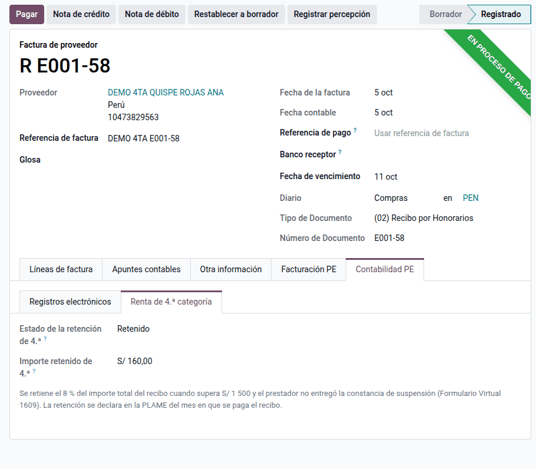
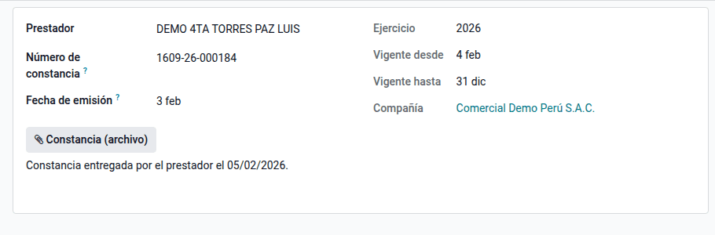
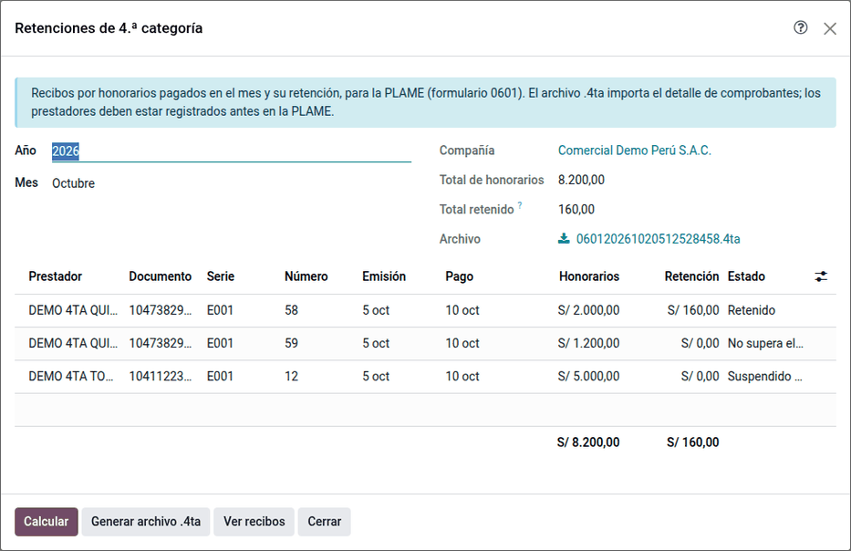
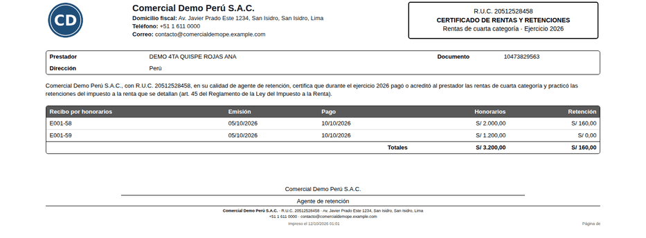

# Retención de renta de 4.ª categoría

Las empresas que pagan recibos por honorarios a trabajadores independientes
retienen el impuesto a la renta de cuarta categoría del prestador. El módulo
**Retención de renta de 4.ª categoría** (`al_l10n_pe_fourth_category`) calcula
la retención en el propio recibo, registra las suspensiones que entregan los
prestadores y prepara la declaración mensual en la PLAME.

## Conceptos

| Concepto | Regla |
|---|---|
| Recibo por honorarios | Documento 02 que emite el prestador independiente |
| Tasa | 8 % del importe total del recibo |
| Tope | No se retiene si el recibo no supera S/ 1 500 |
| Momento | Al pagar o acreditar el recibo; se declara en la PLAME del mes del pago |
| Suspensión | El prestador que no superará el límite anual tramita el Formulario Virtual 1609 y entrega la constancia: rige desde el día siguiente a su emisión hasta el 31 de diciembre |

!!! note "Nota"
    La retención se registra en el recibo, con la cuenta por pagar por el
    neto y la retención en la 40172; la declaración toma la **fecha de pago**,
    como pide la PLAME.

## Configuración

1. Instale el módulo **Retención de renta de 4.ª categoría** (`al_l10n_pe_fourth_category`).
2. Vaya a **Ajustes ‣ Perú ‣ Renta de 4.ª categoría** y revise:
    - **Agente de retención de 4.ª categoría**: activo para las empresas
      obligadas a llevar contabilidad;
    - **Tasa** (8 %) y **Tope sin retención** (S/ 1 500);
    - **Cuenta de retenciones de 4.ª**: vacía usa la 40172 del plan contable.
3. Registre a los prestadores con su **RUC** (tipo de documento 6).

## Registrar un recibo por honorarios

1. Vaya a **Perú ‣ Proveedores ‣ Comprobantes ‣ Recibos por honorarios** y cree el
   recibo con **Tipo de documento** **(02) Recibo por Honorarios**, su número
   (`E001-58`) y el importe de los honorarios, sin IGV.
2. Al guardar o publicar, la línea recibe el impuesto **Retención 4.ª categoría
   8 %** si corresponde, y el total queda por el neto.
3. La pestaña **Contabilidad PE ‣ Renta de 4.ª categoría** muestra el estado y el
   importe retenido.

| Recibo | Honorarios | Estado | Retención | Neto a pagar |
|---|---|---|---|---|
| E001-58 | S/ 2 000.00 | Retenido | S/ 160.00 | S/ 1 840.00 |
| E001-59 | S/ 1 200.00 | No supera el tope | — | S/ 1 200.00 |
| E001-12 (con constancia) | S/ 5 000.00 | Suspendido (constancia 1609) | — | S/ 5 000.00 |

!!! tip "Consejo"
    Un recibo en moneda extranjera se compara con el tope en soles, al tipo de
    cambio de su fecha.

## Registrar una suspensión

1. Vaya a **Perú ‣ Proveedores ‣ Detracciones, retenciones y percepciones ‣ Suspensiones de 4.ª categoría**, o a la
   pestaña **Facturación** del contacto.
2. Indique el **Prestador**, el **Número de constancia** y la **Fecha de
   emisión**; adjunte la constancia.
3. La vigencia (**Vigente desde** el día siguiente y **Vigente hasta** el 31 de
   diciembre) se calcula sola.

!!! warning "Importante"
    Registre la constancia antes de publicar el recibo. Un recibo ya publicado
    conserva su retención aunque la constancia se registre después: para
    corregirlo, restablézcalo a borrador y vuelva a publicarlo.

## Declarar las retenciones del mes

1. Vaya a **Perú ‣ SUNAT ‣ Declaraciones ‣ Retenciones de 4.ª categoría (PLAME)**.
2. Elija el **Año** y el **Mes** y haga clic en **Calcular**: aparecen los
   recibos pagados por completo en el mes, con el total de honorarios y el
   **Total retenido** a declarar.
3. Haga clic en **Generar archivo .4ta** y descargue el archivo
   `0601AAAAMMRUC.4ta` para importarlo en el PDT PLAME.

!!! note "Nota"
    El archivo .4ta sigue la estructura 20 del anexo 3 de la planilla
    electrónica: tipo y número de documento del prestador, tipo (R), serie y
    número del recibo, monto total, fechas de emisión y de pago, indicador de
    retención y régimen pensionario «3 = Sin retención». Los prestadores se
    registran antes en la PLAME.

## Reportes

**Certificado de rentas y retenciones**: en **Perú ‣ Proveedores ‣ Comprobantes ‣ Recibos por honorarios ‣
Certificado de rentas y retenciones**, elija el ejercicio y los prestadores
(vacío: todos) y haga clic en **Imprimir**. También se abre desde la acción
del contacto.

## Casos especiales

| Situación | Qué pasa | Qué hacer |
|---|---|---|
| El recibo está parcialmente pagado | No entra en el mes hasta quedar pagado | Complete el pago |
| La compañía no es agente de retención | El recibo queda «La compañía no es agente…» | Active el ajuste si corresponde |
| El prestador no tiene RUC | El archivo .4ta no se genera | Complete su número de documento |
| Nota de crédito sobre un recibo | No se ajusta la retención automáticamente | Regístrela a mano y revise la PLAME |

## Datos de demostración

Una base creada **con datos de demostración** carga, al instalar el módulo, un
ejemplo completo en la compañía **PE Company** (la compañía peruana de la demo
de Odoo, con el plan contable de Perú). Los registros llevan el prefijo **DEMO
4TA** y las fechas se calculan respecto del día de la instalación. En una base
sin datos de demostración no se carga nada.

- Dos prestadores con RUC 10 y la constancia de suspensión de uno de ellos.
- Tres recibos por honorarios pagados: S/ 2 000 con retención del 8 %, S/ 1 200
  bajo el tope y S/ 5 000 sin retención por la constancia.

!!! info "Ver también"
    - [SUNAT: rentas de cuarta categoría (tasa y tope)](https://orientacion.sunat.gob.pe/node/283)
    - [SUNAT, Oficio 000021-2024: la constancia de suspensión y la retención](https://www.sunat.gob.pe/legislacion/oficios-ti/2024/o-000021-2024-7T0000.pdf)
    - [R.S. 235-2013/SUNAT, anexo 3 de la planilla electrónica (estructura 20)](https://ww3.sunat.gob.pe/legislacion/superin/2013/anexo-235-2013.pdf)
    - [R.S. 028-2018/SUNAT (monto de la estructura 20)](https://ww3.sunat.gob.pe/legislacion/superin/2018/028-2018.pdf)
    - [Retenciones del IGV](withholdings.md)
