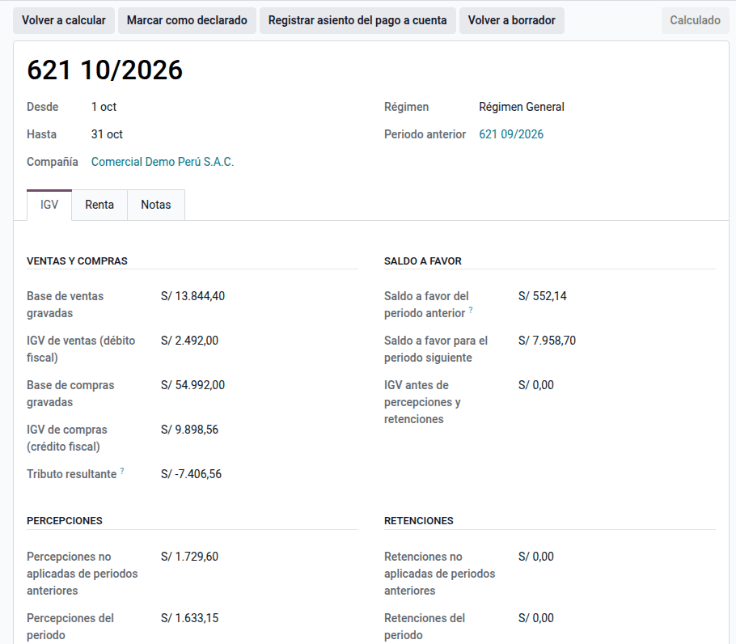
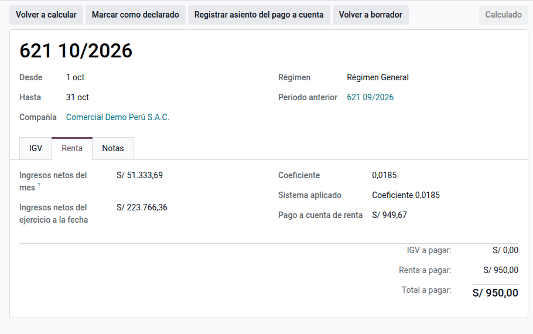

# Declaración mensual IGV y renta (621)

Cada mes la compañía declara en el Formulario Virtual 621 el IGV del periodo y
el pago a cuenta del impuesto a la renta. El módulo **Declaración mensual IGV y
renta (621)** arma ese resumen desde la contabilidad: IGV de ventas y compras,
saldo a favor, percepciones y retenciones sufridas con su arrastre y pago a
cuenta según el régimen. La declaración se presenta en SUNAT Operaciones en
Línea; el resumen no la envía.

## Configuración

1. Instale **PE - Declaración mensual IGV y renta (621)** (`al_l10n_pe_monthly_tax`).
2. Vaya a **Perú ‣ Configuración ‣ Tributos SUNAT ‣ Régimen tributario** y
   registre el régimen del RUC con la fecha desde la que rige.
3. Vaya a **Ajustes ‣ Perú ‣ Declaración mensual (621)** y escriba el
   **Coeficiente** de marzo a diciembre y el de **enero y febrero**, que salen de
   la declaración anual. Marque **Pagos a cuenta suspendidos** solo con la
   suspensión aprobada por SUNAT.
4. Opcional: el **Diario** y las **Cuentas** del asiento del pago a cuenta.

## Conceptos

| Régimen | Pago a cuenta mensual | Norma |
|---|---|---|
| Régimen General | El mayor entre ingresos netos × coeficiente e ingresos netos × 1,5 %. En enero y febrero, el coeficiente del ejercicio precedente al anterior; sin impuesto calculado, 1,5 % | Art. 85 de la Ley del Impuesto a la Renta |
| MYPE Tributario | 1 % de los ingresos netos mientras los del ejercicio no superen 300 UIT; desde que se superan, como el Régimen General | Art. 6 del D. Leg. 1269 |
| Régimen Especial | Cuota de 1,5 % de los ingresos netos | Art. 120 de la Ley del Impuesto a la Renta |

Los ingresos netos del mes son el saldo de las cuentas de ingresos (ventas y
otros ingresos de gestión) menos devoluciones y descuentos.

## Calcular un periodo

1. Vaya a **Perú ‣ Declaración mensual (621)** y haga clic en **Nuevo**.
2. Elija el **Año** y el **Mes** y haga clic en **Calcular**.

El cálculo trae:

- **Ventas y compras**: base e IGV de los asientos publicados del mes (las notas
  de crédito restan). El IGV retenido en las liquidaciones de compra no entra:
  se declara en el formulario 1662.
- **Saldo a favor**: el del periodo anterior, que se descuenta del tributo
  resultante; si el crédito supera al débito, el exceso pasa al mes siguiente.
- **Percepciones** y **retenciones** sufridas en el mes más las no aplicadas
  antes, en ese orden; lo no aplicado pasa al mes siguiente.
- **Renta**: ingresos netos del mes y del ejercicio, el sistema aplicado y la
  cuota.

!!! note "Nota"
    Los importes a pagar se redondean a soles enteros, como en el formulario.
    Sin periodo anterior calculado, escriba a mano los saldos de arrastre antes
    de calcular.

## Declarar y registrar el pago a cuenta

1. Revise el periodo y haga clic en **Marcar como declarado** al presentar el
   621. Un periodo declarado no se recalcula.
2. Opcional: **Registrar asiento del pago a cuenta** carga la cuenta de pagos a
   cuenta contra la cuenta por pagar configurada.

!!! warning "Importante"
    Calcule los periodos en orden: cada uno toma los saldos del anterior. Si
    corrige un mes ya calculado, vuelva a calcular los siguientes.

## Reportes

La lista de **Declaración mensual (621)** suma por año el IGV, la renta y el
total a pagar, y se agrupa por compañía.

!!! info "Ver también"
    - [Determinación de pagos a cuenta (SUNAT)](https://orientacion.sunat.gob.pe/01-determinacion-de-pagos-cuenta)
    - [Ley del Impuesto a la Renta, capítulo XI (art. 85)](https://www.sunat.gob.pe/legislacion/renta/ley/capxi.pdf)
    - [D. Leg. 1269, Régimen MYPE Tributario](https://www.sunat.gob.pe/legislacion/mypeIR/dl1269.pdf)
    - [Percepciones del IGV](perceptions.md)
    - [Retenciones del IGV](withholdings.md)
