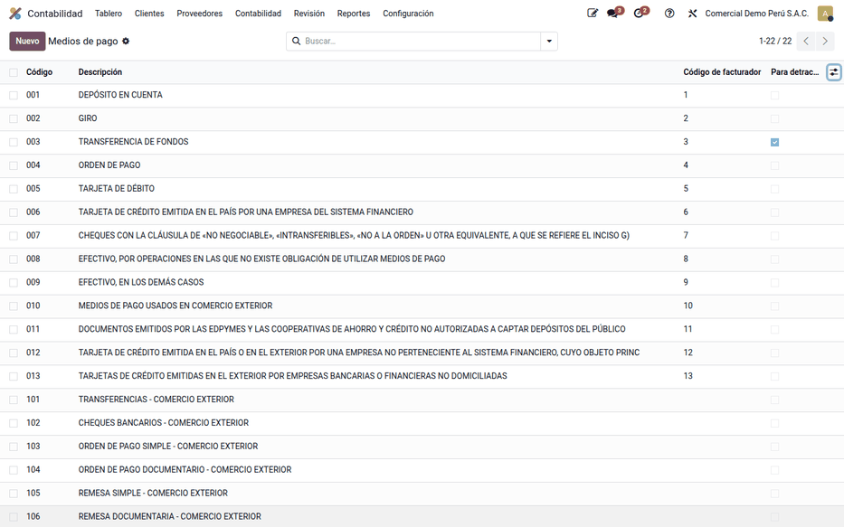
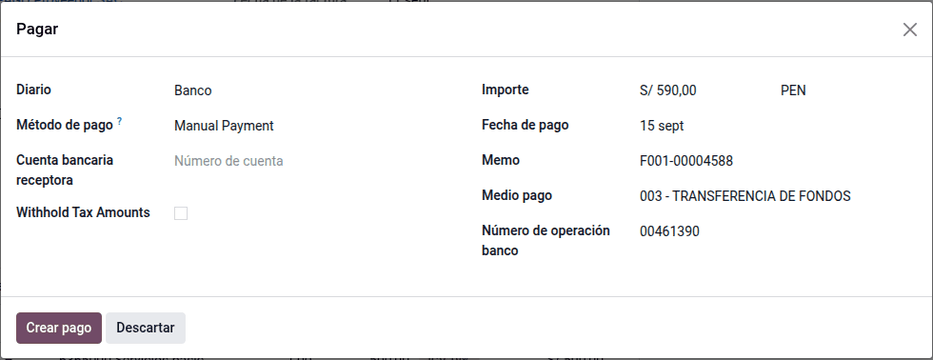
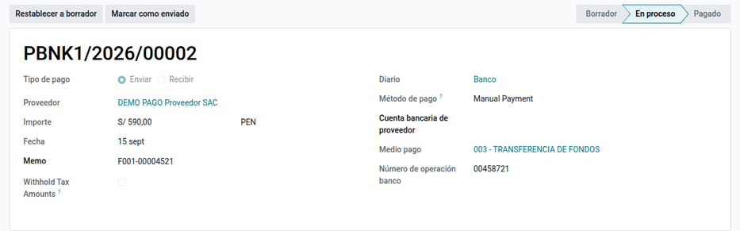
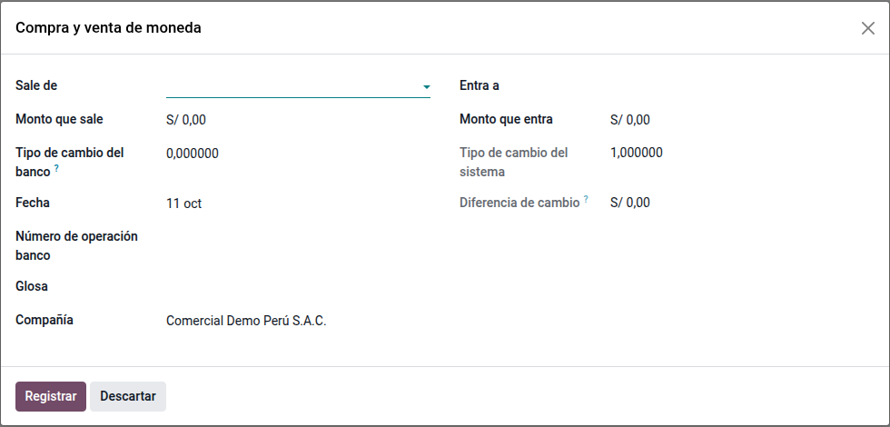

# Medios de pago SUNAT

La ley de bancarización obliga a pagar con **medios de pago** del sistema
financiero las obligaciones desde cierto importe; si no, el gasto o costo y el
crédito fiscal del IGV pueden desconocerse. Para sustentarlo hay que saber,
pago por pago, qué medio se usó según la tabla de SUNAT y qué número de
operación dio el banco. Este módulo carga el **catálogo de medios de pago de
SUNAT** y añade al pago, y al asistente **Pagar**, el **medio de pago** y el
**número de operación bancaria**. Lo usan tesorería y contabilidad.

No valida si un pago debió bancarizarse ni genera asientos propios: el asiento
es el nativo del pago.

## Conceptos

- La **Ley N.° 28194** (TUO aprobado por D.S. N.° 150-2007-EF) establece los
  medios de pago obligatorios y sus efectos tributarios.
- El **D. Leg. N.° 1529** (2022) bajó el monto desde el que se deben usar a
  **S/ 2 000 o US$ 500**. Aplica también a los pagos parciales de una
  obligación que supere ese monto. Para inmuebles, vehículos y aportes de
  capital, el monto es 1 UIT.
- La **tabla 1 de medios de pago** de SUNAT (anexo de los libros
  electrónicos) va de 001 Depósito en cuenta, 003 Transferencia de fondos, 007
  Cheque… a 999 Otros medios de pago.

| Término | Significado | Dónde aparece en Odoo |
|---|---|---|
| Medio de pago | Código de la tabla de SUNAT con su descripción | **Perú ‣ Configuración ‣ Tributos SUNAT ‣ Medios de pago** |
| Código de facturador | Código del medio para el comprobante electrónico | Ficha del medio (columna oculta en la lista) |
| Para detracción | Medio admitido para el depósito de detracciones | Ficha del medio |
| Número de operación banco | Referencia que entrega el banco | Pago y asistente **Pagar** |

## Configuración

1. Instale el módulo: el catálogo de 20 medios (001 a 011, 101 a 108 y 999)
   se carga solo.
2. Vaya a **Perú ‣ Configuración ‣ Tributos SUNAT ‣ Medios de pago** y revise
   la marca **Para detracción** (en el catálogo inicial, 003 Transferencia de
   fondos) y el **Código de facturador**, si su facturador lo requiere.
3. Archive los medios que la empresa no usa (**Acciones ‣ Archivar**).

## Registrar un pago

1. Abra la factura de proveedor publicada en **Contabilidad ‣ Proveedores ‣
   Facturas** y haga clic en **Pagar**.
2. Elija el **Medio pago** (se busca por código, como «003», o por texto, como
   «transf») y escriba el **Número de operación banco**.
3. Haga clic en **Crear pago**.

Para pagar varias facturas del mismo proveedor de una vez, selecciónelas en la
lista, haga clic en **Pagar** y active **Agrupar pagos**: se crea un solo pago
con los datos del asistente. Sin agrupar, cada pago guarda el mismo medio y
número.

El asiento es el nativo de Odoo: proveedor contra pagos pendientes. Al
conciliar el extracto en **Contabilidad ‣ Conciliación bancaria**, el número
de operación se cruza con el del banco y el apunte de pagos pendientes pasa a
la cuenta del banco. Los campos también están en los cobros de clientes.

### Ejemplo

Comercial Demo Perú paga a DEMO PAGO Proveedor SAC dos facturas de S/ 590,00
(S/ 500,00 + IGV) cada una con un solo depósito en cuenta, operación 00471205
(asiento PBNK1/2026/00006 de la demostración). El total, S/ 1 180,00, es menor
que S/ 2 000,00, pero la empresa paga por banco y deja la constancia: medio
**001 - DEPÓSITO EN CUENTA**, número de operación **00471205**.

| Cuenta | Descripción | Debe | Haber |
|---|---|---|---|
| 4212000 | Facturas por pagar — F001-00004620, F001-00004621 | 1 180,00 | |
| 1041004 | Pagos pendientes | | 1 180,00 |
| **Totales** | | **1 180,00** | **1 180,00** |

Una factura de S/ 2 360,00 (S/ 2 000,00 + IGV) sí supera el monto: debe
pagarse con un medio del sistema financiero (por ejemplo, 003 Transferencia de
fondos) aunque se pague en dos partes de S/ 1 180,00.

!!! note "Nota"
    Los campos son opcionales en el sistema, pero conviene completarlos para
    sustentar la bancarización. En un pago confirmado son de solo lectura:
    para corregirlos, haga clic en **Restablecer a borrador**, corrija y
    confirme.

## Exigir el número de operación

En **Contabilidad ‣ Configuración ‣ Diarios**, abra el diario del banco y marque
**Exigir número de operación**. Desde entonces, ese diario no deja confirmar un
pago sin **Número de operación banco**: el dato que pide el Libro Caja y Bancos
y que permite conciliar con el extracto. Los diarios de caja no lo necesitan.

## Comprar y vender moneda

Para cambiar soles por dólares (o al revés) entre dos cuentas de la empresa al
tipo de cambio del banco:

1. Vaya a **Perú ‣ Compra y venta de moneda** (o **Contabilidad ‣ Contabilidad ‣
   Compra y venta de moneda**).
2. Elija la cuenta de la que **Sale** el dinero y a la que **Entra**; una debe
   estar en soles y la otra en moneda extranjera.
3. Indique el **Monto que sale** y el **Tipo de cambio del banco**: el **Monto
   que entra** se calcula y se puede corregir con lo que abonó el banco. El
   asistente muestra el **Tipo de cambio del sistema** (el de SUNAT) y la
   **Diferencia de cambio** resultante.
4. Complete el **Número de operación banco** y pulse **Registrar**.

Se crean dos pagos, uno que sale y otro que entra, por la cuenta de
transferencias de liquidez de la compañía, cada uno conciliable con su extracto.
La diferencia entre lo que salió y lo que entró, valorizados al tipo de cambio
del sistema, va a la cuenta de **pérdida** (676) o de **ganancia** (776) por
diferencia de cambio de la compañía, y la cuenta de transferencias queda
conciliada.

Ejemplo: se compran US$ 1 000 a 3,80 (S/ 3 800) con un tipo de cambio del
sistema de 3,75. Entran S/ 3 750 valorizados: la pérdida por diferencia de
cambio es S/ 50.

## Reportes

- **Libro Caja y Bancos** (PLE 1.1 y 1.2) y **Registro de Compras**: el medio
  y la operación sustentan los pagos de los comprobantes ([PLE](ple.md)).
- [Detracciones](detractions.md): el depósito usa los medios marcados **Para
  detracción**.
- En la lista de pagos, filtre o agrupe por medio de pago para revisar la
  bancarización del periodo.

## Casos especiales

| Situación | Qué pasa | Qué hacer |
|---|---|---|
| No aparece el medio en el asistente | Está archivado o se busca mal | Busque por código o por texto; desarchívelo |
| Se pagó sin medio | El campo queda vacío (es opcional) | Complételo antes de confirmar el pago |
| No se puede crear un medio desde el asistente | Está bloqueado a propósito | Créelo en el catálogo |
| «Indique el número de operación del banco» al confirmar | El diario lo exige | Complete **Número de operación banco** |
| Compra y venta de moneda: «Configure la cuenta de transferencias de liquidez» | La compañía no la tiene | Defínala en **Contabilidad ‣ Configuración ‣ Ajustes** |

!!! info "Ver también"
    - [Ley N.° 28194 (Congreso)](https://www.leyes.congreso.gob.pe/Documentos/Leyes/28194.pdf)
    - [TUO de la Ley N.° 28194 — D.S. N.° 150-2007-EF](https://www.sunat.gob.pe/legislacion/itf/ds150_07.pdf)
    - [D. Leg. N.° 1529 (El Peruano)](https://busquedas.elperuano.pe/dispositivo/NL/2044433-2)
    - [Odoo: pagos](https://www.odoo.com/documentation/19.0/es_419/applications/finance/accounting/payments.html)
