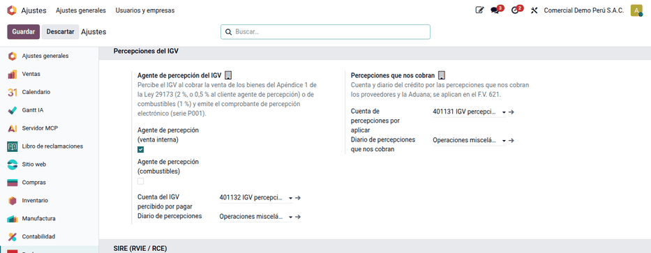
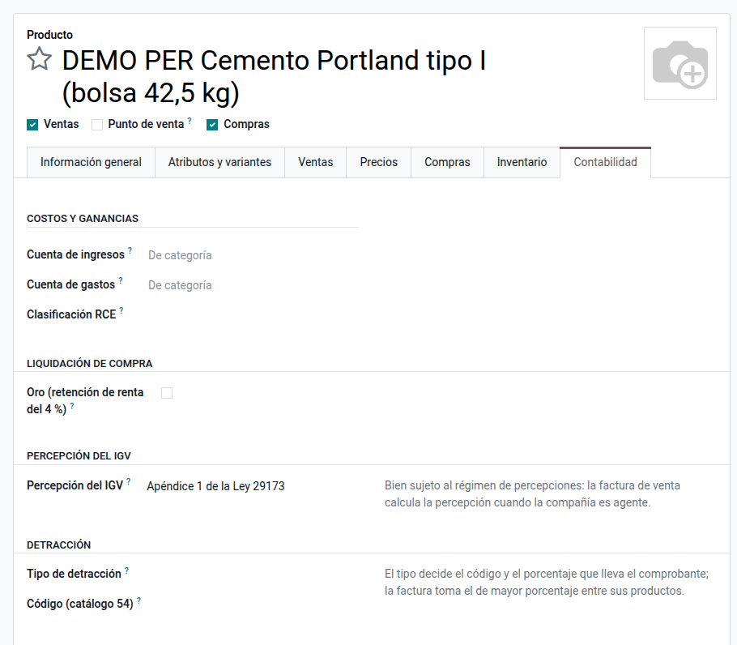
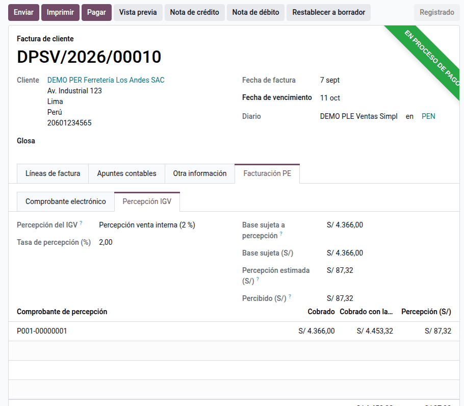
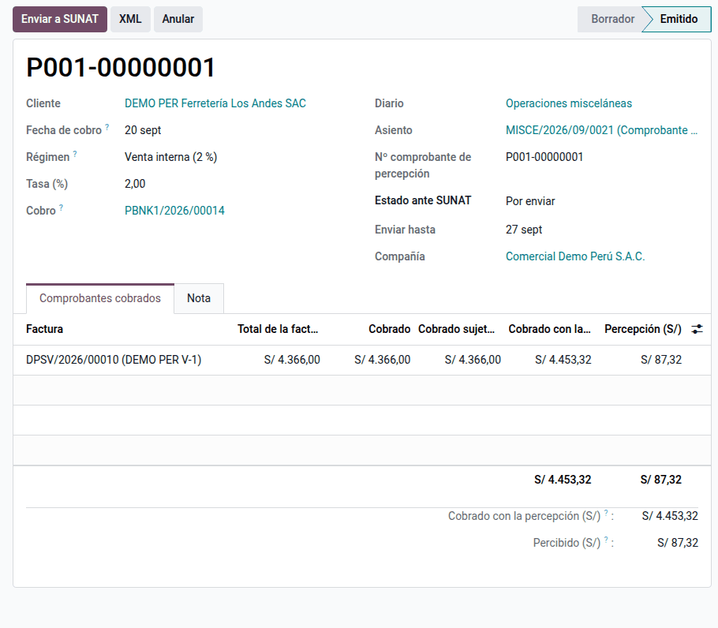
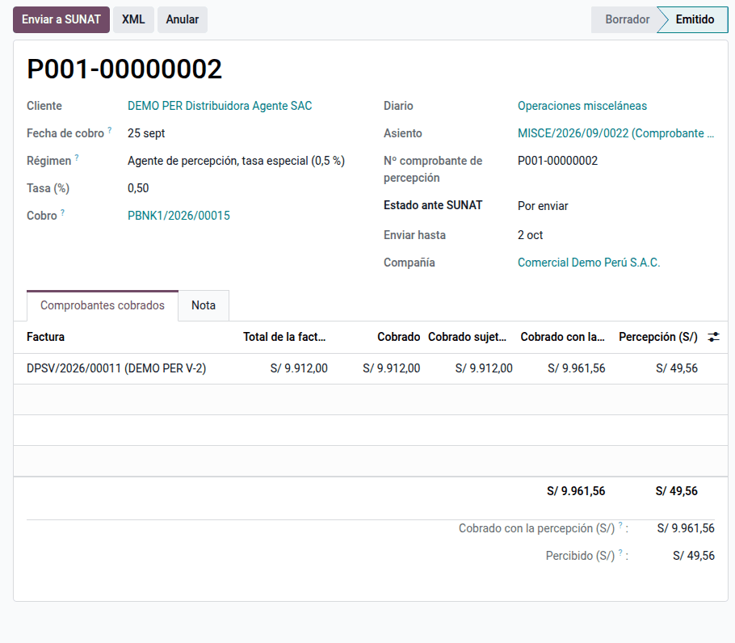
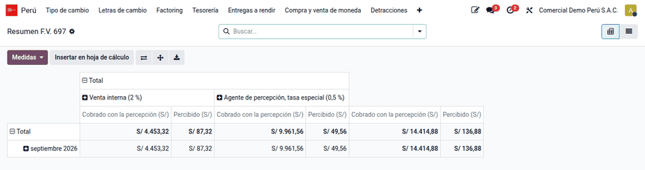
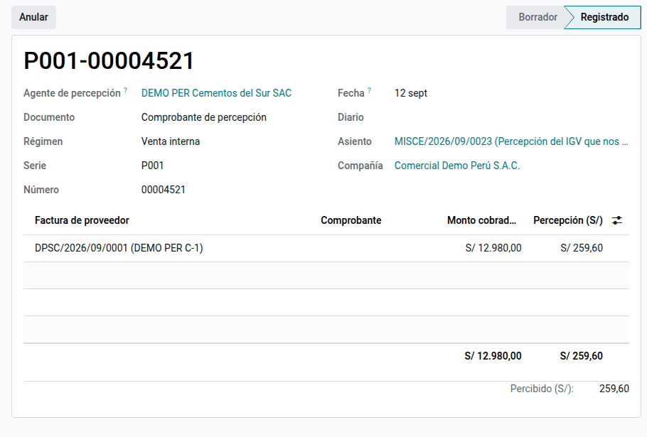
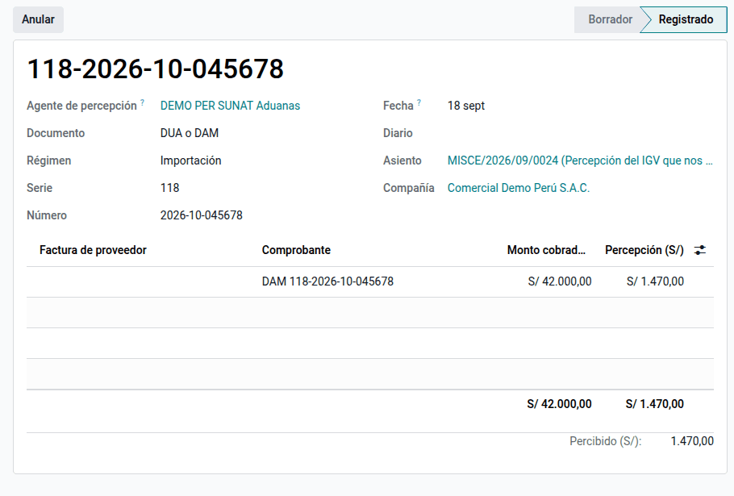
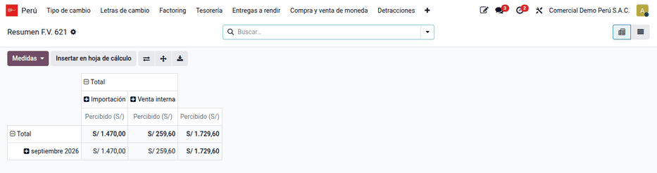

# Percepciones del IGV

El **agente de percepción** designado por SUNAT cobra a su cliente, además del
precio, un porcentaje del IGV que el cliente pagará en sus ventas siguientes, y
le entrega un comprobante de percepción por cada cobro. El módulo
**Percepciones del IGV** (`al_l10n_pe_perception`) decide la percepción en la
factura de venta, emite el comprobante de percepción electrónico al cobrar y
registra también las percepciones que le cobran a la empresa sus proveedores y
la Aduana.

## Conceptos

| Concepto | Regla |
|---|---|
| Bienes sujetos | Los del Apéndice 1 de la Ley 29173 (desde 2015, numerales 1 a 12) y los combustibles líquidos derivados del petróleo |
| Base | Precio de venta con IGV de los bienes sujetos |
| Tasa general | 2 % |
| Cliente agente de percepción | 0,5 %, si el comprobante da crédito fiscal (factura o nota de débito) |
| Combustibles | 1 % (R.S. 128-2002/SUNAT) |
| Momento | Al cobrar: un comprobante por cliente y por tasa, con lo cobrado en ese momento |
| Declaración | El agente declara y paga en el F.V. 697; quien sufre la percepción la aplica en el F.V. 621 |

**No se percibe** (art. 6 y 7 de la R.S. 058-2006/SUNAT):

- con factura, al cliente agente de retención o entidad exceptuada;
- al consumidor final: persona natural que compra con boleta hasta S/ 1 500 por
  comprobante (S/ 100 en los numerales 1, 2 y 3 del Apéndice 1);
- en las operaciones con detracción (SPOT);
- en combustibles, al cliente agente de percepción, al consumidor directo
  exceptuado y al consumidor final.

!!! note "Nota"
    La tasa y las exclusiones se resuelven en la factura. El comprobante de
    percepción calcula el importe con el factor del reglamento: tasa ÷ (100 +
    tasa), redondeado a seis decimales, sobre el monto cobrado con la
    percepción.

## Configuración

1. Instale el módulo **Percepciones del IGV** (`al_l10n_pe_perception`).
2. Vaya a **Ajustes ‣ Perú ‣ Percepciones del IGV** y revise:
    - **Agente de percepción (venta interna)** y, si vende combustibles,
      **Agente de percepción (combustibles)**;
    - **Cuenta del IGV percibido por pagar** y **Diario de percepciones**;
    - **Cuenta de percepciones por aplicar** y su diario, para las que le
      cobran.
3. En cada producto sujeto, pestaña **Contabilidad**, elija el grupo en
   **Percepción del IGV**.
4. En los contactos, revise **Agente de percepción** y **Exceptuado de la
   percepción**. Al consultar la ficha RUC, el primero se marca solo si el
   contribuyente figura en ese padrón.

!!! tip "Consejo"
    La condición de agente es del RUC: una sucursal muestra la de su compañía
    raíz y se configura allí.

## Facturar una venta sujeta

1. Cree y publique la factura de venta como siempre.
2. La pestaña **Facturación PE ‣ Percepción IGV** muestra el régimen, la tasa,
   la base sujeta y la percepción estimada. Si la operación queda excluida,
   **Motivo** explica por qué.
3. Al publicar, el tipo de operación pasa a **2001** (sujeta a percepción). El
   XML informa el cargo de percepción (catálogo 53: 51, 52 o 53) y el monto
   total con la percepción, y el PDF lleva la leyenda **Operación sujeta a
   percepción del IGV**.

| Factura | Cliente | Base sujeta | Tasa | Percepción |
|---|---|---|---|---|
| DPSV/2026/00010 | Ferretería (empresa) | S/ 4 366.00 | 2 % | S/ 87.32 |
| DPSV/2026/00011 | Distribuidora agente de percepción | S/ 9 912.00 | 0,5 % | S/ 49.56 |

## Emitir el comprobante de percepción

1. Registre el cobro de la factura por el total más la percepción.
2. En el pago, haga clic en **Comprobante de percepción**: se crea el borrador
   con lo que ese cobro pagó de cada factura sujeta. También puede elegir las
   facturas en **Perú ‣ Clientes ‣ Detracciones, retenciones y percepciones ‣ Facturas sujetas a percepción** y
   usar **Acciones ‣ Emitir comprobante de percepción**.
3. Revise las líneas y haga clic en **Emitir**: el comprobante recibe su número
   **P001-########**, se crea el asiento (cargo al cliente, abono a la cuenta
   del IGV percibido) y se concilia con lo que el cliente pagó de más.
4. Haga clic en **Enviar a SUNAT**. **XML** descarga el comprobante sin firmar
   para revisarlo.

| Cobrado de la factura | Cobrado con la percepción | Factor | Percepción |
|---|---|---|---|
| S/ 4 366.00 | S/ 4 453.32 | 0.019608 | S/ 87.32 |
| S/ 9 912.00 (0,5 %) | S/ 9 961.56 | 0.004975 | S/ 49.56 |

!!! warning "Importante"
    Con cobros parciales, emita un comprobante por cada cobro. Si la factura
    está en otra moneda, lo cobrado se convierte a soles al tipo de cambio de
    la fecha de cobro.

### Anular o revertir

- Un comprobante emitido y no aceptado se **Anula**: el asiento se cancela.
- Uno aceptado por SUNAT se **Revierte**: indique el motivo y haga clic en
  **Revertir**; luego **Consultar reversión**. Al aceptarse, el comprobante y su
  asiento quedan anulados.

## Declarar en el F.V. 697

Vaya a **Perú ‣ SUNAT ‣ Declaraciones ‣ Resumen F.V. 697**. La tabla muestra, por
mes y régimen, el **Cobrado con la percepción** (base, casilla 502) y lo
**Percibido** (casilla 401) de los comprobantes emitidos.

## Registrar las percepciones que le cobran

1. Vaya a **Perú ‣ Proveedores ‣ Detracciones, retenciones y percepciones ‣ Percepciones que nos cobran** y cree el
   registro con el **Agente de percepción**, el **Documento** (comprobante de
   percepción, factura del proveedor o DUA), el **Régimen**, el número y la
   fecha.
2. Agregue una línea por comprobante percibido con su monto y haga clic en
   **Registrar**: el asiento carga la cuenta de percepciones por aplicar y abona
   al proveedor.
3. Si la factura del proveedor consigna la percepción, use el botón
   **Registrar percepción** de la factura: el borrador toma su serie, su número
   y el 2 % del total.

Para aplicarlas, vaya a **Perú ‣ SUNAT ‣ Declaraciones ‣ Percepciones del F.V. 621**: lo
registrado por mes y régimen se aplica contra el IGV del periodo; el saldo no
aplicado se arrastra a los meses siguientes.

## Datos de demostración

Una base creada **con datos de demostración** carga, al instalar el módulo, un
ejemplo completo en la compañía **PE Company** (la compañía peruana de la demo
de Odoo, con el plan contable de Perú). Las fechas se calculan respecto del día de la instalación. En una base
sin datos de demostración no se carga nada.

- La compañía como agente de percepción, con sus cuentas y diario.
- Tres ventas de cemento y fierro; dos cobradas con su comprobante de
  percepción.
- Dos percepciones sufridas: la de un proveedor agente y la de una importación
  (DAM).

!!! info "Ver también"
    - [R.S. 058-2006/SUNAT — Régimen de percepciones del IGV en la venta de bienes](https://www.sunat.gob.pe/legislacion/superin/2006/058.htm)
    - [R.S. 274-2015/SUNAT — Comprobantes de retención y de percepción electrónicos](https://www.sunat.gob.pe/legislacion/superin/2015/274-2015.pdf)
    - [SUNAT: régimen de percepciones en la venta interna](https://orientacion.sunat.gob.pe/02-regimen-de-percepciones-venta-interna)
    - [SUNAT: porcentajes de percepción](https://orientacion.sunat.gob.pe/03-porcentajes-de-percepcion)
    - [SUNAT: percepciones en la venta de combustible](https://orientacion.sunat.gob.pe/04-regimen-de-percepciones-venta-de-combustible)
    - [SUNAT: comprobante de percepción](https://orientacion.sunat.gob.pe/05-comprobante-de-percepcion)
    - [Retenciones del IGV](withholdings.md)
    - [Detracciones (SPOT)](detractions.md)
    - [Facturación electrónica](electronic_invoicing.md)
