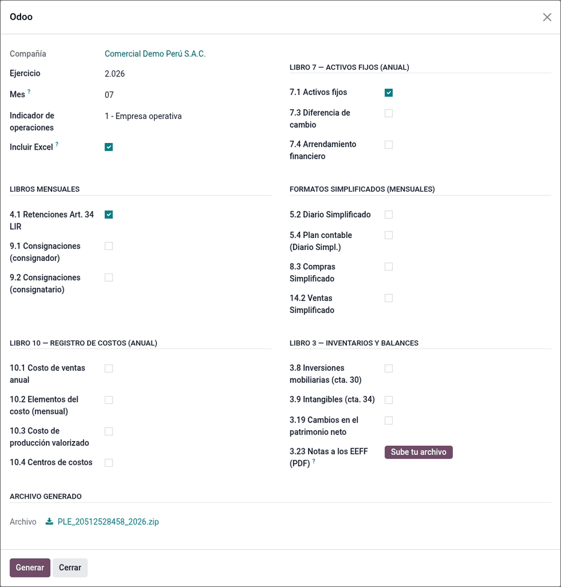
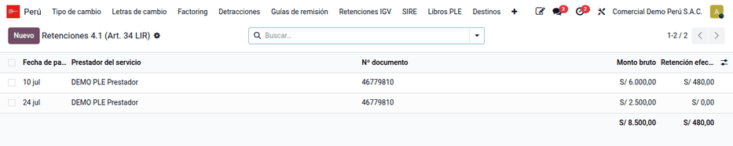
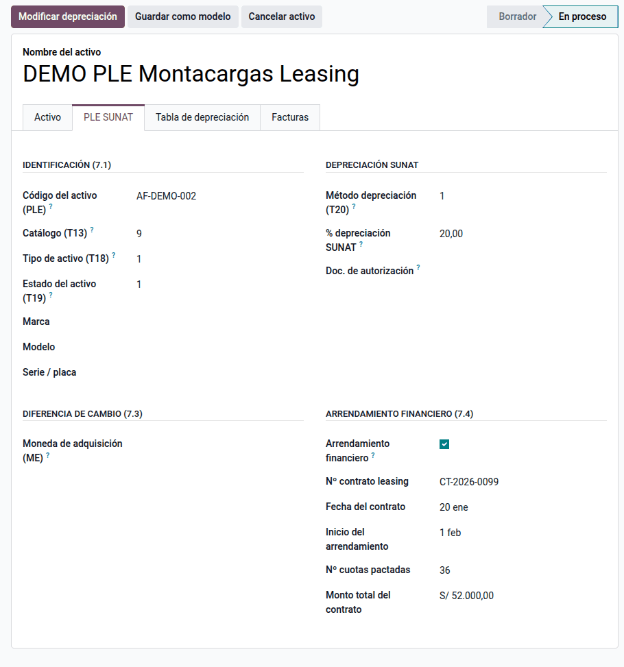
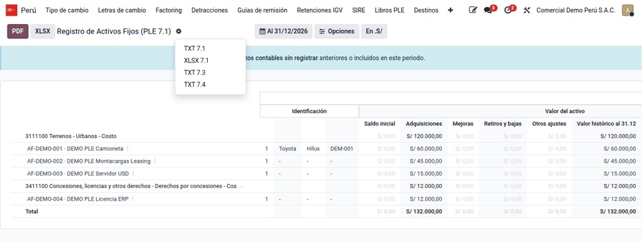

# Libros electrónicos (PLE)

Los contribuyentes obligados llevan sus libros y registros contables de forma
**electrónica**: cada mes o cada año generan un archivo TXT con la estructura
que fija SUNAT, lo validan con el **Programa de Libros Electrónicos (PLE)** y
lo presentan. Odoo Enterprise (`l10n_pe_reports`) ya genera los libros
principales (Diario, Mayor, Caja y Bancos, Ventas, Compras, Inventarios); este
módulo **completa los que faltan** y los reúne en **Perú ‣ SUNAT ‣ Libros PLE**, cada
uno con un Excel de revisión. Lo usa el contador en el cierre mensual y anual.

Cubre Activos Fijos (7.1, 7.3, 7.4), Retenciones del art. 34 de la LIR (4.1),
Consignaciones (9.1, 9.2), complementos del Libro 3 (3.8, 3.9, 3.19, 3.23),
Registro de Costos (10.1 a 10.4) y los formatos **simplificados** (5.2, 5.4,
8.3, 14.2). La presentación se hace con el PLE de SUNAT, fuera de Odoo. Los
registros de compras y ventas de los obligados al SIRE se llevan en
[Registros SIRE](sire.md).

## Conceptos

- La **R.S. 286-2009/SUNAT** dispone el llevado electrónico de libros: su
  **Anexo 2** fija la estructura de cada formato y el **Anexo 3** las tablas
  de códigos. La **R.S. 196-2010/SUNAT** amplía el sistema y reemplaza el
  Anexo 2; la **R.S. 361-2015/SUNAT** define quiénes llevan los registros de
  ventas y compras electrónicos, y la **R.S. 042-2018/SUNAT** los códigos de
  existencias (CUBSO) en los libros de inventarios.

| Término | Significado | Dónde aparece en Odoo |
|---|---|---|
| Formato | Cada libro o registro con su código (por ejemplo, 5.2 Libro Diario simplificado) | Casillas del asistente **Exportar PLE** |
| Nombre del archivo | 33 caracteres: LE + RUC + periodo + código del libro + oportunidad + indicadores | Lo arma el sistema |
| Indicador de operaciones | 1 empresa operativa, 2 cierre del libro, 0 baja de RUC | Asistente **Exportar PLE** |
| Oportunidad | Solo Libro 3: momento de presentación de los estados financieros (01 al 31/12…) | Asistente **Exportar PLE** |
| Estado del registro | 1 = operación del periodo (el módulo emite siempre 1) | Dentro del TXT |
| Formatos simplificados | Para empresas que llevan contabilidad simplificada (5.2, 5.4, 8.3, 14.2) | **Ajustes ‣ Perú ‣ Libros PLE simplificados** |

## Configuración

1. Complete el RUC de 11 dígitos de la compañía: sin él, ninguna exportación
   avanza.
2. Si la empresa lleva libros simplificados, vaya a **Ajustes ‣ Perú** y
   active **Libros PLE simplificados**. Habilita 5.2/5.4, 8.3 y 14.2 y excluye
   5.1/5.3, 8.1 y 14.1: una empresa presenta unos u otros, nunca ambos.
3. Marque la naturaleza y la exclusión de los diarios en **Perú ‣
   Configuración ‣ Contabilidad ‣ Diarios**
   ([Configuración contable básica](accounting_base.md)).
4. Complete la pestaña **PLE SUNAT** de cada activo fijo (Enterprise).
5. Para inventarios, complete la tabla 5 (tipo de existencia) en las
   categorías o los productos.

## Exportar los libros

1. Registre y publique las operaciones del mes y capture lo que no sale de los
   asientos (retenciones 4.1, inversiones 3.8, patrimonio 3.19, costos del
   Libro 10).
2. Vaya a **Perú ‣ SUNAT ‣ Libros PLE ‣ Exportar PLE** (requiere el permiso de
   contador).
3. Elija la **Compañía**, el **Ejercicio** y, si marca un libro mensual, el
   **Mes**. Indique el **Indicador de operaciones**.
4. Para el Libro 3, indique la **Fecha de los EEFF** (por defecto, 31/12 del
   ejercicio) y la **Oportunidad**; para el 3.23, adjunte el PDF de notas a
   los estados financieros (se incluye en el ZIP con el nombre oficial).
5. Marque los formatos y haga clic en **Generar**. **Incluir Excel**, activa
   por defecto, añade un `.xlsx` de revisión por formato. Con un formato sale
   un TXT; con varios, un ZIP.
6. Revise el Excel, valide el TXT en el PLE de SUNAT y preséntelo. Solo se
   presenta el TXT.



### Ejemplo

Compañía con RUC 20512528458 que lleva libros simplificados, periodo
setiembre de 2026. Se registra una venta de S/ 1 000 + IGV:

| Cuenta | Descripción | Debe | Haber |
|---|---|---|---|
| 1212 | Facturas por cobrar — F001-00000123 | 1 180,00 | |
| 40111 | IGV — cuenta propia | | 180,00 |
| 7011 | Ventas de mercaderías | | 1 000,00 |
| **Totales** | | **1 180,00** | **1 180,00** |

En **Exportar PLE** se elige el ejercicio 2026, el mes 09, el indicador de
operaciones 1 y los formatos 5.2 y 14.2. El asiento sale en el 5.2 con sus tres
líneas y la factura en el 14.2 con base 1 000,00, IGV 180,00 y total 1 180,00.
Como se marcaron dos formatos, el asistente entrega un ZIP con los dos TXT y sus
dos Excel. El nombre del archivo del 5.2 es:

```
LE2051252845820260900050200001111.txt
LE | 20512528458 | 2026 | 09 | 00 | 050200 | 00 | 1 | 1 | 1 | 1
   RUC           año    mes día   libro    oport. ind.op. con datos moneda(PEN) fijo
```

Un mes sin movimientos lleva en el nombre el indicador «sin información»:
preséntelo igual si la norma lo exige.

## Formatos simplificados (5.2, 5.4, 8.3, 14.2)

Salen de los datos de Odoo, sin captura adicional:

| Formato | Fuente |
|---|---|
| 5.2 | Todos los asientos publicados del mes, una línea por apunte. La glosa sale de la glosa del asiento o de la línea, o de la referencia |
| 5.4 | Todas las cuentas activas del plan contable de la compañía |
| 8.3 | Facturas y notas de crédito de proveedor publicadas del mes; el número del comprobante sale de la **Referencia del proveedor** |
| 14.2 | Facturas y notas de crédito de cliente publicadas del mes |

Los montos se desglosan en base imponible gravada (documentos con IGV), IGV o
IPM, ICBPER (impuestos cuyo nombre contiene «ICBPER») y otros conceptos
(documentos sin IGV). Las notas de crédito salen en negativo y referencian el
comprobante original; el tipo de cambio (tres decimales) solo se emite en
documentos en moneda extranjera. El 5.2 tiene las mismas líneas que el 5.1
completo.

!!! warning "Importante"
    - En el 8.3, escriba siempre la **Referencia del proveedor** con el
      formato `SERIE-NÚMERO` (por ejemplo, `F001-00000123`).
    - Un documento con operaciones gravadas y exoneradas a la vez se clasifica
      según lleve IGV: para esa casuística use los formatos completos.

## Retenciones 4.1 (art. 34 LIR)

Libro mensual de las retenciones de rentas de los incisos e) y f) del
artículo 34 de la LIR. Se alimenta por captura en **Perú ‣ SUNAT ‣ Libros PLE ‣
Retenciones 4.1**, una lista editable con la **Fecha de pago / retención**, el
**Prestador del servicio** (contacto con tipo y número de documento), el
**Monto bruto** y la **Retención efectuada** (0 si no hubo). Capture los
importes en positivo: el TXT emite la retención en negativo, como exige el
Anexo 2.



Verifique el **Tipo de documento** del contacto (**Contactos ‣ Ventas y
compras ‣ Identificación**): si falta, el sistema solo infiere RUC en números
de 11 dígitos. Para muchos registros, use **Favoritos ‣ Importar registros**
con las mismas columnas. Al exportar, solo entran los registros del mes
elegido.

## Libro 3: inversiones, intangibles y patrimonio

### Inversiones 3.8

Detalle, al cierre, de los títulos que forman el saldo de la cuenta 30. Se
captura en **Perú ‣ SUNAT ‣ Libros PLE ‣ Inversiones 3.8**: **Fecha del saldo
(EEFF)**, **Emisor** (o **Nombre del emisor** si es extranjero sin documento
peruano), **Código del título (T15)**, valor nominal unitario, cantidad, costo
total en libros y **Provisión** (en positivo; el TXT la emite negativa). Solo
se exportan los registros cuya fecha coincide con la fecha de los EEFF. La
suma del costo total debe cuadrar con el saldo de la cuenta 30; si el dato
consta en otro libro, no capture nada y el archivo sale «sin información».

### Intangibles 3.9

No requiere captura: toma los activos cuya **cuenta empieza por 34** vigentes a
la fecha de los EEFF, con la amortización acumulada de sus asientos de
depreciación publicados hasta esa fecha.

### Patrimonio 3.19

Estado de cambios en el patrimonio neto, preparado desde el estado financiero
aprobado. En **Perú ‣ SUNAT ‣ Libros PLE ‣ Patrimonio 3.19**, capture por **Fecha del
EEFF** una fila por **Rubro EEFF (T34)** (el **Catálogo (T22)** se propone
solo) con sus doce columnas: capital, acciones de inversión, capital
adicional, resultados no realizados, reservas legales, otras reservas,
resultados acumulados, diferencia de conversión, ajustes al patrimonio,
resultado neto, excedente de revaluación y resultado del ejercicio. Los
importes pueden ser negativos y el total de cada columna debe cuadrar con el
estado aprobado. Ver también [Estados financieros](financial_statements.md).

## Activos fijos (Libro 7)

Libro anual de los activos fijos y su depreciación (7.1), la diferencia de
cambio (7.3) y los activos en arrendamiento financiero (7.4).

1. En **Contabilidad ‣ Activos**, abra cada activo y complete la pestaña
   **PLE SUNAT**: **Código del activo (PLE)** (vacío = `AF<id>`), **Tipo de
   activo (T18)** (obligatorio), **Estado del activo (T19)** (por defecto 1),
   **Catálogo (T13)** (por defecto 9), marca, modelo y serie o placa (vacíos
   salen como `-`), y **Método (T20)** y **% depreciación** (se proponen
   solos: lineal → 1 y 100 / años de vida útil).
2. Para el 7.3, complete la moneda de adquisición, el valor en moneda
   extranjera y el tipo de cambio de la compra; el del 31/12 sale de las tasas
   cargadas ([Tipo de cambio](exchange_rates.md)).
3. Para el 7.4, marque **Arrendamiento financiero** y complete el número y la
   fecha del contrato, el inicio, el número de cuotas y el monto total.



La depreciación sale de los asientos de depreciación publicados del activo:
la acumulada al cierre del ejercicio anterior (incluida la importada de otros
sistemas) y la del ejercicio. Las bajas y ventas no cuentan como depreciación
y las revaluaciones negativas van a «otros ajustes». Un activo dado de baja en
el ejercicio sale con su valor y su depreciación en cero.

Revise el libro en **Perú ‣ SUNAT ‣ Libros PLE ‣ Activos fijos (Libro 7)** (también en
**Contabilidad ‣ Revisión ‣ Inventario**): un renglón por activo agrupado por
cuenta, con el formato físico 7.1, el menú **Abrir activo** y los botones
**PDF**, **XLSX**, **TXT 7.1**, **XLSX 7.1**, **TXT 7.3** y **TXT 7.4**. La
columna **Tipo (T18)** vacía delata los activos que harán fallar el TXT.



!!! note "Nota"
    - Las revaluaciones y los ajustes por inflación se emiten en 0,00: si la
      empresa revaluó, complete el TXT a mano.
    - Los activos totalmente depreciados sin baja sí aparecen.
    - El saldo inicial más las adquisiciones debe cuadrar con el mayor de las
      cuentas 33x.

## Consignaciones (Libro 9)

Libro mensual de los bienes entregados (9.1, consignador) o recibidos (9.2,
consignatario) en consignación, en unidades. Marque cada transferencia de
consignación en **Inventario ‣ Transferencias**, campo **Consignación PLE
(Libro 9)**:

| Valor | Cuándo usarlo |
|---|---|
| 9.1 Entrega en consignación | Salida de mercadería hacia el consignatario |
| 9.1 Devolución del consignatario | El consignatario devuelve mercadería |
| 9.1 Venta de bienes consignados | El consignatario vendió: salida definitiva |
| 9.2 Recepción en consignación | Ingreso de mercadería de un consignador |
| 9.2 Devolución al consignador | Se devuelve mercadería recibida |
| 9.2 Venta de bienes recibidos | Se vendió mercadería recibida en consignación |

El contacto de la transferencia es la contraparte (el consignador del 9.2 debe
tener RUC). El producto necesita **Tipo de existencia** (tabla 5) y su unidad
el código SUNAT (tabla 6). Solo cuentan las transferencias hechas en el mes;
en las ventas, el comprobante sale de la factura publicada de la orden de
venta. La primera línea de cada producto y contraparte es el **saldo inicial**
de los meses anteriores: marque las operaciones desde el inicio. Si existe la
guía de remisión electrónica, su número alimenta la serie y el número.

## Registro de costos (Libro 10)

Libro anual de las empresas del régimen general con actividad de
transformación. Se captura en **Perú ‣ SUNAT ‣ Libros PLE**:

| Formato | Una fila por | Contenido |
|---|---|---|
| 10.1 Costo de ventas | Ejercicio | Inventario inicial de productos terminados, costo de producción, inventario final (en positivo; sale negativo) y ajustes |
| 10.2 Elementos del costo | Mes | Materiales, mano de obra y otros costos directos y los tres componentes de los gastos indirectos de fabricación |
| 10.3 Costo de producción valorizado | Proceso | Proceso, los seis elementos del costo, inventarios de productos en proceso y código de agrupamiento (tabla 21) |
| 10.4 Centros de costos | Centro | Unidad de operación y centro de costos; con **Cuenta analítica**, se proponen el código y la descripción |

El sistema impide duplicar un ejercicio en el 10.1 o un mes en el 10.2. El
10.1 debe cuadrar con el costo de ventas del estado de resultados y el 10.2 y
el 10.3 con los elementos 6 y 9 del PCGE. Los cuatro se presentan juntos en la
oportunidad anual.

## Libros PLE nativos

**Perú ‣ SUNAT ‣ Libros PLE nativos** reúne los reportes de la
localización Enterprise y añade, junto a cada botón TXT, uno **XLSX** armado
con el mismo TXT oficial:

- **Diario y Mayor (5.1, 5.3, 6.1)**: desde el **Libro Mayor**, con el periodo
  mensual en el filtro de fechas. El 5.3 se presenta en enero o en la primera
  generación del año. **Inventory and Balance** descarga el Libro 3 en un ZIP
  y **XLSX Inventario y Balance** en un Excel con una hoja por formato (3.1 a
  3.25).
- **Caja y Bancos (1.1, 1.2)**: desde el **Flujo de caja**; requiere diarios de
  banco y caja con la cuenta bancaria configurada.
- **Ventas (14.1) y Compras (8.1, 8.2)**: diarios con documentos LATAM,
  contactos con tipo y número de documento y facturas publicadas en el
  periodo. El 8.2 es para compras a no domiciliados. Los obligados al SIRE
  llevan estos registros en [Registros SIRE](sire.md).
- **Inventarios (12.1, 13.1)**: TXT del inventario permanente en unidades y
  valorizado, con **XLSX 12.1** y **XLSX 13.1**. El kárdex imprimible está en
  [Kárdex valorizado](../../../inventory_and_mrp/inventory/kardex.md).

## Notas sobre comprobantes que no están en Odoo

Las notas de crédito y débito (07, 08, 87, 88) informan el comprobante que
modifican (campos 28 a 32 del 8.4 y 29 a 32 del 14.4). Si el original está en
Odoo, se toma de él. Si no lo está (por ejemplo, una factura de antes de la
implementación):

1. Abra la nota y vaya a **Facturación PE ‣ Comprobante modificado**.
2. Escriba el **Tipo**, la **Serie**, el **Número** y la **Fecha** del
   comprobante modificado.

Con esos datos la nota ya no bloquea el TXT, y si el original es de un periodo
anterior se informa como descuento.

## Comprobantes rechazados por SUNAT

Un comprobante con CDR de rechazo no se excluye del registro: la nota 4 del
anexo 2 de la R.S. 112-2021/SUNAT obliga a anotarlo con importe cero, como los
anulados. Así sale en el TXT del 14.4 y en los informes PLE de Odoo, aunque en
Odoo siga publicado.

## Casos especiales

| Situación | Qué pasa | Qué hacer |
|---|---|---|
| «…no están enlazadas al comprobante que modifican…» | Una nota sin original enlazado ni datos escritos | Escriba los datos en **Comprobante modificado** |
| «…no tiene configurado un RUC válido…» | Falta el RUC de la compañía | Complételo en la ficha de la compañía |
| DAM o DSI (tipos 50-54) numerada aduana-año-régimen-número | El 8.4 lleva la aduana (campo 8), el año de la DAM tomado del número (campo 9) y el número (campo 10); el total es base + IGV + otros derechos, sin la cuenta puente del valor en aduana | Nada: registre la DAM con su número completo |
| «Indique el mes…» | Se marcó un libro mensual sin mes | Elija el mes |
| «Los siguientes activos no tienen configurado…» | Falta un dato SUNAT en los activos | Complete la pestaña **PLE SUNAT** |
| «Los formatos simplificados… Habilítelos en Ajustes» | Falta la opción en Ajustes | Active **Libros PLE simplificados** |
| Corrección de un mes ya presentado | El módulo emite siempre el estado 1 | Ajuste los estados 8 y 9 a mano antes de validar |

!!! info "Ver también"
    - [R.S. 286-2009/SUNAT — Libros electrónicos](https://www.sunat.gob.pe/legislacion/superin/2009/rs286.doc)
    - [R.S. 196-2010/SUNAT — Modificación y Anexo 2](https://www.sunat.gob.pe/legislacion/superin/2010/196-10.pdf)
    - [R.S. 361-2015/SUNAT — Obligados a registros electrónicos](https://www.sunat.gob.pe/legislacion/superin/2015/361-2015.pdf)
    - [R.S. 042-2018/SUNAT — Códigos de existencias](https://www.sunat.gob.pe/legislacion/superin/2018/042-2018.pdf)
    - [Registros SIRE](sire.md)
    - [Estados financieros](financial_statements.md)
