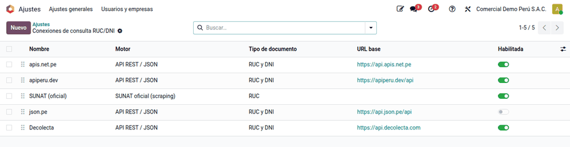
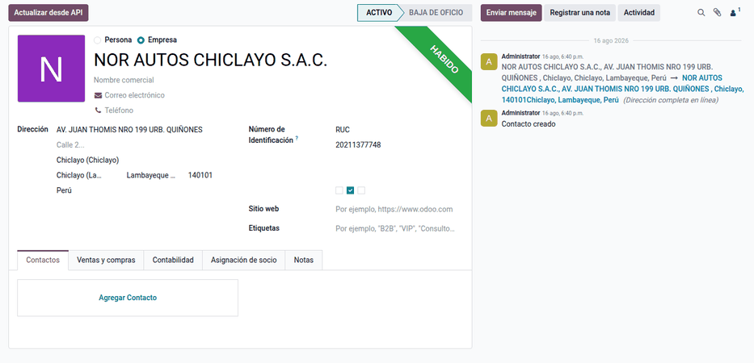
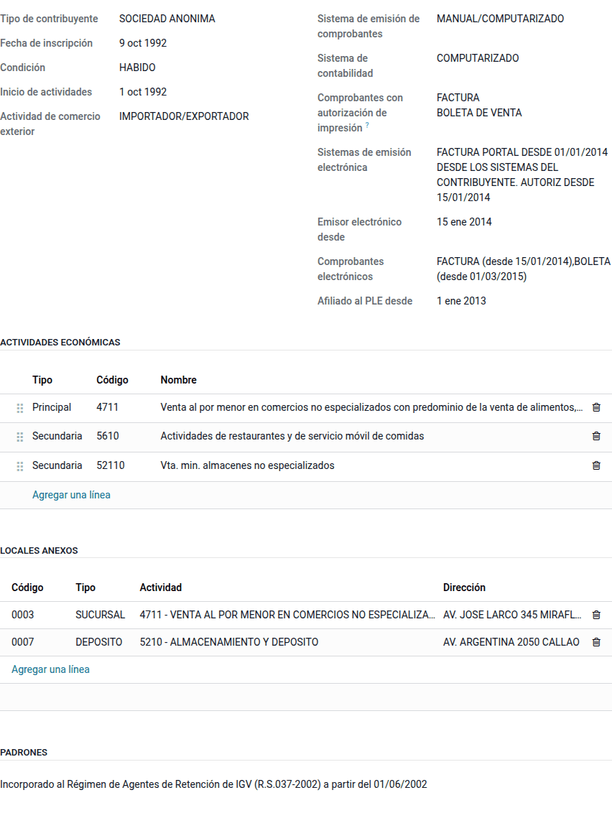
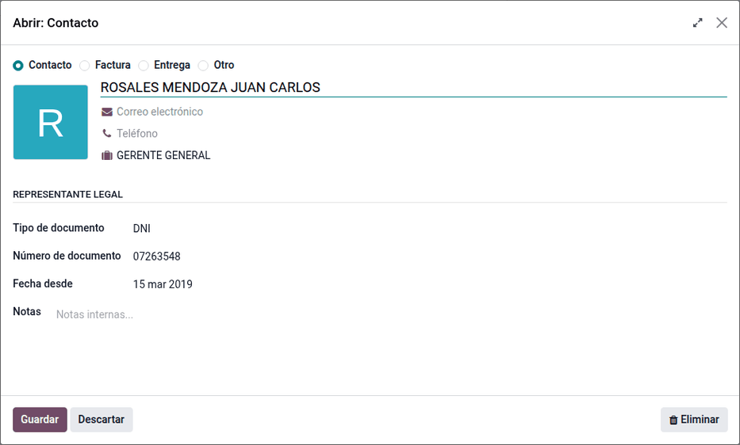
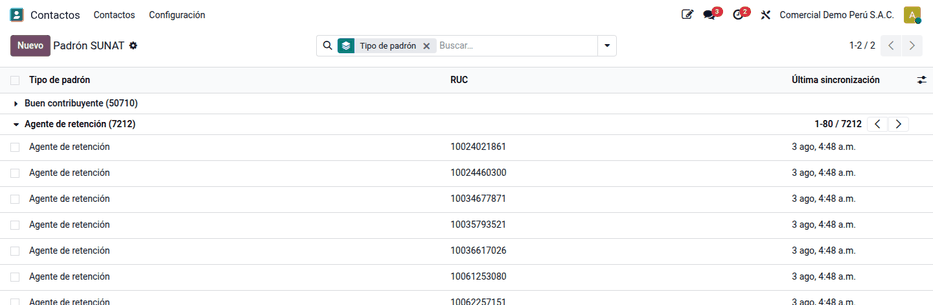

# Consulta de RUC y DNI

Al escribir el RUC o el DNI de un contacto, Odoo completa la razón social, la
dirección con su ubigeo, el **estado** (activo, baja…) y la **condición**
(habido, no habido) consultando una lista de servicios configurables (SUNAT,
Decolecta, apiperu.dev, json.pe, apis.net.pe…) por orden de prioridad. También
guarda los **padrones de SUNAT** de buenos contribuyentes y agentes de
retención, que se recargan cada día. Lo usan Ventas, Compras y Contabilidad al
crear contactos, y evita los errores de copiar los datos a mano que luego
aparecen en los comprobantes electrónicos.

La consulta se hace al crear o actualizar el contacto, no en cada factura. No
trae otros padrones, como el de agentes de percepción.

## Conceptos

El RUC identifica a los contribuyentes (Ley del RUC, D. Leg. 943) y SUNAT
publica su estado y su condición. El Régimen de Retenciones del IGV
(R.S. 037-2002/SUNAT y R.S. 061-2005/SUNAT) exceptúa a los proveedores que son
agentes de retención o buenos contribuyentes, por eso importan los padrones.
SUNAT actualiza la designación de agentes de retención por resolución (la más
reciente revisada: R.S. 000367-2025/SUNAT).

| Término | Significado | Dónde aparece en Odoo |
|---|---|---|
| Estado SUNAT | Activo, baja de oficio, suspensión temporal… | Cabecera del contacto |
| Condición | Habido o No habido (domicilio fiscal verificado) | Cinta del contacto |
| Buen contribuyente | Incluido en el padrón; exceptuado de retenciones | Casilla del contacto |
| Agente de retención | Designado por SUNAT; exceptuado de que le retengan | Casilla del contacto |
| Conexión | Un servicio de consulta con su URL, autenticación y mapeo | **Perú ‣ Configuración ‣ Consultas RUC / DNI ‣ Conexiones RUC/DNI** |
| Fallback en cascada | Si una conexión falla, se prueba la siguiente | **Ajustes ‣ Validación RUC/DNI (PE)** |
| Ubigeo | Código de departamento, provincia y distrito | Dirección del contacto |

## Configuración

1. Vaya a **Perú ‣ Configuración ‣ Ajustes**, sección **Validación RUC/DNI
   (PE)**, y active **Validar RUC**, **Validar DNI** y, si lo necesita,
   **Fallback en cascada**.
2. Vaya a **Perú ‣ Configuración ‣ Consultas RUC / DNI ‣ Conexiones RUC/DNI**.
   El sistema crea cinco conexiones por compañía; escriba el **token** de las
   que va a usar y ordénelas por prioridad. Una conexión sin token se salta;
   la consulta oficial de SUNAT no lo necesita. El token de **Decolecta** lo
   reutiliza también el [tipo de cambio](exchange_rates.md).
3. Compruebe que la acción planificada **SUNAT: Sincronizar padrón** está
   activa (**Ajustes ‣ Técnico ‣ Acciones planificadas**).

### Agregar un servicio de consulta

Cree una conexión con su URL, el endpoint con `{doc}` en el lugar del número y
la autenticación, y complete el **Mapeo de campos** (ruta en la respuesta →
campo del contacto). No hace falta programar.

## Crear un contacto con su RUC o DNI

1. Vaya a **Contactos** y haga clic en **Nuevo**. En una compañía peruana, el
   tipo de identificación es **RUC** por defecto; si elige **DNI**, el
   contacto pasa a persona.
2. Escriba el RUC (11 dígitos) o el DNI (8 dígitos) en el **Número de
   identificación**. Un número con otra longitud se rechaza antes de consultar.
3. El contacto toma el nombre, la dirección fiscal con su distrito, provincia y
   departamento (resueltos desde el ubigeo), el **Estado SUNAT** y la
   **Condición**. Con el DNI llega el nombre (RENIEC); la dirección depende del
   servicio.
4. Las casillas **Buen contribuyente** y **Agente de retención** se marcan
   desde el padrón guardado.

Por ejemplo, al escribir el RUC de **NOR AUTOS CHICLAYO S.A.C.** (base de
demostración) el contacto queda con **Estado SUNAT: ACTIVO**, condición
**Habido** y la casilla de agente de retención marcada: si la compañía también
es agente, sus facturas a este proveedor no se retienen
([Retenciones del IGV](withholdings.md)).

### Volver a consultar

Haga clic en **Actualizar desde API** en el contacto para traer los datos al
día. Si la consulta falla, el contacto muestra «No hay conexión con SUNAT/API o
los datos no existen» y el botón explica el motivo (por ejemplo, el plan del
servicio vencido); complete los datos a mano. El aviso desaparece con la
siguiente consulta correcta.

!!! warning "Importante"
    Un RUC con estado **BAJA** o condición **No habido** se muestra en el
    contacto. Evalúelo con el contador antes de facturarle o deducir el crédito
    fiscal de sus comprobantes.

## Ficha RUC del contribuyente

La pestaña **SUNAT** de una empresa muestra la ficha que SUNAT publica en la
consulta RUC, de solo lectura porque la llena la consulta:

- **Contribuyente**: tipo de contribuyente, fecha de inscripción, condición,
  inicio de actividades, fecha de baja (si la tiene) y actividad de comercio
  exterior. El estado se ve en la barra del encabezado y el nombre comercial
  bajo el nombre.
- **Sistemas y comprobantes**: sistema de emisión de comprobantes, sistema de
  contabilidad, comprobantes con autorización de impresión, sistemas de emisión
  electrónica, emisor electrónico desde, comprobantes electrónicos y afiliado
  al PLE desde.
- **Padrones** en los que figura, con su fecha.

### De dónde sale la ficha

Las API básicas (apis.net.pe, apiperu.dev, Decolecta `ruc`) solo traen nombre,
dirección, estado y condición. La ficha completa la traen:

| Fuente | Qué trae | Requisito |
|---|---|---|
| **SUNAT (oficial)** | Toda la ficha, actividades, locales y representantes | El portal de SUNAT solo responde a direcciones de internet del Perú: desde un servidor en el extranjero responde «403» |
| **Decolecta** con `ruc/full` | Tipo de contribuyente, sistemas de emisión y contabilidad, comercio exterior y actividad principal | Un plan que incluya la consulta completa y el endpoint `/v1/sunat/ruc/full?numero={doc}` en la conexión |

Al hacer clic en **Actualizar desde API**, si la primera conexión que responde
no trae la ficha, la consulta sigue con las demás conexiones activas y
completa solo lo que falta: lo que trajo la primera se conserva.

!!! warning "Importante"
    Si ninguna conexión trae la ficha, los datos básicos se guardan igual y
    aparece el aviso **Ficha RUC incompleta** con el motivo de cada conexión.
    Active una fuente de la tabla anterior para llenarla.

### Actividades económicas

La lista muestra la actividad **principal** y las **secundarias** con su código
CIIU, en el orden en que las publica SUNAT. El catálogo es la CIIU Rev. 4
oficial (**Perú ‣ Configuración ‣ Consultas RUC / DNI ‣ Actividades
económicas**); si SUNAT publica un código que no está, como los de cinco dígitos
de fichas antiguas (CIIU Rev. 3), se agrega al consultar. En la lista de
contactos se puede buscar y agrupar por **Actividad principal**.

### Locales anexos

Cada local anexo es una dirección de entrega de la empresa con su **código de
establecimiento** (el de cuatro dígitos que usan los libros y las guías de
remisión), el tipo (sucursal, depósito, oficina…), la actividad y la dirección.
Para traerlos, active **Importar locales anexos** en la conexión **SUNAT
(oficial)**; también se pueden agregar a mano en la misma lista.

### Representantes legales

Con **Importar representantes** activo en la conexión **SUNAT (oficial)**, los
gerentes, apoderados y titulares quedan como contactos de la empresa con su
cargo, tipo y número de documento y la fecha desde la que figuran. El filtro
**Representantes legales** de Contactos los lista.

Volver a consultar actualiza actividades, locales y representantes sin
duplicarlos.

## Padrón SUNAT

Vaya a **Perú ‣ Configuración ‣ Consultas RUC / DNI ‣ Padrón SUNAT** para ver
los RUC de ambos padrones con su fecha, filtrar por tipo de padrón o buscar un
RUC. La acción planificada lo descarga cada día; si la descarga falla, se
conserva el padrón anterior y se anota el error.

!!! note "Nota"
    Un proveedor recién designado agente de retención puede no estar aún en el
    padrón descargado: marque la casilla a mano.

## Casos especiales

| Situación | Qué pasa | Qué hacer |
|---|---|---|
| Ninguna conexión con token | No se consulta nada | Configure al menos un token o la conexión SUNAT oficial |
| Plan del servicio vencido | La consulta falla | **Actualizar desde API** muestra el motivo; renueve el plan o cambie la prioridad |
| Descarga del padrón fallida | Se conserva el padrón anterior y se anota el error | Ejecute la acción a mano más tarde |

El módulo no genera asientos: solo completa datos del contacto. El nombre y la
dirección que completa son los que salen en los comprobantes electrónicos y en
los libros (PLE y SIRE).

!!! info "Ver también"
    - [Ley del RUC, D. Leg. 943](https://www.sunat.gob.pe/legislacion/ruc/dleg943.htm)
    - [R.S. 037-2002/SUNAT — Régimen de Retenciones del IGV](https://www.sunat.gob.pe/legislacion/superin/2002/037.htm)
    - [R.S. 061-2005/SUNAT — Flexibilización del régimen](https://www.sunat.gob.pe/legislacion/superin/2005/061.htm)
    - [R.S. 000367-2025/SUNAT — Designación de agentes de retención](https://www.sunat.gob.pe/legislacion/superin/2025/000367-2025.pdf)
    - [SUNAT: régimen de retenciones](https://orientacion.sunat.gob.pe/07-regimen-de-retenciones-informacion-general)
    - [Retenciones del IGV](withholdings.md)
