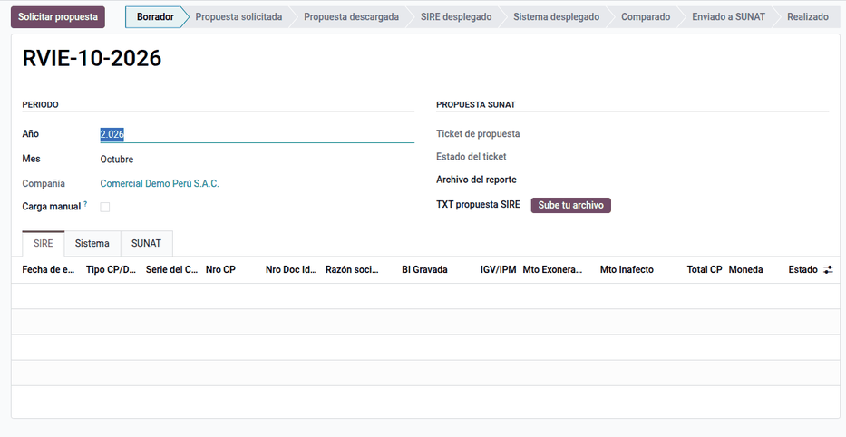
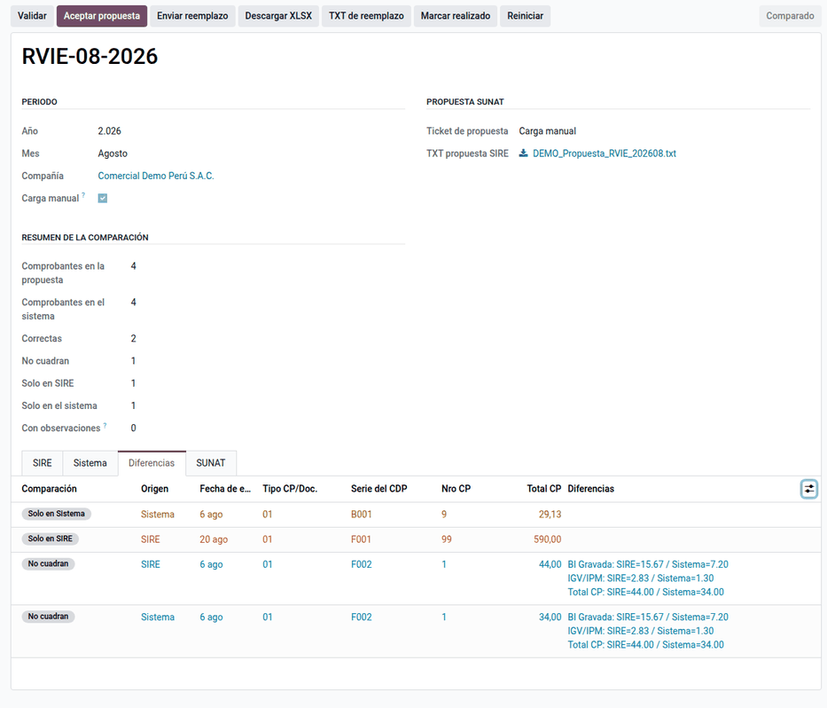
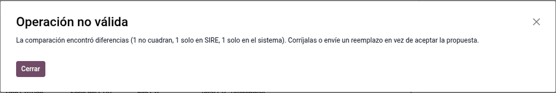

# Registros SIRE

En el **SIRE** (Sistema Integrado de Registros Electrónicos) el Registro de
Ventas (**RVIE**) y el Registro de Compras (**RCE**) parten de una
**propuesta** que SUNAT prepara con los comprobantes electrónicos que conoce;
la empresa la **acepta**, la **complementa** o la **reemplaza** antes de
generar el registro del periodo. Este módulo descarga la propuesta (por la API
de SUNAT o subiendo el TXT), la **compara línea a línea** con las facturas de
Odoo, muestra las diferencias, valida las reglas de SUNAT y envía la
aceptación o el reemplazo. Lo usa el contador cada mes.

El SIRE no genera asientos: compara y declara lo ya contabilizado. La
**generación del registro** se completa en el portal de SUNAT, porque no hay
servicio web para hacerlo desde fuera.

!!! warning "Importante"
    La conexión por API sigue los manuales oficiales de servicios web (Compras
    y Ventas v22), pero no se ha probado con credenciales de producción.
    Estrénela con un periodo de prueba y compruebe el ticket en SUNAT
    Operaciones en Línea.

## Conceptos

- **R.S. 112-2021/SUNAT**: crea el SIRE y el módulo RVIE.
- **R.S. 040-2022/SUNAT**: incorpora el módulo RCE.
- **R.S. 000204-2023/SUNAT**: modifica el SIRE y su calendario.
- **R.S. 000392-2025/SUNAT**: posterga la obligación para los principales
  contribuyentes con ingresos mayores a 2 300 UIT.

| Término | Significado | Dónde aparece en Odoo |
|---|---|---|
| Propuesta | Registro que SUNAT arma con los comprobantes que conoce | Pestaña **SIRE** del periodo |
| Ticket | Número de una operación asíncrona de SUNAT | Pestaña **SUNAT** del periodo |
| CAR | Clave única de cada comprobante en el SIRE | Columna de cruce de la comparación |
| Aceptar propuesta | Dar por buena la propuesta tal cual | Botón, solo sin diferencias |
| Reemplazo | Enviar las líneas del sistema en lugar de la propuesta | Botón **Enviar reemplazo** |
| Preliminar | Registro previo a la generación | Botón **Registrar preliminar** |

## Configuración

1. En SUNAT Operaciones en Línea, cree un usuario secundario con permisos SIRE
   y las credenciales de API (client_id y client_secret, en **Empresas ‣
   Credenciales de API SUNAT**).
2. Vaya a **Ajustes ‣ Perú**, sección **SIRE (RVIE / RCE)**, y escriba el
   **Usuario SOL (SIRE)**, la **Clave SOL (SIRE)**, el **Client ID** y el
   **Client Secret**. Se guardan en la compañía raíz (el RUC).
3. Sin credenciales, use la **Carga manual** en cada periodo: suba el TXT
   exportado del portal. Los pasos siguientes son los mismos.
4. En las facturas de compra, complete el tipo de documento y, en los tipos que
   la exigen, la fecha de vencimiento. El destino de las compras gravadas sale
   del grupo de impuesto (DG, DGNG, DNG) y la **Clasificación de bienes y
   servicios** (tabla 30) de la pestaña **Otra información**.
5. Opcional: en **Perú ‣ Configuración ‣ SIRE: campos de comparación**, active
   o archive las columnas del cruce. Por defecto se comparan fechas, tipo,
   serie y número, documento del socio, importes y estado; la razón social, el
   tipo de cambio y la fecha de vencimiento están archivados (filtro
   **Archivados ‣ Desarchivar** para activarlos).

## Conciliar el periodo

1. Vaya a **Perú ‣ SIRE ‣ Ventas (RVIE)** o **Compras (RCE)** y cree el
   periodo (año y mes).
2. Haga clic en **Solicitar propuesta**: SUNAT devuelve un ticket. Una acción
   planificada lo consulta con espera creciente y descarga la propuesta al
   terminar; también puede hacer clic en **Consultar ticket** y **Descargar
   propuesta**.
3. Haga clic en **Desplegar SIRE** (llena la pestaña **SIRE** con la
   propuesta) y **Desplegar sistema** (llena la pestaña **Sistema** con las
   facturas del periodo: en el RVIE, facturas y notas de crédito de cliente por
   fecha de emisión; en el RCE, las de proveedor por fecha contable).
4. Haga clic en **Comparar**: cada línea queda como **Correcto**, **No
   cuadran**, **Solo en SIRE** o **Solo en Sistema**, y la columna
   **Diferencias** lista todos los campos discrepantes con ambos valores (tipo
   de documento, serie, número, fechas, RUC, moneda, tipo de cambio, bases,
   impuestos y total).
5. Revise las pestañas **Diferencias** y **Observaciones** y descargue el
   **XLSX** de trabajo (hojas SIRE y Sistema con el formato de SUNAT).

### Cómo se calculan los importes del sistema

- Las bases salen de la afectación del IGV del primer impuesto de cada línea
  (catálogo 07): gravada (10, 17), exonerada (20, 21), inafecta (30 a 37) y
  exportación (40); las gratuitas, del código de tributo 9996.
- El IGV, el ISC y el ICBPER salen de las líneas de impuesto del asiento; el
  resto va a «Otros tributos».
- Los importes van en soles con el tipo de cambio del asiento (tres decimales;
  vacío en documentos en soles). Las notas de crédito van con signo negativo y
  los anulados en 0 con estado «2 - Anulado».
- En el RVIE, una nota de crédito de un comprobante de un periodo anterior
  lleva la base y el IGV a las columnas de descuento.
- En el RCE, la columna de detracción se marca si la factura tiene
  [detracción](detractions.md).

## Enviar a SUNAT

1. Si no hay diferencias, haga clic en **Aceptar propuesta**. Con diferencias
   el botón se niega y explica el motivo: aceptar sería declarar algo que el
   propio sistema dice que está mal.
2. Si hay diferencias, corrija en Odoo lo que esté mal registrado y vuelva a
   desplegar el sistema. Si Odoo tiene la verdad, haga clic en **Validar** y
   después en **Enviar reemplazo**: sube el ZIP con las líneas del sistema.
3. Con el ticket del envío terminado (**Consultar envío**), haga clic en
   **Registrar preliminar**. El periodo queda **Realizado**.
4. Genere el registro en el portal de SUNAT.

Aceptar y reemplazar son excluyentes y solo se admite un envío por periodo; un
segundo intento se rechaza mostrando el primer ticket. Después de enviar,
**Reiniciar** queda bloqueado: rehacer las líneas no deshace lo declarado.

### Ejemplo

RVIE de setiembre de 2026: SUNAT propone **120 comprobantes** y en Odoo hay
**121**.

| Resultado de la comparación | Comprobantes | Base | IGV | Total |
|---|---|---|---|---|
| Correcto | 119 | 98 000,00 | 17 640,00 | 115 640,00 |
| No cuadran (tipo de cambio distinto) | 1 | 1 000,00 | 180,00 | 1 180,00 |
| Solo en Sistema (factura aún no informada a SUNAT) | 1 | 1 000,00 | 180,00 | 1 180,00 |
| **Total según el sistema** | **121** | **100 000,00** | **18 000,00** | **118 000,00** |

Como hay diferencias, **Aceptar propuesta** se niega. El contador revisa la
factura con otro tipo de cambio (el de Odoo es el correcto) y la que faltaba
(ya enviada a SUNAT), descarga el XLSX, hace clic en **Validar** (sin
observaciones) y en **Enviar reemplazo**, que sube el ZIP
`LE<RUC>20260900140400021112.zip` con las 121 líneas del sistema. Con el
ticket terminado, registra el preliminar y genera el registro en el portal.

## Operaciones con SUNAT

La pestaña **SUNAT** guarda cada llamada con su ticket, el archivo enviado y
los reportes que devuelve SUNAT. Desde el periodo, las acciones por
comprobante y **Otras acciones** (solo responsables) también se pueden hacer:

| Operación | Qué hace |
|---|---|
| Reportes | Inconsistencias del envío, resumen de inconsistencias (tipos 1 a 4), inconsistencias del preliminar y constancia de recepción |
| Tipo de cambio | Envía el tipo de cambio de los comprobantes (masivo o por comprobante) |
| No domiciliados | Registro 8.5 del RCE con los datos de renta de la factura y el país SUNAT (tabla 16), en la pestaña **No domiciliados**; la factura tiene la pestaña **No domiciliado (SIRE)** |
| Complementos (RCE) | Completar o reubicar datos, excluir o volver a incluir comprobantes, y agregar comprobantes nuevos a la propuesta o al preliminar |
| Ajustes posteriores | Del periodo, con el CAR del anotado, y de periodos anteriores al SIRE en formato general |
| Eliminaciones y crédito fiscal | Exclusión definitiva (RVIE), eliminar de la propuesta o del preliminar, reintegro, crédito especial y prorrata (RCE) |

Quedan fuera los ajustes de periodos anteriores en formato simplificado y los
de no domiciliados anteriores al SIRE.

## Reportes

- **XLSX de trabajo** con las hojas SIRE y Sistema.
- **TXT de reemplazo** (libros 140400 y 080400) para cargarlo a mano en el
  portal; se descarga sin enviar nada, así que el módulo sirve también solo
  para comparar.
- Los registros 8.1 y 14.1 del PLE quedan para quien no está obligado al SIRE
  ([Libros electrónicos (PLE)](ple.md)).

## Casos especiales

| Situación | Qué pasa | Qué hacer |
|---|---|---|
| Nota de crédito o débito cuyo original no está en Odoo | El documento modificado sale vacío | Escriba sus datos en **Facturación PE ‣ Comprobante modificado** de la nota |
| DAM o DSI (tipos 50-54) con el valor en aduana en una cuenta puente | El total del RCE es base + IGV + otros derechos, no el total de la factura | Nada |
| Observaciones de validación (RUC, serie, IGV, fechas) | **Enviar reemplazo** se niega | Corrija las facturas y vuelva a desplegar el sistema |
| Ticket que no termina | La acción planificada reintenta hasta 30 veces y luego deja una actividad | Consulte a mano o espere |
| Sin credenciales | La API no funciona | Use la carga manual del TXT |

!!! info "Ver también"
    - [R.S. 112-2021/SUNAT — SIRE y RVIE](https://www.sunat.gob.pe/legislacion/superin/2021/112-2021.pdf)
    - [R.S. 040-2022/SUNAT — Módulo RCE](https://www.sunat.gob.pe/legislacion/superin/2022/040-2022.pdf)
    - [R.S. 000204-2023/SUNAT — Modificación del SIRE](https://www.sunat.gob.pe/legislacion/superin/2023/000204-2023.pdf)
    - [R.S. 000392-2025/SUNAT — Postergación de la obligación](https://www.sunat.gob.pe/legislacion/superin/2025/000392-2025.pdf)
    - [Libros electrónicos (PLE)](ple.md)
