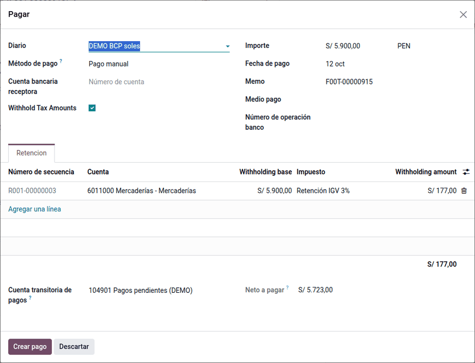
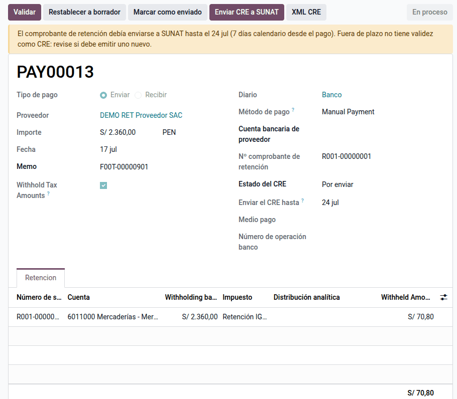
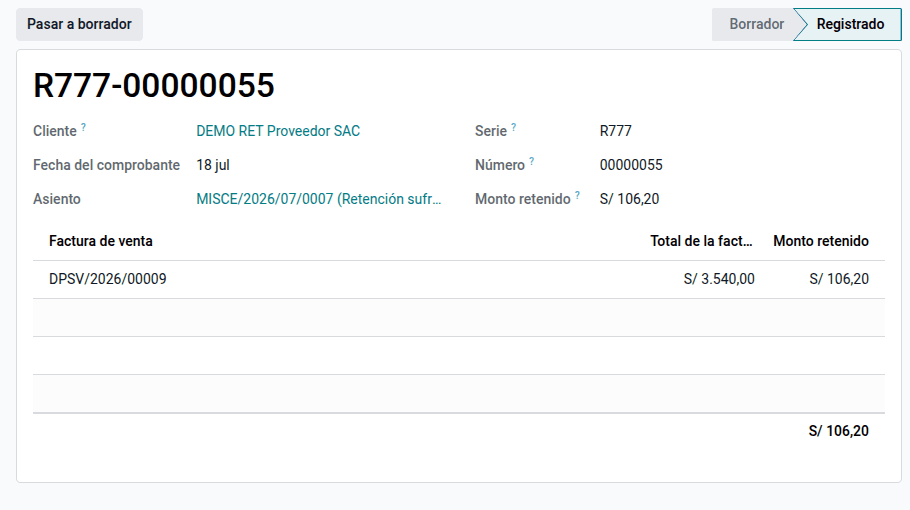

# Retenciones del IGV

Las empresas que SUNAT designa **agentes de retención del IGV** se quedan con
el **3 % del importe total** de lo que pagan a ciertos proveedores, les
entregan un **comprobante de retención electrónico** (CRE, tipo 20) y declaran
y pagan lo retenido en el **PDT 626**. Cuando la empresa es proveedora de un
cliente agente, recibe pagos netos y registra el importe retenido como crédito
contra su IGV. Este módulo lleva todo al flujo normal de facturas y pagos:
decide si la factura está sujeta, propone el 3 % en cada pago, numera y envía
el CRE, registra las retenciones sufridas y prepara el resumen del 626. Lo usan
Tesorería, Contabilidad y Facturación electrónica.

Quedan fuera la retención en pagos con letras o por compensación, el descuento
de una nota de crédito posterior en la siguiente retención y el Régimen de
Percepciones. La reversión de un CRE aceptado la hace
[OSE Factory HKA](electronic_invoicing/ose_factory_hka.md).

## Conceptos

- **Régimen de Retenciones del IGV** (R.S. 037-2002/SUNAT): quién es agente, a
  qué operaciones se aplica, las excepciones, el momento de la retención (el
  pago) y el comprobante. La **R.S. 061-2005/SUNAT** flexibilizó el régimen
  (operaciones excluidas y monto mínimo) y la **R.S. 033-2014/SUNAT** fijó la
  tasa en 3 %.
- El **comprobante de retención electrónico** se emite en el Sistema de Emisión
  Electrónica (R.S. 274-2015/SUNAT).
- SUNAT designa o excluye agentes por resolución (la más reciente revisada:
  R.S. 000367-2025/SUNAT).
- Se retiene sobre el **importe total con IGV**. La retención no cambia el
  total de la factura: la deuda con el proveedor es el total y la retención se
  practica al pagar.

| Término | Significado | Dónde aparece en Odoo |
|---|---|---|
| Agente de retención | Empresa designada por SUNAT que debe retener | **Perú ‣ Configuración ‣ Ajustes ‣ Retenciones del IGV** |
| Operación sujeta | Factura gravada con IGV por más de S/ 700 a un proveedor no exceptuado | Factura de proveedor, **Sujeta a retención de IGV** |
| Excepciones | Proveedor agente de retención, buen contribuyente o agente de percepción; boletas; operaciones con detracción; sin IGV | Casillas del contacto (padrón SUNAT) y tipo de documento |
| Monto mínimo | No se retiene si los comprobantes pagados juntos suman S/ 700 o menos | Asistente de pago |
| CRE | Comprobante de Retención Electrónico, serie R001 | Pago: número de comprobante y botón **Enviar CRE a SUNAT** |
| CRE sin pago | CRE de letras, compensaciones o pagos fuera de Odoo | **Perú ‣ Retenciones IGV ‣ CRE sin pago** |
| Retención sufrida | Lo que un cliente agente retuvo; crédito contra el IGV | **Perú ‣ Retenciones IGV ‣ Retenciones sufridas** |
| PDT 626 | Declaración mensual de las retenciones efectuadas | **Perú ‣ Retenciones IGV ‣ Resumen 626** |

## Configuración

1. Vaya a **Perú ‣ Configuración ‣ Ajustes**, sección **Retenciones del
   IGV**, marque **Agente de retención del IGV** y revise la tasa (3 %) y el
   mínimo (S/ 700).
2. En **Contabilidad ‣ Configuración ‣ Impuestos**, prepare el impuesto de
   compras de -3 % con **Retención en el pago**, la cuenta 40114 «IGV –
   Retenciones por pagar» y la secuencia R001 en **Opciones avanzadas**; luego
   elíjalo en los ajustes.
3. Si el método de pago no tiene cuenta propia, elija la **cuenta transitoria
   (retenciones)** en los ajustes.
4. Para las retenciones sufridas, elija la **cuenta** (40114) y el **diario**
   en el mismo bloque. No hace falta ser agente para usarlas.
5. Las casillas **Agente de retención** y **Buen contribuyente** de los
   contactos las mantiene el padrón SUNAT de la
   [consulta de RUC y DNI](ruc_dni_lookup.md), que se actualiza cada día.
6. Para enviar el CRE, configure el operador y el certificado de la facturación
   electrónica (**Ajustes ‣ Contabilidad ‣ Facturación electrónica
   peruana**).

!!! warning "Importante"
    Si la compañía es agente sin impuesto de retención elegido, la factura no
    se publica («Falta configurar el impuesto de retención»). Una factura
    publicada antes de configurar no propone la retención: pásela a borrador y
    vuelva a publicarla.

## Retener al pagar a un proveedor

1. Registre y publique la factura del proveedor en **Contabilidad ‣
   Proveedores ‣ Facturas**. Si está sujeta, se marca **Sujeta a retención de
   IGV** y sus líneas llevan el impuesto **Retención IGV -3 %**, sin cambiar el
   total.
2. Haga clic en **Pagar**: el asistente propone la retención del 3 % sobre el
   importe pagado y el neto al banco. Varias facturas pequeñas pagadas juntas
   por más de S/ 700 se retienen sobre el total pagado; una factura en dólares
   se compara y retiene en soles al tipo de cambio del pago.
3. Al emitir el pago se asigna el número **R001-########** (grupo
   **Retención** del pago).

### Ejemplo

Factura de un proveedor sin excepciones por un servicio de S/ 5 000 + IGV 18 %
S/ 900 = **S/ 5 900**. La factura no genera aún apunte de retención:

| Cuenta | Descripción | Debe | Haber |
|---|---|---|---|
| 6311 | Servicios de terceros | 5 000,00 | |
| 40111 | IGV — cuenta propia | 900,00 | |
| 4212 | Facturas por pagar | | 5 900,00 |
| **Totales** | | **5 900,00** | **5 900,00** |

Pago único: retención 5 900 × 3 % = **S/ 177,00**; neto S/ 5 723,00.

| Cuenta | Descripción | Debe | Haber |
|---|---|---|---|
| 4212 | Facturas por pagar (proveedor) | 5 900,00 | |
| 1041 | Banco — neto pagado | | 5 723,00 |
| 40114 | IGV — retenciones por pagar (R001-00000001) | | 177,00 |
| **Totales** | | **5 900,00** | **5 900,00** |

Odoo añade dos líneas iguales a la cuenta de gasto (base y contrapartida) que
se anulan entre sí: el marco nativo de retenciones las usa para guardar la base
del cálculo.

Si se paga en dos partes, cada pago retiene el 3 % de su importe:

| Pago | Pagado | Retención | Neto |
|---|---|---|---|
| Primero | 3 000,00 | 90,00 | 2 910,00 |
| Segundo | 2 900,00 | 87,00 | 2 813,00 |
| **Total** | **5 900,00** | **177,00** | **5 723,00** |

Una factura de S/ 650 no retiene: no supera el mínimo. Las notas de crédito no
retienen.

## Enviar el CRE

1. En el pago, haga clic en **Enviar CRE a SUNAT**: se firma el XML y se
   recibe el CDR; el pago pasa a **Enviado**. El CRE impreso (PDF) sale desde el
   pago.
2. Si SUNAT lo rechaza, el error queda en el pago: corríjalo y reenvíe dentro
   del plazo.
3. Revise **Perú ‣ Retenciones IGV ‣ Retenciones efectuadas**: un CRE por pago,
   con el plazo de envío y el estado (amarillo: fuera de plazo; rojo:
   rechazado).

!!! danger "Advertencia"
    El CRE debe enviarse dentro de los 7 días. Si vence el plazo, el pago
    muestra una alerta: evalúe emitir uno nuevo con el asesor tributario.

Cada factura del CRE lleva el número de pago a ese comprobante
(`cac:Payment/cbc:ID`): 1 en el primer pago parcial, 2 en el segundo, y así,
según los CRE anteriores de la misma factura (R.S. 274-2015/SUNAT).

Si el pago se registró por error antes de enviar el CRE, anúlelo y el CRE no
se envía.

### Revertir un CRE aceptado

Un CRE aceptado por SUNAT bloquea el pago: no se puede pasar a borrador ni
cancelar hasta revertirlo con el resumen de reversiones (RR, R.S.
274-2015/SUNAT). Funciona con SUNAT directo, IAP y Digiflow, y con
[OSE Factory HKA](electronic_invoicing/ose_factory_hka.md).

1. En el pago (o en el CRE sin pago), escriba el **Motivo de la reversión** y
   haga clic en **Revertir CRE**: se envía el resumen RR y se guarda el ticket;
   el CRE pasa a **Reversión en proceso**.
2. Haga clic en **Consultar reversión** hasta que SUNAT la acepte: el CRE
   pasa a **Anulado**.
3. Pase el pago a borrador para corregirlo o cancelarlo. Al confirmarlo de
   nuevo, la retención toma un número nuevo y queda por enviar. En un CRE sin
   pago, el asiento se anula al aceptarse la reversión.

!!! note "Nota"
    El correlativo del resumen (RUC-RR-AAAAMMDD-N) no cambia en los
    reintentos: SUNAT rechaza con el error 2220 un correlativo distinto para
    la misma reversión.

## Emitir un CRE sin pago de Odoo

La retención se hace al pagar, cualquiera que sea la forma de pago. Para el
pago de letras de cambio, una compensación o un pago registrado fuera de Odoo,
emita el CRE sin pago:

1. Vaya a **Perú ‣ Retenciones IGV ‣ CRE sin pago** y haga clic en **Nuevo**.
   También puede seleccionar las facturas en **Contabilidad ‣ Proveedores ‣
   Facturas** y usar **Acciones ‣ Emitir CRE sin pago**.
2. Elija el proveedor, la **Fecha de pago**, la **Forma de pago** (letras,
   compensación u otro) y la **Referencia del pago**.
3. En **Comprobantes pagados**, agregue cada factura con lo **Pagado** en su
   moneda. Si la factura se canjeó por letras, elija la partida de la letra en
   **Partida por pagar**.
4. Haga clic en **Emitir**: se validan el mínimo de S/ 700, las excepciones y
   el tipo de cambio de la fecha de pago, se asigna el número R001 y se crea el
   asiento. Luego haga clic en **Enviar CRE a SUNAT**.

| Cuenta | Descripción | Debe | Haber |
|---|---|---|---|
| 4212 | Facturas por pagar (o 4232 Letras por pagar) | 177,00 | |
| 40114 | IGV — retenciones por pagar (R001-00000002) | | 177,00 |
| **Totales** | | **177,00** | **177,00** |

El CRE sin pago cuenta para el número de pago de cada factura, sale en el
resumen 626 y se imprime desde el propio documento.

## Descontar notas de crédito

Las notas de crédito no cambian lo ya retenido ni dan lugar a devolución; su
retención se puede descontar de la siguiente retención al mismo proveedor
(art. 2 de la R.S. 037-2002/SUNAT).

1. Active **Descontar notas de crédito** en **Perú ‣ Configuración ‣
   Ajustes**, bloque **Retenciones del IGV** (desactivada por defecto).
2. Una nota de crédito de proveedor sobre una factura que ya tuvo CRE muestra
   en **Facturación PE ‣ Retención de la nota de crédito** el 3 % que se puede
   descontar y lo pendiente.
3. En el siguiente pago al proveedor (o CRE sin pago), la retención propuesta
   ya viene rebajada. El CRE informa cada factura con su 3 % completo y la
   nota de crédito (tipo 07) con la retención descontada en negativo.

Por ejemplo, la nota de crédito de S/ 118 sobre una factura ya retenida deja
S/ 3,54 por descontar; la siguiente factura de S/ 1 180 retiene
35,40 − 3,54 = **S/ 31,86**.

!!! warning "Importante"
    La guía del XML del CRE no detalla los importes de una nota de crédito.
    Pruebe la opción en el entorno de pruebas de SUNAT o del operador antes de
    usarla en producción.

## Registrar retenciones sufridas

Cuando un cliente agente paga el neto de sus facturas de venta, entrega su
comprobante de retención, que puede cubrir una o varias facturas:

1. Vaya a **Perú ‣ Retenciones IGV ‣ Retenciones sufridas** y haga clic en
   **Nuevo**.
2. Elija el cliente y escriba la **Serie**, el **Número** y la fecha del
   comprobante de retención.
3. En las líneas, agregue cada factura con el **Monto retenido** que indica el
   comprobante (al elegir la factura se propone el 3 % de su total).
4. Haga clic en **Registrar**: se crea un asiento con el IGV retenido por el
   total y un abono a la cuenta por cobrar de cada factura, ya conciliado.

La factura muestra lo retenido en la pestaña **Retenciones sufridas** de
**Facturación PE**.

Por ejemplo, un cliente agente paga una factura de S/ 3 540 y retiene
3 540 × 3 % = **S/ 106,20**:

| Cuenta | Descripción | Debe | Haber |
|---|---|---|---|
| 40114 | IGV — retenciones sufridas (R777-00000055) | 106,20 | |
| 1212 | Facturas por cobrar (cliente) | | 106,20 |
| **Totales** | | **106,20** | **106,20** |

Para corregir una retención sufrida mal registrada, haga clic en **Pasar a
borrador**: deshace el asiento y la conciliación.

## Reportes

- **Perú ‣ Retenciones IGV ‣ Comprobantes de proveedor**: facturas sujetas,
  con lo pendiente de pago.
- **Retenciones sufridas por factura**: el IGV que le retuvieron sus clientes,
  agrupado por periodo, cliente o comprobante (lista y tabla dinámica). Es el
  importe que se aplica contra el IGV del mes en el formulario 621.
- **Retenciones efectuadas**: un CRE por pago, con el plazo de envío y el
  estado.
- **CRE sin pago**: los CRE de letras, compensaciones y pagos fuera de Odoo.
- **Análisis de retenciones**: retenido por proveedor y mes.
- **Resumen 626**: TXT del mes con una línea por retención, de pagos y de
  CRE sin pago (soporte del PDT 626).
- **PLE 8.3**: marca de retención en el campo 26 del Registro de Compras
  Simplificado ([Libros electrónicos (PLE)](ple.md)).

## Casos especiales

| Situación | Qué pasa | Qué hacer |
|---|---|---|
| Proveedor agente o buen contribuyente | No retiene | Si el padrón está desactualizado, corrija la casilla del contacto |
| El asistente no propone la retención | La factura se publicó antes de configurar | Pásela a borrador y vuelva a publicarla |
| CRE fuera de plazo | Alerta en el pago | Evalúe emitir uno nuevo con el asesor tributario |
| Pago con CRE aceptado que hay que corregir | El pago no pasa a borrador | Revierta el CRE y, aceptada la reversión, páselo a borrador |
| Letra de cambio pagada en el banco | No hay pago de Odoo con retención | Emita el CRE sin pago con la partida de la letra |

## Datos de demostración

Una base creada **con datos de demostración** carga, al instalar el módulo, un
ejemplo completo en la compañía **PE Company** (la compañía peruana de la demo
de Odoo, con el plan contable de Perú). Los registros llevan el prefijo **DEMO
RET** y las fechas se calculan respecto del día de la instalación. En una base
sin datos de demostración no se carga nada.

- La compañía como agente de retención, con la cuenta 40114 de retenciones
  sufridas.
- Compra de S/ 2 360,00 pagada con su comprobante de retención (S/ 70,80).
- Venta de S/ 3 540,00 a un cliente agente con la retención sufrida (S/ 106,20).
- No se envía nada a SUNAT.

!!! info "Ver también"
    - [R.S. 037-2002/SUNAT — Régimen de Retenciones del IGV](https://www.sunat.gob.pe/legislacion/superin/2002/037.htm)
    - [R.S. 061-2005/SUNAT — Flexibilización del régimen](https://www.sunat.gob.pe/legislacion/superin/2005/061.htm)
    - [R.S. 033-2014/SUNAT — Tasa del 3 %](https://www.sunat.gob.pe/legislacion/superin/2014/033-2014.pdf)
    - [R.S. 274-2015/SUNAT — Comprobante de retención electrónico](https://www.sunat.gob.pe/legislacion/superin/2015/274-2015.pdf)
    - [R.S. 000367-2025/SUNAT — Designación de agentes de retención](https://www.sunat.gob.pe/legislacion/superin/2025/000367-2025.pdf)
    - [SUNAT: régimen de retenciones](https://orientacion.sunat.gob.pe/07-regimen-de-retenciones-informacion-general)
    - [Consulta de RUC y DNI](ruc_dni_lookup.md)
