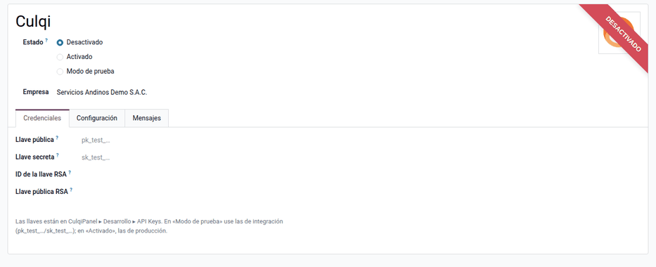
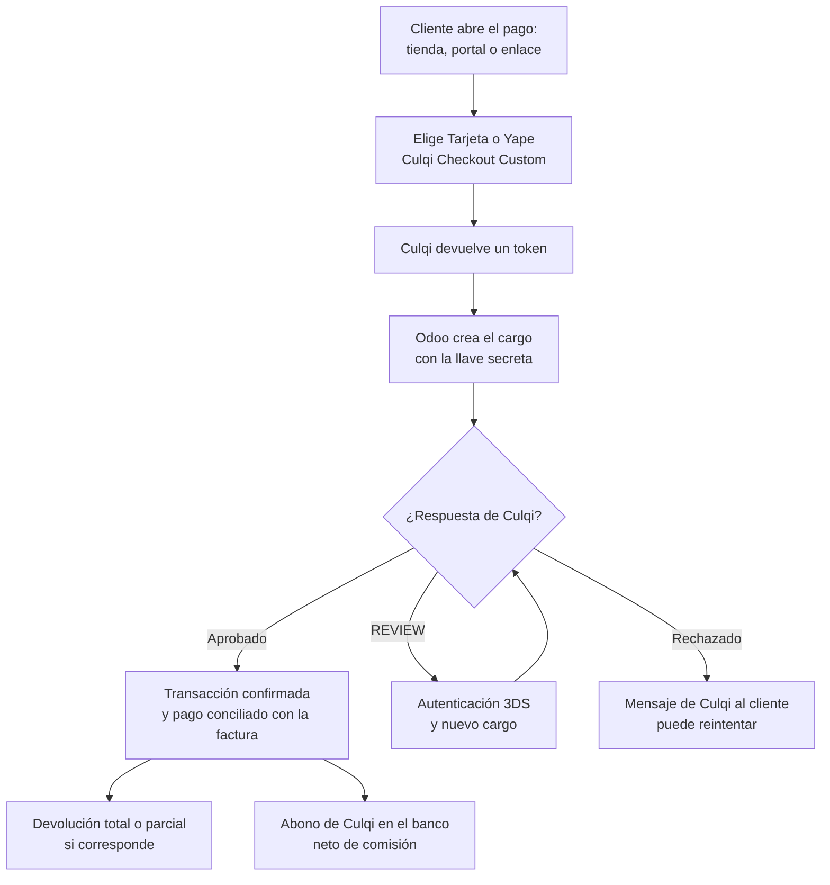
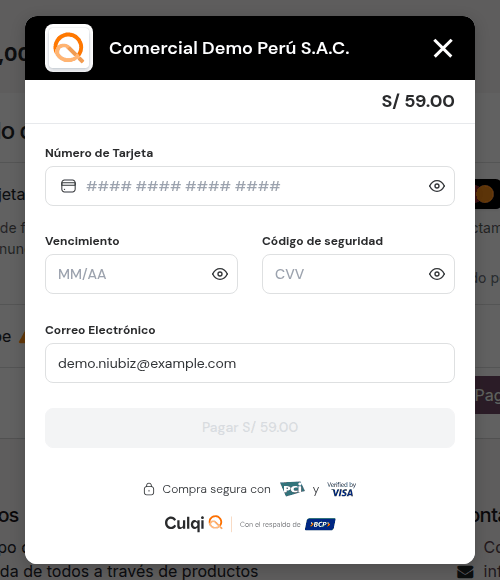

# Culqi

El módulo **Proveedor de pago Culqi** (`al_payment_culqi`) permite cobrar en
línea con **Culqi**, pasarela de pagos peruana, con **tarjetas** y **Yape**
desde la tienda en línea, el portal de clientes y los **enlaces de pago** de
facturas y pedidos. El cobro queda registrado como una **transacción** y, si se
confirma, como un **pago** conciliado con la factura. Admite la autenticación
**3DS** y las **devoluciones** totales o parciales. Lo usan Ventas y Tesorería.

Los datos de la tarjeta van del navegador a Culqi y nunca pasan por Odoo.
Quedan fuera PagoEfectivo, las billeteras distintas de Yape, Cuotéalo, los
agentes, la tarjeta guardada, la captura manual y la **comisión de Culqi**, que
se registra al conciliar el abono de la liquidación en el banco.

## Configuración

1. En CulqiPanel, vaya a **Desarrollo ‣ API Keys** y copie las llaves de prueba
   (`pk_test_…`, `sk_test_…`) y de producción (`pk_live_…`, `sk_live_…`).
2. Vaya a **Contabilidad ‣ Configuración ‣ Proveedores de pago ‣ Culqi** y
   escriba las llaves. Odoo comprueba que el prefijo corresponda al modo: en
   prueba, `pk_test` y `sk_test`; en producción, `live`. Opcionalmente, agregue
   el ID y la llave RSA para cifrar el checkout.
3. Active los métodos **Tarjeta** y **Yape**, elija el diario y haga clic en
   **Publicar**: el proveedor queda visible en la tienda y el portal.
4. Use soles o dólares; Yape solo admite soles.

!!! note "Nota"
    Al neutralizar una copia de la base para pruebas, se borran las llaves.
    Vuelva a poner las de prueba.

## Conceptos

| Término | Significado | En Odoo |
|---|---|---|
| Llave pública y secreta | Credenciales de CulqiPanel (`pk_` y `sk_`) | Proveedor Culqi ‣ **Credenciales** |
| Modo de prueba | Llaves `pk_test` y `sk_test`, sin cobro real | Estado del proveedor |
| Transacción | Intento de pago con su estado | **Contabilidad ‣ Configuración ‣ Transacciones de pago** |
| Cargo | Cobro en Culqi por el importe exacto | Se crea desde Odoo con la llave secreta |
| 3DS | Autenticación adicional que puede pedir el banco; Culqi responde `REVIEW` | El cliente se autentica y se repite el cargo |
| Devolución | Reembolso total o parcial en Culqi | Transacción ‣ **Reembolsar** |

La integración usa la **API v2** de Culqi y **Culqi Checkout Custom**, que es la
vigente: el Checkout v4 está en desuso según Culqi.

## Cobrar

El cliente paga desde la tienda, el portal o el enlace de pago, eligiendo
**Tarjeta** o **Yape**. Culqi devuelve un token de un solo uso y Odoo crea el
cargo con la llave secreta, por el importe exacto del servidor: si el importe se
altera en el navegador, el cargo se rechaza, y un doble clic no cobra dos veces.

- Si el banco pide **3DS**, el cliente se autentica y el cargo se repite.
- Si la tarjeta se rechaza, el mensaje de Culqi se muestra al cliente y queda en
  la transacción; el cliente puede reintentar con otro medio.

Ejemplo: una factura de S/ 500 + IGV S/ 90 = **S/ 590** se paga con tarjeta
desde el enlace de pago y Culqi aprueba el cargo. Al confirmarse la
transacción, se registra el pago en el diario de Culqi:

| Cuenta | Descripción | Debe | Haber |
|---|---|---|---|
| 1041 | Cobros pendientes — Culqi | 590,00 | |
| 1212 | Facturas por cobrar (cliente) | | 590,00 |
| | **Totales** | **590,00** | **590,00** |

## Devolver un cobro

Abra la transacción y haga clic en **Reembolsar**, por el total o una parte:
Culqi reembolsa al cliente y Odoo registra un pago de salida. Si se devuelven
S/ 100, el pago de salida es de S/ 100; la nota de crédito al cliente se emite
aparte.

## Conciliar el abono de Culqi

Culqi abona la liquidación neta de su comisión. Al conciliar el abono en el
banco, registre la comisión. Ejemplo con una comisión de S/ 23,60 (depende del
contrato con Culqi):

| Cuenta | Descripción | Debe | Haber |
|---|---|---|---|
| 1041 | Banco — abono neto | 566,40 | |
| 6391 | Gastos bancarios — comisión Culqi | 23,60 | |
| 1041 | Cobros pendientes — Culqi | | 590,00 |
| | **Totales** | **590,00** | **590,00** |

## Reportes

- **Transacciones de pago**: todas las operaciones con su estado, la referencia
  y los mensajes de Culqi.
- Los pagos salen en el libro caja y bancos de los
  [libros electrónicos](../fiscal_localizations/peru/ple.md) y se concilian con
  la factura, que queda pagada en el informe de antigüedad.

!!! note "Nota"
    El script `docs/culqi/validar_sandbox.py` del repositorio valida la
    integración contra el sandbox de Culqi con las llaves de prueba del
    cliente.

!!! info "Ver también"
    - [Culqi: documentación](https://docs.culqi.com/)
    - [Culqi: API v2](https://apidocs.culqi.com/)
    - [Odoo: proveedores de pago](https://www.odoo.com/documentation/19.0/es/applications/finance/payment_providers.html)
    - [Niubiz](niubiz.md)
