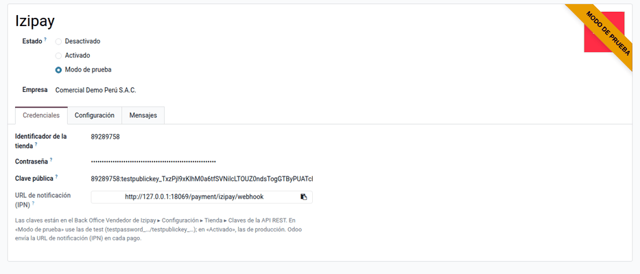
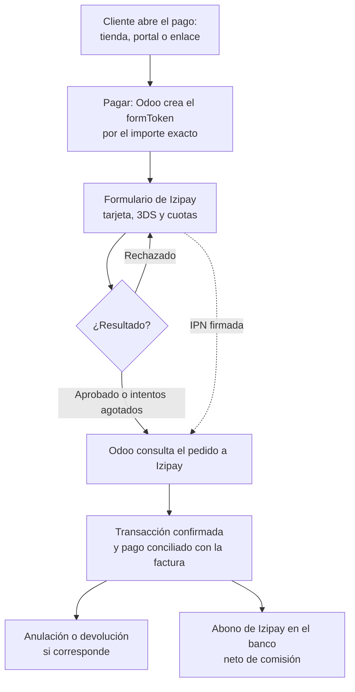
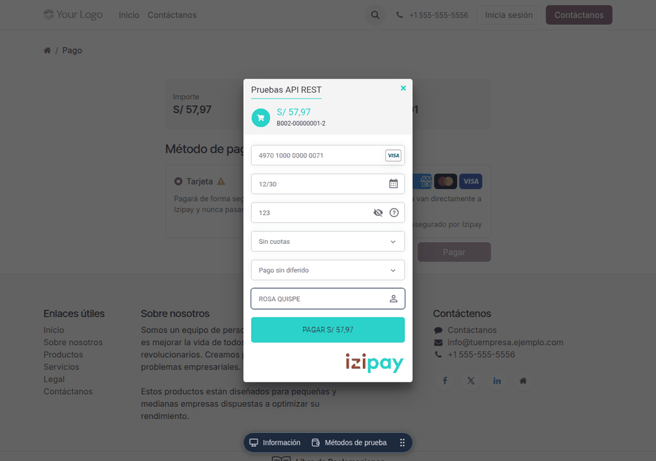

# Izipay

El módulo **Pagos con Izipay** (`al_payment_izipay`) permite cobrar en línea
con **Izipay**, pasarela de pagos peruana, desde la tienda en línea, el portal
de clientes y los **enlaces de pago** de facturas y pedidos. El cliente paga
con **tarjeta** en el formulario de Izipay, que se abre en una ventana sobre
la página de pago. El cobro queda registrado como una **transacción** y, si se
confirma, como un **pago** conciliado con la factura. Admite la **anulación**
y las **devoluciones** totales o parciales. Lo usan Ventas y Tesorería.

Los datos de la tarjeta van del navegador a Izipay y nunca pasan por Odoo.
Izipay se encarga de la autenticación **3DS** y de las **cuotas** que tenga
contratadas la tienda. Quedan fuera la tarjeta guardada, la captura manual y
la **comisión de Izipay**, que se registra al conciliar el abono de la
liquidación en el banco.

## Configuración

1. En el **Back Office Vendedor** de Izipay, vaya a **Configuración ‣ Tienda ‣
   Claves de la API REST**. Copie el **usuario** (identificador de la tienda),
   la **contraseña** y la **clave pública**, de test y de producción.
2. Vaya a **Contabilidad ‣ Configuración ‣ Proveedores de pago ‣ Izipay** y
   escriba las claves. Odoo comprueba que correspondan al modo:
    - **Modo de prueba**: `testpassword_…` y `<tienda>:testpublickey_…`.
    - **Activado**: `prodpassword_…` y `<tienda>:publickey_…`.
3. Elija el diario y haga clic en **Publicar**: el proveedor queda visible en
   la tienda y el portal.
4. Use soles o dólares.

!!! note "Nota"
    La **URL de notificación (IPN)** aparece en el proveedor y Odoo la envía en
    cada pago: no hace falta configurarla en el Back Office. Debe ser
    accesible desde Internet; si hay un cortafuegos, permita el rango de
    Izipay `194.50.38.0/24`.

!!! note "Nota"
    Al neutralizar una copia de la base para pruebas, se borran la contraseña
    y la clave pública. Vuelva a poner las de test.

## Conceptos

| Término | Significado | En Odoo |
|---|---|---|
| Identificador de la tienda, contraseña y clave pública | Claves de la API REST del Back Office Vendedor | Proveedor Izipay ‣ **Credenciales** |
| Modo de prueba | Claves de test, sin cobro real | Estado del proveedor |
| formToken | Sesión de pago de Izipay con el importe exacto; vale 15 minutos | Se crea al hacer clic en **Pagar** |
| Transacción | Intento de pago con su estado | **Contabilidad ‣ Configuración ‣ Transacciones de pago** |
| IPN | Aviso firmado de Izipay al servidor al terminar el pago | Confirma el pago aunque el cliente cierre la ventana |
| Captura | Izipay cobra lo autorizado al cerrar el lote, por la noche | Decide si la devolución anula o reembolsa |

## Cobrar

El cliente elige **Izipay** en la página de pago y hace clic en **Pagar**.
Odoo crea la sesión de pago con el importe exacto de la transacción y se abre
el formulario de Izipay:

- Si el banco pide **3DS**, el cliente se autentica en el mismo formulario.
- Si la tarjeta se rechaza, el formulario muestra el motivo y el cliente
  puede reintentar con otra tarjeta. La transacción sigue abierta.
- Al terminar, Odoo **consulta el resultado a Izipay** y muestra la página de
  estado del pago. Si el cliente cierra la ventana antes, la IPN confirma el
  pago igual.

Ejemplo: una factura de S/ 500 + IGV S/ 90 = **S/ 590** se paga con tarjeta
desde el enlace de pago e Izipay la aprueba. Al confirmarse la transacción, se
registra el pago en el diario de Izipay:

| Cuenta | Descripción | Debe | Haber |
|---|---|---|---|
| 1041 | Cobros pendientes — Izipay | 590,00 | |
| 1212 | Facturas por cobrar (cliente) | | 590,00 |
| | **Totales** | **590,00** | **590,00** |

## Devolver un cobro

Abra la transacción y haga clic en **Reembolsar**, por el total o una parte.
Odoo hace lo que corresponde según el estado del pago en Izipay:

| Estado en Izipay | Devolución total | Devolución parcial |
|---|---|---|
| Sin capturar (el mismo día del pago) | Anula el pago | Reduce el importe que se capturará |
| Capturado (desde el día siguiente) | Reembolso | Reembolso por el importe indicado |

En los dos casos Odoo registra un pago de salida por lo devuelto. Si se
devuelven S/ 100, el pago de salida es de S/ 100; la nota de crédito al
cliente se emite aparte.

!!! warning "Advertencia"
    En Izipay, la opción automática de «anular o reembolsar» anula el pago
    completo aunque se pida una parte, si aún no se capturó. Por eso el módulo
    reduce el importe en vez de anular cuando la devolución es parcial.

## Conciliar el abono de Izipay

Izipay abona la liquidación neta de su comisión. Al conciliar el abono en el
banco, registre la comisión. Ejemplo con una comisión de S/ 23,60 (depende del
contrato con Izipay):

| Cuenta | Descripción | Debe | Haber |
|---|---|---|---|
| 1041 | Banco — abono neto | 566,40 | |
| 6391 | Gastos bancarios — comisión Izipay | 23,60 | |
| 1041 | Cobros pendientes — Izipay | | 590,00 |
| | **Totales** | **590,00** | **590,00** |

## Reportes

- **Transacciones de pago**: todas las operaciones con su estado, la
  referencia de Izipay y el motivo de los rechazos.
- Los pagos salen en el libro caja y bancos de los
  [libros electrónicos](../fiscal_localizations/peru/ple.md) y se concilian con
  la factura, que queda pagada en el informe de antigüedad.

!!! note "Nota"
    El script `docs/izipay/validar_sandbox.py` del repositorio paga desde Odoo
    en la tienda de prueba pública de Izipay, con las tarjetas de prueba
    oficiales, y prueba las devoluciones.

!!! info "Ver también"
    - [Izipay: documentación de la API REST](https://secure.micuentaweb.pe/doc/es-PE/rest/V4.0/)
    - [Izipay: ejemplos de integración](https://github.com/izipay-pe)
    - [Odoo: proveedores de pago](https://www.odoo.com/documentation/19.0/es/applications/finance/payment_providers.html)
    - [Culqi](culqi.md) y [Niubiz](niubiz.md)
