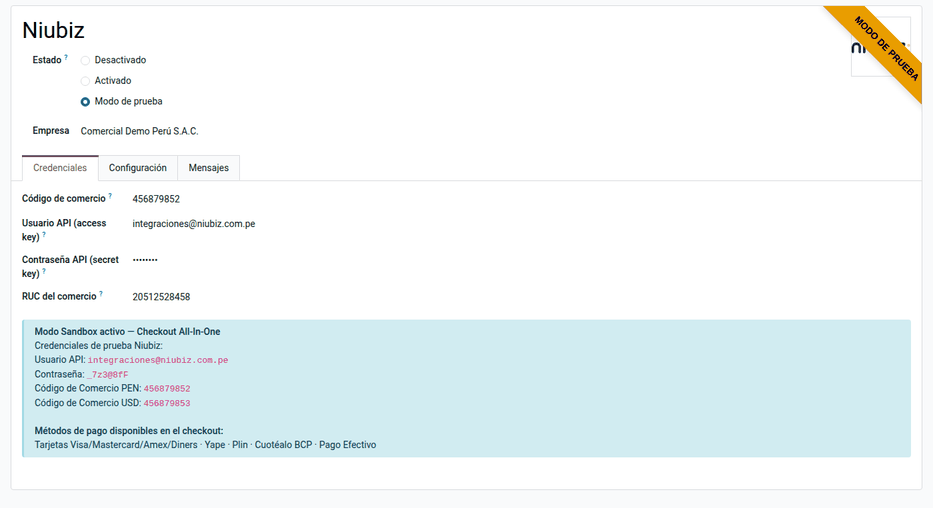
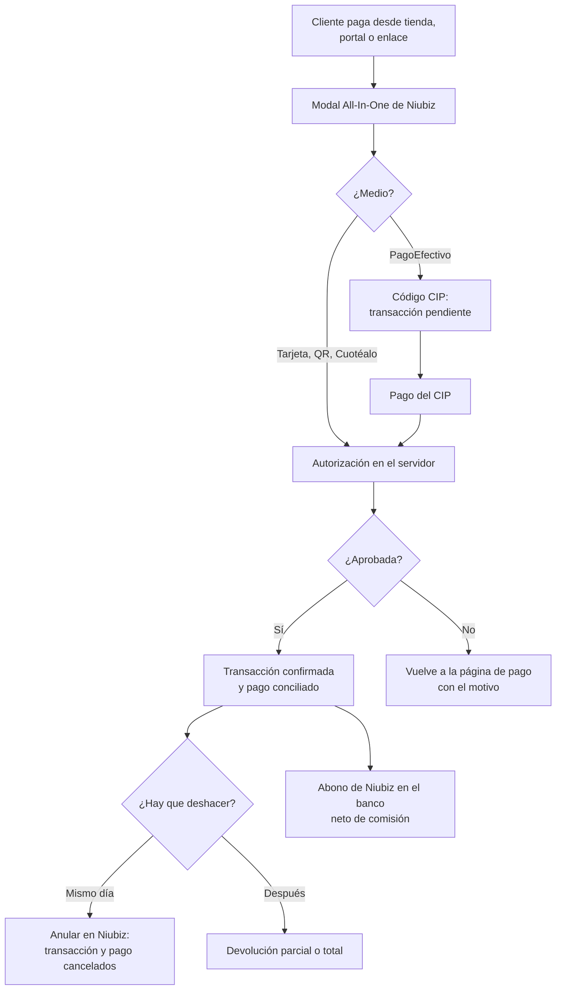
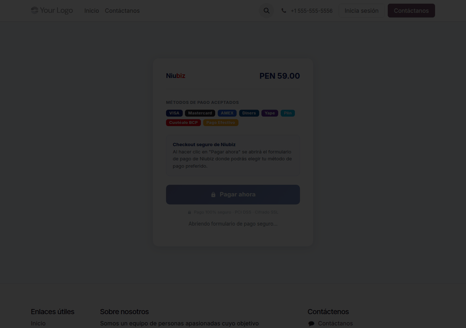
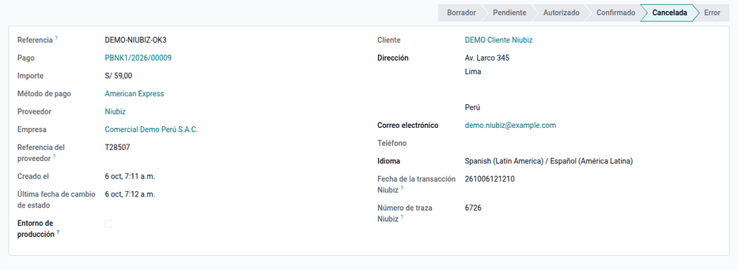

# Niubiz

El módulo **Proveedor de pago Niubiz** (`al_payment_niubiz`) integra el
**Checkout All-In-One de Niubiz** (VisaNet Perú) como proveedor de pago: en una
sola ventana el cliente paga con **tarjetas** (Visa, Mastercard, American
Express, Diners, UnionPay), **billeteras con QR** (Yape, Plin…), **Cuotéalo
BCP**, **PagoEfectivo** o puntos. Odoo guarda el código de autorización, el
número de traza y la marca de la tarjeta, y concilia el pago con la factura.
Permite **anular el mismo día** y **devolver** dentro de los plazos de Niubiz.

Lo usan Ventas (tienda en línea, portal y enlaces de pago) y Tesorería. Niubiz
procesa los datos de la tarjeta (PCI DSS nivel 1). Quedan fuera la **comisión de
Niubiz**, que se registra al conciliar el abono en el banco, y el cobro
recurrente con tarjeta guardada.

## Configuración

1. Pida a Niubiz el código de comercio y el usuario y la contraseña de la API, y
   tenga a mano el RUC del comercio, que se necesita para las devoluciones.
2. Vaya a **Contabilidad ‣ Configuración ‣ Proveedores de pago ‣ Niubiz** y
   cargue los datos; la contraseña solo la ven los administradores.
3. Elija el diario y los métodos de pago, y haga clic en **Publicar**.
4. En **Modo de prueba** se usan el sandbox y las credenciales públicas de
   Niubiz que muestra la propia pantalla.
5. Use soles o dólares.

!!! note "Nota"
    Al neutralizar una copia de la base, se borra la contraseña: vuelva a
    configurarla.

## Conceptos

| Término | Significado | En Odoo |
|---|---|---|
| Código de comercio | Identificador del comercio en Niubiz | Proveedor Niubiz |
| Autorización y traza | Datos de la operación aprobada | Transacción de pago |
| Anulación (reversa) | Cancela el cargo el mismo día, antes de la liquidación; Niubiz responde «Voided» | Botón **Anular en Niubiz** |
| Devolución | Reembolso desde 48 horas hábiles después del pago y hasta 6 meses | Transacción ‣ **Reembolsar** |
| CIP | Código de pago de PagoEfectivo | Transacción pendiente |

La integración sigue la documentación de Niubiz para desarrolladores: token de
seguridad, sesión de pago, autorización en el servidor y reversa.

## Cobrar

El cliente paga desde la tienda, el portal o el enlace de pago en la ventana de
Niubiz. Con tarjeta, QR o Cuotéalo, la autorización se hace en el servidor y la
transacción queda confirmada con la autorización, la traza y la marca. Con
PagoEfectivo, la transacción queda pendiente hasta que el cliente paga el CIP.

Si Niubiz rechaza la tarjeta, por ejemplo con el código 116 (fondos
insuficientes), el cliente vuelve a la página de pago con el motivo y puede
reintentar sin crear otro pedido.

Ejemplo: una factura de S/ 1 000 + IGV S/ 180 = **S/ 1 180** se paga con Visa y
Niubiz aprueba. Al confirmarse la transacción:

| Cuenta | Descripción | Debe | Haber |
|---|---|---|---|
| 1041 | Cobros pendientes — Niubiz | 1 180,00 | |
| 1212 | Facturas por cobrar (cliente) | | 1 180,00 |
| | **Totales** | **1 180,00** | **1 180,00** |

!!! warning "Importante"
    Si la conexión con Niubiz se corta, el token y la sesión se reintentan,
    pero la autorización no. Revise la transacción antes de reintentar el cobro.

## Anular o devolver un cobro

- **El mismo día:** abra la transacción y haga clic en **Anular en Niubiz**. La
  transacción y el pago se cancelan, y la factura vuelve a quedar pendiente.
- **Después:** haga clic en **Reembolsar**, por el total o una parte: Niubiz
  reembolsa al cliente y Odoo registra un pago de salida. Niubiz rechaza la
  devolución antes de 48 horas hábiles y sin el RUC del comercio en el
  proveedor.

## Conciliar el abono de Niubiz

Niubiz abona la liquidación neta de su comisión. Al conciliar el abono en el
banco, registre la comisión. Ejemplo con una comisión de S/ 41,30 (depende del
contrato con Niubiz):

| Cuenta | Descripción | Debe | Haber |
|---|---|---|---|
| 1041 | Banco — abono neto | 1 138,70 | |
| 6391 | Gastos bancarios — comisión Niubiz | 41,30 | |
| 1041 | Cobros pendientes — Niubiz | | 1 180,00 |
| | **Totales** | **1 180,00** | **1 180,00** |

## Reportes

- **Transacciones de pago**, con la autorización, la traza, la fecha y la marca.
- Los pagos salen en el libro caja y bancos de los
  [libros electrónicos](../fiscal_localizations/peru/ple.md), conciliados con
  las facturas.

!!! note "Nota"
    La integración se probó contra el sandbox de Niubiz el 06/10/2026: pagos
    aprobados con Visa, Mastercard y Amex, rechazo 116 y anulación.

!!! info "Ver también"
    - [Niubiz: portal de desarrolladores](https://desarrolladores.niubiz.com.pe/)
    - [Odoo: proveedores de pago](https://www.odoo.com/documentation/19.0/es/applications/finance/payment_providers.html)
    - [Culqi](culqi.md)
