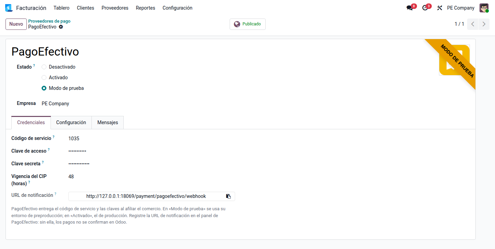
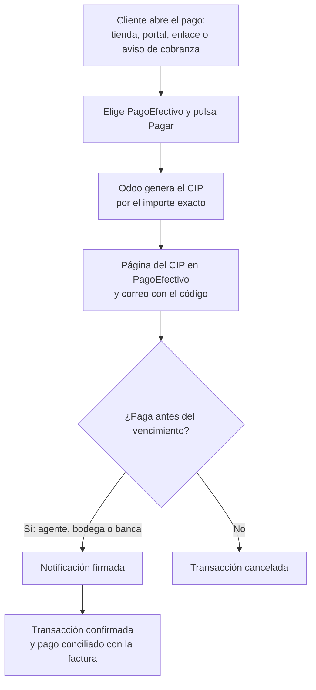
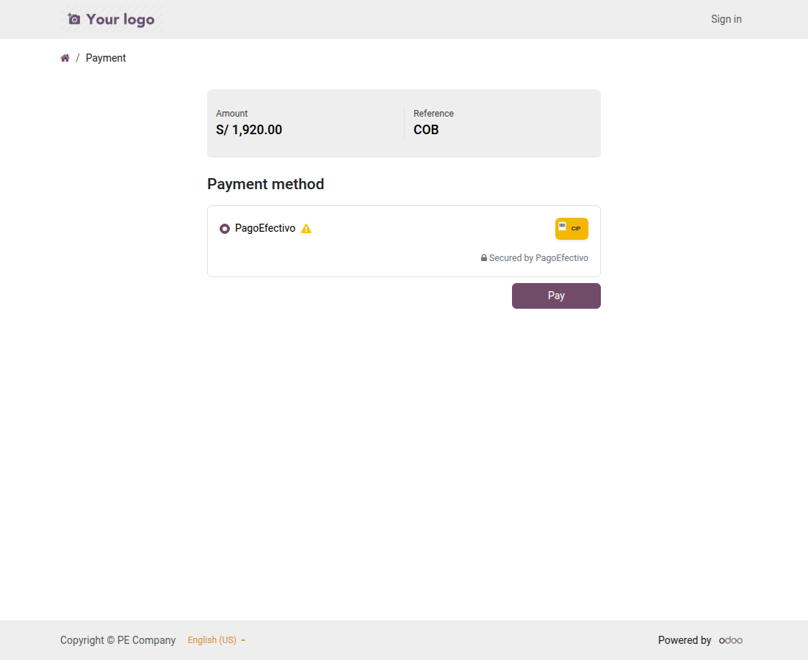

# PagoEfectivo

El módulo **Pagos con PagoEfectivo** (`al_payment_pagoefectivo`) permite cobrar a
clientes **sin tarjeta**. Odoo genera un **código de pago (CIP)** por el importe exacto y
el cliente lo paga en **efectivo** en agentes y bodegas, o desde la **banca por
internet** y las billeteras. Funciona en la tienda en línea, el portal, los **enlaces de
pago** de facturas y pedidos y los **avisos de cobranza**. Lo usan Ventas, Tesorería y
Cobranza.

El pago queda **pendiente** hasta que PagoEfectivo avisa a Odoo que el CIP se pagó. Quedan
fuera las devoluciones, porque PagoEfectivo no las hace por la API, y la **comisión de
PagoEfectivo**, que se registra al conciliar el abono de la liquidación en el banco.

## Configuración

1. PagoEfectivo entrega al comercio afiliado el **código de servicio**, la **clave de
   acceso** y la **clave secreta**, de preproducción y de producción.
2. Vaya a **Contabilidad ‣ Configuración ‣ Proveedores de pago ‣ PagoEfectivo** y escriba
   las claves:
    - **Modo de prueba**: usa el entorno de preproducción de PagoEfectivo.
    - **Activado**: usa el de producción.
3. Indique la **vigencia del CIP** en horas (48 por omisión).
4. Copie la **URL de notificación** y regístrela en el panel de PagoEfectivo.
5. Elija el diario y haga clic en **Publicar**.
6. Use soles o dólares.

!!! warning "Advertencia"
    Sin la URL de notificación registrada en PagoEfectivo, los CIP pagados no se
    confirman en Odoo: la transacción queda pendiente hasta vencer.

!!! note "Nota"
    Al neutralizar una copia de la base para pruebas, se borran la clave de acceso y la
    clave secreta. Vuelva a poner las de preproducción.

## Conceptos

| Término | Significado | En Odoo |
|---|---|---|
| CIP | Código de pago que el cliente paga en efectivo o por banca | Referencia del proveedor en la transacción |
| Código de servicio y claves | Credenciales del comercio en PagoEfectivo | Proveedor PagoEfectivo ‣ **Credenciales** |
| Vigencia | Plazo para pagar el CIP | **Vigencia del CIP (horas)** |
| Notificación | Aviso firmado de PagoEfectivo cuando el CIP se paga | Confirma la transacción |
| Transacción | Intento de pago con su estado | **Contabilidad ‣ Configuración ‣ Transacciones de pago** |

## Cobrar

El cliente elige **PagoEfectivo** en la página de pago y hace clic en **Pagar**:

- Odoo genera el CIP y lleva al cliente a su **página en PagoEfectivo**, con el código y
  los lugares de pago. PagoEfectivo también se lo envía **por correo**: el cliente necesita
  un correo electrónico en su ficha.
- La transacción queda **pendiente**, con el CIP como referencia y la fecha de
  vencimiento.
- Cuando el cliente paga, PagoEfectivo avisa a Odoo y la transacción pasa a
  **confirmada**. Odoo registra el pago y lo concilia con la factura.
- Si el CIP vence sin pagarse, la transacción se **cancela** sola dos horas después del
  vencimiento. Si aun así llega el aviso de un pago hecho al límite, Odoo lo confirma.

Ejemplo: una factura de S/ 500 + IGV S/ 90 = **S/ 590** se paga en un agente con el CIP.
Al llegar la notificación, se registra el pago en el diario de PagoEfectivo:

| Cuenta | Descripción | Debe | Haber |
|---|---|---|---|
| 1041 | Cobros pendientes — PagoEfectivo | 590,00 | |
| 1212 | Facturas por cobrar (cliente) | | 590,00 |
| | **Totales** | **590,00** | **590,00** |

## Desde los avisos de cobranza

Con la [Cobranza](../accounting/collection.md), el botón **Pagar en línea** de los
avisos y el QR del estado de cuenta llevan a la misma página de pago. Si el cliente elige
PagoEfectivo, el pago se aplica a sus **facturas más antiguas**, sin las que estén en
reclamo.

## Conciliar el abono de PagoEfectivo

PagoEfectivo abona la liquidación neta de su comisión. Al conciliar el abono en el banco,
registre la comisión. Ejemplo con una comisión de S/ 5,90 (depende del contrato):

| Cuenta | Descripción | Debe | Haber |
|---|---|---|---|
| 1041 | Banco — abono neto | 584,10 | |
| 6391 | Gastos bancarios — comisión PagoEfectivo | 5,90 | |
| 1041 | Cobros pendientes — PagoEfectivo | | 590,00 |
| | **Totales** | **590,00** | **590,00** |

## Reportes

- **Transacciones de pago**: cada CIP con su estado, vencimiento, enlace a su página y el
  motivo si PagoEfectivo rechazó la solicitud.
- Los pagos salen en el libro caja y bancos de los
  [libros electrónicos](../fiscal_localizations/peru/ple.md).

!!! info "Ver también"
    - [PagoEfectivo](https://www.pagoefectivo.la/pe/)
    - [Odoo: proveedores de pago](https://www.odoo.com/documentation/19.0/es/applications/finance/payment_providers.html)
    - [Culqi](culqi.md), [Izipay](izipay.md) y [Niubiz](niubiz.md)
