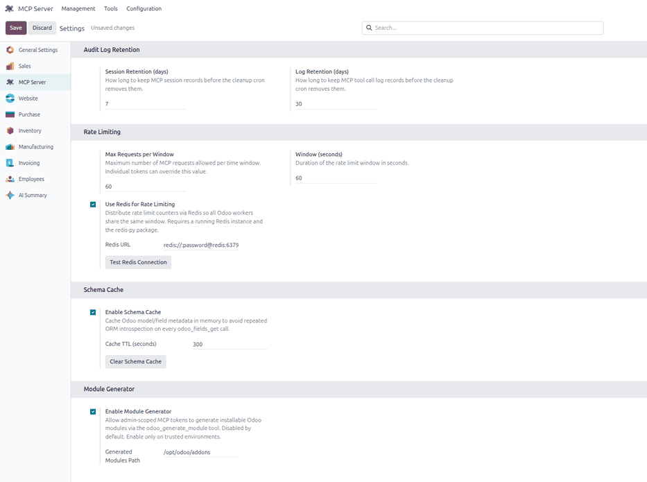
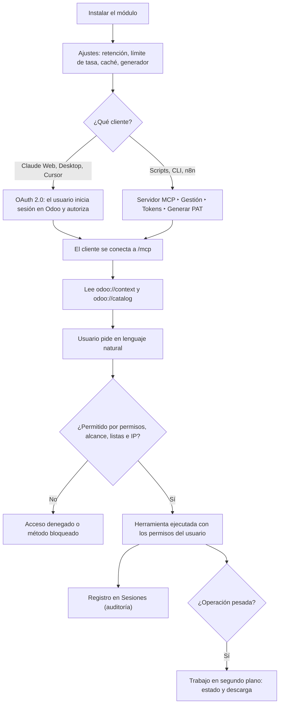
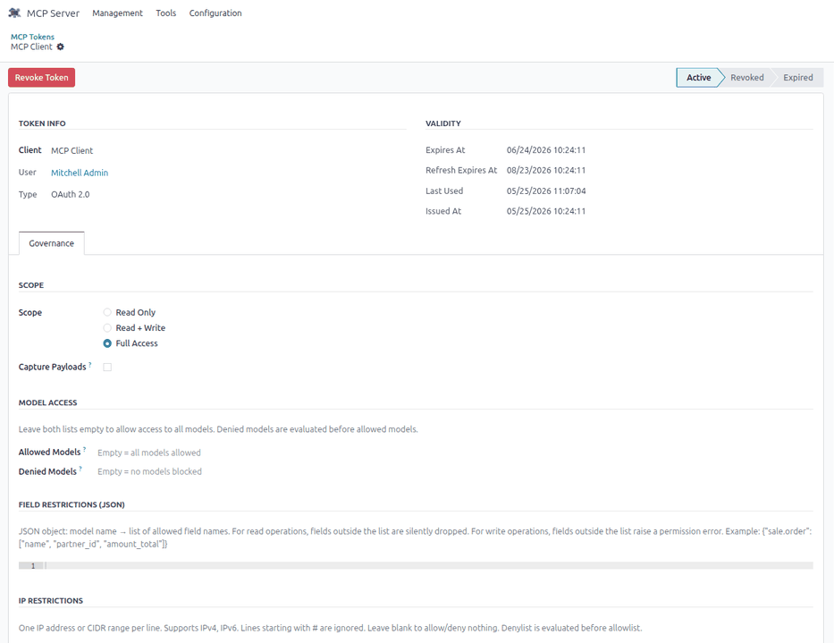
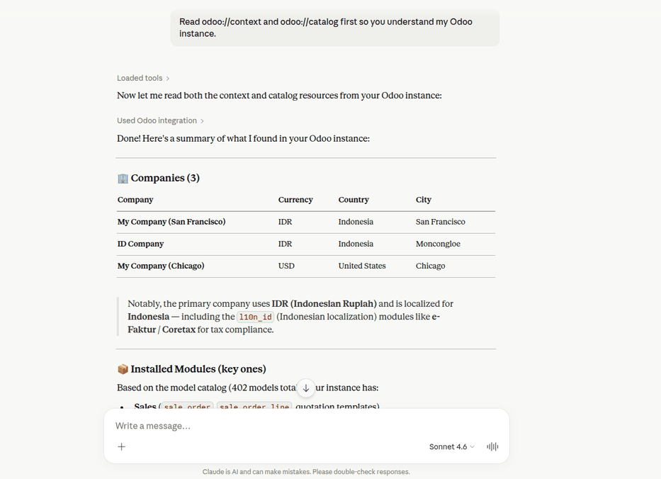
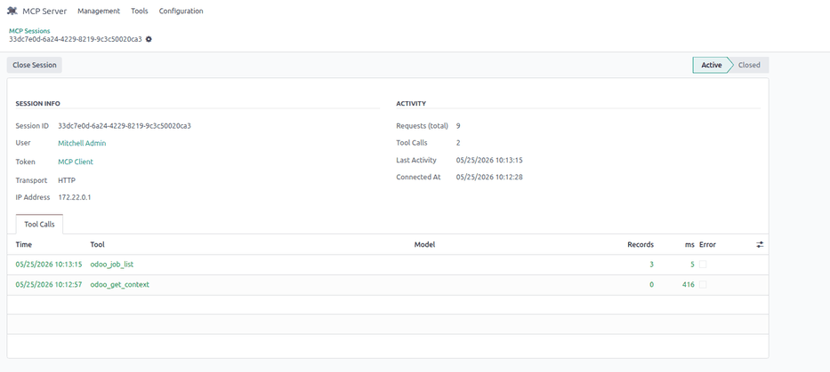

# Servidor MCP

El módulo **Servidor MCP** convierte Odoo en un servidor del **Model Context
Protocol** (MCP): asistentes de IA como Claude, ChatGPT o Cursor, y
herramientas como n8n, se conectan a los datos en vivo de Odoo y trabajan en
lenguaje natural («muéstrame las facturas impagas con más de 30 días», «crea
una orden de venta para…»), siempre con los **permisos del usuario dueño del
token**. Incluye el gobierno del acceso (tokens con alcance, listas de modelos
e IP, límite de tasa), la auditoría de cada llamada, herramientas de análisis,
trabajos en segundo plano, páginas de portal compartibles y un generador de
módulos para administradores.

Lo administran el área de sistemas y los administradores de Odoo, y lo usan
analistas y usuarios que trabajan con un asistente de IA. El asistente y sus
créditos los pone el cliente (Claude, ChatGPT…), y el módulo no salta los
permisos de Odoo.

## Configuración

1. Instale el módulo **Servidor MCP** (`al_mcp_server`). Depende de `base`,
   `web` y `mail`, y funciona en Community y Enterprise.
2. En producción, publique Odoo con **HTTPS**: es obligatorio para OAuth.
3. Vaya a **Servidor MCP ‣ Configuración** y revise:
    - la retención de sesiones (7 días) y de registros (30 días);
    - el límite de tasa (60 solicitudes por ventana de 60 segundos);
    - la caché de esquema (300 segundos) y, si hay varios servidores, Redis
      para compartir el límite de tasa;
    - el generador de módulos, con su ruta, si se usará.
4. Defina la política de acceso: qué usuarios pueden generar tokens, con qué
   alcance, sobre qué modelos y desde qué IP.
5. Opcional: instale `redis` (límite de tasa compartido entre servidores) y
   `xlsxwriter` (exportación a Excel) en el servidor.

!!! warning "Importante"
    Si el asistente de IA es un servicio externo, lo que lea de Odoo (clientes,
    empleados) sale de la empresa y aplica la
    [Ley 29733 de Protección de Datos Personales](https://www.gob.pe/institucion/minjus/normas-legales/243470-29733).
    Use las listas de modelos y campos permitidos y el ocultamiento de datos
    personales en la auditoría.

## Conceptos

| Término | Significado |
|---|---|
| Herramienta MCP | Acción que el asistente puede invocar (buscar, crear, agrupar, exportar…) |
| Recurso MCP | Lectura de contexto: `odoo://context`, `odoo://catalog`, `odoo://model/<modelo>` |
| Token personal (PAT) | Clave para scripts y clientes de línea de comandos; se muestra una sola vez |
| Alcance | `read` (solo lectura), `write` (lectura y escritura) o `admin` (todo) |
| Sesión y registro | Conexión de un cliente y auditoría de cada llamada |

El módulo implementa la [especificación 2025-03-26 de MCP](https://modelcontextprotocol.io/specification/2025-03-26)
con transporte HTTP. Los clientes con ventana de inicio de sesión obtienen el
acceso con [OAuth 2.0](https://www.rfc-editor.org/rfc/rfc6749) y
[PKCE](https://www.rfc-editor.org/rfc/rfc7636), sin copiar claves.

## Conectar un asistente

### Con OAuth

Los clientes con inicio de sesión (Claude Web, Claude Desktop, Cursor) piden
al usuario que inicie sesión en Odoo y autorice el acceso. No hace falta crear
un token a mano.

### Con un token personal

1. Vaya a **Servidor MCP ‣ Gestión ‣ Tokens** y genere un token personal (PAT).
2. Elija el alcance y, si hace falta, los modelos, campos e IP permitidos. El
   token vale 30 días.
3. Copie el token: se muestra una sola vez y Odoo guarda solo su huella
   SHA-256.

### Configurar el cliente

En el cliente de IA, configure la URL `/mcp` de su dominio de Odoo (por ejemplo
`su-empresa.odoo.com/mcp`, siempre con HTTPS) y, con un token personal, la
cabecera `Authorization: Bearer <token>`. Cualquier cliente compatible con MCP
sirve, incluidos ChatGPT y n8n.

## Trabajar con el asistente

Pida primero al asistente que lea `odoo://context` y `odoo://catalog`: así
conoce la compañía, la moneda, los módulos y los modelos. Después, pida en
lenguaje natural. El asistente solo ve lo que puede ver el usuario del token,
acotado por el alcance y las listas de modelos, campos e IP. Las operaciones
pesadas pasan a un trabajo en segundo plano con su estado y su descarga.

### Ejemplo

Un analista de cobranzas usa Claude Desktop con un token de alcance `read`
restringido a facturas y contactos:

1. Genera un PAT de alcance `read`, con los modelos permitidos `account.move` y
   `res.partner` y la IP de la oficina.
2. Configura en el cliente la URL `/mcp` y la cabecera con el token.
3. Pide «Lee odoo://context y odoo://catalog»: el asistente conoce la
   compañía, la moneda (PEN), los módulos y los modelos.
4. Pide «Facturas de cliente impagas con más de 30 días, agrupadas por
   cliente»: el asistente usa la herramienta de agrupación sobre
   `account.move` y devuelve, por ejemplo, 3 clientes con su saldo.
5. Pide «Crea una nota de crédito»: se rechaza, porque el token es de solo
   lectura.
6. En **Sesiones** queda la sesión con cada llamada (herramienta, modelo,
   resultado). Con **Capturar cargas útiles** se guarda además el detalle, con
   los datos personales ocultos.
7. Al terminar el proyecto, el administrador revoca el token.

## Auditar y revocar

- **Servidor MCP ‣ Gestión ‣ Sesiones**: quién llamó a qué herramienta y cuándo.
- **Servidor MCP ‣ Gestión ‣ Tokens**: abra el token y revóquelo; deja de
  funcionar al instante.

Otros menús: **Herramientas** (registro de herramientas), **Trabajos**,
**Páginas de portal**, **Artefactos HTML**, **Módulos generados** y **Clientes
OAuth**. El generador de módulos solo funciona con alcance `admin`, activado en
**Configuración** y con confirmación.

## Reportes

- Herramientas de análisis: tabla dinámica, series de tiempo con tendencia,
  ranking Top-N, retención por cohorte, embudo y exportación CSV o XLSX.
- **Páginas de portal**: tableros compartibles por enlace.
- La auditoría en **Sesiones**. El módulo no alimenta libros contables ni
  archivos SUNAT.

## Casos especiales

| Situación | Qué pasa | Qué hacer |
|---|---|---|
| «Access Denied» | El usuario del token no tiene permiso en ese modelo | Revisar sus derechos en Odoo o las listas del token |
| «Method is blocked» | Método privado o de escalada de privilegios | Usar los métodos que lista la herramienta de vistas |
| «Required field missing» al crear | Faltan campos obligatorios | Pedir al asistente los valores por defecto y los cambios automáticos antes de crear |
| «Rate limit exceeded» | Más solicitudes de las permitidas por ventana | Esperar o subir el límite en **Configuración** |
| La URL de un PDF no abre | Las URL de reportes exigen sesión en Odoo | Iniciar sesión en el navegador |
| El asistente «no conoce» los modelos | No leyó el contexto | Pedirle que lea `odoo://context` y `odoo://catalog` |

!!! info "Ver también"
    - [Qué es Model Context Protocol](https://modelcontextprotocol.io/introduction)
    - [Especificación 2025-03-26 de MCP](https://modelcontextprotocol.io/specification/2025-03-26)
    - [OAuth 2.0 (RFC 6749)](https://www.rfc-editor.org/rfc/rfc6749) y [PKCE (RFC 7636)](https://www.rfc-editor.org/rfc/rfc7636)
    - [Ley 29733, Protección de Datos Personales](https://www.gob.pe/institucion/minjus/normas-legales/243470-29733)
    - [Autoridad Nacional de Protección de Datos Personales](https://www.gob.pe/anpd)
    - [Permisos de acceso en Odoo 19](https://www.odoo.com/documentation/19.0/applications/general/users/access_rights.html)
