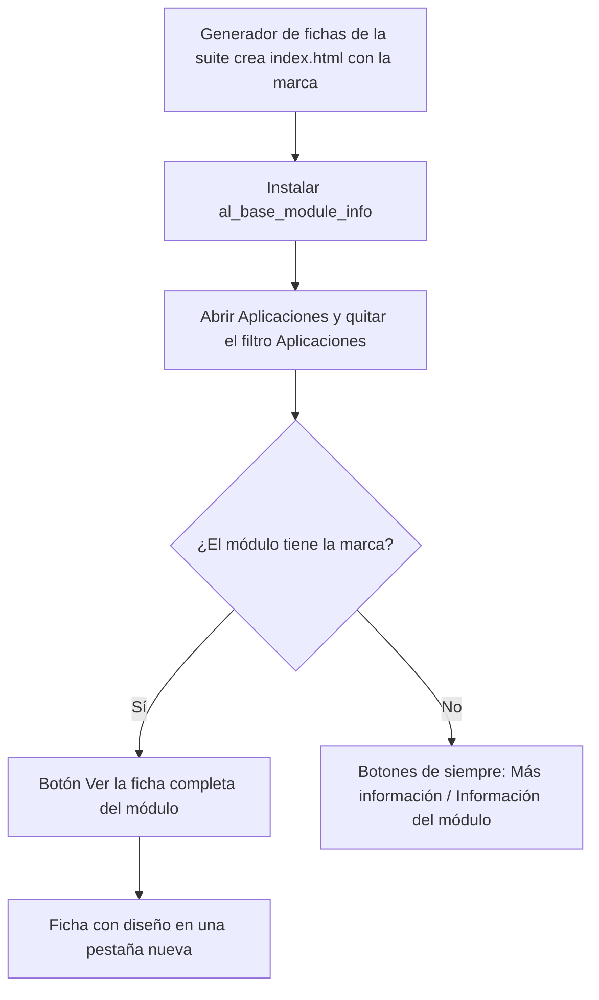
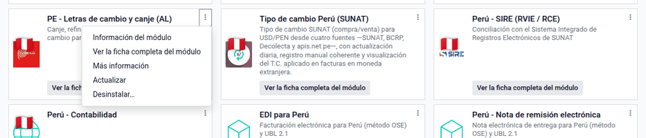
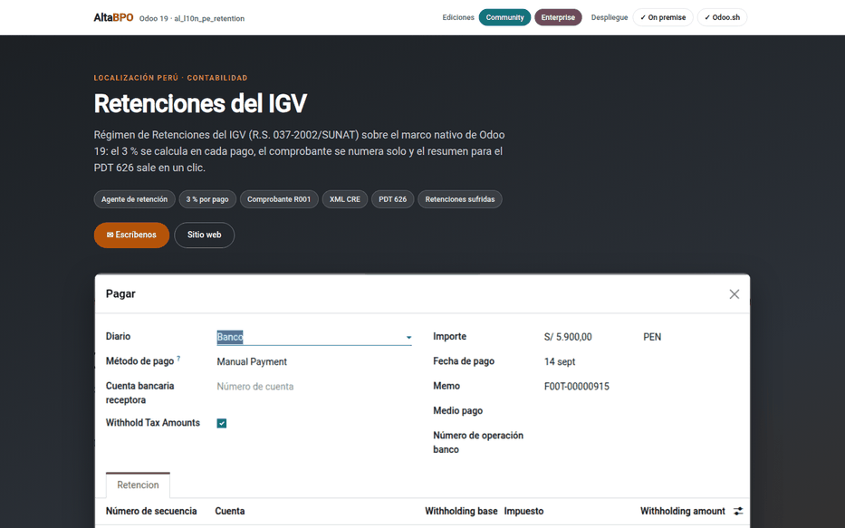

# Ficha completa del módulo

En **Aplicaciones**, Odoo muestra la descripción de cada módulo «saneada»: quita
los estilos, los gráficos y todo lo que considera inseguro, así que la ficha de
los módulos de la suite (portada, capturas, ejemplos) se ve sin diseño. El
módulo **Ficha completa del módulo** pone en la tarjeta de cada módulo de la
suite el botón **Ver la ficha completa del módulo**, que la abre con todo su
diseño en una pestaña nueva. Lo usan consultores y administradores al revisar
qué hace cada módulo.

El módulo lleva además los controles de calidad multicompañía de la suite. No
cambia los módulos de Odoo ni los de terceros, no agrega menús ni ajustes y no
genera las fichas.

## Configuración

1. Instale el módulo **Ficha completa del módulo** (`al_base_module_info`).
   Solo depende de `base` y no necesita configuración.
2. Para que un módulo nuevo ofrezca su ficha, genérela con el generador de
   fichas de la suite y reinicie el servidor: la detección se guarda en caché.

## Conceptos

| Término | Significado |
|---|---|
| Ficha del módulo | Página `static/description/index.html` del módulo, generada por la suite con portada, recorrido, ejemplos y novedades |
| Descripción saneada | Versión que Odoo muestra dentro de **Aplicaciones**, sin estilos |
| Marca `al-ficha-link` | Señal que deja el generador en la ficha; solo esos módulos reciben el botón |

## Abrir la ficha de un módulo

1. Vaya a **Aplicaciones** y quite el filtro **Aplicaciones** para ver todos los
   módulos.
2. En la tarjeta del módulo, haga clic en **Ver la ficha completa del módulo**
   (también en el menú ⋮ de la tarjeta).
3. La ficha se abre con su diseño en una pestaña nueva, en
   `/<módulo>/static/description/index.html`.

**Más información**, que lleva a la web del autor, pasa al menú ⋮ de la
tarjeta. La ficha es un archivo estático del módulo: la abre cualquier usuario
que llegue a la dirección.

### Ejemplo

Con la búsqueda «Perú» en **Aplicaciones**:

| Módulo | ¿Tiene ficha? | Botón del pie de la tarjeta |
|---|---|---|
| PE - Base Contabilidad (AL) | Sí | Ver la ficha completa del módulo |
| Perú - Contabilidad (Odoo) | No (con web del autor) | Más información |
| EDI para Perú (Odoo) | No (sin web del autor) | Información del módulo |

En «PE - Retenciones de IGV (AL)», el botón abre la ficha completa: portada,
destacados, recorrido con capturas, ejemplos, preguntas frecuentes y novedades.

## Control multicompañía

Al ejecutar las pruebas del módulo se revisan todos los módulos propios: cada
modelo con compañía tiene su regla por compañía y su control automático, las
relaciones hacia modelos con compañía llevan control de compañía y la compañía
es de solo lectura en las vistas propias. Si un módulo nuevo no cumple, la
prueba falla y lo señala por nombre. Así ningún módulo de la suite mezcla datos
de compañías distintas.

## Casos especiales

| Situación | Qué pasa | Qué hacer |
|---|---|---|
| Ficha recién generada sin botón | La detección está en caché | Reiniciar el servidor |
| El botón no aparece nunca | El `index.html` no tiene la marca `al-ficha-link` | Generar la ficha con el generador de la suite |
| No aparece **Más información** | Pasa al menú ⋮ de la tarjeta | Usarlo desde ahí |

!!! info "Ver también"
    - [Aplicaciones y módulos en Odoo 19](https://www.odoo.com/documentation/19.0/applications/general/apps_modules.html)
    - [Manifiesto del módulo en Odoo 19](https://www.odoo.com/documentation/19.0/developer/reference/backend/module.html)
    - [Guía multicompañía de Odoo 19](https://www.odoo.com/documentation/19.0/developer/howtos/company.html)
