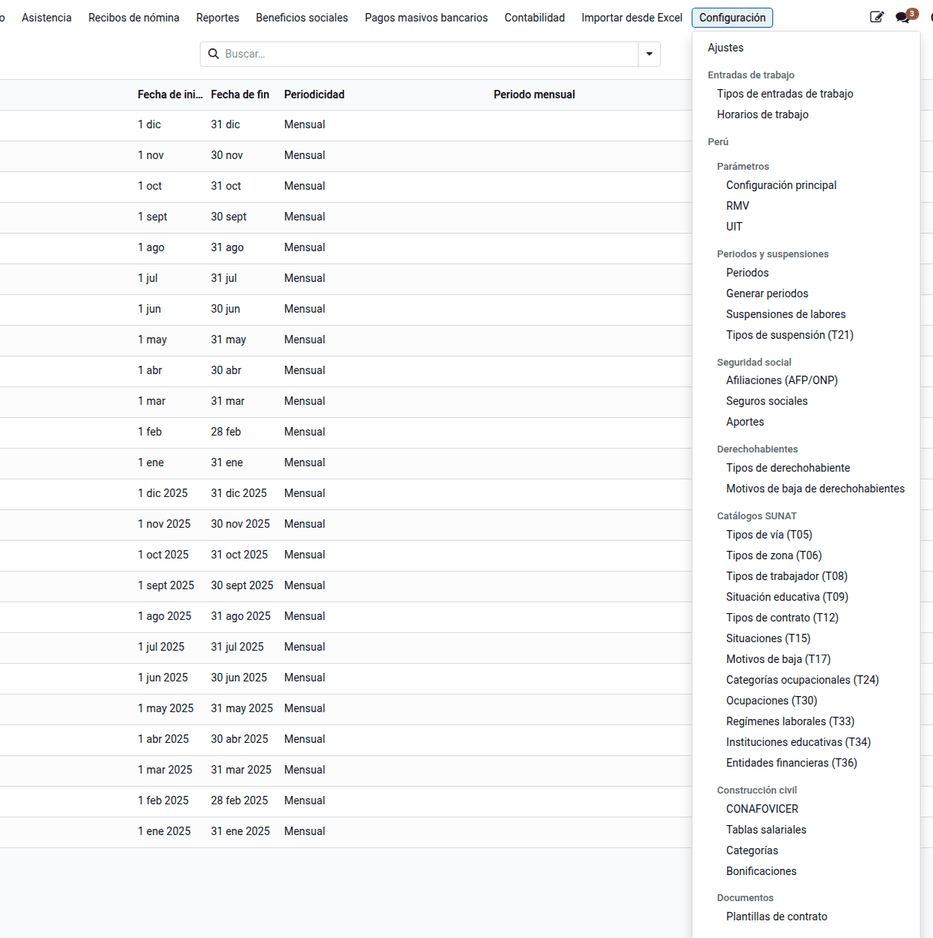
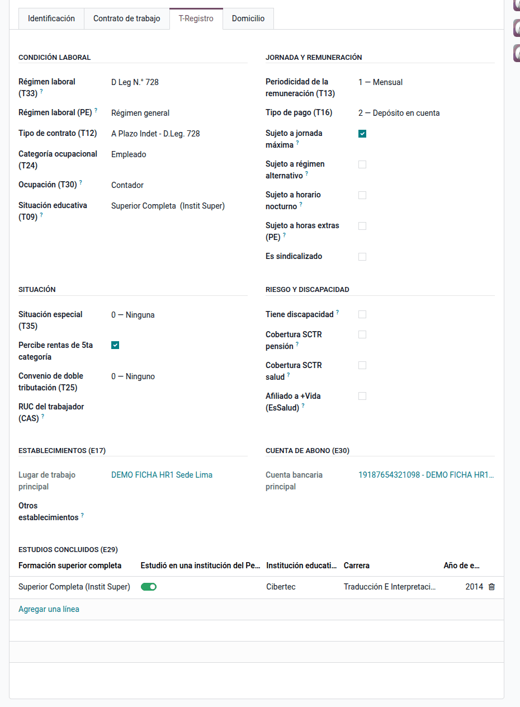
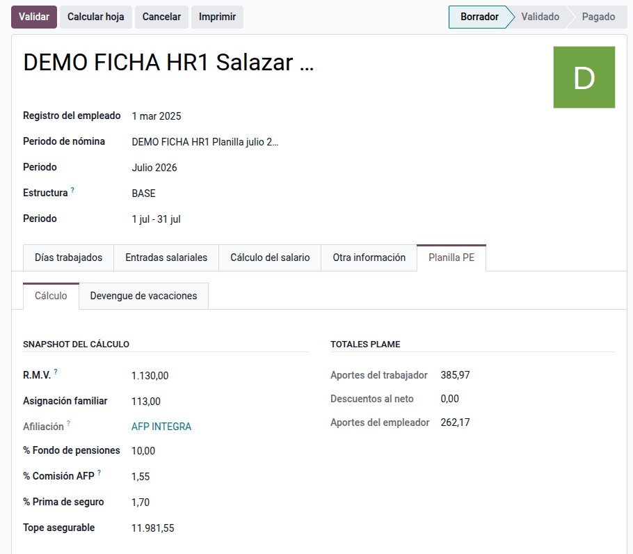
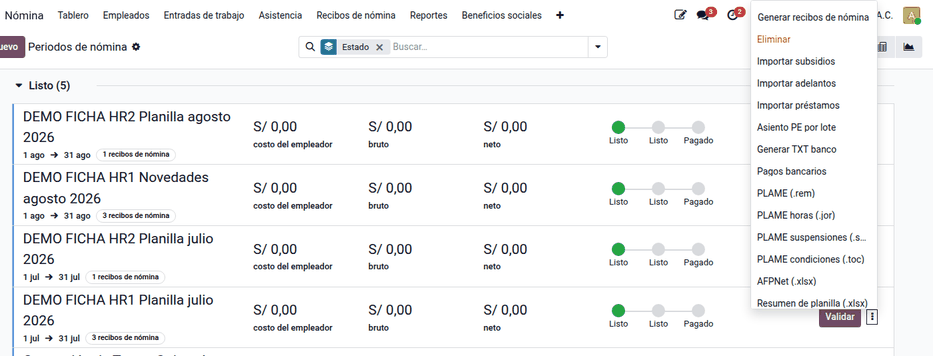

# Perú

La nómina de Odoo es un motor genérico: no trae la norma laboral peruana. La
suite agrega la ficha laboral con los códigos del T-Registro, la seguridad
social (AFP, ONP, EsSalud, EPS, SCTR, Vida Ley), los derechohabientes, la
estructura salarial peruana con sus códigos SUNAT y los archivos **PLAME**,
**AFPNet** y **T-Registro** listos para subir. La usan Recursos Humanos (ficha
y derechohabientes) y el responsable de planillas (cálculo y declaraciones).

Esta página describe la base (`al_hr_pe`). El resto de la nómina peruana está
en sus propias páginas:

| Funcionalidad | Página |
|---|---|
| Ciclos atípicos, turnos, monitor y tareaje | [Asistencia y turnos](peru/attendance.md) |
| Calendario de feriados nacionales | [Feriados](peru/public_holidays.md) |
| CTS, gratificaciones, vacaciones, 5.ª categoría, liquidación, quincena | [Beneficios sociales](peru/benefits.md) |
| Régimen de construcción civil | [Construcción civil](peru/construction.md) |
| Carga de datos y novedades desde Excel | [Importación de novedades](peru/import.md) |
| Asientos de la planilla y provisiones | [Contabilización de planillas](peru/accounting.md) |
| Boletas impresas, certificados, contratos y pagos masivos | [Reportes y documentos](peru/reports.md) |

La presentación de los archivos se hace en el PDT PLAME, el PVS del T-Registro
y AFPNet: el sistema genera los archivos, no los envía.

## Conceptos

- **Régimen laboral de la actividad privada**: TUO del D. Leg. 728 (D.S.
  003-97-TR).
- **Planilla Electrónica** (D.S. 018-2007-TR): tiene dos componentes, el
  **T-Registro** (registro de trabajadores y derechohabientes) y la **PLAME**
  (planilla mensual de pagos), que se elabora a partir del T-Registro.
- **Remuneración Mínima Vital (RMV)**: S/ 1 130 desde el 01/01/2025 (D.S.
  006-2024-TR).
- **Asignación familiar** (Ley 25129 y D.S. 035-90-TR): 10 % de la RMV vigente
  para quien tiene hijos menores de 18 años, o hasta 24 si cursan estudios
  superiores (y mayores con discapacidad severa, Ley 31600).
- **Sistema Privado de Pensiones**: aporte al fondo (10 %), comisión sobre
  flujo o mixta y prima de seguro hasta la remuneración máxima asegurable,
  publicadas por la SBS.
- **Sistema Nacional de Pensiones**: 13 % a cargo del trabajador.
- **EsSalud** (Ley 26790): 9 % a cargo del empleador sobre la remuneración
  (con EPS, la tasa que corresponde).
- **Seguro Vida Ley** (D. Leg. 688, desde el inicio del vínculo): prima a cargo
  del empleador.
- **SCTR** (Ley 26790, D.S. 003-98-SA): seguro complementario de salud y de
  pensión para actividades de riesgo; en la PLAME se informa con los códigos
  0806/0810 (salud) y 0813/0814 (pensión).

| Término | Significado | Dónde aparece en Odoo |
|---|---|---|
| Versión del empleado | Reemplaza al contrato: guarda régimen, afiliación, tipo de trabajador y su histórico | **Nómina ‣ Empleados ‣ Registros de los empleados** |
| Configuración principal | Un registro por compañía con las reglas de referencia y la clasificación de conceptos | **Nómina ‣ Configuración ‣ Perú ‣ Parámetros** |
| Snapshot | Valores que la boleta fotografía al calcular: RMV, asignación familiar, tasas AFP y tope | Boleta, página **Planilla PE ‣ Cálculo** |
| Código SUNAT (tabla 22) | Código PLAME de cada concepto (0121 básico, 0201 asignación familiar…) | Regla salarial |
| Periodo | Mes declarado (AAAAMM) y, si aplica, sus semanas (AAAAMM-S01…) | **Configuración ‣ Perú ‣ Periodos y suspensiones** |
| Suspensión T21 | Día sin labor (perfecta o imperfecta) que va al archivo `.snl` | **Periodos y suspensiones ‣ Suspensiones de labores** |

## Configuración

1. Instale **Planillas Perú — Núcleo** (`al_hr_pe`). Requiere la aplicación
   Nómina y la localización peruana.
2. Vaya a **Ajustes ‣ Nómina ‣ Perú** y, por compañía, indique el SCTR de
   salud y de pensión con su tasa, el representante legal y la firma.
3. Vaya a **Nómina ‣ Configuración ‣ Perú ‣ Parámetros ‣ Configuración
   principal** e indique la regla del neto y la de ingresos afectos AFP. En la
   pestaña **Boleta**, clasifique los tipos de entrada de trabajo (laborados,
   no laborados, subsidiados, sobretiempo y ausencias) y las categorías de
   ingresos, descuentos y aportes.
4. Registre la **UIT** del año y revise las tasas de **Afiliaciones (AFP/ONP)**,
   **Seguros sociales** y **Aportes** (Vida Ley).
5. Vaya a **Configuración ‣ Perú ‣ Periodos y suspensiones ‣ Generar periodos**
   y genere los periodos del ejercicio, con semanas si hay régimen semanal.
6. Indique el **código de establecimiento** en los lugares de trabajo y la
   **entidad SUNAT (T36)** en los bancos.
7. Asigne la estructura **BASE** (o la propia) a los trabajadores.

!!! note "Nota"
    Con varias compañías, cada una tiene su configuración principal. Cambie de
    compañía arriba a la derecha y configúrela.

## Ficha del trabajador

1. Abra el empleado en **Nómina ‣ Empleados** y complete la página **Planilla
   PE**: identificación, T-Registro y domicilio (datos de las estructuras E04,
   E05, E17, E29 y E30).
2. En la versión del empleado, registre el régimen, la afiliación (AFP con su
   CUSPP u ONP), el seguro social y el tipo de trabajador. Para editar muchas a
   la vez, use **Nómina ‣ Empleados ‣ Registros de los empleados** o la
   [importación de novedades](peru/import.md).

### Derechohabientes

1. En la ficha del empleado, haga clic en **Derechohab.** y registre a cada
   hijo, cónyuge o conviviente con su documento y fecha de nacimiento.
2. El derecho a la asignación familiar se evalúa en la fecha de fin de cada
   boleta: una hija de 10 años da derecho; un hijo de 20 años, solo si cursa
   estudios superiores; el cónyuge no da derecho.
3. Para el T-Registro, use **Derechohabientes ‣ Exportar para el T-Registro**:
   genera el Excel con las hojas Altas y Bajas que consume la macro oficial de
   carga masiva de SUNAT.

!!! note "Nota"
    Sin derechohabientes registrados, el cálculo usa el número de hijos de la
    ficha. Regístrelos para que el derecho se controle por edad.

### Alta y baja en el T-Registro

1. Vaya a **Nómina ‣ Empleados**, seleccione a los trabajadores y use
   **Acciones ‣ T-Registro: generar alta**. El sistema genera el ZIP
   `RP_<RUC>` con los archivos `.ide`, `.tra`, `.per`, `.est`, `.edu` y `.cta`
   (estructuras E04, E05, E11, E17, E29 y E30).
2. Súbalo en el PVS del T-Registro de SUNAT.
3. Al cesar a un trabajador, use **Acciones ‣ T-Registro: generar baja**: el
   archivo `.per` lleva la fecha de cese y el motivo (tabla T17).

!!! warning "Importante"
    Si falta un dato obligatorio (sexo, documento, establecimiento, estudios o
    cuenta de abono), el sistema no genera el archivo y lista lo que falta por
    trabajador.

## Calcular la planilla

1. Vaya a **Nómina ‣ Recibos de nómina ‣ Periodos de nómina** y cree el lote
   del mes.
2. Genere y calcule las boletas. Cada boleta guarda el snapshot de la RMV, la
   asignación familiar y las tasas AFP vigentes: si después cambia una tasa,
   las boletas ya calculadas conservan la suya.
3. Revise los totales PLAME de cada boleta en **Planilla PE ‣ Cálculo**:
   aportes del trabajador, descuentos al neto y aportes del empleador.

### Ejemplo

Compañía Comercial Demo Perú S.A.C., planilla de julio de 2026, RMV
S/ 1 130, tres trabajadores con distinto sistema de pensiones (datos de
demostración «DEMO FICHA HR1»):

| Concepto | Salazar (AFP INTEGRA, flujo) | Huamán (ONP) | Rivas (AFP PRIMA, mixta) |
|---|---:|---:|---:|
| Básico | 2 800,00 | 1 800,00 | 4 500,00 |
| Asignación familiar (10 % RMV) | 113,00 | — | — |
| **Total ingresos** | **2 913,00** | **1 800,00** | **4 500,00** |
| Aporte al fondo 10 % / ONP 13 % | 291,30 | 234,00 | 450,00 |
| Comisión AFP (1,55 % flujo / 0 % mixta) | 45,15 | — | 0,00 |
| Prima de seguro 1,70 % | 49,52 | — | 76,50 |
| **Total aportes del trabajador** | **385,97** | **234,00** | **526,50** |
| **Neto a pagar** | **2 527,03** | **1 566,00** | **3 973,50** |
| EsSalud 9 % (empleador) | 262,17 | 162,00 | 405,00 |

Para Salazar: 2 913,00 × 10 % = 291,30; × 1,55 % = 45,15; × 1,70 % = 49,52;
total 385,97; neto 2 913,00 − 385,97 = 2 527,03; EsSalud 2 913,00 × 9 % =
262,17. La prima se calcula hasta el tope asegurable de S/ 11 981,55; para un
afiliado mayor de 65 años vale cero.

El asiento lo arma la [contabilización de planillas](peru/accounting.md) con las
cuentas de cada regla. Con las cuentas de la base de demostración, la boleta de
Salazar aporta estas líneas al asiento del lote:

| Cuenta | Descripción | Debe | Haber |
|---|---|---:|---:|
| 6211000 | Básico | 2 800,00 | |
| 6211000 | Asignación familiar | 113,00 | |
| 4111000 | Remuneraciones por pagar (ingresos) | | 2 913,00 |
| 4111000 | AFP: aporte, comisión y prima (descuento al trabajador) | 385,97 | |
| 4032000 | AFP INTEGRA (cuenta de la afiliación) | | 385,97 |
| 6271000 | EsSalud | 262,17 | |
| 4031000 | EsSalud por pagar | | 262,17 |
| | **Totales** | **3 561,14** | **3 561,14** |

El saldo de la 4111000 queda en S/ 2 527,03 al haber: el neto a pagar.

### Suspensiones de labores

Registre las faltas, licencias y subsidios en **Configuración ‣ Perú ‣
Periodos y suspensiones ‣ Suspensiones de labores**, con su tipo (tabla T21).
Salen en el archivo `.snl` del lote de su periodo.

### EPS y SCTR

- Con EPS, el seguro social EPS tiene su tasa (6,75 %) y la regla de EsSalud la
  aplica.
- El SCTR se configura por compañía en Ajustes; la entidad elegida fija el
  código PLAME (0806/0810 salud, 0813/0814 pensión).

### Régimen semanal

Para el régimen semanal (construcción civil), genere los periodos con semanas:
las semanas se cortan en el fin de mes y el lote semanal declara su mes. Vea
[Construcción civil](peru/construction.md).

## Reportes

Los archivos se descargan desde el menú ⋮ del lote o desde las acciones de la
lista de empleados, con el nombre oficial. Se importan en el aplicativo del
Estado y se presentan con Clave SOL.

| Archivo | Contenido | Dónde |
|---|---|---|
| PLAME `.rem` | Una línea por trabajador y código SUNAT (`0601202607<RUC>.rem` para julio de 2026) | Lote ‣ menú ⋮ |
| PLAME `.jor` | Horas ordinarias y de sobretiempo | Lote ‣ menú ⋮ |
| PLAME `.snl` | Suspensiones por tipo T21 | Lote ‣ menú ⋮ |
| PLAME `.toc` | Trabajadores con Vida Ley | Lote ‣ menú ⋮ |
| AFPNet `.xlsx` | Afiliados AFP, CUSPP y remuneración asegurable | Lote ‣ menú ⋮ |
| T-Registro `RP_<RUC>` | Altas y bajas (E04, E05, E11, E17, E29, E30) | **Empleados ‣ Acciones** |
| Derechohabientes `.xlsx` | Hojas Altas y Bajas para la macro de SUNAT | **Derechohabientes ‣ Exportar para el T-Registro** |

!!! note "Nota"
    Las estructuras 13 y 24 de derechohabientes no tienen especificación
    pública campo a campo: el sistema genera el Excel que consume la macro
    oficial de carga masiva.

!!! info "Ver también"
    - [TUO del D. Leg. 728 (D.S. 003-97-TR) — El Peruano](https://diariooficial.elperuano.pe/Normas/obtenerDocumento?idNorma=35)
    - [SUNAT — Planilla Electrónica](https://orientacion.sunat.gob.pe/informacion-general-planilla-electronica)
    - [SUNAT — PDT PLAME](https://orientacion.sunat.gob.pe/pdt-plame)
    - [SUNAT — Utilización de la PLAME](https://orientacion.sunat.gob.pe/node/1280)
    - [SUNAT — Guía de T-Registro y PLAME (PDF)](https://orientacion.sunat.gob.pe/sites/default/files/inline-files/PDF%20de%20T-Registro%20y%20PLAME.pdf)
    - [D.S. 006-2024-TR, RMV S/ 1 130 — El Peruano](https://busquedas.elperuano.pe/dispositivo/NL/2357884-10)
    - [SBS — comisiones y primas del SPP](https://www.sbs.gob.pe/app/spp/empleadores/comisiones_spp/Paginas/comision_prima.aspx)
    - [AFPnet](https://www.afpnet.com.pe/)
    - [ONP](https://www.gob.pe/onp)
    - [EsSalud — Ley 26790](https://www.gob.pe/institucion/essalud/informes-publicaciones/4936482-ley-n-26790)
    - [MTPE — normas legales](https://www.gob.pe/institucion/mtpe/normas-legales)
    - [Odoo — Nómina](https://www.odoo.com/documentation/19.0/applications/hr/payroll.html)
    - [Formatos del T-Registro](../../../developer/specs/planillas/tregistro_estructuras.md)
    - [Referencia técnica de `al_hr_pe`](../../../developer/reference/modules/al_hr_pe/index.md)
