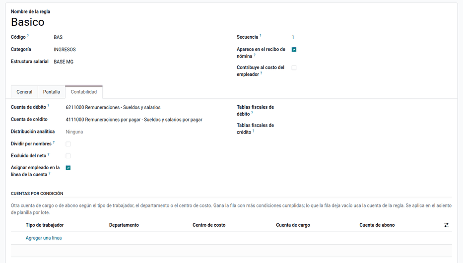
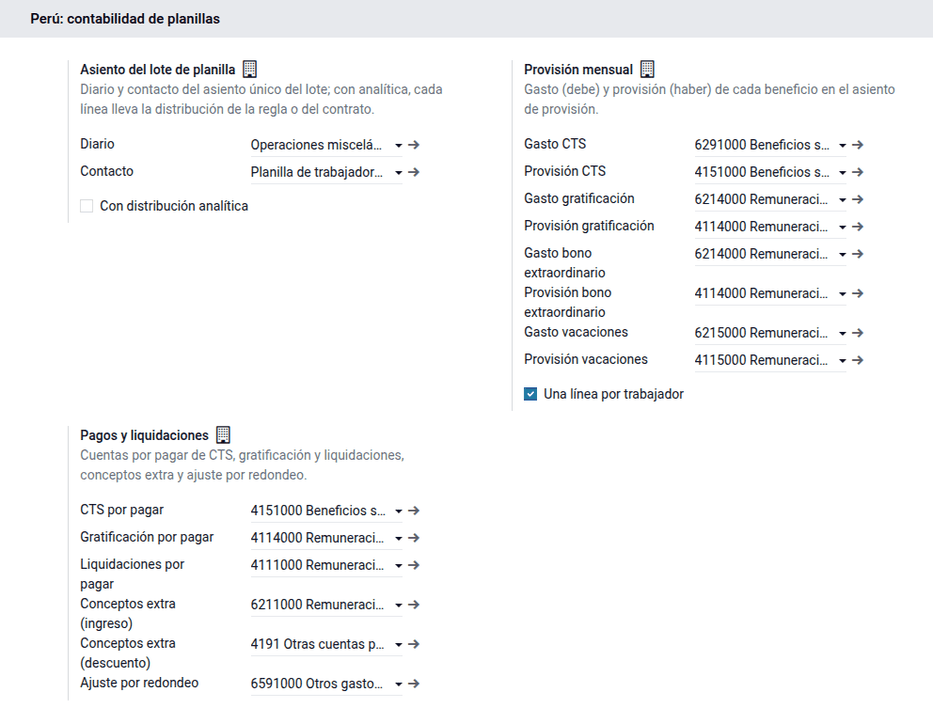
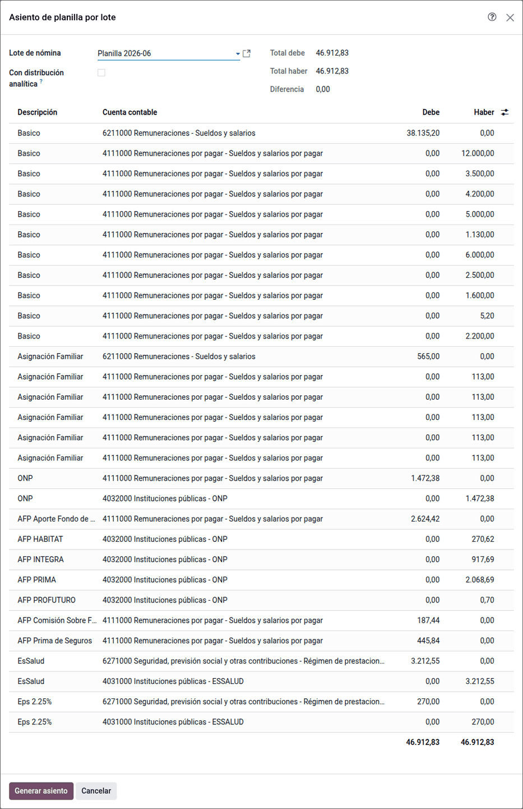
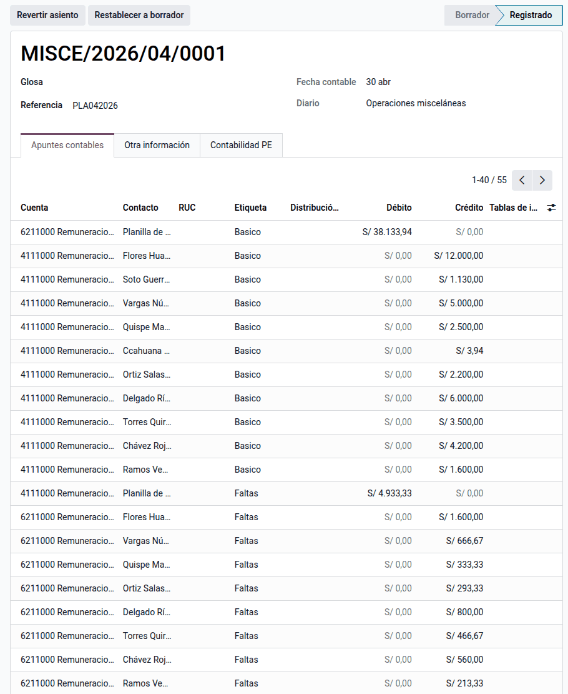

# Contabilización de planillas

La planilla genera gasto (sueldos, cargas sociales, beneficios) y pasivos
(remuneraciones por pagar, AFP, ONP, EsSalud, CTS, gratificaciones). La suite
construye los asientos de la planilla y de los beneficios sociales con las
cuentas configuradas por compañía: un **asiento por lote** agrupado por regla y
cuenta, los asientos de **CTS, gratificación, provisión mensual y liquidación**
con reversión de la provisión acumulada, **cuentas por condición** (otra
cuenta según el tipo de trabajador, el departamento o el centro de costo, sin
duplicar estructuras) y **distribución analítica** opcional. La usan el
contador y el responsable de planillas.

El asiento no se genera al validar las boletas: se lanza a pedido desde el
lote. El pago de la planilla lo hacen los
[reportes y documentos](reports.md) o el registro de pagos de Contabilidad, y el
cálculo de los beneficios, los [beneficios sociales](benefits.md).

## Conceptos

- **Plan Contable General Empresarial (PCGE)**:
    - 62 gastos de personal: 621 remuneraciones, 627 seguridad y previsión
      social, 629 beneficios sociales;
    - 40 tributos y aportes: 4031 EsSalud, 4032 ONP;
    - 41 remuneraciones y participaciones por pagar: 4111 sueldos, 4114
      gratificaciones, 4115 vacaciones, 4151 CTS;
    - 417 administradoras de fondos de pensiones.

    Las cuentas exactas las define cada empresa en su plan de cuentas.
- **Devengo**: CTS, gratificaciones y vacaciones se devengan mes a mes; la
  provisión mensual reconoce ese gasto y el pago o depósito revierte la
  provisión acumulada.
- **Aportes**: el aporte AFP/ONP es del trabajador (se descuenta y se paga por
  cuenta suya); EsSalud es del empleador (gasto).

| Término | Significado | Dónde aparece en Odoo |
|---|---|---|
| Cuenta de débito / crédito de la regla | Cargo y abono de cada concepto | **Regla salarial ‣ Contabilidad** |
| Cuenta de la afiliación | Pasivo por aportes de cada AFP/ONP | **Afiliaciones (AFP/ONP) ‣ Cuenta contable** |
| Cuentas por condición | Excepciones a la cuenta de la regla | **Regla ‣ Contabilidad ‣ Cuentas por condición** |
| Prov. acumulada | Lo provisionado en el semestre por trabajador | Líneas de CTS y gratificación |
| Ajuste por redondeo | Línea para descuadres de céntimos | Asistentes de asiento |

## Configuración

1. Instale **Contabilización de planillas** (`al_hr_pe_account`).
2. En **Nómina ‣ Configuración ‣ Salario ‣ Reglas ‣ Contabilidad**, indique las
   cuentas de débito y crédito de cada regla. Marque **Asignar empleado en la
   línea de la cuenta** en las que deban detallarse por trabajador.
3. En **Configuración ‣ Seguridad social ‣ Afiliaciones**, indique la
   cuenta contable de cada AFP/ONP por compañía.
4. Vaya a **Ajustes ‣ Nómina ‣ Perú: contabilidad de planillas** e indique el
   diario, el contacto para líneas sin trabajador, **Asiento de lote con
   analítica**, las cuentas de gasto, provisión y por pagar de CTS,
   gratificación, bono y vacaciones, la de liquidaciones por pagar y la de
   ajuste por redondeo.
5. En **Configuración principal ‣ Contabilidad**, elija las reglas de aportes
   AFP (las que van a la cuenta de la afiliación).

!!! warning "Importante"
    Con el asiento por lote, deje **sin diario** la estructura salarial. Si la
    nómina nativa ya contabilizó las boletas una por una, el asiento por lote
    se bloquea para no duplicar el gasto.

Con varias compañías, cada asiento usa las cuentas de la compañía del
documento: configure cada compañía con ella activa.

## Asiento de la planilla por lote

1. Calcule y valide las boletas del lote. Las boletas en borrador bloquean el
   asiento y las anuladas no entran.
2. En el lote, use **⋮ ‣ Asiento PE por lote** y previsualice el asiento.
3. Genere el asiento (`PLA` + mes + año): queda publicado y enlazado al lote.

Un lote con asiento no genera otro hasta anular y eliminar el anterior. Si
falta la cuenta de una afiliación, el asistente lista los trabajadores
afectados. Si debe y haber difieren solo en céntimos, el asistente pide la
cuenta de ajuste y añade la línea **Ajuste por Redondeo**; un descuadre real
(falta una cuenta) no se ajusta, se avisa.

### Ejemplo

Resumen agrupado del asiento `PLA042026` (abril de 2026, 10 boletas, 55
líneas). Las faltas y tardanzas tienen importe negativo y cambian de columna.

| Cuenta | Descripción | Debe | Haber |
|---|---|---:|---:|
| 6211000 | Básico | 38 133,94 | |
| 6211000 | Asignación familiar | 565,00 | |
| 6211000 | Horas extras 25 % y 35 % | 1 186,08 | |
| 6211000 | Subsidio por enfermedad | 450,00 | |
| 6211000 | Comisiones | 1 500,00 | |
| 4111000 | Remuneraciones por pagar — ingresos (por trabajador) | | 41 835,02 |
| 4111000 | Faltas y tardanzas | 4 933,79 | |
| 6211000 | Faltas y tardanzas (por trabajador) | | 4 933,79 |
| 4111000 | ONP | 1 279,98 | |
| 4032000 | ONP | | 1 279,98 |
| 4111000 | AFP aporte, comisión y prima | 3 161,88 | |
| 4032000 | AFP HABITAT | | 236,30 |
| 4032000 | AFP INTEGRA | | 956,48 |
| 4032000 | AFP PRIMA | | 1 968,63 |
| 4032000 | AFP PROFUTURO | | 0,47 |
| 4111000 | Adelanto, retención judicial y préstamo | 1 000,00 | |
| 4191 | Adelanto, retención judicial y préstamo (por trabajador) | | 1 000,00 |
| 6271000 | EsSalud | 3 012,55 | |
| 4031000 | EsSalud | | 3 012,55 |
| 6271000 | EPS 2,25 % | 267,75 | |
| 4031000 | EPS 2,25 % | | 267,75 |
| | **Totales** | **55 490,97** | **55 490,97** |

Ingresos: 38 133,94 + 565,00 + 1 186,08 + 450,00 + 1 500,00 = 41 835,02.
Bloque AFP: 236,30 + 956,48 + 1 968,63 + 0,47 = 3 161,88. En la base de
demostración las AFP usan la 4032000; el PCGE prevé la 417 para las
administradoras de fondos de pensiones, y se configura en cada afiliación.

## Cuentas por condición y reparto por obra

Para usar cuentas distintas sin duplicar la estructura salarial (por ejemplo,
empleados y obreros), agregue filas en **Regla ‣ Contabilidad ‣ Cuentas por
condición** o en **Nómina ‣ Configuración ‣ Salario ‣ Cuentas por condición**: por tipo de
trabajador (T08), departamento o centro de costo.

- Gana la fila que cumple **más condiciones**; a igualdad, la de menor
  secuencia.
- Una fila con la cuenta de cargo vacía conserva la cuenta de la regla.
- Las cuentas por condición aplican solo al asiento de planilla por lote, no a
  los de beneficios.

Con **Asiento de lote con analítica**, la distribución sale de la regla, del
[tareaje](attendance.md#reparto-del-costo-por-obra) (días u horas por obra) o
de la ficha del trabajador, en ese orden. El importe se parte por centro de
costo antes de elegir la cuenta.

Un obrero con básico de S/ 3 000 trabaja en el periodo 60 % en la obra A y 40 %
en la obra B. La regla «Básico» tiene la cuenta 6211000 y una fila por
condición: centro de costo **Obra A** → cuenta de cargo **621300 Sueldos obra
A**.

| Cuenta | Analítica | Debe | Haber |
|---|---|---:|---:|
| 621300 Sueldos obra A | Obra A 100 % | 1 800,00 | |
| 6211000 Sueldos (cuenta de la regla) | Obra B 100 % | 1 200,00 | |
| 4111000 Remuneraciones por pagar | | | 3 000,00 |
| | **Totales** | **3 000,00** | **3 000,00** |

## Provisión mensual

En **Beneficios sociales ‣ Provisiones**, use **Generar asiento**: la provisión
pasa a **Hecho** con su asiento.

Julio de 2026, sueldo S/ 2 800: 2 800 ÷ 12 = 233,33 (CTS y vacaciones);
2 800 ÷ 6 = 466,67 (gratificación); 466,67 × 9 % = 42,00 (bono
extraordinario).

| Cuenta | Descripción | Debe | Haber |
|---|---|---:|---:|
| 6291000 | Provisión de CTS | 233,33 | |
| 4151000 | Provisión de CTS por pagar | | 233,33 |
| 6214000 | Provisión de gratificación | 466,67 | |
| 4114000 | Provisión de gratificación por pagar | | 466,67 |
| 6214000 | Provisión del bono extraordinario | 42,00 | |
| 4114000 | Provisión del bono extraordinario por pagar | | 42,00 |
| 6215000 | Provisión de vacaciones | 233,33 | |
| 4115000 | Provisión de vacaciones por pagar | | 233,33 |
| | **Totales** | **975,33** | **975,33** |

## CTS y gratificación

En **Beneficios sociales ‣ CTS** o **Gratificación**, use **Obtener
provisiones** y luego **Generar asiento**: el asiento revierte la provisión
acumulada y lleva a gasto solo la diferencia, contra el pasivo por pagar.

!!! warning "Importante"
    Sin **Obtener provisiones**, todo el importe va a gasto.

## Liquidación de cese

En **Liquidación de cese ‣ Asientos contables** se genera un asiento por
cesado, porque cada cese tiene su fecha, importes y contacto. Al generarlo, la
fila queda marcada **No recalcular**.

Cese del 31/08/2026: se revierte lo provisionado en julio y solo la diferencia
de los truncos va a gasto. Truncos: gratificación 933,33 + bono 84,00, CTS
466,67 y vacaciones 466,67 (con ONP 60,67).

| Cuenta | Descripción | Debe | Haber |
|---|---|---:|---:|
| 4151000 | Reversión provisión de CTS | 233,33 | |
| 4114000 | Reversión provisión de gratificación y bono | 508,67 | |
| 4115000 | Reversión provisión de vacaciones | 233,33 | |
| 6214000 | Gratificación trunca (diferencia) | 508,66 | |
| 6291000 | CTS trunca (diferencia) | 233,34 | |
| 6215000 | Vacaciones truncas (diferencia) | 233,34 | |
| 4111000 | Liquidaciones por pagar | | 1 890,00 |
| 4033000 | ONP (cuenta de la afiliación en la base de pruebas) | | 60,67 |
| | **Totales** | **1 950,67** | **1 950,67** |

Por pagar: 1 017,33 + 466,67 + (466,67 − 60,67) = 1 890,00.

## Reportes

- El asiento queda en el Libro Diario y el Libro Mayor, y en los
  [libros electrónicos (PLE)](../../../finance/fiscal_localizations/peru/ple.md).
- Con analítica, el gasto de personal se ve por centro de costo en los
  informes analíticos y alimenta los
  [asientos de destino](../../../finance/fiscal_localizations/peru/destination_entries.md)
  9x/79.
- Cada asiento queda enlazado a su documento: lote y boletas, CTS,
  gratificación, provisión o fila de liquidación.

!!! info "Ver también"
    - [SBS — comisiones y primas del SPP](https://www.sbs.gob.pe/app/spp/empleadores/comisiones_spp/Paginas/comision_prima.aspx)
    - [ONP](https://www.gob.pe/onp)
    - [EsSalud — Ley 26790](https://www.gob.pe/institucion/essalud/informes-publicaciones/4936482-ley-n-26790)
    - [TUO de la Ley de CTS (D.S. 001-97-TR) — El Peruano](https://diariooficial.elperuano.pe/Normas/obtenerDocumento?idNorma=37)
    - [SERVIR — gratificaciones (Ley 27735)](https://cdn.www.gob.pe/uploads/document/file/5690429/5053106-informe-tecnico-482-2017-servir-gpgsc.pdf)
    - [Odoo — Nómina](https://www.odoo.com/documentation/19.0/applications/hr/payroll.html)
    - [Odoo — Contabilidad analítica](https://www.odoo.com/documentation/19.0/applications/finance/accounting/reporting/analytic_accounting.html)
    - [Beneficios sociales](benefits.md)
    - [Referencia técnica de `al_hr_pe_account`](../../../../developer/reference/modules/al_hr_pe_account/index.md)
