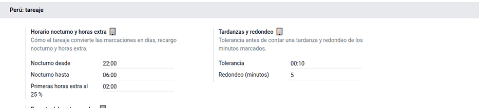
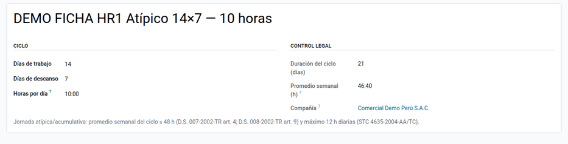
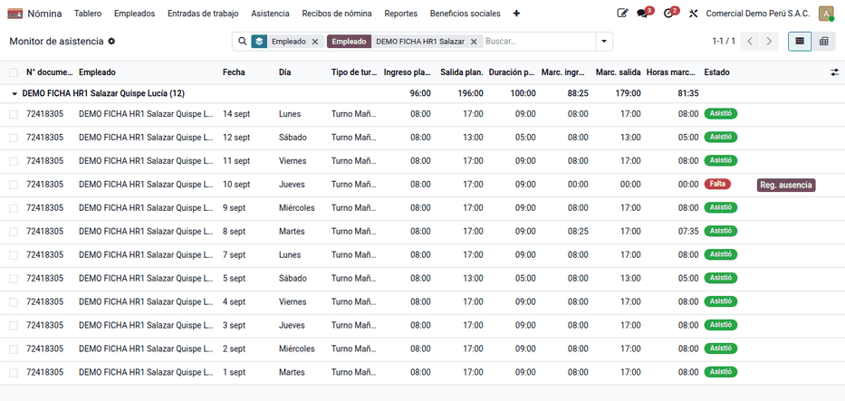
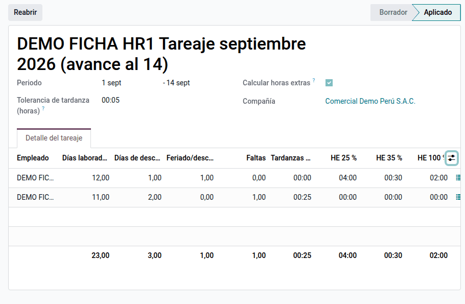

# Asistencia y turnos

El empleador controla la asistencia y paga el sobretiempo, la jornada nocturna
y el trabajo en descanso o feriado con sus sobretasas. Contar esas horas a mano
desde las marcaciones es lento y propenso a errores. Esta funcionalidad define
ciclos de jornada atípica (14×7, 4×3…) con control legal y genera sus turnos en
Planeación, compara lo planificado con lo marcado, arma el **tareaje** del
periodo para la boleta, reparte el costo del trabajador por obra y imprime el
fotocheck. La usan RR. HH., los supervisores de obra o planta y el responsable
de planillas.

El marcado en reloj o biométrico se hace con la aplicación Asistencias o con la
[importación de novedades](import.md); el cálculo de la remuneración lo hace la
boleta y el asiento, la [contabilización de planillas](accounting.md).

## Conceptos

- **Jornada, horario y sobretiempo** (TUO del D. Leg. 854, D.S. 007-2002-TR y
  su reglamento D.S. 008-2002-TR):
    - jornada máxima de 8 h diarias o 48 h semanales;
    - jornadas atípicas o acumulativas con promedio no mayor de 48 h en el ciclo
      (art. 4);
    - jornada nocturna entre las 22:00 y las 06:00 (art. 8);
    - sobretiempo voluntario con sobretasa mínima de 25 % las dos primeras
      horas y 35 % las siguientes (art. 10);
    - el personal de dirección y el no sujeto a fiscalización inmediata están
      excluidos de la jornada máxima (art. 5).
- **Registro de control de asistencia** (D.S. 004-2006-TR y modificatorias):
  ingreso y salida de cada trabajador, en soporte físico o digital, sin
  posibilidad de adulteración.
- **Descansos y feriados** (D. Leg. 713): el trabajo en feriado o en el día de
  descanso sin descanso sustitutorio se paga con 100 % de sobretasa.

| Término | Significado | Dónde aparece en Odoo |
|---|---|---|
| Ciclo atípico N×M | N días de trabajo por M de descanso | **Nómina ‣ Asistencia ‣ Ciclos atípicos** |
| Promedio semanal | Horas por día × días de trabajo × 7 ÷ días del ciclo | Ficha del ciclo |
| Tareaje | Clasificación de las horas del periodo para la boleta | **Nómina ‣ Asistencia ‣ Tareaje** |
| Tolerancia | Retraso que no se computa; superada, la tardanza cuenta desde la hora programada | Ajustes y cada tareaje |
| Entradas DLAB, DOM, FER, FAL, TAR, HE25, HE35, HE100 | Conceptos que recibe la boleta | **Configuración principal ‣ Tareaje** |
| Centro de costo del día | Obra o área donde trabajó ese día | Marcación y detalle diario del tareaje |

## Configuración

1. Instale **Planillas Perú — Asistencia y turnos** (`al_hr_pe_attendance`).
   Requiere Planeación, Asistencias, Nómina y el calendario de
   [feriados](public_holidays.md).
2. Vaya a **Ajustes ‣ Nómina ‣ Perú ‣ Perú — tareaje** e indique la franja
   nocturna (22:00–06:00), las primeras horas al 25 % (2:00), la tolerancia, el
   redondeo y el **Reparto del costo por obra** (por días o por horas).
3. En **Configuración principal ‣ Tareaje**, elija los tipos de entrada de
   trabajo de destino (DLAB, DOM, FER, FAL, TAR, HE25, HE35, HE100 y, si se
   paga, la jornada nocturna).
4. En **Nómina ‣ Empleados ‣ Registros de los empleados**, marque **Sujeto a
   horas extras (PE)** en la versión de quienes pueden generar sobretiempo.
5. Marque **Es vacaciones (Perú)** en los tipos de ausencia de vacaciones.
6. Para el carné, complete la **Configuración de fotocheck** de la compañía.

Cada compañía tiene su franja, tolerancia, reparto y tipos de entrada; los
tareajes y las asignaciones son por compañía.

## Ciclos atípicos y turnos

1. Vaya a **Nómina ‣ Asistencia ‣ Ciclos atípicos** y cree el ciclo con sus
   días de trabajo, de descanso y la plantilla de turno.
2. El sistema calcula el promedio semanal y no guarda un ciclo que supera
   48 h semanales o 12 h diarias:
    - 14×7 de 10 h → 10 × 14 × 7 ÷ 21 = 46:40 h semanales (se admite);
    - 4×3 de 12 h → 48:00 (en el límite);
    - 14×7 de 12 h → 56:00 (se rechaza).
3. En **Asignaciones de ciclo**, asigne el ciclo a los trabajadores con su
   fecha de inicio.
4. Use el botón **Turnos** de la asignación para generarlos y publíquelos en
   Planeación.

!!! note "Nota"
    Si los turnos chocan con otros ya existentes, no se crea ninguno y se
    listan las fechas en conflicto.

## Monitor de asistencia

1. Los trabajadores marcan en Asistencias; en cada marcación se puede indicar
   el centro de costo u obra.
2. Vaya a **Nómina ‣ Asistencia ‣ Monitor de asistencia**: compara día por
   día lo planificado con lo marcado, en lista o tabla dinámica.
3. Para justificar una falta, haga clic en **Reg. ausencia** en su fila.

## Tareaje del periodo

1. Vaya a **Nómina ‣ Asistencia ‣ Tareaje**, cree el tareaje del periodo y
   haga clic en **Procesar**. Entran los trabajadores que marcaron en el
   periodo.
2. Revise las líneas por trabajador y el detalle diario. Cada día queda como
   laborado, descanso, feriado o descanso laborado, falta, tardanza, horas
   extras al 25 %, 35 % y 100 % u horas nocturnas.
3. Haga clic en **Aplicar al periodo**: la boleta toma los días y horas y el
   asiento reparte el costo por obra.

El tareaje compara las marcaciones con el horario de trabajo (los turnos de
Planeación alimentan el monitor). Las ausencias aprobadas no son faltas:
llegan a la boleta por sus propias entradas de trabajo. El sobretiempo
compensado con descanso se registra en **Horas a compensar** y descuenta
primero HE 25 % y luego HE 35 % en la boleta.

!!! warning "Importante"
    Un tareaje en borrador no lo usan ni la boleta ni el asiento. Para
    corregir uno aplicado, haga clic en **Reabrir**, corrija, vuelva a aplicar
    y recalcule la boleta.

### Ejemplo

Tareaje del 1 al 14 de septiembre de 2026, horario de lunes a viernes de
08:00 a 17:00 y sábado de 08:00 a 13:00, tolerancia de 5 minutos:

| Día | Horario | Marcaciones | Clasificación |
|---|---|---|---|
| Mié 02/09 (Rivas) | 08:00–17:00 | 08:00–19:30 | Laborado + 2:00 HE 25 % + 0:30 HE 35 % |
| Dom 06/09 (Rivas) | Sin turno | 08:00–18:00 | Descanso laborado + 2:00 HE 100 % (exceso sobre 8 h) |
| Mar 08/09 (Salazar) | 08:00–17:00 | 08:25–17:00 | Laborado + 0:25 de tardanza |
| Jue 10/09 (Salazar) | 08:00–17:00 | Sin marcaciones | Falta |
| Dom 13/09 (ambas) | Sin turno | Sin marcaciones | Día de descanso |

| Trabajadora | Laborados | Descansos | Descanso laborado | Faltas | Tardanzas | HE 25 % | HE 35 % | HE 100 % |
|---|---:|---:|---:|---:|---:|---:|---:|---:|
| Rivas | 12 | 1 | 1 | 0 | 0:00 | 4:00 | 0:30 | 2:00 |
| Salazar | 11 | 2 | 0 | 1 | 0:25 | 0:00 | 0:00 | 0:00 |

Salazar no está sujeta a horas extras, por eso no tiene sobretiempo. La boleta
de Rivas recibe DLAB 12 días (90 h), DOM 1, FER 1, HE25 4 h, HE35 0,5 h y HE100
2 h. Cada hora extra vale (remuneración + asignación familiar) ÷ 30 ÷ 8 ×
1,25 / 1,35 / 2.

## Reparto del costo por obra

Indique la obra en la marcación de cada día (o en el detalle diario del
tareaje); un obrero puede cambiar de obra de un día a otro. Con **Asiento de
lote con analítica** en la [contabilización de planillas](accounting.md), el
asiento reparte el costo por días u horas del periodo.

Un obrero con básico de S/ 2 500 trabaja en marzo 3 días en la obra A y 2 días
en la obra B, con reparto **por días**: 3 ÷ 5 = 60 % y 2 ÷ 5 = 40 %.

| Cuenta | Analítica | Debe | Haber |
|---|---|---:|---:|
| 6211000 Básico | Obra A 60 %, obra B 40 % (1 500,00 / 1 000,00) | 2 500,00 | |
| 4111000 Remuneraciones por pagar | | | 2 500,00 |
| | **Totales** | **2 500,00** | **2 500,00** |

Con reparto **por horas** se suman las horas diurnas, nocturnas y extras: 10 h
en la obra A (8 + 2 al 25 %) y 10 h en la obra B dan 50 % / 50 %. Los días sin
obra van a la distribución de la ficha del trabajador (2 días en la obra A y 2
sin obra con ficha «Oficina» → 50 % obra A, 50 % oficina).

## Fotocheck

Desde la lista de empleados, imprima **Fotocheck (Perú)** en PDF, con el diseño
de la configuración de fotocheck de la compañía.

## Reportes

- **Monitor de asistencia** (lista y tabla dinámica): planificado frente a
  marcado.
- **Tareaje** con detalle diario: base de la boleta y del archivo PLAME `.jor`.
- **Asiento de planilla por lote** con el reparto por obra.
- **Fotocheck (Perú)** en PDF.

## Casos especiales

| Situación | Qué pasa | Qué hacer |
|---|---|---|
| Un trabajador no aparece en el tareaje | Solo entran quienes marcaron en el periodo | Revisar el monitor y las marcaciones |
| No se calculan horas extras | Faltan el interruptor del tareaje o **Sujeto a horas extras (PE)** | Activar ambos |
| Marcación solo de entrada o de salida | Se señala como inconsistencia y no se clasifica | Completar la marcación |
| Feriado trabajado pagado como día normal | Falta el calendario de feriados | Mantener los [feriados](public_holidays.md) aplicados |
| La nocturnidad no llega a la boleta | Falta el tipo de entrada de jornada nocturna | Configurarlo en la configuración principal |

!!! info "Ver también"
    - [SERVIR — trabajo intermitente y horas extras (D.S. 007-2002-TR)](https://cdn.www.gob.pe/uploads/document/file/5687401/5050761-informe-tecnico-693-2018-servir-gpgsc.pdf)
    - [El Peruano — registro de control de asistencia](https://elperuano.pe/noticia/292443)
    - [Feriados — gob.pe](https://www.gob.pe/feriados)
    - [SUNAFIL](https://www.gob.pe/sunafil)
    - [Odoo — Asistencias](https://www.odoo.com/documentation/19.0/applications/hr/attendances.html)
    - [Odoo — Planeación](https://www.odoo.com/documentation/19.0/applications/services/planning.html)
    - [Referencia técnica de `al_hr_pe_attendance`](../../../../developer/reference/modules/al_hr_pe_attendance/index.md)
